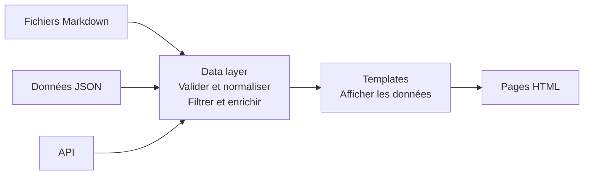
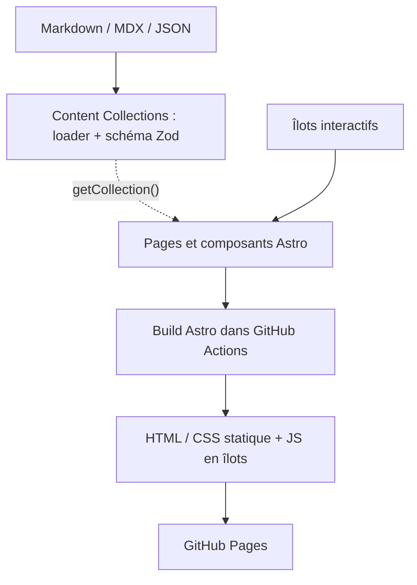
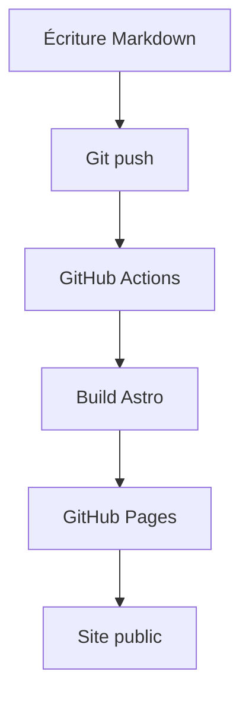

# Mini-blog ou quand se passer d'un backend

Vous avez peut-être déjà construit des applications avec une API et une base de données. Dans cette page, on se pose la question inverse : de quoi un site a-t-il réellement besoin, et quand peut-on se passer d'un backend ? On commence par un exercice d'architecture sur le site d'une association, puis vous construisez et publiez votre propre blog avec Astro.

**Objectifs**

- Choisir une architecture à la mesure des besoins, avec ou sans backend
- Découvrir Astro, un générateur de site statique (SSG), et son data layer
- Publier un site avec un déploiement automatisé par GitHub Actions
- Disposer d'un espace où publier sa veille

**Compétences travaillées**

- Préparer et documenter le déploiement d'une application
- Contribuer à la mise en production dans une démarche DevOps
- La veille, une compétence transversale

**Questions de départ**

- Faut-il toujours un backend ?
- Pourquoi un site statique alors que je sais construire des applications avec un backend ?
- Pourquoi apprendre Astro ou 11ty si je connais déjà React, Vue ou un autre framework ?
- Pourquoi développer un blog alors qu'on peut en créer un en quelques minutes ?

## Le brief

Une association publie des articles, des ressources et des événements. Elle dispose de peu de moyens et n'a pas de développeur pour assurer la maintenance. Elle veut un site performant, accessible et durable.

1. Prenez le temps de schématiser une architecture et vos choix techniques.
2. Faire le schéma... en mermaid ou dessing...
3. C'est bon ?
4. Maintenant l'association as de nouveaux besoins :
	- réduire ses coûts d'hébergement
	- tenir des centaines de milliers de visites après un passage à la télévision
	- laisser les bénévoles publier sans passer par Git
	- permettre aux visiteurs de s'inscrire aux événements

Modifiez votre schéma et pour chaque ajout, essayez d'estimer ce qu'il coûte en argent, en maintenance ou en complexité. Gardez ce schéma, vous y reviendrez à la fin de la page.

## Construire une fois ou à chaque requête

_Un SSG est un logiciel qui crée des sites web composés de pages statiques, généralement au format HTML._ [_src_](https://fr.wikipedia.org/wiki/G%C3%A9n%C3%A9rateur_de_site_statique)

Un CMS comme WordPress génère chaque page côté serveur, à la demande. Une application avec une API fonctionne de la même façon : chaque visite déclenche un appel à l'API, qui interroge la base de données. Pour un article publié une fois et rarement modifié, ce calcul se répète à chaque visite alors que son résultat ne change pas. Un SSG construit donc les pages une seule fois, avant la mise en ligne, puis le serveur les sert telles quelles.


### Quand un backend devient nécessaire

Un SSG convient à un blog, une documentation ou un portfolio, parce que leur contenu est le même pour tous les visiteurs et ne change qu'au moment d'une publication. Un backend devient nécessaire quand le serveur doit répondre différemment selon la personne ou le moment : des comptes utilisateurs, des données privées, des contenus écrits par les visiteurs ou des données qui changent chaque minute. Entre les deux, des services externes couvrent une partie des besoins sans backend à maintenir, par exemple un formulaire hébergé ou un CMS branché sur Git.

Reprenez votre schéma. Si vous avez placé un serveur dès la première version, que vous coûte le pic de trafic ?

| Critère | SSG (Astro, Hugo, 11ty…) | Site avec backend (WordPress, API et BDD…) |
| --- | --- | --- |
| Performance | HTML pré-généré, servi rapidement, facilement distribuable via CDN | HTML généré côté serveur, avec possibilité de cache et CDN |
| Sécurité | Surface d'attaque publique réduite sans backend applicatif | Surface d'attaque plus importante : authentification, plugins, API, BDD |
| Hébergement | Hébergement statique simple, souvent gratuit pour de petits projets | Hébergement compatible avec le runtime, la BDD et les services nécessaires |
| SEO | HTML directement accessible aux moteurs de recherche | HTML également accessible, dépend surtout du contenu et de la configuration |
| Maintenance | Dépendances, build et pipeline à maintenir | Cœur, plugins, thèmes, serveur et BDD à maintenir |
| Contenus | Markdown, fichiers ou CMS externe, souvent reconstruits à la publication | Interface d'administration et publication immédiate |
| Versioning | Git possible pour le code et les contenus | Git pour le code, révisions des contenus dans le CMS |
| Fonctionnalités dynamiques | Nécessitent du JavaScript, des services externes ou un backend | Backend disponible pour comptes, commentaires, recherche, etc. |

_Pour approfondir ces notions, voir la page [Architecture logicielle](/architecture-logicielle/), qui explore les autres stratégies de rendu._

## Trouver son sujet
Que ce soit des questionnements, des ressources, des guides ou façons de faire ou autre, un "blog tech" reste une publication personnelles, sa forme, périodicité et longueur des article vous appartiens.

- [PentesterLab](https://pentesterlab.com/blog) : sécurité applicative
- [Les-Tilleuls.coop](https://les-tilleuls.coop/blog) : coopérative spécialisée dans les API et l'open source
- [Emmanuelle Aboaf](https://emmanuelle-aboaf.netlify.app/blog) : développement, accessibilité et expérience vécue du handicap
- [Alsacréations](https://www.alsacreations.com/actu/) : référence historique pour CSS, HTML, standards du Web, JavaScript et accessibilité
- [Maggie Appleton](https://maggieappleton.com/garden) : digital garden, dessin et écriture
- [Sam Rose](https://samwho.dev/) : ressources pédagogiques interactives
- [Lea Verou](https://lea.verou.me/) : CSS experte, très technique
- [Framablog](https://framablog.org/) : numérique libre
- [Access42](https://access42.net/blog/) : accessibilité web
- [Drew DeVault](https://drewdevault.com/) : culture du logiciel libre et infrastructures indépendantes

_Et pour encore plus de blogs, visitez [Glane](https://glane.ludique.dev/category/blog/)._

Posez-vous ensuite trois questions : sur quoi aimeriez-vous écrire, pour qui, et à quel rythme ? Pour commencer, une liste de liens commentés, une découverte par semaine ou une question en cours suffisent à nourrir un blog de veille. La page [Veille](/veille/) liste des sources.

## Construire son blog avec Astro

### Panorama de l'écosystème des SSG

- [Hugo](https://gohugo.io/) : générateur en Go, performant, avec un écosystème de thèmes
- [Zola](https://www.getzola.org/) : générateur en Rust, autonome, approche intégrée
- [Jekyll](https://jekyllrb.com/) : écosystème Ruby, historique du blog statique
- [11ty](https://www.11ty.dev/) : approche JavaScript minimaliste et templates flexibles
- [Astro](https://astro.build/) : composants, contenu structuré, rendu hybride et îlots

Un CMS qui s'appuie sur Git offre une interface d'édition et enregistre les contenus en Markdown dans le dépôt : [Pages CMS](https://pagescms.org/), [Sveltia](https://sveltiacms.app/en/), [Decap](https://decapcms.org/).

Un CMS headless stocke les contenus dans sa propre base et les expose par une API, sans s'occuper de l'affichage : [Directus](https://directus.com/), [Payload](https://payloadcms.com/), [Strapi](https://strapi.io/).

### Pourquoi Astro

Dans cette page, je vous suggère [**Astro**](https://astro.build/). C'est un SSG populaire qui accepte les composants de vos frameworks JS préférés : Svelte, Vue ou React. Il repose aussi sur l'architecture en îlots [_(Islands Architecture)_](https://docs.astro.build/en/concepts/islands/) : la page reste du HTML statique, et seuls les composants interactifs, les îlots, chargent du JavaScript.

Pour une alternative minimaliste, je vous recommande [**11ty**](https://www.11ty.dev/) (aussi appelé _Build Awesome_). Il génère les pages avec Node.js, et un simple fichier de configuration ajoute des fonctions comme des filtres de contenu ou le choix du moteur de templates (**Liquid**, **Nunjucks** ou **JSX**).

| Astro | 11ty |
| --- | --- |
| Syntaxe proche de HTML/JSX | Minimaliste, zéro JS côté client par défaut |
| Composants réutilisables natifs | Supporte Markdown, Nunjucks, Liquid, JSX… |
| Supporte Svelte, Vue, React en îlots | Data Cascade : données globales, par dossier ou par page |
| Islands Architecture : du JS seulement dans les composants qui en ont besoin | Build rapide |
| Content Collections pour le data layer | Simple configuration en JavaScript |

### Le data layer

Le _data layer_ (couche de données) relie différentes sources de contenu (fichiers `.md`, API, JSON) aux templates qui les affichent. Cette couche normalise, filtre et enrichit les données avant de les injecter dans les pages.



**Sans data layer**, chaque template lit directement les fichiers source et la logique de transformation se retrouve copiée dans plusieurs templates. **Avec un data layer**, les données se transforment à un seul endroit et les templates ne s'occupent que de l'affichage.

Dans **Astro**, le data layer passe par les [Content Collections](https://docs.astro.build/fr/guides/content-collections/) : vous définissez un schéma (Zod) pour vos articles, et Astro valide chaque fichier `.md` à la compilation.



Dans **11ty**, le data layer passe par la [Data Cascade](https://www.11ty.dev/docs/data-cascade/) : des fichiers `.json`, `.js` ou `.11tydata.js` fournissent des données globales ou par dossier.

Le data layer sépare _ce que vous savez_ (vos données) de _la façon de l'afficher_ (vos templates).

### Pas à pas

**1** Créez le projet à partir du modèle de blog officiel.

```sh
npm create astro@latest -- --template blog
```

**2** Ouvrez `src/content.config.ts`. La collection `blog` décrit les articles : son schéma liste les champs attendus dans le frontmatter, l'en-tête placé entre deux lignes `---` en haut de chaque fichier Markdown. Astro arrête la compilation si un article ne respecte pas ce schéma.

**3** Ajoutez une collection `ressources` pour votre veille, avec un titre, un lien, un type et des tags. Limitez le type à trois valeurs avec `z.enum(["article", "vidéo", "outil"])`. Créez ensuite sa page de liste en vous inspirant de `src/pages/blog/index.astro`.

**4** Ajoutez un champ `tags` au schéma de la collection `blog`, avec une valeur par défaut (`z.array(z.string()).default([])`) pour que les articles sans tags restent valides, puis une page par tag. Le fichier `src/pages/tags/[tag].astro` exporte une fonction `getStaticPaths()` qui renvoie la liste des tags, et Astro génère une page HTML par tag au moment du build. Le tutoriel d'Astro détaille cette étape : [générer des pages d'étiquettes](https://docs.astro.build/fr/tutorial/5-astro-api/2/).

### Tester le schéma en local

Ouvrez une ressource et donnez-lui un type que le schéma refuse, par exemple `type: "podcast"`. Lancez ensuite la commande que GitHub Actions exécutera à chaque mise en ligne :

```sh
npm run build
```

Le build s'arrête et indique la collection, le fichier et le champ fautifs :

```
[InvalidContentEntryDataError] ressources → example data does not match collection schema.

  type: Invalid option: expected one of "article"|"vidéo"|"outil"
```

Remettez une valeur valide et relancez le build. Le schéma contrôle donc la qualité des contenus avant la mise en ligne : une erreur dans un fichier bloque la publication au lieu de produire une page cassée en production.

Avec `npm run dev`, l'erreur est plus discrète. Le serveur garde la dernière version valide de la page et écrit l'erreur dans le terminal, sans rien afficher dans le navigateur. Quand une modification ne semble pas prise en compte, regardez donc le terminal.

## Mettre en ligne sur GitHub Pages

GitHub Pages permet de servir gratuitement des fichiers statiques depuis un dépôt Git.



### Mise en place pas à pas

**1** **Créez un dépôt GitHub** nommé `votre-username.github.io` (pour un site racine) ou n'importe quel nom (pour un sous-chemin).

**2** **Configurez la base URL** dans votre générateur.

Pour Astro (`astro.config.mjs`) :

```
export default defineConfig({
  site: 'https://username.github.io',
  base: '/nom-du-repo', // seulement si ce n'est pas le repo racine
});
```

Pour 11ty (`.eleventy.js`) :

```
module.exports = function(eleventyConfig) {
  return {
    pathPrefix: "/nom-du-repo/"
  };
};
```

**3** **Créez le workflow GitHub Actions** dans `.github/workflows/deploy.yml`. Ce fichier lance le build et le déploiement à chaque `git push`. La documentation d'Astro fournit le fichier complet : [déployer sur GitHub Pages](https://docs.astro.build/fr/guides/deploy/github/).

**4** **Activez GitHub Pages** dans les settings du dépôt : _Settings → Pages → Source : GitHub Actions_.

**5** **Poussez votre code** avec `git push`. Le site est en ligne en 1 ou 2 minutes à l'adresse indiquée dans l'onglet Pages.

Si le build échoue, par exemple parce qu'un contenu ne respecte pas le schéma, le workflow s'arrête avant le déploiement et le site en ligne reste dans son état précédent. L'onglet _Actions_ du dépôt affiche alors le même message d'erreur qu'en local.

**Astuce :** votre URL ressemblera à `https://username.github.io/nom-du-repo`. Pour un domaine personnalisé, ajoutez un fichier `CNAME` (gratuit côté GitHub, le domaine reste à acheter).

## Faire évoluer l'architecture

Votre blog grandit et de nouveaux besoins apparaissent. Choisissez-en un et réalisez la version la plus simple qui y réponde.

- Vos lecteurs veulent commenter. [giscus](https://giscus.app/fr) stocke les commentaires dans les discussions GitHub de votre dépôt et les affiche dans un îlot.
- Vos lecteurs veulent recevoir les nouveaux articles. Le modèle de blog génère déjà un flux RSS (`src/pages/rss.xml.js`). Pour une newsletter, envoyez le formulaire d'inscription vers un service hébergé. C'est la première donnée personnelle que vous collectez, et elle part chez un tiers : cherchez où elle est stockée (voir la page [RGPD](/rgpd/)).
- Vos lecteurs cherchent un article. [Pagefind](https://pagefind.app/) construit un index de recherche au moment du build, et la recherche s'exécute ensuite dans le navigateur.
- Vous voulez publier depuis votre téléphone, sans Git. Branchez Pages CMS ou Sveltia sur votre dépôt : vous remplissez un formulaire, le CMS enregistre le fichier Markdown dans le dépôt et ce commit déclenche le déploiement.

Chacune de ces solutions ajoute une brique sans ajouter de serveur à maintenir. Un espace personnel ou des contenus mis à jour chaque minute demandent en revanche un serveur : le chapitre [Frontend, backend et rendu](/architecture-logicielle/02-rendu-web/) présente les stratégies de rendu qui y répondent.

## Retour au schéma d'architecture

Revenez au schéma de l'association. Ses besoins se règlent avec les mêmes briques que votre blog : les bénévoles publient avec un CMS branché sur Git, les inscriptions passent par un formulaire hébergé, et l'hébergement statique absorbe à la fois les coûts et le pic de trafic, car GitHub Pages sert les fichiers à travers un CDN (Content Delivery Network).

Comparez avec votre schéma et ajoutez-y trois phrases :

1. ce que vous avez ajouté
2. pourquoi vous l'avez ajouté
3. ce à quoi vous avez renoncé

Revenez ensuite aux questions de départ. Le SSG existe aussi dans les frameworks que vous connaissez : Next.js (`output: 'export'`), Nuxt (`nuxt generate`) et SvelteKit (`adapter-static`) savent générer un site statique.

## Et après : votre blog de veille

Votre blog est en ligne. Publiez-y vos lectures, vos découvertes et vos questions au fil de l'eau. La veille fait partie des compétences transversales attendues par le RNCP, et un blog en garde une trace que vous pourrez montrer.

**Idées pour faire évoluer votre site**

- Filtrer les ressources par type ou par tag dans un îlot Svelte, Vue ou React.
- Récupérer des contenus depuis une API au moment du build, avec un loader de Content Collections.
- Dessiner l'architecture qui intégrerait un CMS headless, puis argumenter les compromis.
