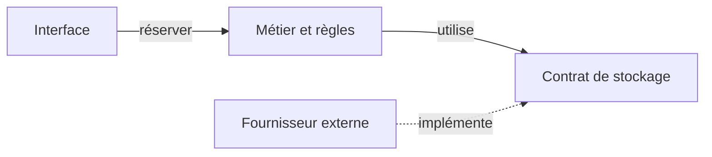

# POO, SOLID et responsabilités

La programmation orientée objet associe des données et des comportements. Une instance possède un état. Une classe décrit ses instances. L'encapsulation protège les règles qui rendent cet état valide. Par exemple, réserver passe par une opération qui contrôle la capacité, plutôt que modifier un compteur depuis chaque écran.

Une interface TypeScript décrit un contrat vérifié pendant le développement. Elle ne valide pas une réponse reçue du réseau. Une fonction ou un objet suffit à beaucoup d'exemples du module, sans classe supplémentaire.

## Responsabilités et dépendances

Une responsabilité regroupe une connaissance qui évolue pour une même raison. Le tarif change avec les règles commerciales, le format JSON avec le fournisseur, l'affichage avec l'interface. La cohésion mesure si les éléments d'un module travaillent au même rôle. Le couplage décrit ce qu'un module doit connaître des autres.



Une flèche signifie ici « connaît et utilise ». Le sens d'une dépendance dans le code peut différer du trajet des données. N'ajoute une frontière que si elle protège une règle ou facilite un changement observé.

## Les cinq principes SOLID

| Principe | Question concrète dans notre application |
| --- | --- |
| S, responsabilité unique | Un changement de courriel oblige-t-il à modifier le calcul du tarif ? Séparer ces raisons d'évoluer. |
| O, ouvert à l'extension, fermé à la modification | Peut-on ajouter un tarif solidaire sans toucher à la validation des places ? Une fonction de prix interchangeable peut suffire. |
| L, substitution de Liskov | Le stockage de remplacement tient-il les mêmes promesses ? Un objet qui perd silencieusement une réservation ne remplace pas un stockage qui confirme sa sauvegarde. |
| I, ségrégation des interfaces | Une vue qui consulte les places a-t-elle besoin des méthodes d'administration ? Lui donner seulement ce qu'elle utilise. |
| D, inversion des dépendances | Le métier peut-il dépendre d'un contrat « enregistrer une réservation » plutôt que du SDK d'un fournisseur précis ? |

SOLID aide à poser des questions. Appliquer chaque lettre en créant systématiquement une interface ajoute du travail sans garantir une meilleure conception.

## Composition ou héritage

L'héritage exprime une relation de sous-type et engage à respecter le contrat du parent. Une `ReservationNonAnnulable` qui hérite d'une réservation promettant `annuler()`, mais refuse toujours cette opération, pose un problème de substitution.

La composition assemble des comportements. Pour varier le tarif, une réservation peut recevoir une fonction de prix.

```ts
type Tarif = (prixCentimes: number) => number;
const solidaire: Tarif = prix => Math.round(prix / 2);
const montant = (prix: number, tarif: Tarif) => tarif(prix);
console.log(montant(2000, solidaire)); // 1000
```

La composition évite une hiérarchie `AtelierSolidaireAvecEmail`. Elle impose tout de même de choisir où assembler les fonctions. L'héritage reste pertinent si plusieurs types partagent réellement un contrat stable et substituable.

Pour les principes de simplicité, consulter [DRY, KISS et YAGNI](/lire-une-codebase/10-principes/). Pour modifier la structure sans changer le comportement, consulter [Refactoriser](/lire-une-codebase/03-refactoriser/).
