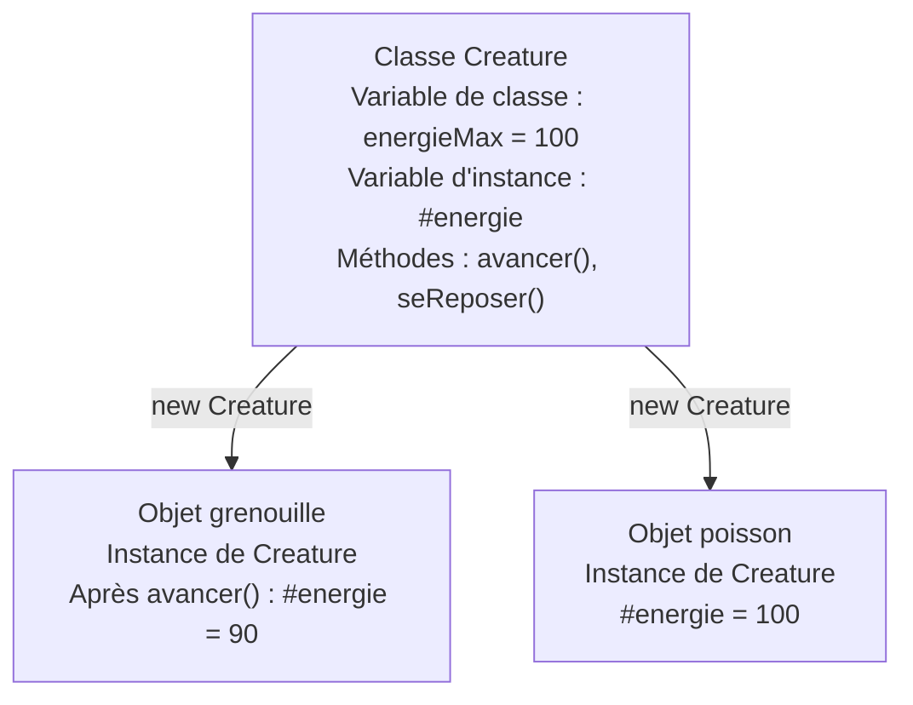
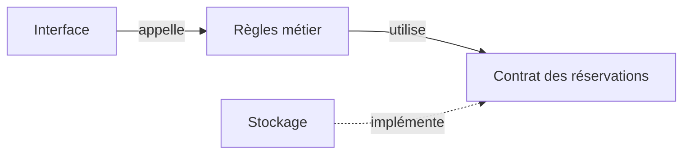
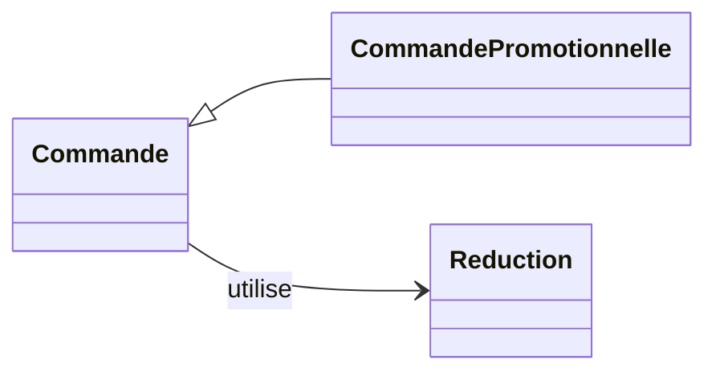

# Les bases de la programmation orientée objet

<span id="poo-solid-et-responsabilites"></span>

Un objet regroupe des données et les opérations qui les utilisent. Pour concevoir un objet, il faut préciser ce qu'il représente, les règles qu'il protège et ce que son code appelant peut lui demander. Ce chapitre explique ces bases avant d'aborder les choix de conception dans le chapitre [SOLID, comprendre les cinq principes](/poo-patterns-frameworks/01-solid/).

Les exemples sont autonomes. Ils aident à relire l'application de [réservation d'ateliers](/poo-patterns-frameworks/10-exercice/), dont les règles guident les séances du parcours. Le [glossaire](/poo-patterns-frameworks/12-glossaire/) rassemble le vocabulaire du parcours.

## Objets, classes et encapsulation

Un objet possède un état et expose des opérations. Une classe décrit comment créer des objets de même structure. Chaque objet créé est une instance, avec son propre état. JavaScript permet aussi de créer des objets sans classe.

### Lire une classe pas à pas

Pour commencer, une créature possède un nom et sait se présenter. On écrit la classe, puis on crée deux objets à partir de cette description.

```ts
import assert from "node:assert/strict";

class Creature {
	nom: string;

	constructor(nom: string) {
		this.nom = nom;
	}

	sePresenter(): string {
		return `Je m'appelle ${this.nom}.`;
	}
}

const grenouille = new Creature("René");
const poisson = new Creature("Mina");

assert.equal(grenouille.sePresenter(), "Je m'appelle René.");
assert.equal(poisson.sePresenter(), "Je m'appelle Mina.");
assert.notEqual(grenouille, poisson);
```

`class Creature` donne un nom à la classe. À l'intérieur des accolades, `nom: string` déclare une propriété qui contiendra du texte. Cette notation TypeScript vérifie le type des valeurs avant l'exécution. Elle ne donne donc pas encore de nom à une créature.

L'expression `new Creature("René")` crée une instance et appelle son `constructor`, le constructeur. Le paramètre `nom` reçoit la valeur `"René"`. Dans `this.nom = nom`, la partie droite désigne ce paramètre, tandis que `this.nom` désigne la propriété de l'objet en cours de construction. L'affectation conserve donc le nom dans cet objet.

Le second `new`, avec `"Mina"`, crée un autre objet et appelle à nouveau le constructeur. Le paramètre porte le même nom dans les deux appels, mais chaque instance conserve sa propre propriété. Les assertions vérifient les deux présentations et le fait qu'il s'agit de deux objets distincts.

`sePresenter()` est une méthode d'instance. Dans l'appel `grenouille.sePresenter()`, `this` désigne `grenouille`. La méthode lit donc son nom. Dans `poisson.sePresenter()`, elle lit celui de `poisson`. L'annotation `: string` après les parenthèses indique que la méthode renvoie du texte. On peut retrouver cette syntaxe dans la [présentation des classes de MDN](https://developer.mozilla.org/fr/docs/Web/JavaScript/Reference/Classes).

### Protéger les règles de l'objet

On peut utiliser un objet comme une boîte noire. Pour conduire une voiture, on utilise le volant et les pédales sans intervenir dans le moteur. De même, le code qui utilise un objet connaît ses opérations publiques sans devoir connaître son organisation interne. Ces opérations constituent son interface publique.

L'encapsulation réserve la modification de l'état à des opérations qui préservent ses règles. Une créature possède entre 0 et 100 points d'énergie. Se déplacer coûte 10 points. Se reposer en rend 20, sans dépasser 100.



Chaque objet possède ses variables d'instance. Les méthodes `avancer()` et `seReposer()` agissent sur l'objet qui les reçoit. La variable de classe, déclarée `static`, appartient à `Creature` et se consulte avec `Creature.energieMax`. Elle est ici `readonly`, donc TypeScript interdit de lui affecter une autre valeur.

```ts
class Creature {
  static readonly energieMax = 100;
  #energie = Creature.energieMax;

  get energie(): number {
    return this.#energie;
  }

  avancer(): boolean {
    if (this.#energie < 10) return false;
    this.#energie -= 10;
    return true;
  }

  seReposer(): void {
    this.#energie = Math.min(Creature.energieMax, this.#energie + 20);
  }
}

const grenouille = new Creature();
grenouille.avancer();
console.log(grenouille.energie); // 90
```

Le champ `#energie` est privé. Le getter donne accès à sa valeur sans autoriser une affectation directe.

Le code appelant connaît `avancer()` et son résultat, sans devoir reproduire le contrôle d'énergie. L'invariant, ici l'intervalle de 0 à 100, reste sous la responsabilité de l'objet. Cacher un champ sans contrôler les modifications ne suffit pas à protéger cet invariant.

Un *getter* permet de lire une valeur, un *setter* permet de la modifier. Ajouter un setter qui accepte n'importe quel nombre rendrait possible une énergie de -50 ou de 500. Ici, `avancer()` et `seReposer()` expriment les actions autorisées et contrôlent leurs effets. Chaque champ privé n'a donc pas besoin de son couple getter/setter.

En TypeScript, une propriété ou une méthode est `public` par défaut, comme `nom` et `sePresenter()` dans le premier exemple. Le mot `private`, dans une déclaration telle que `private energie = 100`, réserve l'accès au code de cette classe pendant la vérification des types. `protected` autorise aussi le code des sous-classes, que l'on découvre [avec l'héritage](#lire-extends-super-et-implements).

Ces mots-clés TypeScript disparaissent du JavaScript exécuté. Ils aident à détecter des accès interdits dans le code vérifié, mais ne constituent pas une protection de sécurité. La syntaxe JavaScript `#energie`, utilisée dans notre exemple, contrôle aussi l'accès au champ à l'exécution. Le nom `#energie` n'est pas une propriété publique nommée `energie` que l'on pourrait retrouver avec une chaîne de caractères.

De même, `readonly` est un contrôle TypeScript. Dans `static readonly energieMax = 100`, il interdit de réaffecter ce membre après son initialisation. Appliqué à une propriété qui contient un objet, il ne rend pas toutes les propriétés de cet objet immuables. Protéger les règles exige donc de choisir les opérations disponibles et de contrôler leurs effets.

### Distinguer deux objets et deux références

Deux appels à `new Creature("René")` créent deux objets, même s'ils contiennent le même nom. À l'inverse, l'affectation `b = a` ne crée aucun objet. Elle copie une référence, c'est-à-dire une valeur qui permet de retrouver le même objet. `a` et `b` deviennent alors deux noms pour cet objet.

Le même mécanisme s'applique aux objets écrits avec des accolades. On peut l'observer avec une réservation dont les champs sont des nombres et du texte.

```ts
import assert from "node:assert/strict";

const reservation = { id: 1, email: "lea@example.test", montantCentimes: 2000 };
const autreReservation = { id: 1, email: "lea@example.test", montantCentimes: 2000 };
const alias = reservation;

assert.equal(reservation === autreReservation, false);
assert.equal(reservation === alias, true);
alias.montantCentimes = 1500;
assert.equal(reservation.montantCentimes, 1500);

const copie = { ...reservation };
copie.montantCentimes = 1000;
assert.equal(reservation.montantCentimes, 1500);
assert.equal(copie === reservation, false);

const atelier = { titre: "Photo", participants: ["Léa"] };
const copieAtelier = { ...atelier };
copieAtelier.participants.push("Sam");
assert.equal(copieAtelier.participants === atelier.participants, true);
assert.deepEqual(atelier.participants, ["Léa", "Sam"]);
```

Pour des objets, `===` compare l'identité, donc le fait de désigner le même objet. Il ne compare pas le contenu des propriétés. La première assertion vaut ainsi `false`, même si les deux réservations possèdent initialement les mêmes valeurs. Après `const alias = reservation`, modifier `alias.montantCentimes` modifie la réservation que les deux variables désignent.

`const` interdit de réaffecter une variable à une autre valeur. Il n'interdit pas de modifier les propriétés de l'objet qu'elle désigne. C'est pourquoi l'affectation à `alias.montantCentimes` est possible dans cet exemple.

La [syntaxe de décomposition `...`](https://developer.mozilla.org/fr/docs/Web/JavaScript/Reference/Operators/Spread_syntax) crée ici une copie superficielle. `{ ...reservation }` produit un nouvel objet avec les valeurs de ses propriétés. Modifier le nombre `copie.montantCentimes` laisse donc l'original intact. Dans `atelier`, en revanche, la propriété `participants` contient une référence vers un tableau. La copie conserve cette référence, donc les deux objets partagent le même tableau.

Dans la [séance Repository](/poo-patterns-frameworks/07-repository/#simuler-le-contrat-en-memoire), les champs d'une réservation sont tous primitifs, comme les nombres et les chaînes de cet exemple. Une copie superficielle suffit alors à éviter qu'un résultat reçu serve à modifier les enregistrements internes. Si on ajoute un tableau ou un objet imbriqué, il faudra revoir cette garantie.

## Modéliser un écosystème

Cette illustration facultative permet de transposer les mêmes questions dans un autre domaine.

Murmur simule des écosystèmes, dont la forêt Plot. Un modèle pédagogique de mare, nommé `Pond`, peut distinguer l'état des créatures, la météo et les événements. Chaque créature protège ses règles d'énergie. Le monde coordonne leurs interactions, et un journal affiche les événements observables. Ce découpage est un exemple de conception, indépendant de l'architecture interne de Murmur.

<figure class="course-figure">

<figcaption>Plot, un écosystème de <a href="https://www.murmur.living/">Murmur</a>, projet de oio et mattering.</figcaption>
</figure>

## Contrats et polymorphisme

Un contrat précise ce que l'appelant peut demander et ce que l'objet garantit en retour. Il comprend les opérations disponibles, leurs conditions d'utilisation et leurs effets. Une interface TypeScript décrit la partie vérifiable par le système de types, comme les noms des méthodes et leurs types de retour.

TypeScript utilise un **typage structurel**. Le compilateur compare les membres et leurs types pour vérifier leur compatibilité. Un objet peut donc satisfaire une interface sans déclarer qu'il l'implémente.

```ts
import assert from "node:assert/strict";

interface Nageur {
	nager(): string;
}
const canard = { nager: () => "Le canard nage.", voler: () => "Il vole." };
const poisson = { nager: () => "Le poisson nage." };
const decrire = (animal: Nageur) => animal.nager();

assert.equal(decrire(canard), "Le canard nage.");
assert.equal(decrire(poisson), "Le poisson nage.");
```

Le polymorphisme permet à `decrire` d'utiliser la même opération avec des implémentations différentes. Le canard possède une capacité supplémentaire que cette fonction n'a pas besoin de connaître.

## Duck typing et typage structurel

Le **duck typing**, ou typage canard, consiste à utiliser les opérations d'un objet sans exiger une classe précise. L'image du canard donne son nom à cette approche. Si l'objet fournit l'opération attendue, le code l'utilise. Le [glossaire Python](https://docs.python.org/fr/3/glossary.html#term-duck-typing) décrit ce style, également courant en JavaScript.

En JavaScript, cet appel se résout à l'exécution. Il ne nécessite ni interface déclarée ni test de classe.

```js
import assert from "node:assert/strict";

function decrire(animal) {
	return animal.nager();
}

assert.equal(decrire({ nager: () => "Je nage." }), "Je nage.");
assert.throws(() => decrire({ voler: () => "Je vole." }), TypeError);
```

Le typage structurel de l'exemple TypeScript précédent effectue une vérification avant l'exécution. Le duck typing désigne la manière d'utiliser l'objet. Les deux favorisent l'utilisation d'objets indépendants d'une hiérarchie de classes, mais n'interviennent pas au même moment.

La présence de `nager()` ne prouve pas le respect du contrat comportemental. Une méthode peut renvoyer une chaîne tout en produisant un effet interdit ou en levant une erreur inattendue. Le compilateur contrôle des types. La description du contrat et les tests précisent le comportement attendu.

## Cohésion, couplage et responsabilités

Un module cohésif regroupe des éléments qui contribuent au même rôle. Le couplage décrit les connaissances et dépendances entre modules. Si chaque écran connaît les champs propres à un fournisseur, changer ce fournisseur oblige à modifier plusieurs écrans.



Les flèches représentent des dépendances de code. Les données peuvent circuler dans les deux sens. Une séparation par responsabilités cherche à contenir un changement, par exemple celui du format du fournisseur, sans multiplier les modules sans raison.

## Les principes SOLID

Les principes SOLID aident à examiner les responsabilités, les variations et les dépendances du code. Ils disposent désormais d'un [chapitre complet avec des exemples avant et après](/poo-patterns-frameworks/01-solid/). Les bases POO décrivent les objets. SOLID aide à juger leurs collaborations face à un changement précis.

### Remplacer sans rompre le contrat

Une réservation non annulable ne peut pas tenir la promesse d'un type qui garantit l'annulation. Le principe de Liskov explique cette difficulté. L'[exemple corrigé de réservation](/poo-patterns-frameworks/01-solid/#remplacer-sans-rompre-le-contrat) distingue les capacités de consultation et d'annulation, puis vérifie leurs garanties.

## Composition et héritage

Hériter, c'est définir une classe à partir d'une autre. Une classe `CommandePromotionnelle` est une sorte de `Commande`. Elle doit respecter les promesses de sa classe parente. Une réservation non annulable, par exemple, ne peut pas remplacer un type qui promet une annulation sans condition.

Composer, c'est assembler des objets ou des fonctions qui travaillent ensemble. Une commande a une règle de réduction et lui confie le calcul de la remise. On peut changer cette règle sans créer une nouvelle sous-classe de commande pour chaque promotion.



On lit "une commande promotionnelle est une commande" et "une commande a une réduction". Le triangle pointe vers la classe parente. La flèche simple représente le collaborateur utilisé. Ces deux liens peuvent coexister, mais ils n'engagent pas les mêmes règles. Partager quelques lignes de code ne suffit pas à justifier un héritage.

L'article [Héritage vs composition de LeanDeep](https://leandeep.com/h%C3%A9ritage-vs-composition-en-programmation-orient%C3%A9e-objet/) introduit cette distinction avec des exemples Python. Les formulations "est un" et "a un" aident à commencer. Le chapitre [UML, lire et dessiner un diagramme de classes](/poo-patterns-frameworks/01-uml/) explique les flèches, les multiplicités et le sens plus précis de la composition en UML.

[Strategy](/poo-patterns-frameworks/02-strategy/) illustre cette composition. [DRY, KISS et YAGNI](/lire-une-codebase/10-principes/) aident à juger son coût. Le [refactoring](/lire-une-codebase/03-refactoriser/) change la structure tout en préservant le comportement observé.

### Lire extends, super et implements

Le code suivant montre comment déclarer un héritage et un contrat. `Presentable` décrit une opération attendue. `Creature` fournit du code pour cette opération, puis `Grenouille` le complète.

```ts
import assert from "node:assert/strict";

interface Presentable {
	sePresenter(): string;
}

class Creature implements Presentable {
	protected nom: string;

	constructor(nom: string) {
		this.nom = nom;
	}

	sePresenter(): string {
		return `Je m'appelle ${this.nom}.`;
	}
}

class Grenouille extends Creature {
	constructor(nom: string) {
		super(nom);
	}

	override sePresenter(): string {
		return `${super.sePresenter()} Je vis près de la mare.`;
	}
}

const grenouille = new Grenouille("René");
const presentation: Presentable = grenouille;
assert.equal(presentation.sePresenter(), "Je m'appelle René. Je vis près de la mare.");
```

`extends Creature` fait de `Grenouille` une sous-classe de `Creature`. Dans son constructeur, `super(nom)` appelle le constructeur parent, qui initialise le nom. Dans un constructeur de sous-classe, cet appel doit avoir lieu avant d'utiliser `this`. La propriété `nom` est ici `protected`, donc la classe parente et ses sous-classes peuvent l'utiliser dans le code TypeScript.

La méthode `sePresenter()` existe déjà dans la classe parente. La sous-classe la redéfinit pour compléter la présentation. `super.sePresenter()` exécute la version parente, puis la méthode ajoute une phrase. Le mot TypeScript `override` permet au compilateur de vérifier qu'une méthode de ce nom existe bien dans la classe parente.

`implements Presentable` demande une autre vérification. TypeScript contrôle que `Creature` fournit l'opération décrite par l'interface, avec les types compatibles. Ce mot n'ajoute donc aucun code à la classe. Avec `extends`, on hérite du code de la classe parente. Avec `implements`, on annonce explicitement un contrat de types que son propre code doit satisfaire.

L'affectation à `presentation` permet ensuite d'utiliser la grenouille à travers ce contrat. Le [typage structurel](#contrats-et-polymorphisme) reste valable. Un objet qui possède une méthode `sePresenter(): string` peut convenir même sans écrire `implements Presentable`. Aucune de ces vérifications ne prouve à elle seule que les promesses comportementales sont respectées, comme le montre [Liskov](/poo-patterns-frameworks/01-solid/#remplacer-sans-rompre-le-contrat).

### Comparer une interface et une classe abstraite

Une interface décrit les membres attendus, sans fournir leur code. Une classe abstraite peut aussi conserver un état et fournir des méthodes communes, tout en laissant certaines méthodes à écrire dans les sous-classes. Ce second outil est facultatif dans nos exercices. On peut d'abord réussir les collaborations avec des interfaces et des objets indépendants.

```ts
import assert from "node:assert/strict";

interface Nageur {
	nager(): string;
}

abstract class CreatureAquatique implements Nageur {
	protected nom: string;

	constructor(nom: string) {
		this.nom = nom;
	}

	sePresenter(): string {
		return `Je m'appelle ${this.nom}.`;
	}

	abstract nager(): string;
}

class Poisson extends CreatureAquatique {
	nager(): string {
		return `${this.nom} nage sous l'eau.`;
	}
}

function observerNage(nageur: Nageur): string {
	return nageur.nager();
}

const poisson = new Poisson("Mina");
const robot = { nager: () => "Le robot avance à la surface." };
assert.equal(poisson.sePresenter(), "Je m'appelle Mina.");
assert.equal(observerNage(poisson), "Mina nage sous l'eau.");
assert.equal(observerNage(robot), "Le robot avance à la surface.");
```

`abstract class CreatureAquatique` fournit le constructeur, le champ et la présentation. La déclaration `abstract nager(): string` annonce une méthode sans corps. Puisque cette classe est abstraite, TypeScript interdit de créer directement une de ses instances. Une sous-classe concrète telle que `Poisson` doit fournir le code manquant avant de pouvoir être instanciée.

`Poisson` hérite ici de la présentation sans la réécrire. Comme `Poisson` ne déclare pas de constructeur, son constructeur par défaut transmet le nom au constructeur de `CreatureAquatique`. À l'inverse, `robot` ne dépend d'aucune de ces classes. Il satisfait pourtant l'interface `Nageur`, donc `observerNage` l'accepte.

Une interface convient lorsque l'appelant a seulement besoin d'une capacité. Une classe abstraite peut convenir si plusieurs sous-classes ont réellement un état et du code communs à conserver. On ne crée pas une hiérarchie pour obliger tous les objets capables de nager à partager un ancêtre.

Les [trois mini-exercices progressifs](/poo-patterns-frameworks/13-entrainement/#construire-des-creatures-en-trois-etapes) permettent maintenant de pratiquer la construction, l'encapsulation et les capacités, avec des résultats attendus et des corrections expliquées.
