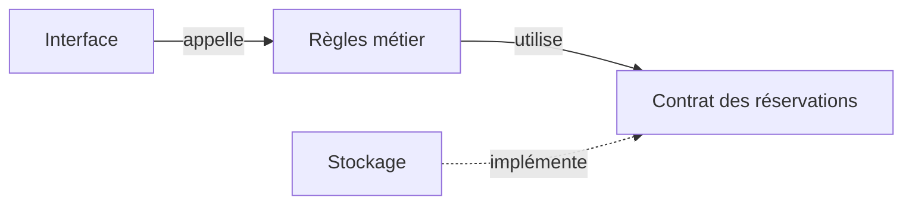
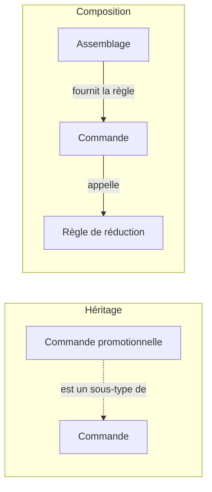

# POO, SOLID et responsabilités

## Objets, classes et encapsulation

Un objet possède un état et expose des opérations. Une classe décrit comment créer des objets de même structure. Chaque objet créé est une instance, avec son propre état. JavaScript permet aussi de créer des objets sans classe.

L'encapsulation réserve la modification de l'état à des opérations qui préservent ses règles. Une créature possède entre 0 et 100 points d'énergie. Se déplacer coûte 10 points. Se reposer en rend 20, sans dépasser 100.

```ts
class Creature {
  #energie = 100;

  get energie(): number {
    return this.#energie;
  }

  avancer(): boolean {
    if (this.#energie < 10) return false;
    this.#energie -= 10;
    return true;
  }

  seReposer(): void {
    this.#energie = Math.min(100, this.#energie + 20);
  }
}

const grenouille = new Creature();
grenouille.avancer();
console.log(grenouille.energie); // 90
```

Le champ `#energie` est privé à l'exécution. Le getter donne accès à sa valeur sans autoriser une affectation directe. `private energie` en TypeScript limite l'accès lors de la vérification des types, mais n'apporte pas la même confidentialité à l'exécution. Le [manuel TypeScript sur les classes](https://www.typescriptlang.org/docs/handbook/2/classes.html) détaille cette distinction.

Le code appelant connaît `avancer()` et son résultat, sans devoir reproduire le contrôle d'énergie. L'invariant, ici l'intervalle de 0 à 100, reste sous la responsabilité de l'objet. Cacher un champ sans contrôler les modifications ne suffit pas à protéger cet invariant.

## Modéliser un écosystème

Murmur représente des mondes vivants, dont l'écosystème forestier Plot. Un modèle pédagogique de mare, nommé `Pond`, peut distinguer l'état des créatures, la météo et les événements. Chaque créature protège ses règles d'énergie. Le monde coordonne leurs interactions, et un journal affiche les événements observables. Ce découpage est un exemple de conception, indépendant de l'architecture interne de Murmur.

<figure class="course-figure">

<figcaption>Plot, un écosystème de <a href="https://www.murmur.living/">Murmur</a>, projet de oio et mattering.</figcaption>
</figure>

## Contrats et polymorphisme

Une interface décrit les opérations attendues d'un objet. Elle n'impose pas une classe particulière. TypeScript utilise un typage structurel, donc un objet convient s'il possède la structure requise.

```ts
interface Nageur {
  nager(): string;
}
const canard = { nager: () => "Le canard nage.", voler: () => "Il vole." };
const poisson = { nager: () => "Le poisson nage." };
const decrire = (animal: Nageur) => animal.nager();
console.log(decrire(canard), decrire(poisson));
```

Le polymorphisme permet à `decrire` d'utiliser le même contrat avec des comportements différents. Le canard possède une capacité supplémentaire que cette fonction n'a pas besoin de connaître. Une interface TypeScript disparaît à l'exécution. Elle ne valide donc pas les données reçues du réseau.

## Cohésion, couplage et responsabilités

Un module cohésif regroupe des éléments qui contribuent au même rôle. Le couplage décrit les connaissances et dépendances entre modules. Si chaque écran connaît les champs propres à un fournisseur, changer ce fournisseur oblige à modifier plusieurs écrans.



Les flèches représentent des dépendances de code. Les données peuvent circuler dans les deux sens. Une séparation par responsabilités cherche à contenir un changement, par exemple celui du format du fournisseur, sans multiplier les modules sans raison.

## Les principes SOLID

Les cinq principes [SOLID](https://blog.cleancoder.com/uncle-bob/2020/10/18/Solid-Relevance.html) concernent les responsabilités et les dépendances du code.

| Principe | Sens et exemple |
| --- | --- |
| S, responsabilité unique | Un module regroupe ce qui change pour un même acteur ou une même raison métier. La politique tarifaire et le format d'un courriel peuvent évoluer séparément. |
| O, ouvert à l'extension, fermé à la modification | Une variation prévue peut s'ajouter derrière un contrat stable. Ajouter un tarif ne demande plus de modifier la validation des places. Cela ne signifie pas interdire toute modification du code. |
| L, substitution de Liskov | Un sous-type respecte les promesses du type remplacé. Il ne réclame pas davantage de préconditions et ne réduit pas les garanties du résultat. Une opération annoncée comme disponible ne peut pas disparaître dans un sous-type. |
| I, ségrégation des interfaces | Chaque client dépend des opérations dont il a besoin. Une vue de consultation peut recevoir un contrat de lecture sans méthodes d'administration. |
| D, inversion des dépendances | Les règles de haut niveau et les détails techniques dépendent d'abstractions adaptées au métier. Les règles de réservation dépendent d'un contrat de stockage, pas du SDK d'un fournisseur. |

Robert C. Martin relie la [responsabilité unique](https://blog.cleancoder.com/uncle-bob/2014/05/08/SingleReponsibilityPrinciple.html) aux acteurs à l'origine des changements. Une classe peut contenir plusieurs méthodes cohérentes. Le nombre de méthodes ne mesure pas ses responsabilités.

## Composition et héritage

L'héritage crée une relation de sous-type. Il convient si les instances respectent le contrat du parent. Une réservation non annulable ne peut pas remplacer un type qui promet une annulation sans condition.

La composition confie une partie du travail à un autre objet ou à une fonction. Une commande reçoit une règle de réduction, sans devenir une sous-classe `CommandeAvecReductionEtCourriel`. Le choix et l'assemblage de ces dépendances restent à organiser.



Les flèches ne décrivent pas la même relation. L'héritage promet une substitution. La composition organise une collaboration. Partager quelques lignes de code ne suffit pas à justifier une relation de sous-type.

[Strategy](/poo-patterns-frameworks/02-strategy/) illustre cette composition. [DRY, KISS et YAGNI](/lire-une-codebase/10-principes/) aident à juger son coût. Le [refactoring](/lire-une-codebase/03-refactoriser/) change la structure tout en préservant le comportement observé.
