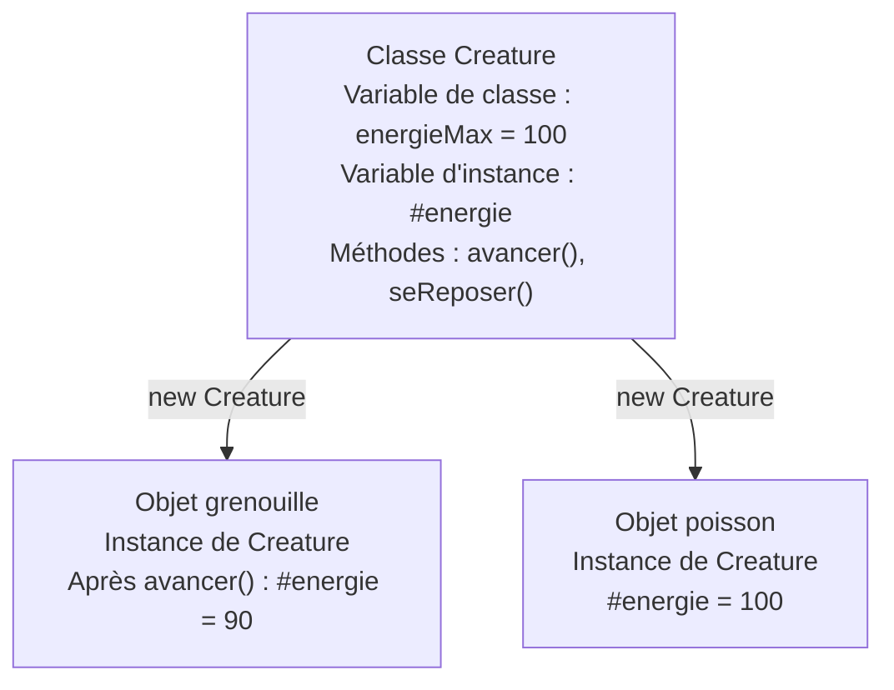
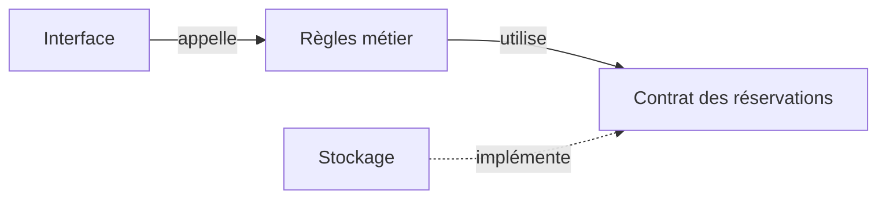
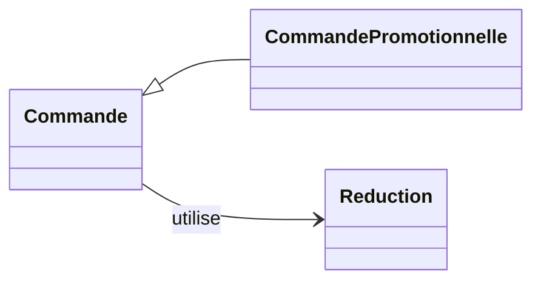

# Les bases de la programmation orientée objet

<span id="poo-solid-et-responsabilites"></span>

Dans l'application de réservation, on vérifie qu'il reste une place et que la personne n'est pas déjà inscrite avant d'ajouter son inscription. La programmation orientée objet permet de réunir un état et les opérations qui le consultent ou le modifient. On peut ainsi confier ces règles à un objet, plutôt que demander à chaque code qui l'utilise de les vérifier lui-même. Ce code est son appelant.

Pour concevoir un objet, on précise donc ce qu'il représente, les données qu'il conserve et les opérations qu'il autorise. Ce chapitre explique comment lire et utiliser ces objets. Les séances de patterns montrent ensuite comment ils collaborent dans l'application.

Les exemples sont autonomes et se lisent séparément, même lorsque plusieurs blocs reprennent un même nom de classe. Les créatures permettent d'observer la construction, l'état et les comportements sans lire toute l'application. On revient ensuite aux règles de [réservation d'ateliers](/poo-patterns-frameworks/10-exercice/), qui guident les séances du parcours. Le [glossaire](/poo-patterns-frameworks/12-glossaire/) rassemble le vocabulaire utilisé.

## Objets, classes et encapsulation

L'état d'un objet correspond aux valeurs qu'il conserve dans ses propriétés à un moment donné. Ses méthodes sont les opérations que l'on peut lui demander d'exécuter. Une créature peut ainsi conserver son énergie et proposer une méthode pour avancer en utilisant cette énergie.

Une classe décrit comment créer des objets de même structure et les méthodes qu'ils proposent. Chaque objet créé à partir de cette classe est une instance, avec son propre état. La classe n'est donc pas une créature particulière, mais la description qui permet d'en créer plusieurs. JavaScript permet aussi de créer des objets sans classe, notamment avec des accolades, comme on le verra avec les réservations.

### Lire une classe pas à pas

Pour commencer, une créature possède un nom et sait se présenter. La déclaration de classe décrit ces deux éléments, mais ne crée encore aucune créature. Les deux appels qui suivent créent chacun un objet, puis les assertions vérifient sa présentation et son identité.

```ts
import assert from "node:assert/strict";

class Creature {
	nom: string;

	constructor(nom: string) {
		this.nom = nom;
	}

	sePresenter(): string {
		return `Je m'appelle ${this.nom}.`;
	}
}

const grenouille = new Creature("René");
const poisson = new Creature("Mina");

assert.equal(grenouille.sePresenter(), "Je m'appelle René.");
assert.equal(poisson.sePresenter(), "Je m'appelle Mina.");
assert.notEqual(grenouille, poisson);
```

`class Creature` donne un nom à la classe. À l'intérieur des accolades, `nom: string` déclare une propriété qui contiendra du texte. Cette annotation indique à TypeScript quel type vérifier avant l'exécution. Elle ne fournit pas de valeur à la propriété. Le constructeur s'en chargera pour chaque objet créé.

L'expression `new Creature("René")` crée une instance et appelle son `constructor`, le constructeur. Le paramètre `nom` reçoit la valeur `"René"`. Dans `this.nom = nom`, la partie droite désigne ce paramètre, tandis que `this.nom` désigne la propriété de l'objet en cours de construction. L'affectation conserve donc le nom dans cet objet.

Le second `new`, avec `"Mina"`, crée un autre objet et appelle à nouveau le constructeur. Le paramètre porte le même nom dans les deux appels, mais chaque instance conserve sa propre propriété. Changer le nom de la grenouille ne changerait donc pas celui du poisson. Les assertions vérifient les deux présentations et le fait qu'il s'agit de deux objets distincts.

`sePresenter()` est une méthode d'instance. Dans l'appel `grenouille.sePresenter()`, `this` désigne `grenouille`. La méthode lit donc son nom. Dans `poisson.sePresenter()`, elle lit celui de `poisson`. L'annotation `: string` après les parenthèses indique que la méthode renvoie du texte. On peut retrouver cette syntaxe dans la [présentation des classes de MDN](https://developer.mozilla.org/fr/docs/Web/JavaScript/Reference/Classes).

### Protéger les règles de l'objet

Le premier exemple rend le nom directement accessible. L'appelant peut donc le lire ou le remplacer. Cette liberté ne convient pas à toutes les données. Si une créature possède une énergie limitée, autoriser n'importe quelle affectation permettrait de lui donner une énergie négative. On doit définir les modifications autorisées avant de choisir comment exposer cette donnée.

Le code appelant passe alors par les opérations publiques de l'objet, sans devoir reproduire ses contrôles ni connaître son organisation interne. Les membres accessibles à l'appelant constituent son interface publique. Le mot « interface » désigne ici ce que l'objet expose, pas encore une déclaration de type TypeScript.

L'encapsulation consiste à contrôler les accès à l'état d'un objet pour préserver ses règles. Dans ce nouvel exemple, une créature commence avec 100 points d'énergie et doit rester entre 0 et 100. Se déplacer lui coûte 10 points, tandis que se reposer lui en rend 20, sans dépasser 100. La classe reprend le nom de l'exemple précédent, mais on laisse de côté la présentation pour se concentrer sur l'énergie.



Les propriétés propres à chaque objet sont appelées variables d'instance. Les méthodes `avancer()` et `seReposer()` agissent sur l'énergie de l'objet qui les reçoit. Dans le schéma, déplacer la grenouille ne consomme donc pas l'énergie du poisson. En revanche, la variable de classe, déclarée `static`, appartient à `Creature` et se consulte avec `Creature.energieMax`. Elle indique une limite commune, pas une réserve d'énergie partagée. Elle est ici `readonly`, donc TypeScript interdit de lui affecter une autre valeur.

```ts
class Creature {
  static readonly energieMax = 100;
  #energie = Creature.energieMax;

  get energie(): number {
    return this.#energie;
  }

  avancer(): boolean {
    if (this.#energie < 10) return false;
    this.#energie -= 10;
    return true;
  }

  seReposer(): void {
    this.#energie = Math.min(Creature.energieMax, this.#energie + 20);
  }
}

const grenouille = new Creature();
grenouille.avancer();
console.log(grenouille.energie); // 90
```

Le champ `#energie` est privé. L'appelant ne peut pas le lire ou le modifier directement. Le getter, c'est-à-dire l'accesseur en lecture, permet de consulter sa valeur depuis l'extérieur. La lecture `grenouille.energie`, sans parenthèses, exécute le corps de cet accesseur et renvoie le nombre conservé dans le champ privé. Elle ne rend pas ce champ modifiable.

Au premier déplacement, le contrôle constate que la créature possède au moins 10 points. La méthode en retire 10 et renvoie `true` pour signaler la réussite. C'est pourquoi le programme affiche 90. Lorsque l'énergie est insuffisante, la méthode renvoie `false` avant la soustraction et laisse l'état inchangé. Lors du repos, le choix du minimum entre 100 et l'énergie augmentée empêche de dépasser la limite.

Dans les signatures, `boolean` annonce une réponse `true` ou `false`, tandis que `void` indique que l'appelant n'attend pas de valeur de retour. Une méthode peut donc modifier l'état sans renvoyer de résultat.

Le code appelant connaît `avancer()` et son résultat, sans devoir reproduire le contrôle d'énergie. La limite de 0 à 100 est un invariant, c'est-à-dire une règle vraie à la création de l'objet et préservée après ses opérations publiques. Pour la vérifier, on examine donc aussi bien l'état initial que les déplacements réussis, les déplacements refusés et les repos. Cacher un champ sans contrôler les modifications ne suffit pas à protéger cet invariant.

Un *getter* exécute du code à la lecture d'une propriété, un *setter* en exécute lors d'une affectation. Un setter peut contrôler la valeur reçue, mais en ajouter un qui accepte n'importe quel nombre rendrait possible une énergie de -50 ou de 500. Ici, `avancer()` et `seReposer()` expriment les actions autorisées et contrôlent leurs effets. L'appelant demande un déplacement ou un repos au lieu de choisir lui-même la nouvelle énergie. Chaque champ privé n'a donc pas besoin de son couple getter/setter.

En TypeScript, une propriété ou une méthode est `public` par défaut, comme `nom` et `sePresenter()` dans le premier exemple. Le mot `private`, dans une déclaration telle que `private energie = 100`, réserve l'accès au code de cette classe pendant la vérification des types. `protected` autorise aussi le code des sous-classes, que l'on découvre [avec l'héritage](#lire-extends-super-et-implements).

Ces mots-clés TypeScript disparaissent du JavaScript exécuté. Ils aident à détecter des accès interdits dans le code vérifié, mais ne constituent pas une protection de sécurité. La syntaxe JavaScript `#energie`, utilisée dans notre exemple, contrôle aussi l'accès au champ à l'exécution. Le nom `#energie` n'est pas une propriété publique nommée `energie` que l'on pourrait retrouver avec une chaîne de caractères.

De même, `readonly` est un contrôle TypeScript. Dans `static readonly energieMax = 100`, il interdit de réaffecter ce membre après son initialisation. Appliqué à une propriété qui contient un objet, il empêche d'y affecter une autre référence, sans interdire les modifications des propriétés de cet objet. Protéger les règles exige donc de choisir les opérations disponibles et de contrôler leurs effets.

### Distinguer deux objets et deux références

L'encapsulation oblige aussi à distinguer l'objet des variables qui le désignent. Deux appels à `new Creature("René")` créent deux objets, même s'ils contiennent le même nom. À l'inverse, l'affectation `b = a` ne crée aucun objet. Elle copie une référence, c'est-à-dire une valeur qui permet de retrouver le même objet. `a` et `b` deviennent alors deux noms pour cet objet. Une modification autorisée par l'un est donc visible par l'autre.

Le même mécanisme s'applique aux objets écrits avec des accolades. On peut l'observer avec une réservation dont les champs sont des nombres et du texte.

```ts
import assert from "node:assert/strict";

const reservation = { id: 1, email: "lea@example.test", montantCentimes: 2000 };
const autreReservation = { id: 1, email: "lea@example.test", montantCentimes: 2000 };
const alias = reservation;

assert.equal(reservation === autreReservation, false);
assert.equal(reservation === alias, true);
alias.montantCentimes = 1500;
assert.equal(reservation.montantCentimes, 1500);

const copie = { ...reservation };
copie.montantCentimes = 1000;
assert.equal(reservation.montantCentimes, 1500);
assert.equal(copie === reservation, false);

const atelier = { titre: "Photo", participants: ["Léa"] };
const copieAtelier = { ...atelier };
copieAtelier.participants.push("Sam");
assert.equal(copieAtelier.participants === atelier.participants, true);
assert.deepEqual(atelier.participants, ["Léa", "Sam"]);
```

Pour des objets, `===` compare l'identité, donc le fait de désigner le même objet. Il ne compare pas le contenu des propriétés. La première assertion vaut ainsi `false`, même si les deux réservations possèdent initialement les mêmes valeurs, y compris le même identifiant. Le champ qui identifie une réservation dans l'application ne détermine pas l'identité de l'objet JavaScript. Après `const alias = reservation`, modifier `alias.montantCentimes` modifie au contraire la réservation que les deux variables désignent. L'alias n'en est pas une copie indépendante.

`const` interdit de réaffecter une variable à une autre valeur. Il n'interdit pas de modifier les propriétés de l'objet qu'elle désigne. C'est pourquoi l'affectation à `alias.montantCentimes` est possible dans cet exemple.

La [syntaxe de décomposition `...`](https://developer.mozilla.org/fr/docs/Web/JavaScript/Reference/Operators/Spread_syntax) crée ici une copie superficielle. `{ ...reservation }` produit un nouvel objet avec les valeurs de ses propriétés. Modifier le nombre `copie.montantCentimes` laisse donc l'original intact.

Dans `atelier`, en revanche, la propriété `participants` contient une référence vers un tableau. La copie conserve cette référence, donc les deux objets partagent le même tableau. Ajouter Sam depuis la copie modifie ce tableau partagé, ce que vérifie la dernière assertion. « Superficielle » signifie que la copie s'arrête au premier niveau de propriétés, sans recopier les objets et les tableaux qu'elles désignent.

Dans la [séance Repository](/poo-patterns-frameworks/07-repository/#simuler-le-contrat-en-memoire), les champs d'une réservation sont tous primitifs, comme les nombres et les chaînes de cet exemple. Une copie superficielle suffit alors à éviter qu'un résultat reçu serve à modifier les enregistrements internes. Si on ajoute un tableau ou un objet imbriqué, il faudra revoir cette garantie.

## Modéliser un écosystème

On peut retrouver ces questions d'état et de responsabilité dans une simulation d'écosystème. Cette illustration facultative propose de distinguer ce qui relève de chaque créature de ce qui relève du monde qui les réunit.

Murmur simule des écosystèmes, dont la forêt Plot. Un modèle pédagogique de mare, nommé `Pond`, peut distinguer l'état des créatures, la météo et les événements. Le monde pourrait demander aux créatures d'avancer, tandis que chaque créature déciderait si son énergie lui permet ce déplacement. Le monde n'aurait alors pas à reproduire les contrôles d'énergie. Un journal pourrait afficher les événements observables. Ce découpage illustre des responsabilités possibles, indépendamment de l'architecture interne de Murmur.

<figure class="course-figure">

<figcaption>Plot, un écosystème de <a href="https://www.murmur.living/">Murmur</a>, projet de oio et mattering.</figcaption>
</figure>

## Contrats et polymorphisme

On a décrit ce qu'un déplacement peut faire à l'énergie de la créature et comment l'appelant sait s'il a réussi. Ces précisions forment un contrat. L'appelant peut demander un déplacement, mais celui-ci peut être refusé. En cas de refus, il sait que l'énergie reste inchangée. Un contrat indique donc les opérations disponibles, leurs conditions d'utilisation et les garanties sur leur résultat ou leurs effets.

Une interface TypeScript décrit la partie que le système de types peut vérifier, comme les noms des méthodes et leurs types de retour. Dans l'exemple suivant, on veut décrire un animal qui sait nager. La fonction n'a besoin de connaître ni son espèce ni ses autres capacités. On nomme donc la capacité attendue plutôt qu'une classe particulière. L'interface déclare une méthode sans argument qui renvoie du texte, mais ne fournit pas le code de cette méthode.

TypeScript utilise un **typage structurel**. Le compilateur compare les membres et leurs types pour vérifier leur compatibilité. Une classe peut donc satisfaire une interface sans déclarer qu'elle l'implémente, c'est-à-dire qu'elle fournit les membres décrits. La [documentation TypeScript sur la compatibilité des types](https://www.typescriptlang.org/docs/handbook/type-compatibility.html) détaille cette vérification.

```ts
import assert from "node:assert/strict";

interface Nageur {
	nager(): string;
}

class Canard {
	nager(): string {
		return "Le canard nage.";
	}

	voler(): string {
		return "Il vole.";
	}
}

class Poisson {
	nager(): string {
		return "Le poisson nage.";
	}
}

function decrire(animal: Nageur): string {
	return animal.nager();
}

assert.equal(decrire(new Canard()), "Le canard nage.");
assert.equal(decrire(new Poisson()), "Le poisson nage.");
```

Ni `Canard` ni `Poisson` ne mentionnent `Nageur`. TypeScript accepte pourtant leurs instances, parce que chacune possède une méthode `nager()` qui renvoie du texte. L'interface exprime ici une capacité commune, pas un ancêtre commun. La section [Lire extends, super et implements](#lire-extends-super-et-implements) montre comment déclarer ce lien explicitement.

Le polymorphisme permet à `decrire` d'appeler la même opération sur des objets de classes différentes. La ligne `animal.nager()` exécute la méthode du canard ou celle du poisson, selon l'objet reçu. La fonction n'a pas besoin de tester l'espèce pour choisir la bonne méthode. Le canard possède aussi une méthode `voler()` que cette fonction n'a pas besoin de connaître. Elle utilise seulement la capacité de nage annoncée par son paramètre.

Dans l'application d'ateliers, on retrouvera cette organisation avec les tarifs. Un calcul de réservation pourra demander un montant à une règle de tarification, sans connaître le détail de chaque tarif. Le contrat devra alors préciser davantage qu'un type de retour, notamment l'unité du montant.

## Duck typing et typage structurel

Le **duck typing**, ou typage canard, consiste à utiliser les opérations d'un objet sans exiger une classe précise. L'image du canard donne son nom à cette approche. Si l'objet fournit l'opération attendue, le code l'utilise. Le [glossaire Python](https://docs.python.org/fr/3/glossary.html#term-duck-typing) décrit ce style, également courant en JavaScript.

En JavaScript, cet appel se résout à l'exécution. Il ne nécessite ni interface déclarée ni test de classe. L'objet écrit directement avec des accolades dans le premier appel suffit, parce qu'il fournit la méthode attendue. Le second objet ne la fournit pas, et l'appel échoue.

```js
import assert from "node:assert/strict";

function decrire(animal) {
	return animal.nager();
}

assert.equal(decrire({ nager: () => "Je nage." }), "Je nage.");
assert.throws(() => decrire({ voler: () => "Je vole." }), TypeError);
```

La première assertion vérifie la phrase renvoyée. La seconde vérifie qu'essayer d'appeler la méthode absente provoque une erreur. Le code ne rejette pas une espèce d'animal, il tente une opération que l'objet ne permet pas d'exécuter.

Le typage structurel de l'exemple TypeScript précédent effectue une vérification avant l'exécution. Le duck typing désigne la manière d'utiliser l'objet, pas une vérification du compilateur. Les deux approches permettent d'utiliser des objets indépendants d'une hiérarchie de classes.

Même lorsque le compilateur accepte le code, la présence de `nager()` ne prouve pas le respect du contrat comportemental. Une méthode peut renvoyer une chaîne tout en produisant un effet interdit ou en levant une erreur inattendue. Le compilateur contrôle des types, tandis que la description du contrat et les tests précisent le comportement attendu.

## Cohésion, couplage et responsabilités

Pour examiner comment les objets travaillent ensemble, on regarde ce qui est regroupé et ce que chaque partie connaît des autres. Un module est une partie du programme qui regroupe du code, par exemple dans un fichier. Sa cohésion est forte lorsque ses éléments contribuent au même rôle. Des calculs de tarifs peuvent ainsi former un ensemble cohérent sans prendre aussi en charge le texte des confirmations.

Le couplage décrit ce qu'un module doit connaître des autres pour fonctionner. Si chaque écran connaît les champs propres à un fournisseur, changer ce fournisseur oblige à modifier plusieurs écrans. On peut limiter cette connaissance en intercalant un contrat adapté aux opérations de réservation, comme dans le schéma suivant.



L'interface appelle le code qui applique les règles de réservation. Ces règles utilisent un contrat pour demander l'enregistrement ou la lecture des réservations. Le stockage fournit les opérations annoncées par ce contrat. Les règles peuvent ainsi exprimer ce dont elles ont besoin sans connaître le format propre au stockage.

Les flèches représentent ce que chaque partie du code doit connaître pour fonctionner, et non le sens de circulation des données. Celles-ci peuvent circuler dans les deux sens. Séparer les responsabilités vise à limiter le nombre de parties à modifier quand le format du fournisseur change. Ce découpage ajoute cependant des éléments à comprendre. Il se justifie par les connaissances qu'il permet de séparer, pas par le nombre de modules obtenus.

## Les principes SOLID

L'encapsulation explique comment un objet protège son état. Les contrats expliquent comment d'autres codes peuvent l'utiliser. Les principes SOLID prolongent ces questions en examinant les responsabilités, les variations et les dépendances face à un changement précis. Le [chapitre complet avec des exemples avant et après](/poo-patterns-frameworks/01-solid/) les étudie à partir des réservations, plutôt que comme une liste de règles à appliquer partout. Il fait partie des approfondissements, que vous pouvez lire après les séances de patterns.

### Remplacer sans rompre le contrat

Le polymorphisme suppose que les objets proposés à l'appelant tiennent les promesses sur lesquelles son code s'appuie. Une réservation non annulable ne peut donc pas tenir la promesse d'un type qui garantit l'annulation. Présenter une méthode portant le bon nom ne résout pas cette incompatibilité. Le principe de Liskov explique cette difficulté. L'[exemple corrigé de réservation](/poo-patterns-frameworks/01-solid/#remplacer-sans-rompre-le-contrat) distingue les capacités de consultation et d'annulation, puis vérifie leurs garanties.

## Composition et héritage

Pour partager un comportement ou le faire varier, on dispose notamment de l'héritage et de la composition. Hériter, c'est définir une classe à partir d'une autre en reprenant ses membres. Si une classe `CommandePromotionnelle` est utilisable comme une sorte de `Commande`, elle doit respecter les promesses de sa classe parente. Reprendre le code du parent ne suffit pas à prouver cette compatibilité. Une réservation non annulable, par exemple, ne peut pas remplacer un type qui promet une annulation sans condition.

Composer, c'est assembler des objets ou des fonctions qui travaillent ensemble. Au lieu d'hériter d'une nouvelle sorte de commande pour chaque promotion, une commande peut recevoir une règle de réduction et lui confier le calcul de la remise. Le traitement de la commande utilise le résultat, tandis que la règle choisie détermine le calcul. Un changement de promotion revient alors à lui fournir une autre règle.



On lit « une commande promotionnelle est une commande » et « une commande a une réduction ». Le triangle pointe vers la classe parente, dont la sous-classe reprend le code. La flèche simple représente le collaborateur utilisé, auquel la commande confie une partie du travail. Ces deux liens peuvent coexister. L'héritage lie les classes entre elles, tandis que la collaboration demande au collaborateur de satisfaire le contrat attendu. Partager quelques lignes de code ne suffit donc pas à justifier un héritage.

L'article [Héritage vs composition de LeanDeep](https://leandeep.com/h%C3%A9ritage-vs-composition-en-programmation-orient%C3%A9e-objet/) introduit cette distinction avec des exemples Python. Les formulations « est un » et « a un » aident à distinguer ces deux relations. Le chapitre [UML, lire et dessiner un diagramme de classes](/poo-patterns-frameworks/01-uml/) explique les flèches, les multiplicités et le sens plus précis de la composition en UML.

Dans le code web, l'héritage sert surtout à étendre une classe fournie par la plateforme ou par une bibliothèque. Un élément HTML personnalisé hérite ainsi de `HTMLElement`, et une erreur propre à l'application peut hériter de `Error` pour garder sa pile d'appels et se reconnaître avec `instanceof`. On dépasse rarement ce premier niveau. Pour faire varier un comportement, on fournit plutôt un objet ou une fonction à la classe qui l'utilise, ce qui revient à composer.

Le chapitre [Strategy](/poo-patterns-frameworks/02-strategy/) montre comment utiliser cette composition pour changer une règle de calcul. Pour évaluer si cette organisation reste proportionnée au besoin, on peut s'appuyer sur [DRY, KISS et YAGNI](/lire-une-codebase/10-principes/). Une telle réorganisation est un [refactoring](/lire-une-codebase/03-refactoriser/) lorsqu'elle préserve le comportement observé.

### Lire extends, super et implements

Le code suivant reprend les créatures pour distinguer deux relations. `Presentable` décrit une opération que l'appelant veut utiliser. `Creature` fournit le code de cette opération, puis `Grenouille` hérite de ce code et le complète. Satisfaire le contrat et hériter d'une classe sont donc deux décisions distinctes.

```ts
import assert from "node:assert/strict";

interface Presentable {
	sePresenter(): string;
}

class Creature implements Presentable {
	protected nom: string;

	constructor(nom: string) {
		this.nom = nom;
	}

	sePresenter(): string {
		return `Je m'appelle ${this.nom}.`;
	}
}

class Grenouille extends Creature {
	constructor(nom: string) {
		super(nom);
	}

	override sePresenter(): string {
		return `${super.sePresenter()} Je vis près de la mare.`;
	}
}

const grenouille = new Grenouille("René");
const presentation: Presentable = grenouille;
assert.equal(presentation.sePresenter(), "Je m'appelle René. Je vis près de la mare.");
```

`extends Creature` fait de `Grenouille` une sous-classe de `Creature`. Dans son constructeur, `super(nom)` appelle le constructeur parent, qui initialise le nom. Dans un constructeur de sous-classe, cet appel doit avoir lieu avant d'utiliser `this`. La propriété `nom` est ici `protected`, donc la classe parente et ses sous-classes peuvent l'utiliser dans le code TypeScript.

La méthode `sePresenter()` existe déjà dans la classe parente. La sous-classe la redéfinit pour compléter la présentation. `super.sePresenter()` exécute la version parente sur la même grenouille, puis la méthode ajoute une phrase. Cet appel ne crée pas une seconde créature. Le mot TypeScript `override` permet au compilateur de vérifier qu'une méthode de ce nom existe bien dans la classe parente.

`implements Presentable` demande une autre vérification. TypeScript contrôle que `Creature` fournit l'opération décrite par l'interface, avec les types compatibles. Ce mot n'ajoute donc aucun code à la classe. Avec `extends`, on hérite du code de la classe parente. Avec `implements`, on annonce explicitement un contrat de types que son propre code doit satisfaire. La [documentation des classes TypeScript](https://www.typescriptlang.org/docs/handbook/2/classes.html#implements-clauses) précise cette distinction.

L'affectation à `presentation` permet ensuite d'utiliser la grenouille à travers ce contrat. Elle ne crée pas un nouvel objet et ne retire pas les capacités de la grenouille. Elle indique quelles opérations le code peut utiliser à travers cette variable. L'appel final exécute donc toujours la méthode redéfinie par la grenouille.

Le [typage structurel](#contrats-et-polymorphisme) reste valable. Un objet qui possède une méthode `sePresenter(): string` peut convenir même sans écrire `implements Presentable`. Aucune de ces vérifications ne prouve à elle seule que les promesses comportementales sont respectées, comme le montre [Liskov](/poo-patterns-frameworks/01-solid/#remplacer-sans-rompre-le-contrat).

### Comparer une interface et une classe abstraite

Une interface décrit les membres attendus, sans fournir leur code. Une classe abstraite peut aussi conserver un état et fournir des méthodes communes, tout en laissant certaines méthodes à écrire dans les sous-classes. Elle associe donc du code partagé à des opérations encore incomplètes.

Dans l'exemple suivant, le poisson hérite d'une façon de conserver son nom et de se présenter, mais fournit sa propre façon de nager. L'observateur demande seulement la capacité de nage, ce qui lui permet aussi d'accepter un robot indépendant de cette hiérarchie. La classe abstraite reste facultative dans les exercices.

```ts
import assert from "node:assert/strict";

interface Nageur {
	nager(): string;
}

abstract class CreatureAquatique implements Nageur {
	protected nom: string;

	constructor(nom: string) {
		this.nom = nom;
	}

	sePresenter(): string {
		return `Je m'appelle ${this.nom}.`;
	}

	abstract nager(): string;
}

class Poisson extends CreatureAquatique {
	nager(): string {
		return `${this.nom} nage sous l'eau.`;
	}
}

class Robot {
	nager(): string {
		return "Le robot avance à la surface.";
	}
}

function observerNage(nageur: Nageur): string {
	return nageur.nager();
}

const poisson = new Poisson("Mina");
assert.equal(poisson.sePresenter(), "Je m'appelle Mina.");
assert.equal(observerNage(poisson), "Mina nage sous l'eau.");
assert.equal(observerNage(new Robot()), "Le robot avance à la surface.");
```

`abstract class CreatureAquatique` fournit le constructeur, le champ et la présentation. La déclaration `abstract nager(): string` annonce une méthode sans corps. Puisque cette classe est abstraite, TypeScript interdit de créer directement une de ses instances. Une sous-classe concrète telle que `Poisson` doit fournir le code manquant avant de pouvoir être instanciée.

`Poisson` hérite ici de la présentation sans la réécrire. Comme `Poisson` ne déclare pas de constructeur, son constructeur par défaut transmet le nom au constructeur de `CreatureAquatique`. À l'inverse, `Robot` n'hérite d'aucune de ces classes et ne déclare pas `implements Nageur`. Ses instances satisfont pourtant l'interface `Nageur`, donc `observerNage` les accepte.

Une interface convient lorsque l'appelant a seulement besoin d'une capacité. Une classe abstraite peut convenir si plusieurs sous-classes ont réellement un état et du code communs à conserver. Dans cet exemple, le partage du nom et de la présentation concerne les créatures aquatiques, pas tous les objets que l'observateur accepte. On ne crée donc pas une hiérarchie pour obliger tous les objets capables de nager à partager un ancêtre.

Les [trois mini-exercices progressifs](/poo-patterns-frameworks/13-entrainement/#construire-des-creatures-en-trois-etapes) permettent maintenant de pratiquer la construction, l'encapsulation et les capacités, avec des résultats attendus et des corrections expliquées.
