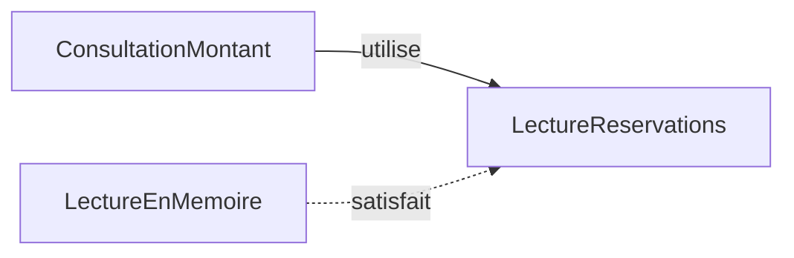

# SOLID, comprendre les cinq principes

Quand une application évolue, son organisation peut compliquer un changement pourtant limité. Modifier un tarif oblige parfois à relire le code des courriels, tandis qu'un écran de consultation exige inutilement des méthodes de suppression. Une sous-classe peut aussi refuser une opération promise par sa classe parente. Les cinq principes SOLID aident à comprendre ces difficultés et à choisir quelle partie du code modifier.

Ces principes prolongent les [bases POO](/poo-patterns-frameworks/01-fondations/), mais concernent aussi les fonctions et les modules. Ils proposent des questions pour examiner une conception, pas des règles à appliquer à chaque classe. Une séparation se justifie si elle rend un changement plus compréhensible ou moins risqué, compte tenu du code supplémentaire à maintenir.

Ce chapitre fait partie des approfondissements du cours, car les séances de patterns n'en ont pas besoin. Si vous manquez de temps, lisez S et D, puis la section [Choisir quel principe examiner](#choisir-quel-principe-examiner). Ces deux principes reviennent dans la plupart des projets web. O, L et I deviennent utiles plus tard, quand une hiérarchie de classes ou une interface trop large rend un changement difficile.

Les exemples reprennent le domaine des [réservations d'ateliers](/poo-patterns-frameworks/10-exercice/). Pour chaque principe, les variantes avant et après traitent le même problème. Elles restent indépendantes des autres exemples, sans construire progressivement une nouvelle application. Les montants sont des nombres entiers de centimes.

Exécutez chaque bloc dans un fichier séparé. Comme dans le premier atelier, un fichier `.ts` s'exécute avec Node.js 24 ou une version ultérieure. Les assertions comparent les résultats observés aux résultats attendus et lèvent une erreur en cas de différence. Une exécution réussie de ces extraits n'affiche rien.

La vérification des types par TypeScript examine le code avant son exécution. Node.js efface ici les annotations de type sans effectuer ce contrôle. Lorsque le chapitre indique que TypeScript refuse un appel, il parle donc du contrôle des types, pas de l'exécution des assertions.

## S, responsabilité unique

L'équipe qui décide des tarifs demande de modifier la réduction solidaire des ateliers. Au même moment, l'équipe qui rédige les confirmations souhaite changer le texte envoyé aux participants. Ces demandes peuvent arriver séparément et pour des raisons différentes. On cherche donc à modifier l'une sans intervenir dans le code de l'autre.

Dans le premier programme, ces deux demandes obligent à modifier la même méthode de la classe de réservation. Le résultat calculé est correct, mais les deux règles sont réunies dans cette méthode. Le problème apparaît donc au moment de faire évoluer le code, pas au moment de l'exécuter.

### Avant, le calcul et la rédaction changent ensemble

La classe `Reservation` conserve l'adresse du participant, le prix et le choix du tarif solidaire. Sa méthode `preparerConfirmation` calcule le montant à partir de ces champs, puis l'insère dans une phrase. Elle renvoie cette phrase sans envoyer de courriel.

```ts
import assert from "node:assert/strict";

class Reservation {
	readonly email: string;
	readonly prixCentimes: number;
	readonly solidaire: boolean;

	constructor(email: string, prixCentimes: number, solidaire: boolean) {
		this.email = email;
		this.prixCentimes = prixCentimes;
		this.solidaire = solidaire;
	}

	preparerConfirmation(): string {
		const montantCentimes = this.solidaire
			? Math.round(this.prixCentimes / 2)
			: this.prixCentimes;
		return `Réservation pour ${this.email} : ${montantCentimes} centimes.`;
	}
}

const lea = new Reservation("lea@example.org", 2001, true);
assert.equal(
	lea.preparerConfirmation(),
	"Réservation pour lea@example.org : 1001 centimes.",
);
```

Dans l'appel vérifié par l'assertion, le constructeur a rangé `2001` dans `this.prixCentimes` et `true` dans `this.solidaire`. La méthode divise donc `2001` par deux, puis `Math.round` arrondit `1000.5` à `1001`. Le `return` insère ensuite ce montant et `this.email` dans le message.

L'assertion confirme le message obtenu pour cette réservation solidaire. Elle ne dit pas si le calcul et la rédaction ont de bonnes raisons de rester ensemble. Changer la formule de réduction ou remplacer la phrase oblige à modifier `preparerConfirmation`. On intervient donc dans la même méthode pour deux décisions indépendantes, avec le risque de toucher à l'autre en la modifiant.

### Après, chaque règle appartient à une classe identifiable

On conserve le même résultat en séparant le calcul du montant et la rédaction du message. `Reservation` garde ses données et calcule son montant avec `montantCentimes()`. Une nouvelle classe, `Confirmation`, demande ce montant, puis l'insère dans le texte.

```ts
import assert from "node:assert/strict";

class Reservation {
	readonly email: string;
	readonly prixCentimes: number;
	readonly solidaire: boolean;

	constructor(email: string, prixCentimes: number, solidaire: boolean) {
		this.email = email;
		this.prixCentimes = prixCentimes;
		this.solidaire = solidaire;
	}

	montantCentimes(): number {
		return this.solidaire
			? Math.round(this.prixCentimes / 2)
			: this.prixCentimes;
	}
}

class Confirmation {
	rediger(reservation: Reservation): string {
		const montant = reservation.montantCentimes();
		return `Réservation pour ${reservation.email} : ${montant} centimes.`;
	}
}

const lea = new Reservation("lea@example.org", 2001, true);
assert.equal(lea.montantCentimes(), 1001);
assert.equal(new Reservation("sam@example.org", 2001, false).montantCentimes(), 2001);
assert.equal(
	new Confirmation().rediger(lea),
	"Réservation pour lea@example.org : 1001 centimes.",
);
```

`lea.montantCentimes()` applique la règle tarifaire aux champs de `lea` et renvoie le nombre `1001`. Cette méthode ne contient aucune phrase, si bien que `Reservation` ne sait plus comment la confirmation est rédigée.

L'appel `new Confirmation().rediger(lea)` reçoit ensuite la réservation entière. La méthode lit son adresse, demande son montant à `montantCentimes()`, puis renvoie le même message que le premier programme. La rédaction n'a plus à savoir si le tarif était normal ou solidaire, parce que la réservation a déjà tranché cette question.

Les deux premières assertions vérifient désormais le calcul sans passer par le message, pour un tarif solidaire puis un tarif normal. La dernière vérifie le texte produit pour la réservation de Léa. Si le texte change, on modifie la classe `Confirmation`. Si la réduction change, on examine `montantCentimes()` et les résultats attendus de ses tests. Le code de rédaction reste inchangé tant qu'il doit afficher le montant calculé.

Cette séparation illustre la responsabilité unique, ou *Single Responsibility Principle* (**SRP**). Une responsabilité correspond ici à une raison de changer. Robert C. Martin relie cette raison à un acteur, la personne ou le groupe qui décide d'une règle. On distingue ce rôle de celui du développeur chargé de modifier le fichier. Dans notre exemple, les équipes de tarification et de rédaction prennent deux décisions indépendantes. `Reservation` porte la première, et `Confirmation` la seconde.

Le nombre de personnes ne dicte pas le nombre de classes. Une même personne peut décider des tarifs et rédiger les courriels, sans que ces deux activités aient les mêmes raisons d'évoluer. À l'inverse, plusieurs personnes peuvent travailler sur une même règle. Pour choisir une séparation, on regarde quelles décisions changent ensemble et lesquelles doivent pouvoir changer séparément.

Une classe peut donc avoir plusieurs méthodes qui répondent au même besoin. Une responsabilité ne signifie ni une seule méthode par classe, ni un fichier pour chaque ligne. Ici, le découpage ajoute une classe et un appel à suivre. Ce coût se justifie si les deux décisions évoluent séparément, pas parce que toute rédaction exige une classe. Les contrôles des saisies et l'envoi du message restent hors de cet exemple.

Le [support ENSICAEN, section 2.1, pages 1 et 2](https://foad.ensicaen.fr/pluginfile.php/1214/course/section/633/DP-Handout-02.pdf#page=1) illustre cette séparation avec un importateur CSV qui distingue la lecture du fichier et l'écriture des données.

L'[article en anglais de Robert C. Martin sur la responsabilité unique](https://blog.cleancoder.com/uncle-bob/2014/05/08/SingleReponsibilityPrinciple.html) développe le lien avec les acteurs du changement.

## O, ouvert à l'extension, fermé à la modification

Les ateliers proposent déjà un tarif normal et un tarif solidaire. L'association demande maintenant un tarif adhérent qui retire 300 centimes au prix, sans rendre le montant négatif. Où faut-il intervenir pour ajouter cette règle ?

La question concerne la formule tarifaire. Les réservations, les places disponibles et les confirmations ne changent pas dans cet exemple.

### Avant, chaque nouveau tarif modifie le calcul commun

```ts
import assert from "node:assert/strict";

class Reservation {
	readonly prixCentimes: number;
	readonly tarif: "normal" | "solidaire";

	constructor(prixCentimes: number, tarif: "normal" | "solidaire") {
		this.prixCentimes = prixCentimes;
		this.tarif = tarif;
	}

	montantCentimes(): number {
		if (this.tarif === "solidaire") return Math.round(this.prixCentimes / 2);
		return this.prixCentimes;
	}
}

assert.equal(new Reservation(2001, "normal").montantCentimes(), 2001);
assert.equal(new Reservation(2001, "solidaire").montantCentimes(), 1001);
```

Le constructeur reçoit ici un nom de tarif et le range dans `this.tarif`. Avec `"solidaire"`, la condition de `montantCentimes()` est vraie et la méthode renvoie la moitié du prix arrondie. Avec `"normal"`, elle atteint le dernier `return` et renvoie le prix entier. Les assertions vérifient ces deux trajets pour `2001` centimes.

Le type du champ autorise seulement `"normal"` et `"solidaire"`. Pour ajouter le tarif adhérent, il faut modifier ce type, puis ajouter une condition et son calcul. Si les demandes tarifaires se répètent, chaque nouvelle formule oblige à modifier la classe `Reservation`.

### Après, la réservation reçoit la règle qui varie

On peut transmettre la formule elle-même sous la forme d'un objet. L'interface `Tarif` décrit l'opération attendue, une méthode `appliquer` qui transforme un prix en montant. Chaque formule devient alors une classe qui implémente cette interface.

Cette version ajoute aussi des contrôles absents du premier extrait. `Reservation` vérifie le prix dans son constructeur, puis `montantCentimes()` exécute la formule reçue et vérifie le montant avant de le renvoyer. Ces contrôles sont communs à tous les tarifs, indépendamment du déplacement de la formule dans un objet.

```ts
import assert from "node:assert/strict";

interface Tarif {
	appliquer(prixCentimes: number): number;
}

class TarifNormal implements Tarif {
	appliquer(prixCentimes: number): number {
		return prixCentimes;
	}
}

class TarifSolidaire implements Tarif {
	appliquer(prixCentimes: number): number {
		return Math.round(prixCentimes / 2);
	}
}

class TarifAdherent implements Tarif {
	appliquer(prixCentimes: number): number {
		return Math.max(0, prixCentimes - 300);
	}
}

class TarifFixe implements Tarif {
	#montantCentimes: number;

	constructor(montantCentimes: number) {
		this.#montantCentimes = montantCentimes;
	}

	appliquer(): number {
		return this.#montantCentimes;
	}
}

class Reservation {
	#prixCentimes: number;
	#tarif: Tarif;

	constructor(prixCentimes: number, tarif: Tarif) {
		if (!Number.isSafeInteger(prixCentimes) || prixCentimes < 0) {
			throw new Error("Prix invalide.");
		}
		this.#prixCentimes = prixCentimes;
		this.#tarif = tarif;
	}

	montantCentimes(): number {
		const montant = this.#tarif.appliquer(this.#prixCentimes);
		if (!Number.isSafeInteger(montant) || montant < 0) {
			throw new Error("Montant invalide.");
		}
		return montant;
	}
}

assert.equal(new Reservation(2001, new TarifNormal()).montantCentimes(), 2001);
assert.equal(new Reservation(2001, new TarifSolidaire()).montantCentimes(), 1001);
assert.equal(new Reservation(2001, new TarifAdherent()).montantCentimes(), 1701);
assert.equal(new Reservation(200, new TarifAdherent()).montantCentimes(), 0);
assert.equal(new Reservation(2001, new TarifFixe(1500)).montantCentimes(), 1500);
assert.throws(() => new Reservation(-1, new TarifNormal()), /Prix invalide/);
assert.throws(() => new Reservation(2001, new TarifFixe(-1)).montantCentimes(), /Montant invalide/);
assert.throws(() => new Reservation(2001, new TarifFixe(10.5)).montantCentimes(), /Montant invalide/);
```

`Tarif` décrit la forme attendue d'une formule. Toute classe qui l'implémente doit fournir `appliquer`, une méthode appelable avec un nombre de centimes et qui renvoie un nombre. `TarifNormal`, `TarifSolidaire`, `TarifAdherent` et `TarifFixe` respectent cette signature, chacune avec son propre calcul. Le sens de ces nombres, notamment l'interdiction des montants négatifs, doit être précisé en plus des types.

`TarifFixe` ignore le prix et renvoie le montant reçu par son constructeur. Sa méthode `appliquer()` ne déclare donc aucun paramètre, ce que TypeScript accepte. L'appel effectué par la réservation lui passe le prix prévu par l'interface, mais cette formule n'a pas besoin de le lire.

Dans `new Reservation(2001, new TarifAdherent())`, on crée un objet `TarifAdherent` et on le transmet au constructeur, qui le range dans le champ privé `#tarif`. La réservation ne connaît pas la classe exacte de cet objet. Son champ est déclaré avec le type `Tarif`, donc elle sait seulement qu'il possède une méthode `appliquer`, et c'est elle qui décide quand l'appeler.

Le contrôle du constructeur accepte `2001`, car c'est un entier positif situé dans la plage où JavaScript représente tous les entiers exactement. C'est ce que signifie ici « entier sûr ».

Quand l'assertion appelle `montantCentimes()`, la ligne `this.#tarif.appliquer(this.#prixCentimes)` exécute la méthode de l'objet reçu. Pour cette réservation, `#tarif` désigne un `TarifAdherent`, si bien que c'est sa version d'`appliquer` qui s'exécute. Le calcul `2001 - 300` produit `1701`, et `Math.max(0, 1701)` conserve ce montant. Le second contrôle l'accepte, puis le dernier `return` le renvoie.

La même ligne produit donc un calcul différent selon l'objet transmis. Les bases POO appellent ce mécanisme le [polymorphisme](/poo-patterns-frameworks/01-fondations/#contrats-et-polymorphisme).

Avec un prix de `200`, le retrait de `300` donnerait `-100`. `Math.max(0, -100)` choisit `0` et évite un montant négatif. Les dernières assertions vérifient aussi les refus. Un prix de `-1` échoue dès la construction de la réservation, avant tout appel du tarif. Un `TarifFixe` de `-1` ou de `10.5` respecte la signature de `Tarif`, mais son résultat échoue au contrôle du montant. Une signature TypeScript compatible ne garantit donc pas, à elle seule, un montant acceptable.

Le principe ouvert-fermé, ou *Open-Closed Principle* (**OCP**), décrit l'objectif de cette séparation. Ajouter une formule revient à fournir un nouvel objet, sans modifier `Reservation`, qui l'utilise. On dit que `Reservation` est ouverte à l'extension par de nouveaux tarifs et fermée aux modifications causées par cet ajout. Elle reste stable parce qu'elle demande toujours la même opération, quelle que soit la formule choisie.

En revanche, le code qui choisit le tarif doit encore évoluer. L'application doit savoir quand fournir un `TarifAdherent` plutôt qu'un `TarifNormal`. On ajoute donc du code pour la formule et pour son choix, mais pas de nouvelle branche dans le calcul commun. Le principe ne promet pas qu'une nouvelle demande laissera tout le programme inchangé.

Cette stabilité concerne une variation précise, la formule tarifaire compatible avec le contrat actuel. Une nouvelle règle sur les places disponibles demanderait une autre modification. OCP n'interdit ni les `if` ni la correction d'un bogue dans le calcul commun. Si deux tarifs restent stables et que la condition initiale se lit bien, ajouter une interface et plusieurs classes peut coûter plus qu'il ne rapporte. Les assertions vérifient les résultats choisis ici, mais elles ne décident pas quelle réduction l'association doit proposer.

Le chapitre [Strategy](/poo-patterns-frameworks/02-strategy/) applique cette décision à l'application complète. La partie sur le principe ouvert-fermé de [l'article de Philippe Vialatte sur SOLID](https://philippe.developpez.com/articles/SOLIDdotNet/) donne d'autres exemples en C#.

## L, substitution de Liskov

### Remplacer sans rompre le contrat

Prenons un écran de réservation avec un bouton **Annuler**. Au clic, l'écran transmet la réservation à une fonction `annulerEtConfirmer`. Cette fonction demande l'annulation, puis renvoie le message « Annulation confirmée ». Elle doit pouvoir se fier à l'objet qu'elle reçoit.

Le code qui utilise un objet est son **appelant**. Ici, `annulerEtConfirmer` est l'appelant de la réservation. Il attend que `annuler()` rende `annulee` vrai sans lever d'erreur, y compris si la réservation est déjà annulée. Cette promesse permet d'afficher une confirmation sans ajouter de contrôle après l'appel. Elle est choisie pour cet exemple, pas imposée à toutes les applications de réservation.

Le principe de substitution de Liskov, ou *Liskov Substitution Principle* (**LSP**), demande de préserver cette promesse quand on remplace un objet par un autre du même type attendu. **Le code qui utilise l'objet doit pouvoir continuer à compter sur les mêmes garanties.**

### Un remplacement qui échoue

Dans ce premier modèle, `Reservation` permet l'annulation. On ajoute une réservation ferme, dont les conditions interdisent l'annulation. `ReservationFerme` hérite de `Reservation`, mais remplace sa méthode `annuler()` par une erreur.

Le problème se voit en donnant cette nouvelle réservation à la même fonction `annulerEtConfirmer`.

```ts
import assert from "node:assert/strict";

class Reservation {
	#annulee = false;

	get annulee(): boolean {
		return this.#annulee;
	}

	annuler(): void {
		this.#annulee = true;
	}
}

class ReservationFerme extends Reservation {
	override annuler(): void {
		throw new Error("Cette réservation ne peut pas être annulée.");
	}
}

function annulerEtConfirmer(reservation: Reservation): string {
	reservation.annuler();
	return "Annulation confirmée";
}

const flexible = new Reservation();
assert.equal(annulerEtConfirmer(flexible), "Annulation confirmée");
assert.equal(flexible.annulee, true);

const ferme: Reservation = new ReservationFerme();
assert.throws(() => annulerEtConfirmer(ferme), /ne peut pas être annulée/);
assert.equal(ferme.annulee, false);
```

Avec `flexible`, l'état est d'abord confirmé. L'appel `reservation.annuler()` met ensuite l'état d'annulation à `true`. L'exécution continue jusqu'au `return`, qui produit le message attendu. Les deux premières assertions vérifient donc le message et l'état obtenu.

La ligne `const ferme: Reservation = new ReservationFerme()` présente ensuite la réservation ferme comme une `Reservation`. TypeScript accepte cette sous-classe, dont la méthode `annuler()` conserve une signature compatible. Le compilateur ne vérifie pas qu'elle tient la promesse d'annulation. Le type attendu autorise donc l'appel, alors que l'objet reçu en détermine le comportement réel.

Quand `annulerEtConfirmer` reçoit `ferme`, la même ligne `reservation.annuler()` lève cette fois une erreur. Le `return` n'est jamais atteint et la réservation reste confirmée. Le remplacement a rompu la promesse faite à l'appelant. C'est la violation de Liskov.

`assert.throws` vérifie que ce contre-exemple produit bien l'erreur annoncée. Cette assertion rend la rupture observable. Elle ne rend pas le modèle correct. Un test demandant une annulation réussie pour toute `Reservation` échouerait avec `ReservationFerme`.

### Annoncer seulement les capacités possibles

Le refus d'annuler une réservation ferme est une règle métier légitime. Il faut donc changer le contrat annoncé par le type, plutôt que permettre une annulation interdite. Les deux réservations peuvent être consultées, mais seule la réservation flexible peut être annulée.

Le second extrait remplace le précédent. `ReservationConsultable` permet de lire l'état, et `ReservationAnnulable` y ajoute l'opération d'annulation. La classe `ReservationFerme` implémente donc seulement `ReservationConsultable`, si bien qu'elle expose son état, toujours confirmé, sans hériter d'une méthode impossible à respecter.

```ts
import assert from "node:assert/strict";

interface ReservationConsultable {
	readonly annulee: boolean;
}

interface ReservationAnnulable extends ReservationConsultable {
	annuler(): void;
}

class ReservationFlexible implements ReservationAnnulable {
	#annulee = false;

	get annulee(): boolean {
		return this.#annulee;
	}

	annuler(): void {
		this.#annulee = true;
	}
}

class ReservationFerme implements ReservationConsultable {
	get annulee(): boolean {
		return false;
	}
}

function consulter(reservation: ReservationConsultable): string {
	return reservation.annulee ? "Annulée" : "Confirmée";
}

function annulerEtConfirmer(reservation: ReservationAnnulable): string {
	reservation.annuler();
	return "Annulation confirmée";
}

const flexible = new ReservationFlexible();
const ferme = new ReservationFerme();

assert.equal(consulter(flexible), "Confirmée");
assert.equal(consulter(ferme), "Confirmée");
assert.equal(flexible.annulee, false);
assert.equal(ferme.annulee, false);
assert.equal(annulerEtConfirmer(flexible), "Annulation confirmée");
assert.equal(consulter(flexible), "Annulée");
assert.equal(consulter(ferme), "Confirmée");
assert.equal(annulerEtConfirmer(flexible), "Annulation confirmée");
assert.equal(consulter(flexible), "Annulée");
```

`consulter` attend une `ReservationConsultable`. Les deux objets conviennent, et les premières assertions vérifient qu'ils sont confirmés. Dans ces appels, leur lecture laisse bien `annulee` à `false`. La fonction de consultation n'a pas besoin de savoir quelle réservation pourrait ensuite être annulée.

`annulerEtConfirmer` attend désormais une `ReservationAnnulable`. Elle accepte donc `flexible`, qui possède cette capacité. Après son appel, `consulter(flexible)` renvoie « Annulée », tandis que `consulter(ferme)` renvoie toujours « Confirmée ». La dernière paire d'assertions vérifie qu'une seconde annulation réussit et laisse la réservation annulée.

Écrire `annulerEtConfirmer(ferme)` provoque maintenant une erreur TypeScript, car la classe `ReservationFerme` ne possède pas `annuler()`. On n'a pas besoin d'ajouter un `if` dans cette fonction pour reconnaître les réservations fermes. Elles ne sont plus présentées comme annulables.

### Vérifier les promesses du contrat

La correction rend les capacités explicites, mais la présence d'une méthode ne garantit pas son comportement. Une autre implémentation, c'est-à-dire un autre objet qui fournit les opérations du contrat, pourrait proposer `annuler()` et ne rien faire. Elle laisserait `annulee` à `false` et romprait encore la promesse. Le [duck typing](/poo-patterns-frameworks/01-fondations/#duck-typing-et-typage-structurel) et la compatibilité des types ne suffisent donc pas à vérifier Liskov.

Pour chaque implémentation de `ReservationAnnulable`, les tests doivent vérifier l'annulation et sa répétition. Pour chaque objet consultable, ils doivent aussi vérifier que la lecture ne change pas l'état. Une même série de vérifications peut être appliquée à chaque implémentation, parce que la promesse attendue reste la même. Ces vérifications concernent les interfaces et les objets sans héritage autant que les sous-classes.

Pour décrire ces garanties, on distingue ce qui est exigé avant l'appel, ce qui est garanti après et ce qui doit rester vrai.

- Une **précondition** est une exigence avant un appel. Ici, `annuler()` ne demande pas que la réservation soit encore confirmée. Une nouvelle implémentation qui refuse les réservations déjà annulées ajouterait une exigence et romprait ce contrat.
- Une **postcondition** est une garantie après un appel réussi. Ici, `annulee` vaut `true` après `annuler()`. Une méthode qui ne fait rien ne tient pas cette garantie.
- Un **invariant** est une règle qui reste vraie dans chaque état valide de l'objet. Ici, l'état d'annulation reste un booléen. Chaque opération doit préserver cette règle. Ce seul invariant ne garantit pas que l'annulation a eu lieu, d'où la postcondition précédente.

Un objet remplaçant doit préserver les invariants, sans exiger davantage avant l'appel ni garantir moins après. On examine aussi les suites d'appels permises par le contrat, comme deux annulations successives suivies d'une consultation. Les assertions en vérifient quelques-unes, sans constituer une preuve pour tous les comportements possibles.

Lever une erreur ne viole pas ce principe si le contrat prévoit ce refus. La violation vient ici d'un refus supplémentaire là où notre contrat garantit l'annulation. On ne décide donc pas si une sous-classe est correcte en regardant seulement si elle lève une erreur, mais en comparant son comportement aux promesses du type attendu.

La séparation des capacités prépare le principe suivant, la ségrégation des interfaces, mais les deux questions restent différentes. Liskov demande si un objet tient les promesses du type attendu. La ségrégation demande si le code dépend seulement des opérations dont il a besoin.

### Approfondir

Dans [le support ENSICAEN, section 2.3, pages 3 et 4](https://foad.ensicaen.fr/pluginfile.php/1214/course/section/633/DP-Handout-02.pdf#page=3), `Square` ne respecte pas les promesses des méthodes de `Rectangle`. La correction utilise la composition. Repérez la promesse perdue lorsque l'on modifie ces objets.

La [partie Liskov de Philippe Vialatte](https://philippe.developpez.com/articles/SOLIDdotNet/#LIV) présente un autre exemple de substitution.

### Repère historique

Le principe porte le nom de [Barbara Liskov, chercheuse au MIT](https://www.csail.mit.edu/person/barbara-liskov). Barbara Liskov et Jeannette Wing développent cette idée de sous-typage comportemental dans [*A Behavioral Notion of Subtyping*, publié en 1994](https://www.cs.cmu.edu/~svc/papers/view-publications-lw94.html). Le comportement attendu par le code qui utilise un objet est au centre de cette approche.

## I, ségrégation des interfaces

Prenons un écran qui consulte une réservation pour afficher l'adresse du participant. Cet écran ne crée ni ne supprime de réservation. Pourtant, la classe qui prépare son affichage exige, dans son constructeur, un objet capable de lire, d'enregistrer et de supprimer.

Cette exigence apparaît lorsqu'on veut consulter une archive qui ne propose que la lecture. Elle contient les données nécessaires à l'écran, mais ne satisfait pas le contrat de son constructeur. Pour réutiliser l'écran, il faut revoir ce qu'il exige de sa source, plutôt qu'inventer des opérations d'écriture sans utilité.

### Avant, consulter exige aussi le contrat d'administration

```ts
import assert from "node:assert/strict";

type Reservation = {
	id: number;
	atelierId: number;
	email: string;
	montantCentimes: number;
};

interface GestionReservations {
	lire(id: number): Reservation | undefined;
	enregistrer(reservation: Reservation): void;
	supprimer(id: number): void;
}

class ReservationsEnMemoire implements GestionReservations {
	#reservations = new Map<number, Reservation>();

	lire(id: number): Reservation | undefined {
		return this.#reservations.get(id);
	}

	enregistrer(reservation: Reservation): void {
		this.#reservations.set(reservation.id, reservation);
	}

	supprimer(id: number): void {
		this.#reservations.delete(id);
	}
}

class EcranReservation {
	#source: GestionReservations;

	constructor(source: GestionReservations) {
		this.#source = source;
	}

	afficher(id: number): string {
		const reservation = this.#source.lire(id);
		return reservation ? reservation.email : "Réservation introuvable";
	}
}

const source = new ReservationsEnMemoire();
source.enregistrer({
	id: 1, atelierId: 1, email: "lea@example.org", montantCentimes: 2000,
});
const ecran = new EcranReservation(source);

assert.equal(ecran.afficher(1), "lea@example.org");
assert.equal(ecran.afficher(999), "Réservation introuvable");
```

La classe `ReservationsEnMemoire` range les réservations dans une `Map`, une collection qui associe ici un identifiant à une réservation. La préparation de l'exemple crée une instance de cette classe, puis appelle `source.enregistrer` pour y placer la réservation `1`. Cette écriture prépare les données avant de construire l'écran. L'écran reçoit ensuite `source` dans son constructeur et la garde dans son champ privé `#source`. Il peut ainsi consulter les données sans les avoir enregistrées lui-même.

Quand on appelle `ecran.afficher(1)`, la ligne `this.#source.lire(id)` retrouve la réservation dans la `Map`. La méthode renvoie son adresse, `lea@example.org`. Avec l'identifiant `999`, `lire` renvoie `undefined`, car aucune réservation ne correspond. La méthode choisit alors le texte « Réservation introuvable ».

Ces deux trajets utilisent seulement `lire`. Pourtant, le paramètre du constructeur, `source: GestionReservations`, exige les trois méthodes de l'interface. TypeScript refuse donc de construire l'écran avec un objet qui propose uniquement `lire`. Les méthodes `enregistrer` et `supprimer` lui manquent, même si l'écran ne les appelle jamais.

Dans ce contexte, le **client** est le code qui utilise l'objet. Il ne s'agit pas du participant à l'atelier. `EcranReservation` est le client de `source`, et son besoin se limite à lire une réservation.

### Après, l'écran annonce son besoin de lecture

On peut donc limiter le contrat demandé par le constructeur à ce besoin de lecture. `LectureReservations` exige seulement une méthode `lire`. La méthode `afficher` garde les mêmes instructions, car son travail ne change pas. Pour le vérifier, on fournit cette fois `ArchiveReservations`, une source dont l'interface publique ne propose ni enregistrement ni suppression. « En lecture seule » décrit ici les opérations offertes par cette source, pas une garantie que ses données ne peuvent jamais changer.

```ts
import assert from "node:assert/strict";

type Reservation = {
	id: number;
	atelierId: number;
	email: string;
	montantCentimes: number;
};

interface LectureReservations {
	lire(id: number): Reservation | undefined;
}

class EcranReservation {
	#source: LectureReservations;

	constructor(source: LectureReservations) {
		this.#source = source;
	}

	afficher(id: number): string {
		const reservation = this.#source.lire(id);
		return reservation ? reservation.email : "Réservation introuvable";
	}
}

class ArchiveReservations implements LectureReservations {
	#reservations: Reservation[];

	constructor(reservations: Reservation[]) {
		this.#reservations = reservations;
	}

	lire(id: number): Reservation | undefined {
		const reservation = this.#reservations.find((r) => r.id === id);
		return reservation ? { ...reservation } : undefined;
	}
}

const archive = new ArchiveReservations([
	{ id: 1, atelierId: 1, email: "lea@example.org", montantCentimes: 2000 },
]);
const ecran = new EcranReservation(archive);

assert.equal(ecran.afficher(1), "lea@example.org");
assert.equal(ecran.afficher(999), "Réservation introuvable");
assert.equal(archive.lire(1)?.montantCentimes, 2000);
```

`ArchiveReservations` reçoit ses réservations dans son constructeur et ne propose qu'une méthode publique. Lors de `lire(1)`, `find` parcourt le tableau et retrouve la réservation dont l'identifiant vaut `1`. La méthode renvoie alors une copie de cette réservation. `afficher` reçoit cette copie et renvoie la même adresse que précédemment.

Lors de `lire(999)`, `find` ne trouve aucune réservation et renvoie `undefined`. La source renvoie donc `undefined`, puis l'écran produit le même message d'absence. Les premières assertions vérifient que le changement de contrat n'a pas changé ces résultats. La dernière retrouve le montant `2000` dans la réservation lue. Elle observe une donnée de l'archive, sans prouver que celle-ci est immuable.

L'interface décrit ce que l'écran exige de l'objet reçu. Elle n'impose pas que cet objet possède uniquement ces méthodes. Grâce au [typage structurel](/poo-patterns-frameworks/01-fondations/#duck-typing-et-typage-structurel) de TypeScript, une instance de `ReservationsEnMemoire`, la classe du premier exemple, pourrait aussi convenir sans déclarer `implements LectureReservations`. Elle possède bien `lire`, même si elle sait également enregistrer et supprimer.

La ségrégation des interfaces, ou *Interface Segregation Principle* (**ISP**), consiste à adapter les contrats aux besoins de leurs clients. Ici, un contrat de consultation évite à l'écran d'exiger les opérations d'administration. On peut donc réutiliser cet écran avec une archive comme avec une source modifiable, sans imposer à l'archive des méthodes qu'elle ne peut pas fournir utilement.

Le contrat contient une seule méthode parce que cet écran n'en utilise qu'une. Si plusieurs opérations sont toujours nécessaires ensemble pour un même rôle, une interface peut les regrouper. Le principe ne demande pas une interface par méthode.

Ce contrat minimal ne constitue pas un système d'autorisations. Si l'objet fourni possède aussi des opérations d'écriture, le contrat de lecture ne les supprime pas. Il limite ce que l'écran peut demander dans le code vérifié par TypeScript, pas ce qu'un autre code peut faire du même objet. Les permissions réelles doivent être contrôlées par le système qui exécute ces opérations. Les assertions de cet exemple vérifient l'affichage, sans prouver une politique de sécurité.

La question diffère aussi de celle de Liskov. Ici, on cherche quelles opérations le client a besoin d'exiger. Liskov demande ensuite si les objets acceptés tiennent les promesses de ces opérations.

Dans [le support ENSICAEN, section 2.4, pages 4 et 5](https://foad.ensicaen.fr/pluginfile.php/1214/course/section/633/DP-Handout-02.pdf#page=4), les clients d'un distributeur n'utilisent pas les mêmes opérations de dépôt et de retrait.

L'[article SOLID de DigitalOcean](https://www.digitalocean.com/community/conceptual-articles/s-o-l-i-d-the-first-five-principles-of-object-oriented-design-fr) illustre la ségrégation des interfaces avec du code PHP.

## D, inversion des dépendances

L'association veut réorganiser les données de son application. Aujourd'hui, les réservations se trouvent dans `stockage.tables.reservations`. Cette organisation pourrait changer sans que le besoin de consultation change. On veut toujours obtenir le montant d'une réservation à partir de son identifiant.

Le code métier exprime ici ce besoin lié à l'activité de l'association. Le code de stockage précise comment retrouver les données. Dans le premier programme, ces deux rôles sont mêlés, car la consultation connaît le chemin exact vers les réservations. Réorganiser le stockage oblige donc à modifier la consultation, même si son travail reste le même.

### Avant, le métier connaît l'organisation du stockage

Une `Map` est une collection qui associe une clé à une valeur. Ici, la clé est un identifiant et la valeur est une réservation. Sa méthode `get(id)` recherche la réservation associée à cet identifiant.

```ts
import assert from "node:assert/strict";

type Reservation = {
	id: number;
	atelierId: number;
	email: string;
	montantCentimes: number;
};

const reservation: Reservation = {
	id: 1, atelierId: 1, email: "lea@example.org", montantCentimes: 2000,
};
const stockage = {
	tables: { reservations: new Map([[reservation.id, reservation]]) },
};

class ConsultationMontant {
	montant(id: number): number {
		const reservation = stockage.tables.reservations.get(id);
		if (!reservation) throw new Error("Réservation introuvable.");
		return reservation.montantCentimes;
	}
}

const consultation = new ConsultationMontant();
assert.equal(consultation.montant(1), 2000);
assert.throws(() => consultation.montant(999), /Réservation introuvable/);
```

Lors de l'appel `consultation.montant(1)`, la méthode part de l'objet `stockage`, lit sa propriété `tables`, puis accède à `reservations`. Elle appelle ensuite la méthode `get(1)` de cette `Map`. La réservation existe, donc le dernier `return` renvoie son montant, `2000` centimes.

Avec `consultation.montant(999)`, la `Map` ne trouve aucune réservation et renvoie `undefined`. Le contrôle `if (!reservation)` provoque alors l'erreur annoncée par la seconde assertion. La méthode ne doit pas inventer un montant quand la réservation est absente.

La classe `ConsultationMontant` dépend de l'organisation du stockage. Une **dépendance** désigne ici une connaissance dont le code a besoin pour fonctionner. Pour écrire cette consultation, on doit connaître `tables`, `reservations` et la méthode `get`. Renommer ou déplacer une table oblige à revenir dans la classe, alors que son besoin n'a pas changé.

### Après, le stockage satisfait le contrat demandé par le métier

La consultation a besoin d'une opération plus précise que l'accès à toutes les tables. Elle veut trouver une réservation par son identifiant. On exprime ce besoin avec l'interface `LectureReservations`. Une classe fournit ensuite cette opération de lecture, et on en transmet une instance à la consultation.

```ts
import assert from "node:assert/strict";

type Reservation = {
	id: number;
	atelierId: number;
	email: string;
	montantCentimes: number;
};

interface LectureReservations {
	trouverParId(id: number): Reservation | undefined;
}

class ConsultationMontant {
	#lecture: LectureReservations;

	constructor(lecture: LectureReservations) {
		this.#lecture = lecture;
	}

	montant(id: number): number {
		const reservation = this.#lecture.trouverParId(id);
		if (!reservation) throw new Error("Réservation introuvable.");
		return reservation.montantCentimes;
	}
}

const reservation: Reservation = {
	id: 1, atelierId: 1, email: "lea@example.org", montantCentimes: 2000,
};
const stockage = {
	tables: { reservations: new Map([[reservation.id, reservation]]) },
};

class LectureEnMemoire implements LectureReservations {
	trouverParId(id: number): Reservation | undefined {
		return stockage.tables.reservations.get(id);
	}
}

class StockageEnPanne implements LectureReservations {
	trouverParId(): Reservation | undefined {
		throw new Error("Stockage indisponible.");
	}
}

const consultation = new ConsultationMontant(new LectureEnMemoire());
assert.equal(consultation.montant(1), 2000);
assert.throws(() => consultation.montant(999), /Réservation introuvable/);

const enPanne = new ConsultationMontant(new StockageEnPanne());
assert.throws(() => enPanne.montant(1), /Stockage indisponible/);
```

`ConsultationMontant` reçoit maintenant, dans son constructeur, l'objet à qui elle demandera de retrouver les réservations. Elle le garde dans son champ privé `#lecture`, si bien que l'appel `consultation.montant(1)` ne transmet plus que l'identifiant recherché. À l'intérieur, `this.#lecture.trouverParId(id)` remplace tout le chemin vers la `Map`.

La classe `LectureEnMemoire` fait le lien avec le stockage actuel. Sa méthode `trouverParId` reçoit l'identifiant et exécute `stockage.tables.reservations.get(id)`. Pour `1`, elle renvoie la réservation, puis `montant` renvoie `2000`. Pour `999`, elle renvoie `undefined` et la consultation conserve son erreur « Réservation introuvable ».

Si on réorganise les tables, on modifie ce chemin dans `LectureEnMemoire`. La classe `ConsultationMontant` continue de demander une réservation par identifiant. Elle n'a plus besoin de connaître les noms des tables ou la `Map`.

Le principe d'inversion des dépendances, ou *Dependency Inversion Principle* (**DIP**), décrit cette direction de conception. La règle de **haut niveau** exprime ce que l'application veut faire, ici consulter le montant d'une réservation. Le **détail technique** est la manière de fournir les données, ici une `Map` rangée dans un objet `tables`. Ces termes distinguent des rôles dans le programme.

Le contrat `LectureReservations` exprime le besoin de la consultation, plutôt que de reproduire toutes les possibilités du stockage. Dans une application répartie en modules, on le définit du côté du code métier. Le module de stockage dépend alors de ce contrat pour fournir l'opération attendue. Le module métier n'importe pas l'organisation du stockage.

C'est cette relation qui est inversée. Au lieu d'adapter la consultation aux détails du stockage, on adapte le stockage au besoin annoncé par la consultation. Les deux parties dépendent du contrat. Cet exemple reste dans un seul fichier pour suivre les appels. Il illustre la séparation sans réaliser ce découpage en modules.



Ces flèches représentent les dépendances du code. Elles indiquent ce que chaque partie doit connaître. Elles ne montrent pas le trajet des appels pendant l'exécution. `ConsultationMontant` appelle bien l'objet `LectureEnMemoire`, puis cet objet accède à la `Map`. Le changement concerne les connaissances nécessaires pour écrire la consultation.

Le contrat distingue aussi une absence et une panne. `undefined` signifie que la lecture a réussi sans trouver cette réservation. La classe `StockageEnPanne`, elle, lève une erreur dès qu'on lui demande une lecture. La dernière assertion vérifie que cette erreur traverse `montant` et arrive jusqu'à son appelant. La même classe `ConsultationMontant` peut donc être utilisée avec ces deux implémentations, sans changer son code. Cela ne signifie pas qu'elle peut fournir un montant lorsque le stockage est indisponible.

Transformer cette panne en `undefined` ferait croire qu'aucune réservation ne correspond à l'identifiant. Cela masquerait l'échec de la lecture. Le contrat doit donc préciser les résultats attendus et les erreurs possibles. Le nom d'une interface ne suffit pas à garantir ce comportement.

Le passage de l'objet de lecture au constructeur est une **injection de dépendances**, plus précisément une injection par le constructeur. On fournit à la classe l'objet dont elle a besoin, plutôt que de lui faire choisir ou construire son stockage avec `new`. L'injection décrit cette manière de fournir un objet. DIP concerne ce que les différentes parties du programme connaissent et la direction de leurs dépendances.

Passer directement l'objet `stockage` au constructeur serait aussi une injection. Mais la consultation devrait encore suivre ses tables et leur organisation. On aurait déplacé le choix de l'objet sans supprimer la connaissance du détail technique. Ici, le contrat de lecture permet de séparer ces deux questions.

L'**inversion de contrôle** désigne l'idée plus générale de confier à un autre code une partie du pilotage des appels. Un framework qui appelle votre gestionnaire lors d'un événement en est un exemple. Dans cet extrait, les appels restent visibles et on crée soi-même `new LectureEnMemoire()`. Aucun framework ni outil d'injection n'est nécessaire pour effectuer cette séparation.

La `Map` reste un stockage en mémoire. Elle perd ses données quand le processus s'arrête. Le contrat et les assertions n'apportent aucune garantie de persistance ou de résistance aux accès concurrents. Le chapitre [Repository](/poo-patterns-frameworks/07-repository/) poursuit la discussion sur les contrats de stockage.

Le [support ENSICAEN, section 2.5, pages 5 et 6](https://foad.ensicaen.fr/pluginfile.php/1214/course/section/633/DP-Handout-02.pdf#page=5) place des contrats de lecture et d'écriture entre la règle et les outils utilisés.

L'[article en anglais de Martin Fowler sur l'injection de dépendances](https://martinfowler.com/articles/injection.html) distingue la configuration des objets de leur utilisation. On retrouve cette séparation dans `new ConsultationMontant(new LectureEnMemoire())`.

## Situer SOLID et Clean Code

Robert C. Martin, également connu sous le nom d'Uncle Bob, a contribué à diffuser ces principes de conception. Son article [*Solid Relevance*](https://blog.cleancoder.com/uncle-bob/2020/10/18/Solid-Relevance.html) les présente à travers les problèmes de changement et de dépendances qu'ils cherchent à limiter. Les travaux de Barbara Liskov et de Jeannette Wing sur le sous-typage ont leur propre histoire.

Robert C. Martin est aussi l'auteur de [*Clean Code: A Handbook of Agile Software Craftsmanship*](https://www.informit.com/store/clean-code-a-handbook-of-agile-software-craftsmanship-9780132639408), dont la première édition paraît en 2008. Ce livre traite notamment des noms, des fonctions, des classes et des tests, avec des exemples en Java. Il donne des recommandations de conception à examiner dans leur contexte. SOLID ne résume pas tout le livre, et lire le livre n'est pas un prérequis pour suivre ces exemples.

## Choisir quel principe examiner

Commencez par décrire le changement qui pose problème. Si changer un texte menace le calcul du montant, examinez les responsabilités avec S. Si une nouvelle formule tarifaire oblige à modifier un traitement commun déjà stable, examinez la variation avec O.

Si un objet accepté par une fonction refuse une opération promise, écrivez le contrat et examinez L. Si une vue de consultation exige des opérations d'administration, partez du besoin de ce client et examinez I. Si une règle métier connaît les noms de tables ou les méthodes d'un fournisseur, suivez les dépendances et examinez D.

Une même modification peut concerner plusieurs principes. La séparation entre consultation et annulation répond à une promesse impossible dans l'exemple Liskov. Elle donne aussi aux clients des contrats adaptés à leurs besoins.

## Exercice, une réservation ferme dans une liste

Une liste doit afficher le statut de toutes les réservations. Une nouvelle réservation ferme peut être consultée mais ne peut jamais être annulée. Une proposition consiste à la faire hériter de `ReservationFlexible`, puis à redéfinir `annuler()` pour ne rien faire.

La liste a-t-elle besoin d'une méthode d'annulation pour afficher ces deux types de réservations ? Proposez une interface adaptée à son affichage.

### Réponse expliquée

`ReservationFlexible` promet que l'annulation rend `annulee` vrai. Une méthode qui ne fait rien conserve la signature mais ne tient pas cette postcondition. La fonction d'annulation pourrait alors annoncer une réussite qui n'a pas eu lieu. Le problème principal relève donc de L, la substitution. Supprimer l'exception du premier contre-exemple ne corrige pas le modèle.

La liste doit recevoir des objets `ReservationConsultable`, car elle n'a besoin que de lire `annulee`. Les réservations fermes et flexibles satisfont toutes deux ce contrat. La liste peut donc afficher les deux sans connaître leurs conditions d'annulation. Cette décision suit aussi I, car le client de consultation n'exige plus une opération dont il ne se sert pas.

Les assertions de la solution Liskov vérifient que les deux réservations se consultent à l'état confirmé, puis que seule la flexible change après son annulation. La seconde annulation garde le même état. Le code qui annule reçoit `ReservationAnnulable`. Passer une réservation ferme à ce code doit être refusé par TypeScript, plutôt que conduire à une annulation silencieusement ignorée.
