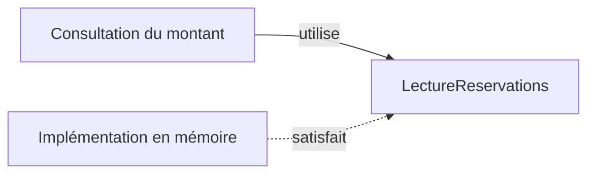

# SOLID, comprendre les cinq principes

Une modification de tarif oblige à relire le code qui rédige les courriels. Un écran de consultation exige des méthodes de suppression. Une sous-classe refuse une opération pourtant promise par sa classe parente. SOLID donne cinq angles pour comprendre ce genre de difficultés et décider où intervenir.

Ces principes prolongent les [bases POO](/poo-patterns-frameworks/01-fondations/). Ils concernent aussi les fonctions et les modules. Leur intérêt dépend du problème rencontré et du coût de la séparation proposée.

Les exemples suivants reprennent le domaine des [réservations d'ateliers](/poo-patterns-frameworks/10-exercice/). Chaque bloc s'exécute dans un fichier séparé. Les variantes avant et après illustrent la même question. Ces exemples traitent des décisions distinctes, sans construire progressivement une nouvelle application. Les montants sont des nombres entiers de centimes. Les assertions vérifient un résultat précis et lèvent une erreur si ce résultat change. Comme dans le premier atelier, un fichier `.ts` s'exécute avec Node.js 24 ou une version ultérieure. Une exécution réussie de ces extraits n'affiche rien.

## S, responsabilité unique

L'équipe qui décide des tarifs demande de modifier la réduction solidaire des ateliers. Au même moment, l'équipe qui rédige les confirmations souhaite changer le texte envoyé aux participants. Une personne qui travaille sur les tarifs doit-elle aussi relire la rédaction des messages ?

Dans le premier programme, ces deux demandes conduisent au même endroit. Le programme donne pourtant le résultat attendu. Le problème apparaît quand on cherche quelle partie modifier pour répondre à chaque équipe.

### Avant, le calcul et la rédaction changent ensemble

La fonction `preparerConfirmation` reçoit le prix, le choix du tarif solidaire et l'adresse du participant. Elle calcule le montant, puis l'insère dans une phrase. Elle renvoie cette phrase sans envoyer de courriel.

```ts
import assert from "node:assert/strict";

function preparerConfirmation(
	prixCentimes: number,
	solidaire: boolean,
	email: string,
): string {
	const montantCentimes = solidaire
		? Math.round(prixCentimes / 2)
		: prixCentimes;
	return `Réservation pour ${email} : ${montantCentimes} centimes.`;
}

assert.equal(
	preparerConfirmation(2001, true, "lea@example.org"),
	"Réservation pour lea@example.org : 1001 centimes.",
);
```

Suivons l'appel de l'assertion. Le prix vaut `2001` centimes et `solidaire` vaut `true`. Le calcul divise donc `2001` par deux, puis `Math.round` arrondit `1000.5` à `1001`. Le `return` insère ensuite ce montant et l'adresse dans le message.

L'assertion confirme que toute cette préparation fonctionne. Elle ne dit pas si le calcul et la rédaction ont de bonnes raisons de rester ensemble. Changer la formule de réduction ou remplacer la phrase oblige à modifier `preparerConfirmation`. Chaque intervention touche une fonction qui porte aussi la décision de l'autre équipe.

### Après, chaque règle possède une fonction identifiable

Gardons les mêmes étapes, mais donnons un nom à chacune. `calculerMontant` s'occupe de la règle tarifaire. `redigerConfirmation` compose le message à partir d'un montant déjà connu.

```ts
import assert from "node:assert/strict";

function calculerMontant(prixCentimes: number, solidaire: boolean): number {
	return solidaire ? Math.round(prixCentimes / 2) : prixCentimes;
}

function redigerConfirmation(email: string, montantCentimes: number): string {
	return `Réservation pour ${email} : ${montantCentimes} centimes.`;
}

const montant = calculerMontant(2001, true);
assert.equal(montant, 1001);
assert.equal(calculerMontant(2001, false), 2001);
assert.equal(
	redigerConfirmation("lea@example.org", montant),
	"Réservation pour lea@example.org : 1001 centimes.",
);
```

`calculerMontant(2001, true)` reçoit deux valeurs et renvoie le nombre `1001`. La variable `montant` conserve ce résultat. La fonction ne reçoit aucune adresse et ne connaît pas la phrase de confirmation.

L'appel `redigerConfirmation("lea@example.org", montant)` reçoit ensuite l'adresse et ce nombre. Il renvoie le même message que le premier programme. La rédaction n'a plus à savoir si le tarif était normal ou solidaire. Le calcul a déjà tranché cette question.

Les assertions peuvent maintenant vérifier le calcul sans passer par le message. Elles vérifient aussi que la rédaction utilise le montant transmis. Si le texte change, nous modifions `redigerConfirmation`. Si la réduction change, nous examinons `calculerMontant` et les résultats attendus de ses tests.

Cette séparation illustre la responsabilité unique, ou *Single Responsibility Principle* (**SRP**). Une responsabilité correspond ici à une raison de changer liée à un besoin. Robert C. Martin précise cette idée en regardant les acteurs qui demandent les changements. Dans notre exemple, les équipes de tarification et de rédaction portent deux besoins indépendants.

Une classe peut avoir plusieurs méthodes qui répondent au même besoin. Une responsabilité ne signifie donc ni une seule méthode par classe, ni un fichier pour chaque ligne. La séparation doit aider à comprendre et à modifier le programme. Elle ne prouve pas que tous les découpages plus fins seraient utiles. Les contrôles des saisies et l'envoi du message restent hors de cet exemple.

Pour poursuivre en français, lire [le support ENSICAEN, section 2.1, pages 1 et 2](https://foad.ensicaen.fr/pluginfile.php/1214/course/section/633/DP-Handout-02.pdf#page=1). Son importateur CSV distingue la lecture du fichier et l'écriture des données. Chercher les raisons qui conduiraient à changer chaque partie.

En complément facultatif, [l'article de Robert C. Martin sur la responsabilité unique](https://blog.cleancoder.com/uncle-bob/2014/05/08/SingleReponsibilityPrinciple.html) est en anglais. Repérer les acteurs de son exemple, puis comparer leurs demandes à celles des deux équipes de notre atelier.

## O, ouvert à l'extension, fermé à la modification

Les ateliers proposent déjà un tarif normal et un tarif solidaire. L'association demande maintenant un tarif adhérent qui retire 300 centimes au prix, sans rendre le montant négatif. Où faut-il intervenir pour ajouter cette règle ?

La question concerne la formule tarifaire. Les réservations, les places disponibles et les confirmations ne changent pas dans cet exemple.

### Avant, chaque nouveau tarif modifie le calcul commun

```ts
import assert from "node:assert/strict";

function calculerMontant(
	prixCentimes: number,
	tarif: "normal" | "solidaire",
): number {
	if (tarif === "solidaire") return Math.round(prixCentimes / 2);
	return prixCentimes;
}

assert.equal(calculerMontant(2001, "normal"), 2001);
assert.equal(calculerMontant(2001, "solidaire"), 1001);
```

Le deuxième argument est ici un nom de tarif. Avec `"solidaire"`, la condition est vraie et la fonction renvoie la moitié du prix arrondie. Avec `"normal"`, elle atteint le dernier `return` et renvoie le prix entier. Les assertions vérifient ces deux trajets pour `2001` centimes.

Le type du paramètre autorise seulement `"normal"` et `"solidaire"`. Pour ajouter le tarif adhérent, il faut modifier ce type, puis ajouter une condition et son calcul. Si les demandes tarifaires se répètent, chaque nouvelle formule nous oblige à reprendre la fonction commune.

### Après, le calcul reçoit la règle qui varie

Nous pouvons transmettre la formule elle-même. La fonction commune garde le travail qui reste identique pour tous les tarifs. Elle vérifie le prix, exécute la formule reçue, puis vérifie le montant avant de le renvoyer.

```ts
import assert from "node:assert/strict";

type Tarif = (prixCentimes: number) => number;

function calculerMontant(prixCentimes: number, tarif: Tarif): number {
	if (!Number.isSafeInteger(prixCentimes) || prixCentimes < 0) {
		throw new Error("Prix invalide.");
	}
	const montantCentimes = tarif(prixCentimes);
	if (!Number.isSafeInteger(montantCentimes) || montantCentimes < 0) {
		throw new Error("Montant invalide.");
	}
	return montantCentimes;
}

const normal: Tarif = (prix) => prix;
const solidaire: Tarif = (prix) => Math.round(prix / 2);
const adherent: Tarif = (prix) => Math.max(0, prix - 300);

assert.equal(calculerMontant(2001, normal), 2001);
assert.equal(calculerMontant(2001, solidaire), 1001);
assert.equal(calculerMontant(2001, adherent), 1701);
assert.equal(calculerMontant(200, adherent), 0);
assert.throws(() => calculerMontant(-1, normal), /Prix invalide/);
assert.throws(() => calculerMontant(2001, () => -1), /Montant invalide/);
assert.throws(() => calculerMontant(2001, () => 10.5), /Montant invalide/);
```

`Tarif` décrit la forme attendue d'une formule. C'est une fonction qui reçoit un nombre de centimes et renvoie un nombre de centimes. `normal`, `solidaire` et `adherent` sont trois fonctions qui ont cette forme.

Dans `calculerMontant(2001, adherent)`, nous transmettons la fonction `adherent`, sans parenthèses après son nom. Écrire `adherent()` serait un appel immédiat de cette fonction, et il manquerait ici le prix attendu. Nous voulons que `calculerMontant` reçoive la règle, puis décide quand l'appeler.

Le premier contrôle accepte `2001`, car c'est un entier sûr, positif ou nul. La ligne `tarif(prixCentimes)` appelle alors la fonction reçue avec ce prix. Pour cet appel, `tarif` désigne `adherent`. Le calcul `2001 - 300` produit `1701`, et `Math.max(0, 1701)` conserve ce montant. Le second contrôle l'accepte, puis le dernier `return` le renvoie.

Avec un prix de `200`, le retrait de `300` donnerait `-100`. `Math.max(0, -100)` choisit `0` et évite un montant négatif. Les dernières assertions vérifient aussi les refus. Un prix de `-1` échoue avant l'appel du tarif. Une formule qui renvoie `-1` ou `10.5` échoue au contrôle du résultat. Une signature TypeScript compatible ne garantit pas, à elle seule, un montant acceptable.

Le principe ouvert-fermé, ou *Open-Closed Principle* (**OCP**), décrit l'objectif de cette correction. Nous pouvons ajouter une formule sans modifier le traitement commun qui l'utilise. Ici, ce traitement reste fermé aux modifications nécessaires pour ajouter un tarif, tout en restant ouvert à cette extension.

Le code qui choisit le tarif change toujours quelque part. L'application doit savoir quand fournir `adherent` plutôt que `normal`. Le principe aide à concentrer ce changement. Il ne promet pas qu'une nouvelle demande n'aura aucun effet sur le programme.

Cette stabilité concerne une variation précise. Une nouvelle règle sur les places disponibles demanderait une autre modification. OCP n'interdit ni les `if` ni la correction d'un bogue dans le calcul commun. Si deux tarifs restent stables et que la condition initiale se lit bien, la conserver peut suffire. Les assertions vérifient les résultats choisis ici, mais elles ne décident pas quelle réduction l'association doit proposer.

Le chapitre [Strategy](/poo-patterns-frameworks/02-strategy/) applique cette décision à l'application complète. Pour une autre explication en français, lire la partie sur le principe ouvert-fermé de [l'article de Philippe Vialatte sur SOLID](https://philippe.developpez.com/articles/SOLIDdotNet/). Ses exemples sont en C#. Chercher ce qui varie et ce qui reste inchangé quand une variante s'ajoute.

## L, substitution de Liskov

### Remplacer sans rompre le contrat

Imaginons un écran de réservation avec un bouton **Annuler**. Au clic, l'écran transmet la réservation à une fonction `annulerEtConfirmer`. Cette fonction demande l'annulation, puis renvoie le message « Annulation confirmée ». Elle doit pouvoir se fier à l'objet qu'elle reçoit.

Le code qui utilise un objet est son **appelant**. Ici, `annulerEtConfirmer` est l'appelant de la réservation. Il attend que `annuler()` rende `annulee` vrai sans lever d'erreur, y compris si la réservation est déjà annulée. C'est la promesse choisie pour cet exemple.

Le principe de substitution de Liskov, ou *Liskov Substitution Principle* (**LSP**), demande de préserver cette promesse quand on remplace un objet par un autre du même type attendu. **Le code qui utilise l'objet doit pouvoir continuer à compter sur les mêmes garanties.**

### Un remplacement qui échoue

Dans ce premier modèle, `Reservation` permet l'annulation. Nous ajoutons une réservation ferme, dont les conditions interdisent l'annulation. `ReservationFerme` hérite de `Reservation`, mais remplace sa méthode `annuler()` par une erreur.

Le problème se voit en donnant cette nouvelle réservation à la même fonction `annulerEtConfirmer`.

```ts
import assert from "node:assert/strict";

class Reservation {
	#annulee = false;

	get annulee(): boolean {
		return this.#annulee;
	}

	annuler(): void {
		this.#annulee = true;
	}
}

class ReservationFerme extends Reservation {
	override annuler(): void {
		throw new Error("Cette réservation ne peut pas être annulée.");
	}
}

function annulerEtConfirmer(reservation: Reservation): string {
	reservation.annuler();
	return "Annulation confirmée";
}

const flexible = new Reservation();
assert.equal(annulerEtConfirmer(flexible), "Annulation confirmée");
assert.equal(flexible.annulee, true);

const ferme: Reservation = new ReservationFerme();
assert.throws(() => annulerEtConfirmer(ferme), /ne peut pas être annulée/);
assert.equal(ferme.annulee, false);
```

Avec `flexible`, l'appel `reservation.annuler()` met l'état à `true`. L'exécution continue jusqu'au `return`, qui produit le message attendu.

La ligne `const ferme: Reservation = new ReservationFerme()` présente ensuite la réservation ferme comme une `Reservation`. TypeScript l'accepte, car elle possède une méthode `annuler()` dont la signature convient. Le compilateur ne vérifie pas qu'elle tient la promesse d'annulation.

Quand `annulerEtConfirmer` reçoit `ferme`, la même ligne `reservation.annuler()` lève cette fois une erreur. Le `return` n'est jamais atteint et la réservation reste confirmée. Le remplacement a rompu la promesse faite à l'appelant. C'est la violation de Liskov.

`assert.throws` vérifie que ce contre-exemple produit bien l'erreur annoncée. Cette assertion rend la rupture observable. Elle ne rend pas le modèle correct. Un test demandant une annulation réussie pour toute `Reservation` échouerait avec `ReservationFerme`.

### Annoncer seulement les capacités possibles

Le refus d'annuler une réservation ferme est une règle métier légitime. C'est le contrat annoncé par le type qui doit changer. Les deux réservations peuvent être consultées. Seule la réservation flexible peut être annulée.

Le second extrait remplace le précédent. `ReservationConsultable` permet de lire l'état. `ReservationAnnulable` ajoute l'opération d'annulation. La réservation ferme est ici un objet qui expose seulement son état, sans hériter d'une méthode impossible à respecter.

```ts
import assert from "node:assert/strict";

interface ReservationConsultable {
	readonly annulee: boolean;
}

interface ReservationAnnulable extends ReservationConsultable {
	annuler(): void;
}

class ReservationFlexible implements ReservationAnnulable {
	#annulee = false;

	get annulee(): boolean {
		return this.#annulee;
	}

	annuler(): void {
		this.#annulee = true;
	}
}

function consulter(reservation: ReservationConsultable): string {
	return reservation.annulee ? "Annulée" : "Confirmée";
}

function annulerEtConfirmer(reservation: ReservationAnnulable): string {
	reservation.annuler();
	return "Annulation confirmée";
}

const flexible = new ReservationFlexible();
const ferme: ReservationConsultable = { annulee: false };

assert.equal(consulter(flexible), "Confirmée");
assert.equal(consulter(ferme), "Confirmée");
assert.equal(flexible.annulee, false);
assert.equal(ferme.annulee, false);
assert.equal(annulerEtConfirmer(flexible), "Annulation confirmée");
assert.equal(consulter(flexible), "Annulée");
assert.equal(consulter(ferme), "Confirmée");
assert.equal(annulerEtConfirmer(flexible), "Annulation confirmée");
assert.equal(consulter(flexible), "Annulée");
```

`consulter` attend une `ReservationConsultable`. Les deux objets conviennent, et les premières assertions vérifient que leur lecture laisse `annulee` à `false`.

`annulerEtConfirmer` attend désormais une `ReservationAnnulable`. Elle accepte `flexible`. Après son appel, `consulter(flexible)` renvoie « Annulée », tandis que `consulter(ferme)` renvoie toujours « Confirmée ». La dernière paire d'assertions vérifie qu'une seconde annulation réussit et laisse la réservation annulée.

Écrire `annulerEtConfirmer(ferme)` provoque maintenant une erreur TypeScript, car cet objet ne possède pas `annuler()`. Nous n'avons pas besoin d'ajouter un `if` dans cette fonction pour reconnaître les réservations fermes. Elles ne sont plus présentées comme annulables.

### Vérifier les promesses du contrat

La correction rend les capacités explicites, mais la présence d'une méthode ne garantit pas son comportement. Une autre implémentation pourrait proposer `annuler()` et ne rien faire. Elle laisserait `annulee` à `false` et romprait encore la promesse. Le [duck typing](/poo-patterns-frameworks/01-fondations/#duck-typing-et-typage-structurel) et la compatibilité des types ne suffisent donc pas à vérifier Liskov.

Pour chaque implémentation de `ReservationAnnulable`, les tests doivent vérifier l'annulation et sa répétition. Pour chaque objet consultable, ils doivent aussi vérifier que la lecture ne change pas l'état. Ces vérifications concernent les interfaces et les objets sans héritage autant que les sous-classes.

Le vocabulaire du contrat précise ces attentes.

- Une **précondition** est une exigence avant un appel. Ici, `annuler()` ne demande pas que la réservation soit encore confirmée. Une nouvelle implémentation qui refuse les réservations déjà annulées ajouterait une exigence et romprait ce contrat.
- Une **postcondition** est une garantie après un appel réussi. Ici, `annulee` vaut `true` après `annuler()`. Une méthode qui ne fait rien ne tient pas cette garantie.
- Un **invariant** est une règle qui reste vraie dans chaque état valide de l'objet. Ici, l'état d'annulation reste un booléen. Chaque opération doit préserver cette règle.

Un objet remplaçant doit préserver les invariants, sans exiger davantage avant l'appel ni garantir moins après. Lever une erreur n'est pas automatiquement une violation de Liskov. Un contrat peut prévoir des refus. La violation vient ici d'un refus supplémentaire là où notre contrat garantit l'annulation.

La séparation des capacités prépare le principe suivant, la ségrégation des interfaces. Les deux questions restent différentes. Liskov demande si un objet tient les promesses du type attendu. La ségrégation demande si le code dépend seulement des opérations dont il a besoin.

### Approfondir en français

Dans [le support ENSICAEN, section 2.3, pages 3 et 4](https://foad.ensicaen.fr/pluginfile.php/1214/course/section/633/DP-Handout-02.pdf#page=3), `Square` ne respecte pas les promesses des méthodes de `Rectangle`. La correction utilise la composition. Repérer la promesse perdue. Le problème concerne des objets modifiables.

Lire aussi [la partie Liskov de Philippe Vialatte](https://philippe.developpez.com/articles/SOLIDdotNet/#LIV). Pour chaque sous-classe de son exemple, écrire la promesse du type parent, puis la promesse que l'appelant perd.

### Repère historique

Le principe porte le nom de [Barbara Liskov, chercheuse au MIT](https://www.csail.mit.edu/person/barbara-liskov). Barbara Liskov et Jeannette Wing développent cette idée de sous-typage comportemental dans [*A Behavioral Notion of Subtyping*, publié en 1994](https://www.cs.cmu.edu/~svc/papers/view-publications-lw94.html). Le comportement attendu par le code qui utilise un objet est au centre de cette approche.

## I, ségrégation des interfaces

Imaginons un écran qui consulte une réservation pour afficher l'adresse du participant. Cet écran ne crée aucune réservation et ne peut pas en supprimer. Pourtant, la fonction qui prépare son affichage exige un objet capable de lire, d'enregistrer et de supprimer.

Cela devient gênant quand nous voulons lui fournir une source qui permet seulement la lecture. Le résultat à afficher ne demande aucune écriture, mais le contrat de la fonction en exige.

### Avant, consulter exige aussi le contrat d'administration

```ts
import assert from "node:assert/strict";

type Reservation = {
	id: number;
	atelierId: number;
	email: string;
	montantCentimes: number;
};

interface GestionReservations {
	lire(id: number): Reservation | undefined;
	enregistrer(reservation: Reservation): void;
	supprimer(id: number): void;
}

function afficherReservation(source: GestionReservations, id: number): string {
	const reservation = source.lire(id);
	return reservation ? reservation.email : "Réservation introuvable";
}

const reservations = new Map<number, Reservation>();
const source: GestionReservations = {
	lire: (id) => reservations.get(id),
	enregistrer: (reservation) => { reservations.set(reservation.id, reservation); },
	supprimer: (id) => { reservations.delete(id); },
};
source.enregistrer({
	id: 1, atelierId: 1, email: "lea@example.org", montantCentimes: 2000,
});

assert.equal(afficherReservation(source, 1), "lea@example.org");
assert.equal(afficherReservation(source, 999), "Réservation introuvable");
```

La préparation de l'exemple crée une `Map`, une collection qui associe ici un identifiant à une réservation. Elle appelle ensuite `source.enregistrer` pour y placer la réservation `1`. Cette écriture fournit les données de départ. Elle ne fait pas partie du travail de `afficherReservation`.

Quand nous appelons `afficherReservation(source, 1)`, la ligne `source.lire(id)` retrouve la réservation dans la `Map`. La fonction renvoie son adresse, `lea@example.org`. Avec l'identifiant `999`, `lire` renvoie `undefined`, car aucune réservation ne correspond. La fonction choisit alors le texte « Réservation introuvable ».

Ces deux trajets utilisent seulement `lire`. Pourtant, le paramètre `source: GestionReservations` exige les trois méthodes de l'interface. TypeScript refuse donc de recevoir un objet qui propose uniquement `lire`. Les méthodes `enregistrer` et `supprimer` lui manquent, même si la fonction ne les appelle jamais.

Dans ce contexte, le **client** est le code qui utilise l'objet. Il ne s'agit pas du participant à l'atelier. `afficherReservation` est le client de `source`, et son besoin se limite à lire une réservation.

### Après, l'écran annonce son besoin de lecture

Changeons le contrat du paramètre pour annoncer ce besoin. `LectureReservations` exige seulement une méthode `lire`. La fonction d'affichage garde les mêmes instructions, car son travail ne change pas.

```ts
import assert from "node:assert/strict";

type Reservation = {
	id: number;
	atelierId: number;
	email: string;
	montantCentimes: number;
};

interface LectureReservations {
	lire(id: number): Reservation | undefined;
}

function afficherReservation(source: LectureReservations, id: number): string {
	const reservation = source.lire(id);
	return reservation ? reservation.email : "Réservation introuvable";
}

const reservation: Reservation = {
	id: 1, atelierId: 1, email: "lea@example.org", montantCentimes: 2000,
};
const source: LectureReservations = {
	lire: (id) => id === reservation.id ? { ...reservation } : undefined,
};

assert.equal(afficherReservation(source, 1), "lea@example.org");
assert.equal(afficherReservation(source, 999), "Réservation introuvable");
assert.equal(source.lire(1)?.montantCentimes, 2000);
```

La nouvelle source contient une seule méthode. Lors de `lire(1)`, elle compare l'identifiant demandé à celui de `reservation`. Ils correspondent, donc elle renvoie une copie de cette réservation. `afficherReservation` reçoit cette copie et renvoie la même adresse que précédemment.

Lors de `lire(999)`, les identifiants ne correspondent pas. La source renvoie `undefined`, puis la fonction produit le même message d'absence. Les premières assertions vérifient que le changement de contrat n'a pas changé ces résultats. La dernière retrouve le montant `2000` dans la réservation lue.

L'interface décrit ce que la fonction exige de l'objet reçu. Elle n'impose pas que cet objet possède uniquement ces méthodes. Grâce au [typage structurel](/poo-patterns-frameworks/01-fondations/#duck-typing-et-typage-structurel) de TypeScript, l'objet `source` du premier exemple pourrait aussi convenir. Il possède bien `lire`, même s'il sait également enregistrer et supprimer.

La ségrégation des interfaces, ou *Interface Segregation Principle* (**ISP**), consiste à adapter les contrats aux besoins de leurs clients. Ici, un contrat de consultation évite d'imposer les opérations d'administration à la fonction d'affichage.

Nous avons utilisé une seule méthode parce que cet écran n'en utilise qu'une. Si plusieurs opérations sont toujours nécessaires ensemble pour un même rôle, une interface peut les regrouper. Le principe ne demande pas une interface par méthode.

Une déclaration TypeScript ne protège pas les données contre un accès interdit. Le contrat de lecture n'enlève pas les capacités d'écriture d'un objet qui en possède. Les permissions réelles doivent être contrôlées par le système qui exécute ces opérations. Les assertions de cet exemple vérifient l'affichage, sans prouver une politique de sécurité.

La question diffère aussi de celle de Liskov. Ici, nous cherchons quelles opérations le client a besoin d'exiger. Liskov demande ensuite si les objets acceptés tiennent les promesses de ces opérations.

Dans [le support ENSICAEN, section 2.4, pages 4 et 5](https://foad.ensicaen.fr/pluginfile.php/1214/course/section/633/DP-Handout-02.pdf#page=4), les clients d'un distributeur n'utilisent pas les mêmes opérations de dépôt et de retrait. Identifier le besoin de chaque client avant de lire le découpage proposé.

Pour une autre lecture en français, [l'article SOLID de DigitalOcean](https://www.digitalocean.com/community/conceptual-articles/s-o-l-i-d-the-first-five-principles-of-object-oriented-design-fr) présente aussi la ségrégation des interfaces, avec du code PHP. Rechercher, dans son exemple, quelles opérations chaque client utilise réellement.

## D, inversion des dépendances

L'association veut réorganiser les données de son application. Aujourd'hui, les réservations se trouvent dans `stockage.tables.reservations`. Cette organisation pourrait changer sans que le besoin de consultation change. Nous voulons toujours obtenir le montant d'une réservation à partir de son identifiant.

Faut-il alors réécrire la consultation du montant chaque fois que le stockage change de structure ? Le premier programme nous y oblige, car la fonction de consultation connaît le chemin exact vers les données.

### Avant, le métier connaît l'organisation du stockage

Une `Map` est une collection qui associe une clé à une valeur. Ici, la clé est un identifiant et la valeur est une réservation. Sa méthode `get(id)` recherche la réservation associée à cet identifiant.

```ts
import assert from "node:assert/strict";

type Reservation = {
	id: number;
	atelierId: number;
	email: string;
	montantCentimes: number;
};

const reservation: Reservation = {
	id: 1, atelierId: 1, email: "lea@example.org", montantCentimes: 2000,
};
const stockage = {
	tables: { reservations: new Map([[reservation.id, reservation]]) },
};

function montantReserve(id: number): number {
	const reservation = stockage.tables.reservations.get(id);
	if (!reservation) throw new Error("Réservation introuvable.");
	return reservation.montantCentimes;
}

assert.equal(montantReserve(1), 2000);
assert.throws(() => montantReserve(999), /Réservation introuvable/);
```

Suivons `montantReserve(1)`. La fonction part de l'objet `stockage`, lit sa propriété `tables`, puis accède à `reservations`. Elle appelle ensuite la méthode `get(1)` de cette `Map`. La réservation existe, donc le dernier `return` renvoie son montant, `2000` centimes.

Avec `montantReserve(999)`, la `Map` ne trouve aucune réservation et renvoie `undefined`. Le contrôle `if (!reservation)` provoque alors l'erreur annoncée par la seconde assertion. La fonction ne doit pas inventer un montant quand la réservation est absente.

Cette fonction dépend de l'organisation du stockage. Une **dépendance** désigne ici une connaissance dont le code a besoin pour fonctionner. Nous devons connaître `tables`, `reservations` et la méthode `get` pour écrire cette consultation. Renommer ou déplacer une table oblige à revenir dans la fonction, alors que son besoin n'a pas changé.

### Après, le stockage satisfait le contrat demandé par le métier

La consultation a besoin d'une opération plus précise que l'accès à toutes les tables. Elle veut trouver une réservation par son identifiant. Nous exprimons ce besoin avec `LectureReservations`, puis nous fournissons un objet qui réalise cette lecture.

```ts
import assert from "node:assert/strict";

type Reservation = {
	id: number;
	atelierId: number;
	email: string;
	montantCentimes: number;
};

interface LectureReservations {
	trouverParId(id: number): Reservation | undefined;
}

function montantReserve(id: number, lecture: LectureReservations): number {
	const reservation = lecture.trouverParId(id);
	if (!reservation) throw new Error("Réservation introuvable.");
	return reservation.montantCentimes;
}

const reservation: Reservation = {
	id: 1, atelierId: 1, email: "lea@example.org", montantCentimes: 2000,
};
const stockage = {
	tables: { reservations: new Map([[reservation.id, reservation]]) },
};
const lecture: LectureReservations = {
	trouverParId: (id) => stockage.tables.reservations.get(id),
};

assert.equal(montantReserve(1, lecture), 2000);
assert.throws(() => montantReserve(999, lecture), /Réservation introuvable/);

const stockageEnPanne: LectureReservations = {
	trouverParId: () => { throw new Error("Stockage indisponible."); },
};
assert.throws(() => montantReserve(1, stockageEnPanne), /Stockage indisponible/);
```

L'appel `montantReserve(1, lecture)` fournit maintenant deux arguments. `1` est l'identifiant recherché. `lecture` est l'objet à qui la fonction demande de retrouver la réservation. À l'intérieur, `lecture.trouverParId(id)` remplace tout le chemin vers la `Map`.

L'objet `lecture` fait le lien avec le stockage actuel. Sa méthode reçoit l'identifiant et exécute `stockage.tables.reservations.get(id)`. Pour `1`, elle renvoie la réservation, puis `montantReserve` renvoie `2000`. Pour `999`, elle renvoie `undefined` et la consultation conserve son erreur « Réservation introuvable ».

Si nous réorganisons les tables, ce chemin se modifie dans l'objet `lecture`. La fonction `montantReserve` continue de demander une réservation par identifiant. Elle n'a plus besoin de connaître les noms des tables ou la `Map`.

Le principe d'inversion des dépendances, ou *Dependency Inversion Principle* (**DIP**), décrit cette direction de conception. La règle de **haut niveau** exprime le besoin utile à l'application, ici consulter le montant d'une réservation. Le **détail technique** est la manière de fournir les données, ici une `Map` rangée dans un objet `tables`. Ces termes distinguent des rôles dans le programme.

Le contrat `LectureReservations` exprime le besoin de la consultation. Dans une application répartie en modules, il appartient à la partie métier. Le module de stockage dépend de ce contrat pour fournir l'opération attendue. Le module métier n'importe pas l'organisation du stockage. Cet exemple reste dans un seul fichier pour suivre les appels. Il illustre la séparation sans réaliser ce découpage en modules.



Ces flèches représentent les dépendances du code. Elles indiquent ce que chaque partie doit connaître. Elles ne montrent pas le trajet des appels pendant l'exécution. `montantReserve` appelle bien l'objet fourni par le stockage, puis cet objet accède à la `Map`. Le changement concerne les connaissances nécessaires pour écrire la consultation.

Le contrat distingue aussi une absence et une panne. `undefined` signifie que la lecture a réussi sans trouver cette réservation. L'objet `stockageEnPanne`, lui, lève une erreur dès qu'on lui demande une lecture. La dernière assertion vérifie que cette erreur traverse `montantReserve` et arrive jusqu'à son appelant.

Transformer cette panne en `undefined` ferait croire qu'aucune réservation ne correspond à l'identifiant. Cela masquerait l'échec de la lecture. Le contrat doit donc préciser les résultats attendus et les erreurs possibles. Le nom d'une interface ne suffit pas à garantir ce comportement.

Le passage de `lecture` en paramètre est une **injection de dépendances**. Nous fournissons à la fonction l'objet dont elle a besoin, plutôt que de lui faire choisir ou construire son stockage. L'injection décrit cette manière de fournir un objet. DIP concerne ce que les différentes parties du programme connaissent et la direction de leurs dépendances. Passer directement l'objet `stockage` en paramètre serait aussi une injection, mais la fonction devrait encore connaître ses tables.

L'**inversion de contrôle** désigne l'idée plus générale de confier à un autre code une partie du pilotage des appels. Un framework qui appelle votre gestionnaire lors d'un événement en est un exemple. Dans notre extrait, les appels restent visibles et nous fournissons nous-mêmes `lecture`. Aucun framework ni outil d'injection n'est nécessaire pour effectuer cette séparation.

La `Map` reste un stockage en mémoire. Elle perd ses données quand le processus s'arrête. Le contrat et les assertions n'apportent aucune garantie de persistance ou de résistance aux accès concurrents. Le chapitre [Repository](/poo-patterns-frameworks/07-repository/) poursuit la discussion sur les contrats de stockage.

Pour approfondir en français, lire [le support ENSICAEN, section 2.5, pages 5 et 6](https://foad.ensicaen.fr/pluginfile.php/1214/course/section/633/DP-Handout-02.pdf#page=5). Il place des contrats de lecture et d'écriture entre la règle et les outils utilisés. Rechercher quel besoin chaque contrat exprime.

En complément facultatif, [l'article de Martin Fowler sur l'injection de dépendances](https://martinfowler.com/articles/injection.html) est en anglais. Sa séparation entre la configuration des objets et leur utilisation aide à relire le rôle du code qui fournit `lecture`.

## Situer SOLID et Clean Code

Robert C. Martin, également connu sous le nom d'Uncle Bob, a contribué à diffuser ces principes de conception. Son article [*Solid Relevance*](https://blog.cleancoder.com/uncle-bob/2020/10/18/Solid-Relevance.html) les présente à travers les problèmes de changement et de dépendances qu'ils cherchent à limiter. Les travaux de Barbara Liskov et de Jeannette Wing sur le sous-typage ont leur propre histoire.

Robert C. Martin est aussi l'auteur de [*Clean Code: A Handbook of Agile Software Craftsmanship*](https://www.informit.com/store/clean-code-a-handbook-of-agile-software-craftsmanship-9780132639408), dont la première édition paraît en 2008. Ce livre traite notamment des noms, des fonctions, des classes et des tests, avec des exemples en Java. Il donne des recommandations de conception à examiner dans leur contexte. SOLID ne résume pas tout le livre, et lire le livre n'est pas un prérequis pour suivre ces exemples.

## Choisir quel principe examiner

Commencer par décrire le changement qui pose problème. Si changer un texte menace le calcul du montant, examiner les responsabilités avec S. Si une nouvelle formule tarifaire oblige à modifier un traitement commun déjà stable, examiner la variation avec O.

Si un objet accepté par une fonction refuse une opération promise, écrire le contrat et examiner L. Si une vue de consultation exige des opérations d'administration, partir du besoin de ce client et examiner I. Si une règle métier connaît les noms de tables ou les méthodes d'un fournisseur, suivre les dépendances et examiner D.

Une même modification peut concerner plusieurs principes. La séparation entre consultation et annulation répond à une promesse impossible dans l'exemple Liskov. Elle donne aussi aux clients des contrats adaptés à leurs besoins. Les lettres servent à expliquer la décision. Elles ne décident pas à la place du besoin observé.

## Exercice, une réservation ferme dans une liste

Une liste doit afficher le statut de toutes les réservations. Une nouvelle réservation ferme peut être consultée mais ne peut jamais être annulée. Une proposition consiste à la faire hériter de `ReservationFlexible`, puis à redéfinir `annuler()` pour ne rien faire.

Avant de lire la réponse, formuler la promesse rompue, choisir le contrat à donner à la liste et décrire une vérification du résultat. Examiner aussi cette question. Faut-il ajouter une méthode d'annulation à la liste pour qu'elle accepte cette réservation ?

### Réponse expliquée

Le problème principal est L. `ReservationFlexible` promet que l'annulation rend `annulee` vrai. Une méthode qui ne fait rien conserve la signature mais ne tient pas cette postcondition. Supprimer l'exception du premier contre-exemple ne corrige donc pas le modèle.

La liste doit recevoir des objets `ReservationConsultable`. Elle n'a besoin que de lire `annulee`. Les réservations fermes et flexibles satisfont toutes deux ce contrat. Cette décision suit aussi I, car le client de consultation n'exige plus une opération d'annulation.

Les assertions de la solution Liskov vérifient que les deux réservations se consultent à l'état confirmé, puis que seule la flexible change après son annulation. La seconde annulation garde le même état. Le code qui annule reçoit `ReservationAnnulable`. Passer une réservation ferme à ce code doit être refusé par TypeScript, plutôt que conduire à une annulation silencieusement ignorée.
