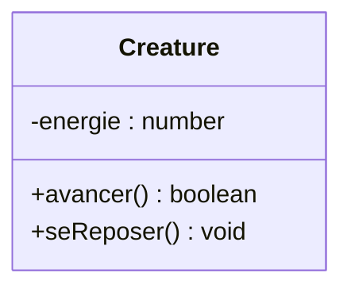
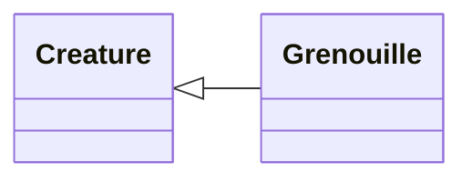
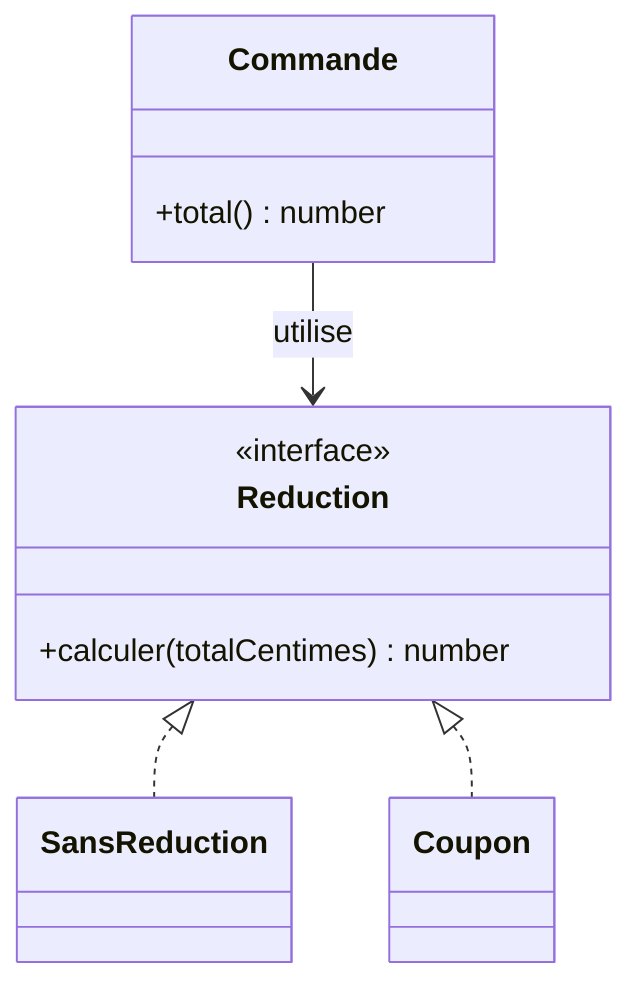
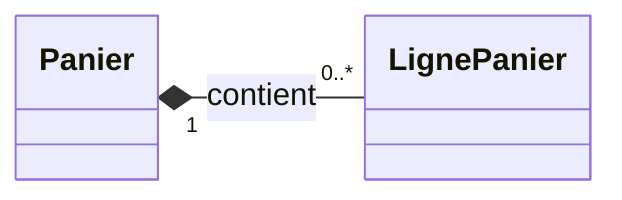
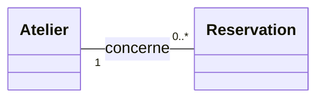
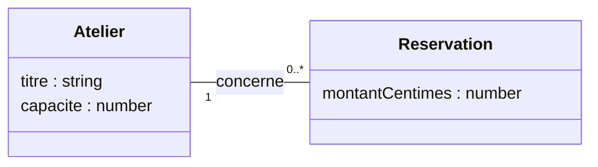
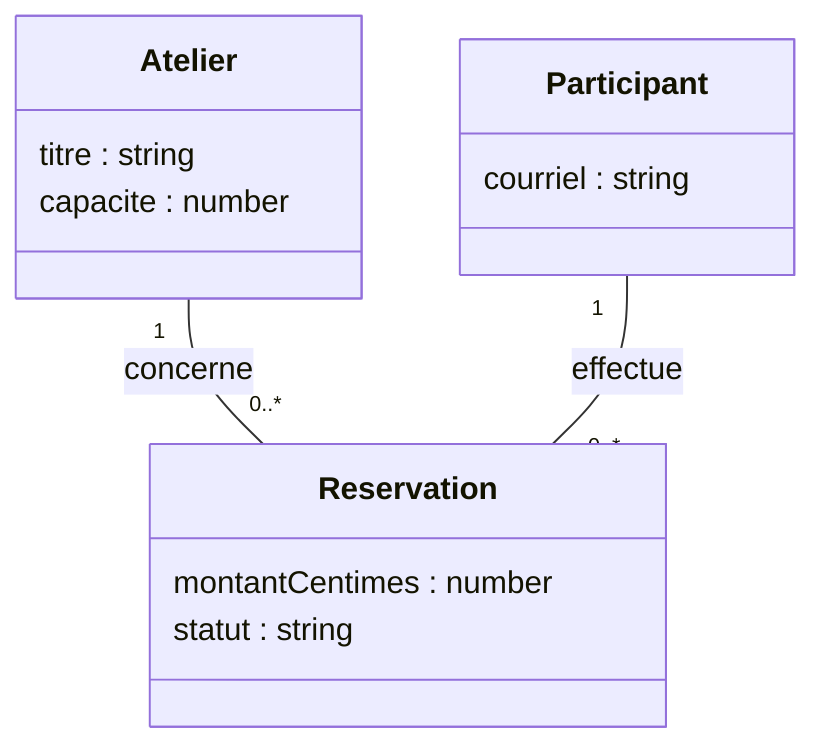

# UML, lire et dessiner un diagramme de classes

Une réservation concerne un atelier, mais un atelier peut recevoir plusieurs réservations. Un diagramme de classes rend cette différence visible, sans parcourir tous les fichiers du programme. On y choisit les éléments à montrer, leurs données, leurs opérations et les relations qui les unissent.

Dans ce chapitre, vous allez lire ces informations, puis dessiner le modèle des ateliers et des réservations. L'objectif est de pouvoir expliquer ce que chaque symbole affirme, mais aussi de reconnaître les règles que le dessin ne suffit pas à exprimer.

Ce chapitre fait partie des approfondissements. Pour lire les schémas des autres chapitres, les sections [Lire une classe](#lire-une-classe) et [Reconnaître les relations](#reconnaitre-les-relations) suffisent. Dessiner un modèle complet sert surtout à présenter une conception, dans un dossier technique, un entretien ou un jury.

## Choisir ce que le diagramme doit montrer

UML signifie *Unified Modeling Language*. Ce langage propose plusieurs types de diagrammes, selon la question que l'on cherche à résoudre. Le diagramme de classes décrit les types d'objets du modèle et les relations possibles entre leurs instances. Un [diagramme de séquence](/poo-patterns-frameworks/03-observer/#la-duree-dun-abonnement) montre plutôt qui appelle qui, dans quel ordre.

Le même langage permet de travailler à des niveaux différents. Pour discuter des règles de réservation, on peut représenter un atelier et une réservation sans décider comment les coder. Pour expliquer un programme existant, on montre plutôt ses classes, leurs membres et leur visibilité. Il faut annoncer si le dessin décrit les concepts de l'activité ou des choix de programmation.

Dans les autres chapitres, certains schémas montrent le parcours d'une demande à travers le programme. La présence de rectangles et de flèches ne suffit pas à en faire des diagrammes de classes UML. Un diagramme de classes décrit les relations entre les éléments du modèle, et la forme de chaque lien a un sens précis.

Nous utilisons [Mermaid](https://mermaid.js.org/syntax/classDiagram.html) pour produire les diagrammes à partir de texte. UML fournit la notation du modèle, Mermaid fournit une façon de la dessiner. On peut aussi dessiner les mêmes symboles sur papier.

## Lire une classe

Reprenons la classe `Creature` des [fondations](/poo-patterns-frameworks/01-fondations/#objets-classes-et-encapsulation) pour décrire une classe du programme. Son rectangle comporte trois compartiments qui séparent le nom, en haut, les attributs, au milieu, et les opérations, en bas.



`energie` est un attribut, c'est-à-dire une donnée portée par les instances de la classe. `avancer()` et `seReposer()` sont des opérations, reconnaissables à leurs parenthèses. Le type `boolean` indique que `avancer()` renvoie `true` ou `false`. `void` indique l'absence de valeur de retour. Le schéma omet ici le getter et la constante d'énergie maximale pour se concentrer sur ces trois membres.

Cette liste ne décrit pas le déroulement des opérations. Le type numérique de l'énergie n'impose pas non plus une valeur entre 0 et 100. Cette règle doit être précisée dans une explication et vérifiée dans le code.

Les signes placés devant les membres indiquent leur visibilité. Le signe moins réserve l'énergie à la classe, tandis que le signe plus rend les opérations accessibles depuis l'extérieur. Le tableau récapitule ces signes et celui des membres protégés :

| Signe UML | Visibilité | Lecture |
| --- | --- | --- |
| `+` | Publique | Le code qui utilise l'objet peut accéder à ce membre. |
| `-` | Privée | Ce membre appartient au fonctionnement interne de la classe. |
| `#` | Protégée | La classe et ses sous-classes peuvent accéder à ce membre. |

Le `#` d'UML signifie « protégé ». Dans le code JavaScript `#energie`, le même caractère déclare un champ privé. Ce champ se représente donc par `-energie` sur le diagramme. Les symboles UML ne sont pas la syntaxe du langage de programmation.

Un rectangle `Creature` décrit une classe. Il ne représente pas une grenouille précise avec 90 points d'énergie. Montrer les valeurs de plusieurs objets à un instant donné relève du diagramme d'objets.

## Reconnaître les relations

Une association relie des types dont les objets peuvent être liés, par exemple des commandes et des réductions. Une flèche de navigation précise dans quel sens un objet peut accéder à l'autre. Elle ne montre pas l'ordre des appels pendant l'exécution.

Une dépendance signale plutôt qu'un code utilise un type pour effectuer son travail, par exemple comme paramètre d'une méthode. Elle n'impose pas de conserver un objet de ce type parmi ses attributs.

Dans les exemples suivants, `A` et `B` désignent des classes ou des interfaces. Le tableau sert de repère pour retrouver les écritures Mermaid. Les triangles et le losange plein sont ensuite expliqués sur des dessins.

| Relation | Écriture Mermaid | Lecture |
| --- | --- | --- |
| Association | `A --> B` | La flèche indique ici que l'on peut naviguer de A vers B. `A -- B` laisse ce sens non précisé. |
| Dépendance | `A ..> B` | A utilise B pour une opération, sans nécessairement en garder une référence. |
| Généralisation, ou héritage | `A --\|> B` | A spécialise B. Le trait est plein et le triangle creux pointe vers le parent B. |
| Réalisation d'une interface | `A ..\|> B` | A respecte le contrat B. Le trait est pointillé et le triangle creux pointe vers B. |
| Composition | `A *-- B` | A possède des parties B, qui ne sont pas partagées entre plusieurs propriétaires à la fois. Le losange plein est du côté du tout A. |
| Agrégation partagée | `A o-- B` | Le losange creux indique un regroupement dont les règles doivent être précisées dans le modèle. Il n'impose pas la propriété exclusive de la composition. |

Une association suffit à représenter beaucoup de collaborations. Le mot « utilise » ne justifie pas à lui seul une relation d'héritage ou un losange. De même, l'absence de flèche ne prouve pas que la navigation est possible dans les deux sens. Elle signifie seulement que le dessin ne précise pas cette information.

### Le triangle pointe vers le parent

Imaginons une classe `Grenouille` qui spécialise `Creature`. Contrairement à une association, l'héritage affirme que les instances de la classe spécialisée sont aussi des instances du type parent. On peut lire le lien « une grenouille est une créature ».



Le triangle creux pointe vers la classe générale. On part donc de `Grenouille` pour lire la relation en allant vers `Creature`. Le trait plein représente ici l'héritage.

Cette relation engage aussi le comportement de la sous-classe. Si `avancer()` promet de renvoyer un booléen sans rendre l'énergie négative, la spécialisation doit préserver ces règles. La phrase « est un » aide à formuler la relation, mais le [principe de substitution de Liskov](/poo-patterns-frameworks/01-solid/#remplacer-sans-rompre-le-contrat) permet d'en vérifier le comportement.

### Une collaboration peut passer par une interface

Pour calculer son total, une commande peut utiliser une réduction sans en hériter. Dans cet exemple de [Strategy](/poo-patterns-frameworks/02-strategy/), deux classes proposent des façons de calculer cette réduction derrière un même contrat.



Le rectangle de la réduction porte la mention « interface ». Il annonce une opération de calcul, sans fournir ici son code. La flèche simple part de la commande et pointe vers ce contrat. La commande connaît donc les opérations à utiliser, sans avoir besoin de connaître la classe concrète choisie pour la réduction.

Les traits pointillés partent des deux classes concrètes et se terminent par un triangle creux près de l'interface. Ils indiquent que ces classes réalisent le contrat, donc qu'elles fournissent le comportement attendu. Contrairement au trait plein de l'héritage, ils n'annoncent pas une reprise de code. La commande n'hérite pas de la réduction. La séance Strategy applique la même structure aux tarifs, avec l'interface `Tarif` et les classes `TarifNormal` et `TarifSolidaire`.

### Le losange plein indique une propriété forte

Une association peut aussi préciser qu'un objet est une partie d'un autre. Prenons un panier et ses lignes pour représenter une relation de composition. Dans ce modèle, chaque ligne appartient à un seul panier et n'a pas d'existence indépendante de celui-ci.



Le losange plein est collé au panier, qui représente le tout, et non à la ligne, qui représente une partie. Il exprime une propriété exclusive, car une même ligne ne fait pas partie de plusieurs paniers à la fois. Si on supprime le panier du modèle, les lignes qui lui appartiennent disparaissent avec lui.

Ce dessin engage les règles du modèle, pas un mécanisme automatique de JavaScript ou de la base de données. Le programme doit appliquer la suppression prévue. Le fait de conserver des lignes dans un tableau ne suffit donc pas à justifier un losange plein.

Dans le code, « préférer la composition à l'héritage » signifie souvent assembler des objets qui collaborent. Cela n'impose pas une composition UML avec un losange plein. Une règle de réduction fournie à une commande peut exister et servir ailleurs. L'association du diagramme précédent décrit ce cas.

## Lire les nombres aux extrémités

Une multiplicité précise combien d'objets d'un côté peuvent être liés à un objet donné de l'autre côté. Il s'agit des nombres autorisés par le modèle, pas du nombre de réservations déjà enregistrées.

Les notations usuelles décrivent un nombre exact ou un intervalle :

| Multiplicité | Signification |
| --- | --- |
| `1` | Exactement un. |
| `0..1` | Aucun ou un seul. |
| `0..*` | Aucun, un ou plusieurs. |
| `1..*` | Au moins un. |

Dans notre modèle, un atelier peut exister avant toute réservation. Chaque réservation concerne exactement un atelier.



Pour lire le diagramme, partez d'un objet et regardez le nombre près de l'autre classe :

- Pour un atelier, regardez le côté `Reservation`. On trouve `0..*` réservations.
- Pour une réservation, regardez le côté `Atelier`. On trouve `1` atelier.

`0..*` ne signifie pas que les places sont illimitées. Cette multiplicité ne fixe aucune borne supérieure au nombre de réservations liées à un atelier, mais une règle supplémentaire limite les réservations actives à sa capacité. Un atelier de 12 places peut ainsi avoir 12 réservations actives et plusieurs réservations annulées dans son historique.

Les nombres ne se déduisent pas de la forme du lien. Si aucune multiplicité n'est affichée, on ne peut pas conclure que la relation autorise un seul objet, ni qu'elle en autorise plusieurs.

## Dessiner son premier modèle

Partons de cette description :

> Un atelier possède un titre et une capacité. Une réservation enregistre un montant en centimes. Chaque réservation concerne un atelier. Un atelier peut n'avoir encore aucune réservation.

1. Donnez une question au schéma. Ici, on veut montrer comment les réservations se rattachent aux ateliers, pas l'ensemble de l'application.
2. Choisissez les concepts utiles. `Atelier` et `Reservation` suffisent pour cette question. La réservation porte ses propres données, on lui donne donc un rectangle.
3. Placez les données sur le concept qu'elles décrivent. La capacité appartient à l'atelier. Le montant enregistré appartient à la réservation, car deux personnes peuvent réserver le même atelier à des tarifs différents.
4. Tracez une association, puisque la description n'impose ni propriété exclusive ni suppression commune. Choisissez les multiplicités en écrivant une phrase dans chaque sens. Un atelier a zéro ou plusieurs réservations, et une réservation concerne exactement un atelier.
5. Ajoutez les opérations dont on veut discuter. On les omet ici, puisque la question porte sur les données et leurs relations.

Voici le texte Mermaid à saisir pour ce modèle. Il peut se conserver dans un fichier Markdown ou se tester dans l'[éditeur Mermaid](https://mermaid.live/).

```text
classDiagram
  direction LR
  class Atelier {
    titre : string
    capacite : number
  }
  class Reservation {
    montantCentimes : number
  }
  Atelier "1" -- "0..*" Reservation : concerne
```

Ce texte produit le diagramme suivant. La visibilité des attributs n'est pas précisée, car on décrit ici les ateliers et les réservations, sans décider de leur organisation dans le code.



Il faut compléter le diagramme par les règles que les attributs et les liens n'expriment pas. Une réservation est refusée quand l'atelier est complet, et son montant reste inchangé si le tarif de l'atelier évolue ensuite.

Ce modèle ne prescrit ni une table de base de données par rectangle ni une classe TypeScript par concept. L'[exercice du cours](/poo-patterns-frameworks/10-exercice/) représente ces données avec des objets. Le choix de leur organisation dans le programme vient après la clarification des règles.

## À vous de compléter

Le modèle précédent ne traite pas encore l'annulation. Complétez-le avec les règles suivantes, qui demandent de conserver l'historique plutôt que de supprimer les réservations annulées :

- Un participant possède une adresse de courriel.
- Chaque réservation désigne un seul participant.
- Un participant peut exister sans avoir réservé et réserver plusieurs ateliers.
- L'annulation d'une réservation conserve son historique et son lien avec le participant.

Dessinez `Participant` avec son attribut et son lien vers `Reservation`. Ajoutez les multiplicités, puis comparez avec le schéma suivant.

### Une proposition



Les associations relient chaque réservation à son participant et à son atelier. Le nombre un près du participant signifie qu'une réservation désigne exactement une personne. La multiplicité près de la réservation autorise une personne à n'avoir aucune réservation ou à en avoir plusieurs.

Le statut permet ici de distinguer une réservation active d'une réservation annulée. L'annulation change ce statut, mais conserve l'enregistrement et ses deux liens. Elle libère une place sans effacer l'historique. Un changement d'état ne nécessite donc pas une composition UML.

Une association suffit pour les règles demandées, qui n'imposent ni propriété exclusive ni suppression commune. Le dessin ne décide pas ce qui doit se produire si l'on supprime un participant ou un atelier. Si cette opération devient nécessaire, il faudra préciser comment conserver ou supprimer les réservations concernées.

Une classe, une interface ou une relation supplémentaire doit aider à répondre à la question posée. On peut enrichir le modèle à mesure que les règles se précisent. La [documentation Mermaid des diagrammes de classes](https://mermaid.js.org/syntax/classDiagram.html) fournit la syntaxe, tandis que la [spécification UML de l'OMG](https://www.omg.org/spec/UML/2.5.1/) définit le langage.
