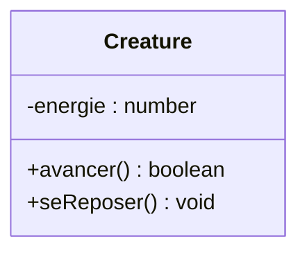
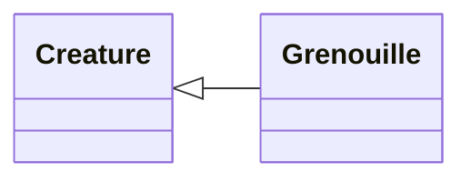
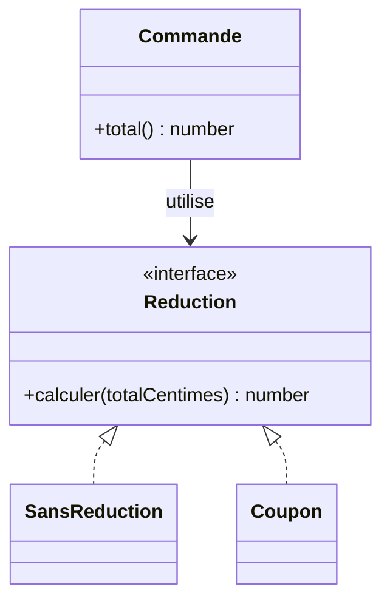
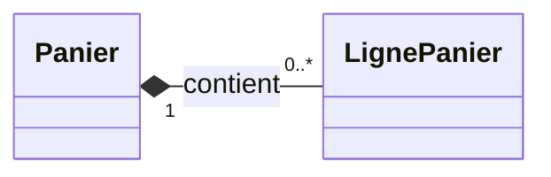
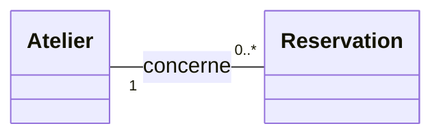
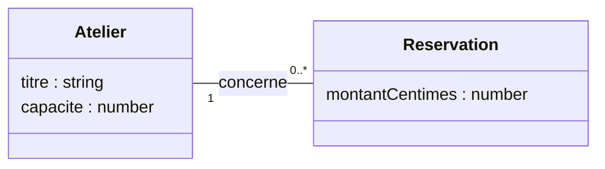
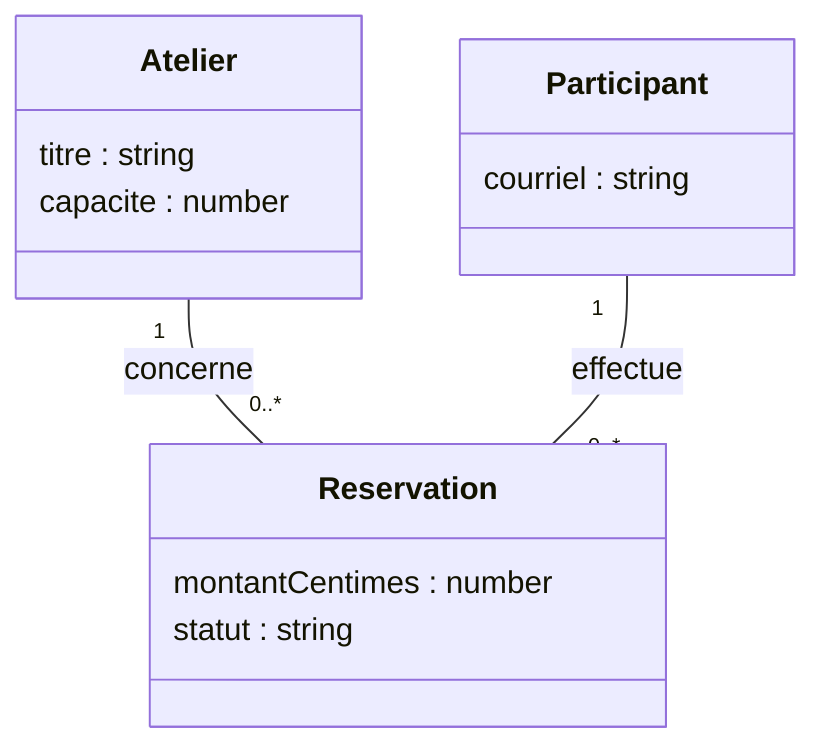

# UML, lire et dessiner un diagramme de classes

Un diagramme de classes montre les données, les opérations et les relations d'un modèle. Il aide à lire les schémas des références et à expliquer les changements de notre application. Dans ce chapitre, nous allons lire les symboles puis dessiner un modèle d'ateliers et de réservations. On peut revenir à cette aide au moment où une séance demande un dessin.

## Choisir ce que le diagramme doit montrer

UML signifie *Unified Modeling Language*. Ce langage propose plusieurs types de diagrammes. Le diagramme de classes répond à la question "Quels éléments composent le modèle et quels liens ont-ils ?". Un [diagramme de séquence](/poo-patterns-frameworks/03-observer/#la-duree-dun-abonnement) montre plutôt qui appelle qui, dans quel ordre.

Les schémas de circulation des autres chapitres expliquent un trajet. Leurs rectangles et leurs flèches n'en font pas automatiquement des diagrammes de classes UML. Ici, la forme de chaque lien a un sens précis.

Nous utilisons [Mermaid](https://mermaid.js.org/syntax/classDiagram.html) pour produire les diagrammes à partir de texte. UML fournit la notation du modèle, Mermaid fournit une façon de la dessiner. On peut aussi dessiner les mêmes symboles sur papier.

## Lire une classe

Reprenons la classe `Creature` des [fondations](/poo-patterns-frameworks/01-fondations/#objets-classes-et-encapsulation). Le rectangle comporte trois compartiments. Son nom est en haut, ses attributs au milieu et ses opérations en bas.



`energie` est une donnée. `avancer()` et `seReposer()` sont des opérations. Le type `boolean` indique que `avancer()` renvoie `true` ou `false`. `void` indique l'absence de valeur de retour. Le schéma omet ici le getter et la constante d'énergie maximale pour se concentrer sur ces trois membres.

Les signes placés devant les membres indiquent leur visibilité :

| Signe UML | Visibilité | Lecture |
| --- | --- | --- |
| `+` | Publique | Le code qui utilise l'objet peut accéder à ce membre. |
| `-` | Privée | Ce membre appartient au fonctionnement interne de la classe. |
| `#` | Protégée | La classe et ses sous-classes peuvent accéder à ce membre. |

Le `#` d'UML signifie "protégé". Dans le code JavaScript `#energie`, le même caractère déclare un champ privé. Ce champ se représente donc par `-energie` sur le diagramme. Les symboles UML ne sont pas la syntaxe du langage de programmation.

Un rectangle `Creature` décrit une classe. Il ne représente pas une grenouille précise avec 90 points d'énergie. Montrer les valeurs de plusieurs objets à un instant donné relève du diagramme d'objets.

## Reconnaître les relations

Dans les exemples suivants, `A` et `B` désignent des classes ou des interfaces. Le tableau donne la syntaxe Mermaid et la lecture du lien.

| Relation | Écriture Mermaid | Lecture |
| --- | --- | --- |
| Association | `A --> B` | Un objet A connaît un objet B. La flèche indique ici le sens de navigation. `A -- B` laisse ce sens non précisé. |
| Dépendance | `A ..> B` | A utilise B pour une opération, sans nécessairement en garder une référence. |
| Généralisation, ou héritage | `A --\|> B` | A spécialise B. Le trait est plein et le triangle creux pointe vers le parent B. |
| Réalisation d'une interface | `A ..\|> B` | A respecte le contrat B. Le trait est pointillé et le triangle creux pointe vers B. |
| Composition | `A *-- B` | A possède des parties B. Le losange plein est du côté du tout A. |
| Agrégation partagée | `A o-- B` | Le losange creux indique un regroupement. Il n'impose pas la propriété exclusive de la composition. |

Pour débuter, une association suffit à représenter beaucoup de collaborations. Le mot "utilise" ne justifie pas à lui seul une relation d'héritage ou un losange.

### Le triangle pointe vers le parent

Imaginons une classe `Grenouille` qui spécialise `Creature`. On peut lire le lien "une grenouille est une créature".



`Grenouille` doit aussi respecter les promesses de `Creature`. Si `avancer()` promet de renvoyer un booléen sans rendre l'énergie négative, la spécialisation doit préserver ces règles. La phrase "est un" aide à formuler la relation ; le [principe de substitution de Liskov](/poo-patterns-frameworks/01-solid/#remplacer-sans-rompre-le-contrat) permet d'en vérifier le comportement.

### Une collaboration peut passer par une interface

Dans cet exemple de [Strategy](/poo-patterns-frameworks/02-strategy/), une commande utilise une réduction. Deux classes proposent des façons de la calculer.



La flèche simple dit que la commande connaît sa réduction. Les triangles pointillés disent que les deux classes respectent son contrat. La commande n'hérite pas de la réduction. La séance Strategy applique la même structure aux tarifs, avec l'interface `Tarif` et les classes `TarifNormal` et `TarifSolidaire`.

### Le losange plein indique une propriété forte

Prenons un panier et ses lignes. Dans ce modèle, une ligne appartient à un seul panier. Elle n'a pas d'existence indépendante de celui-ci.



Si on supprime le panier du modèle, ses lignes disparaissent avec lui.

Dans le code, "préférer la composition à l'héritage" signifie souvent assembler des collaborateurs. Cela n'impose pas une composition UML avec un losange plein. Une règle de réduction fournie à une commande peut exister et servir ailleurs. L'association du diagramme précédent décrit ce cas.

## Lire les nombres aux extrémités

Une multiplicité indique combien d'objets peuvent participer à une relation :

| Multiplicité | Signification |
| --- | --- |
| `1` | Exactement un. |
| `0..1` | Aucun ou un seul. |
| `0..*` | Aucun, un ou plusieurs. |
| `1..*` | Au moins un. |

Dans notre modèle, un atelier peut exister avant toute réservation. Chaque réservation concerne exactement un atelier.



Pour lire le diagramme, partir d'un objet et regarder le nombre près de l'autre classe :

- Pour un atelier, regarder le côté `Reservation`. On trouve `0..*` réservations.
- Pour une réservation, regarder le côté `Atelier`. On trouve `1` atelier.

`0..*` ne signifie pas que les places sont illimitées. La règle "le nombre de réservations actives ne dépasse pas la capacité" reste à préciser en complément.

## Dessiner son premier modèle

Partons de cette description :

> Un atelier possède un titre et une capacité. Une réservation enregistre un montant en centimes. Chaque réservation concerne un atelier. Un atelier peut n'avoir encore aucune réservation.

1. Donner une question au schéma. Ici, on veut montrer comment les réservations se rattachent aux ateliers.
2. Choisir les concepts utiles. `Atelier` et `Reservation` suffisent pour cette question.
3. Placer les données sur le concept qui les porte. La capacité décrit l'atelier ; le montant enregistré décrit la réservation.
4. Tracer le lien, puis écrire une phrase dans chaque sens pour choisir les multiplicités.
5. Ajouter les opérations dont on veut discuter. On peut les omettre si le schéma porte seulement sur les données et leurs relations.

Voici le texte Mermaid à saisir pour ce modèle. Il peut se conserver dans un fichier Markdown ou se tester dans l'[éditeur Mermaid](https://mermaid.live/).

```text
classDiagram
  direction LR
  class Atelier {
    titre : string
    capacite : number
  }
  class Reservation {
    montantCentimes : number
  }
  Atelier "1" -- "0..*" Reservation : concerne
```

Ce texte produit le diagramme suivant. La visibilité des attributs n'est pas précisée, car on discute ici du modèle métier.



Un diagramme de modèle ne remplace pas les règles métier. Ici, il faut encore préciser le refus d'une réservation quand l'atelier est complet. Il n'impose pas non plus d'écrire une classe TypeScript pour chaque rectangle. L'[exercice du cours](/poo-patterns-frameworks/10-exercice/) représente ces données avec des objets.

## À vous de compléter

Ajouter les règles suivantes au modèle précédent :

- Un participant possède une adresse de courriel.
- Chaque réservation désigne un seul participant.
- Un participant peut exister sans avoir réservé et réserver plusieurs ateliers.
- L'annulation d'une réservation conserve son historique et son lien avec le participant.

Dessiner `Participant`, placer son attribut, puis ajouter son lien avec `Reservation`. Justifier la relation et lire les deux multiplicités à voix haute avant de regarder la proposition.

### Une proposition



Une réservation a un participant et un atelier. Les associations expriment ces liens. L'annulation change son statut sans supprimer ces liens. Cette consigne ne demande donc pas de losange de composition.

Une classe, une interface ou une relation supplémentaire doit aider à répondre à la question posée. On peut enrichir le modèle à mesure que les règles se précisent. La [documentation Mermaid des diagrammes de classes](https://mermaid.js.org/syntax/classDiagram.html) fournit la syntaxe ; la [spécification UML de l'OMG](https://www.omg.org/spec/UML/2.5.1/) définit le langage.
