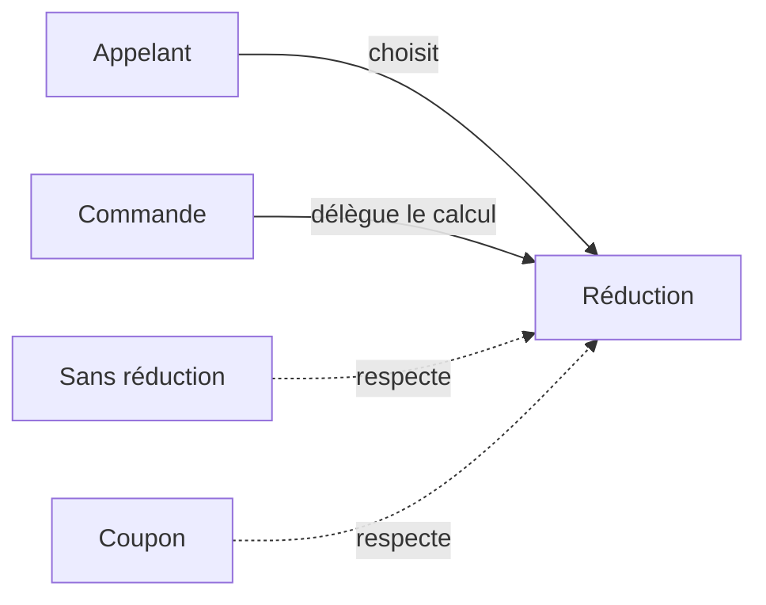

# Strategy, varier une règle

Strategy rend plusieurs algorithmes interchangeables derrière un contrat commun. Le code qui utilise le résultat délègue le calcul à une stratégie. Il peut conserver son organisation lorsque la règle change.

Une commande de restaurant additionne ses articles puis applique une réduction. Le calcul du sous-total reste identique, que la réduction soit absente, proportionnelle ou liée à un coupon. Répéter ces variantes dans le paiement et l'affichage crée plusieurs endroits à synchroniser.

## Les rôles

Le contexte réalise l'opération qui a besoin du calcul. Le contrat définit les entrées et le résultat attendus. Chaque stratégie fournit une variante. Le code d'assemblage choisit laquelle fournir au contexte.



## Une forme fonctionnelle du mécanisme

```ts
type Reduction = (totalCentimes: number) => number;
const sansReduction: Reduction = total => total;
const solidaire: Reduction = total => Math.round(total / 2);
const coupon500: Reduction = total => Math.max(0, total - 500);

function totalCommande(prix: readonly number[], reduction: Reduction): number {
  const sousTotal = prix.reduce((total, montant) => total + montant, 0);
  return reduction(sousTotal);
}

console.log(totalCommande([1500, 501], solidaire)); // 1001
console.log(totalCommande([300], coupon500)); // 0
```

Les prix internes sont des entiers positifs ou nuls, en centimes. Chaque stratégie renvoie un montant dans la même unité. La règle solidaire précise son arrondi, tandis que le coupon évite un montant négatif. Ces promesses font partie du contrat, même si `number` ne les exprime pas.

Le pattern orienté objet emploie généralement des objets partageant une interface. Une fonction suffit à cet exemple sans état propre. Un objet devient utile si une stratégie porte une configuration ou plusieurs opérations cohérentes.

## Ce que le choix change

Les variantes se testent séparément et le contexte ignore leur détail. En contrepartie, la sélection de la stratégie existe toujours quelque part. Si chaque appelant reproduit la même sélection, une [fabrique](/poo-patterns-frameworks/04-factory/) peut la regrouper.

Strategy convient à des règles qui changent séparément ou se réutilisent. Un `if` local lisible peut suffire pour deux cas stables. Extraire chaque branche sans besoin de variation disperse la lecture.

L'injection fournit la règle au contexte. Strategy décrit pourquoi ces règles sont interchangeables. Ces notions se recoupent dans cet exemple, mais ne sont pas synonymes. La [fiche Strategy de Refactoring.Guru](https://refactoring.guru/fr/design-patterns/strategy) présente la structure orientée objet. L'[étude des tarifs](/poo-patterns-frameworks/09-situations/#situation-1-des-tarifs-qui-varient) compare son coût à celui d'une condition.
