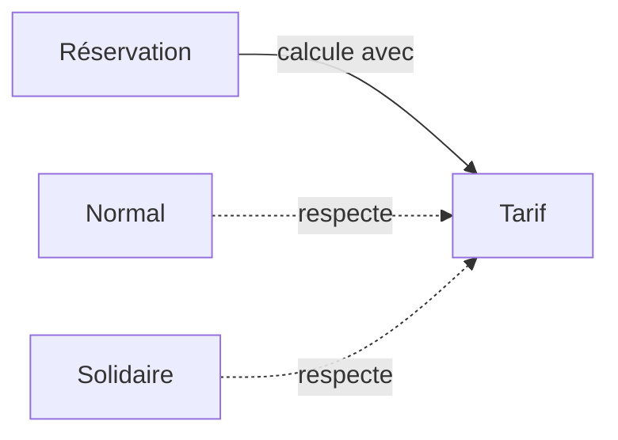

# Strategy, varier une règle

Strategy rend plusieurs algorithmes interchangeables derrière le même contrat. Dans notre application, le problème apparaît quand les tarifs normal et solidaire varient indépendamment des règles de réservation.



## Exemple TypeScript

```ts
type Tarif = (prixCentimes: number) => number;
const normal: Tarif = prix => prix;
const solidaire: Tarif = prix => Math.round(prix * 0.5);
function calculer(prix: number, tarif: Tarif) {
  return tarif(prix);
}
console.log(calculer(2000, solidaire)); // 1000
```

Le code qui appelle `calculer` choisit le tarif. Les règles utilisent les mêmes unités, les centimes. Une fonction suffit ici à représenter une stratégie.

## Compromis et limites

Le calcul varie sans disperser des conditions dans la réservation. En contrepartie, il faut trouver où sélectionner la stratégie et garantir que chaque règle respecte le contrat, notamment l'arrondi.

Ne l'utilise pas pour remplacer mécaniquement un unique `if` lisible. Deux tarifs stables dans une fonction locale peuvent rester ensemble. Strategy devient utile quand les règles changent séparément ou sont réutilisées.

À discuter sur la [situation des tarifs](/poo-patterns-frameworks/09-situations/#situation-1-des-tarifs-qui-varient).
