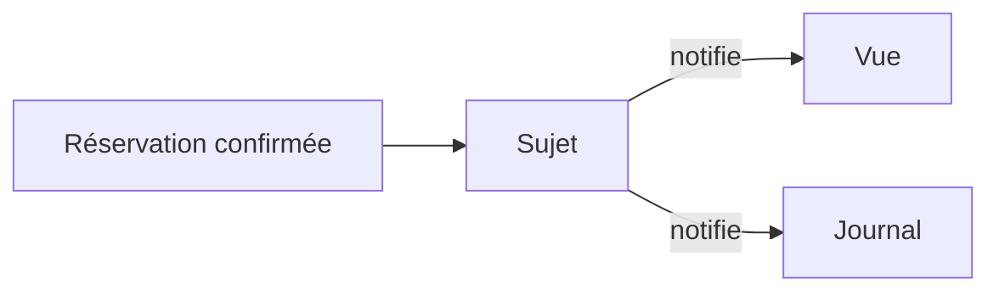

# Observer, prévenir plusieurs abonnés

Observer permet à un sujet de prévenir ses abonnés lorsqu'un événement survient. Le sujet connaît leur contrat, pas leur rôle. Une réservation confirmée peut ainsi intéresser un affichage et un journal d'activité.



## Exemple TypeScript

```ts
type Abonne = (id: number) => void;
const abonnes = new Set<Abonne>();
function abonner(fn: Abonne) {
  abonnes.add(fn);
  return () => { abonnes.delete(fn); };
}
const arreter = abonner(id => console.log(`Confirmée ${id}`));
for (const fn of [...abonnes]) fn(42);
arreter();
```

L'abonnement renvoie une fonction de désabonnement. La copie du tableau d'abonnés fixe les destinataires de cette émission, même si un abonnement change pendant un appel.

## Compromis et limites

L'émetteur accueille de nouvelles réactions sans les appeler par leur nom. Le trajet d'exécution devient moins visible. Dans cet exemple synchrone, un abonné qui lance une erreur interrompt la boucle. Ce comportement doit être décidé, surtout avant des envois externes.

Ne l'utilise pas lorsqu'un seul appel explicite suffit. Observer ne garantit ni livraison, ni reprise après panne, ni absence de doublons. Un événement DOM peut déjà fournir le mécanisme nécessaire. Une vue retirée doit se désabonner.

Prolongement dans la [conception du micro-framework](/poo-patterns-frameworks/08-frameworks/).
