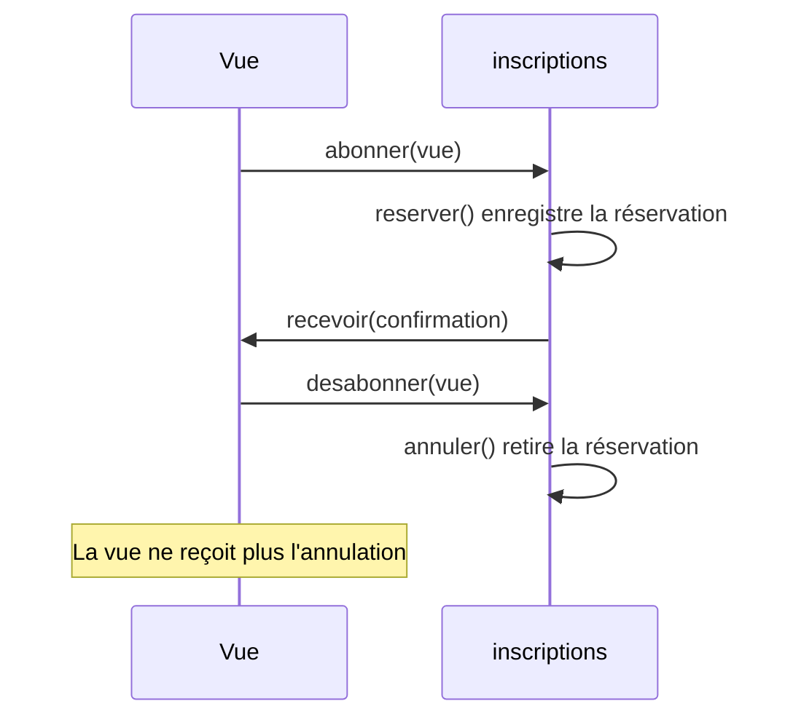

# Faire réagir les vues avec Observer

Après chaque confirmation ou annulation, une vue des places disponibles doit se mettre à jour. Cette vue est la partie de l'interface qui affiche les places restantes. D'autres réactions viendront ensuite, comme l'envoi d'un courriel. Quand l'utilisateur ferme la vue, elle ne doit plus rien recevoir.

Travaillez dans une copie d'[`ateliers.ts`](/ressources/poo-patterns-frameworks/ateliers.ts). Dans cette séance, un petit objet simule la vue, sans interface réelle.

## Le problème

La solution directe appelle chaque réaction dans `reserver`, juste après l'enregistrement, puis fait de même dans `annuler`.

```ts
this.#notifications.push(`Confirmation ${reservation.id} pour ${adresse}`);
this.#vue.actualiser(reservation);
this.#courriel.envoyer(reservation);
```

`Inscriptions` doit alors connaître chaque réaction et la recevoir dans son constructeur. Ajouter une réaction modifie la classe à plusieurs endroits, et une vue fermée n'a aucun moyen de se retirer.

Avec Observer, `Inscriptions` garde une liste d'abonnés, appelés observateurs, et les prévient tous après chaque changement. Elle ne connaît d'eux que leur contrat, et chacun peut s'abonner ou se retirer à tout moment.

## La refacto pas à pas

### Étape 1, le contrat

Ajoutez ce type et cette interface au-dessus de la classe `Inscriptions`. Un **événement** décrit un changement qui a déjà eu lieu, et tout observateur sait le recevoir.

```ts
type Evenement = { type: "confirmation" | "annulation"; reservation: Reservation };

interface Observateur {
	recevoir(evenement: Evenement): void;
}
```

### Étape 2, les classes qui le respectent

La vue devient un observateur. Pour la simulation, elle note le type de chaque changement reçu. Ajoutez-la sous l'interface.

```ts
class VueReservations implements Observateur {
	changements: string[] = [];

	recevoir(evenement: Evenement): void {
		this.changements.push(evenement.type);
	}
}
```

### Étape 3, le code qui utilise le contrat

Dans la classe `Inscriptions`, ajoutez les lignes marquées `+`. `abonner` et `desabonner` gèrent la liste, `#notifier` prévient chaque observateur, et `reserver` comme `annuler` appellent `#notifier` après leur travail.

```diff
 class Inscriptions {
 	// Les champs, le constructeur et les autres méthodes ne changent pas.
+	#observateurs = new Set<Observateur>();
+
+	abonner(observateur: Observateur): void {
+		this.#observateurs.add(observateur);
+	}
+
+	desabonner(observateur: Observateur): void {
+		this.#observateurs.delete(observateur);
+	}
+
+	#notifier(type: Evenement["type"], reservation: Reservation): void {
+		const evenement = { type, reservation: { ...reservation } };
+		for (const observateur of [...this.#observateurs]) {
+			try {
+				observateur.recevoir(evenement);
+			} catch (erreur) {
+				console.error("Réaction en échec :", erreur);
+			}
+		}
+	}
 
 	reserver(atelierId: number, email: string): Reservation {
 		// Les vérifications et l'enregistrement ne changent pas.
 		this.#notifications.push(`Confirmation ${reservation.id} pour ${adresse}`);
+		this.#notifier("confirmation", reservation);
 		return { ...reservation };
 	}
 
 	annuler(reservationId: number): void {
 		// La recherche et le retrait ne changent pas.
 		this.#notifications.push(`Annulation ${reservation.id} pour ${reservation.email}`);
+		this.#notifier("annulation", reservation);
 	}
 }
```

La boucle parcourt une copie de la liste, si bien qu'un désabonnement pendant l'envoi ne la perturbe pas. Le `try` affiche l'erreur d'un observateur sans bloquer les suivants ni annuler la réservation déjà enregistrée.

### Étape 4, le branchement

Le code qui crée la vue l'abonne, puis la retire quand la vue se ferme. Ajoutez ce scénario après les assertions du départ. L'atelier Photo a encore une place à cet endroit.

```ts
const vue = new VueReservations();
inscriptions.abonner(vue);
const mia = inscriptions.reserver(2, "mia@example.test");
assert.deepEqual(vue.changements, ["confirmation"]);

inscriptions.desabonner(vue);
inscriptions.annuler(mia.id);
assert.deepEqual(vue.changements, ["confirmation"]);
assert.equal(inscriptions.notifications.at(-1), `Annulation ${mia.id} pour mia@example.test`);
```

Le diagramme suivant montre l'ordre de ces appels. La vue ne reçoit pas l'annulation, car elle s'est désabonnée avant. Supprimer une vue du HTML ne suffirait pas, puisque `#observateurs` garde une référence vers elle.



## À vous

Ajoutez un observateur `CompteurAnnulations` qui compte les annulations, sans modifier la classe `Inscriptions`. Après une réservation puis son annulation, son compteur doit valoir 1.

## La même idée avec des fonctions

Dans le code web, un observateur est le plus souvent une simple fonction. L'interface devient alors un type de fonction, et `abonner` peut renvoyer la fonction qui retire l'abonnement, ce qui remplace `desabonner`.

```ts
type Observateur = (evenement: Evenement) => void;

class Inscriptions {
	// Les autres membres ne changent pas. La méthode desabonner disparaît.

	abonner(observateur: Observateur): () => void {
		this.#observateurs.add(observateur);
		return () => {
			this.#observateurs.delete(observateur);
		};
	}
}
```

Dans `#notifier`, l'appel devient `observateur(evenement)`. Le code qui s'abonne garde la fonction de retrait qu'il reçoit.

```ts
const changements: string[] = [];
const desabonner = inscriptions.abonner(evenement => changements.push(evenement.type));
const mia = inscriptions.reserver(2, "mia@example.test");
desabonner();
inscriptions.annuler(mia.id);
assert.deepEqual(changements, ["confirmation"]);
```

Les stores de Svelte, la méthode `subscribe` de Redux et le store de [Frameworks 2](/poo-patterns-frameworks/08-2-etat/) suivent cette forme. Le DOM garde l'autre forme, car [`removeEventListener`](https://developer.mozilla.org/fr/docs/Web/API/EventTarget/removeEventListener) doit recevoir la même fonction que `addEventListener`. On peut aussi transmettre un `AbortSignal` à `addEventListener`, puis appeler `abort()` sur son contrôleur.

## Pour réviser

La [fiche Observer](/ressources/poo-patterns-frameworks/fiches/observer.html) résume le pattern sur un schéma, et la [fiche de Refactoring.Guru](https://refactoring.guru/fr/design-patterns/observer) le présente avec d'autres exemples. Le chapitre [Frameworks 5](/poo-patterns-frameworks/08-5-nettoyage/) rattache la durée d'un abonnement à celle de la vue qui l'a créé.
