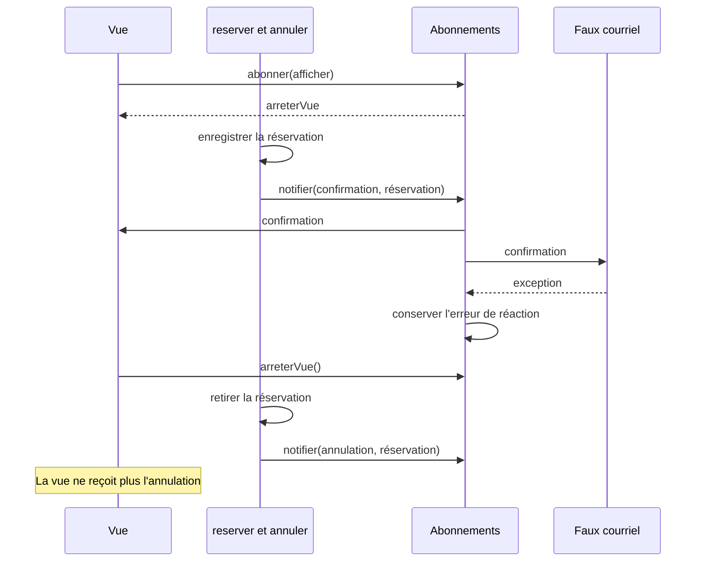

# Faire réagir les vues avec Observer

Une confirmation et une annulation alimentent un journal, un courriel et une vue des places. La vue peut disparaître. Un courriel en échec ne doit pas transformer une réservation enregistrée en réservation refusée.

Dans une copie d'[`ateliers.ts`](/ressources/poo-patterns-frameworks/ateliers.ts), retrouvez les deux `notifications.push`. Ces lignes écrivent des textes dans un tableau. Le programme de départ n'envoie aucun courriel et n'affiche aucune interface.

Notre séance simule les réactions par des fonctions synchrones. Conservez les règles de `reserver`, celles d'`annuler`, et les assertions du départ.

## Commencer par des appels directs

Pour une première solution, appelez vos réactions après `reservations.push` dans `reserver`, puis après `reservations.splice` dans `annuler`. Donnez à chaque réaction le type de changement et une copie de la réservation concernée.

Gardez l'échec du faux courriel dans une liste séparée. Un `try` autour de cet appel permet d'enregistrer son erreur, puis de poursuivre la mise à jour de la vue. Un `try` autour de toute la réservation brouillerait les deux résultats.

Avec trois destinataires stables, ces appels directs sont une solution recevable. Nous allons maintenant comparer un mécanisme qui permet à une vue de s'inscrire puis de se retirer.

## Lire les abonnements avec nos fonctions

Lisez « Solution » et « Structure » dans la [présentation d'Observer de Refactoring.Guru](https://refactoring.guru/fr/design-patterns/observer). Dans [Observer sur Patterns.dev](https://www.patterns.dev/vanilla/observer-pattern/), suivez l'ajout d'un abonné, la notification et le retrait.

1. Quel code décide qu'une réservation vient de changer ?
2. Qui conserve les fonctions à prévenir ?
3. Qui sait à quel moment une vue n'existe plus ?

Dans notre variante, `reserver` et `annuler` déclenchent les événements. `abonner`, `notifier` et `abonnes` forment le mécanisme du sujet observé. Le type `Abonne` est le contrat commun des réactions. Le journal, le faux courriel et la vue jouent les observateurs concrets de la source.

## Ajouter une inscription et son retrait

Ajoutez ce mécanisme avant `reserver`. Un **événement** décrit un changement qui a déjà eu lieu. Il ne demande pas de refaire la réservation.

```ts
type Evenement = Readonly<{
	type: "confirmation" | "annulation";
	reservation: Readonly<Reservation>;
}>;
type Abonne = (evenement: Evenement) => void;
const abonnes = new Set<Abonne>();
const erreursNotifications: { reservationId: number; erreur: unknown }[] = [];

function abonner(fn: Abonne): () => void {
	abonnes.add(fn);
	return () => { abonnes.delete(fn); };
}

function notifier(type: Evenement["type"], reservation: Reservation): void {
	const evenement: Evenement = Object.freeze({
		type,
		reservation: Object.freeze({ ...reservation }),
	});
	for (const fn of [...abonnes]) {
		try {
			fn(evenement);
		} catch (erreur) {
			erreursNotifications.push({ reservationId: reservation.id, erreur });
		}
	}
}

abonner(evenement => {
	const reservation = evenement.reservation;
	const libelle = evenement.type === "confirmation" ? "Confirmation" : "Annulation";
	notifications.push(`${libelle} ${reservation.id} pour ${reservation.email}`);
});
```

La copie des abonnés fixe les destinataires de l'émission en cours. Une fonction retirée pendant cette émission peut encore la recevoir. La copie figée de `reservation` protège ses champs, tous primitifs dans ce programme.

Remplacez le `notifications.push` de `reserver` par `notifier("confirmation", reservation)`. Remplacez celui d'`annuler` par `notifier("annulation", reservation)`. Gardez ces appels après les modifications du tableau. L'abonné journal reproduit les textes d'origine, donc les assertions initiales restent valides.

## La durée d'un abonnement



Ajoutez ces contrôles après les assertions du programme de départ. L'atelier Photo est encore libre à cet endroit.

```ts
const changementsVue: string[] = [];
const arreterVue = abonner(evenement => {
	changementsVue.push(evenement.type);
});
const arreterCourriel = abonner(evenement => {
	if (evenement.type === "confirmation") throw new Error("Courriel indisponible");
});
const mia = reserver(2, "mia@example.test");
assert.ok(reservations.some(r => r.id === mia.id));
assert.equal(erreursNotifications.length, 1);
assert.deepEqual(changementsVue, ["confirmation"]);

arreterVue();
annuler(mia.id);
assert.deepEqual(changementsVue, ["confirmation"]);
assert.equal(erreursNotifications.length, 1);
assert.equal(notifications.at(-1), `Annulation ${mia.id} pour mia@example.test`);
arreterCourriel();
```

La fonction renvoyée par `abonner` est le **désabonnement**. L'écran qui crée une vue garde cette fonction et l'appelle quand il retire la vue. Supprimer du HTML ne supprime pas la référence conservée dans `abonnes`. Le DOM possède déjà ses abonnements avec [`addEventListener`](https://developer.mozilla.org/fr/docs/Web/API/EventTarget/addEventListener).

Pour voir les deux réactions, réservez puis annulez avant `arreterVue`. La vue doit alors recevoir `confirmation`, puis `annulation`. Vérifiez aussi qu'un refus de `reserver` ne produit aucun événement.

## Séparer le succès de la réservation et celui du courriel

Le faux courriel lance une exception synchrone. `notifier` conserve cette erreur, poursuit les autres réactions, puis `reserver` renvoie la réservation. L'appelant peut donc constater une réservation confirmée et une réaction en échec.

## Comparer au retour attendu

Votre solution convient si les confirmations et les annulations atteignent les réactions actives, si le retrait d'une vue coupe les émissions suivantes, et si une erreur de courriel laisse la réservation enregistrée. Une solution avec appels directs et une fonction de nettoyage peut aussi répondre au besoin. Justifiez le coût des abonnements dans la [situation des réactions multiples](/poo-patterns-frameworks/09-situations/#situation-3-plusieurs-reactions-puis-une-interface).

La [séance sur les frameworks](/poo-patterns-frameworks/08-frameworks/) rattache la durée d'abonnement à celle d'une vue.
