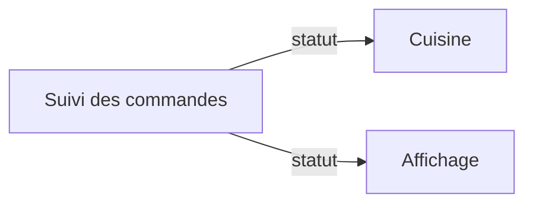
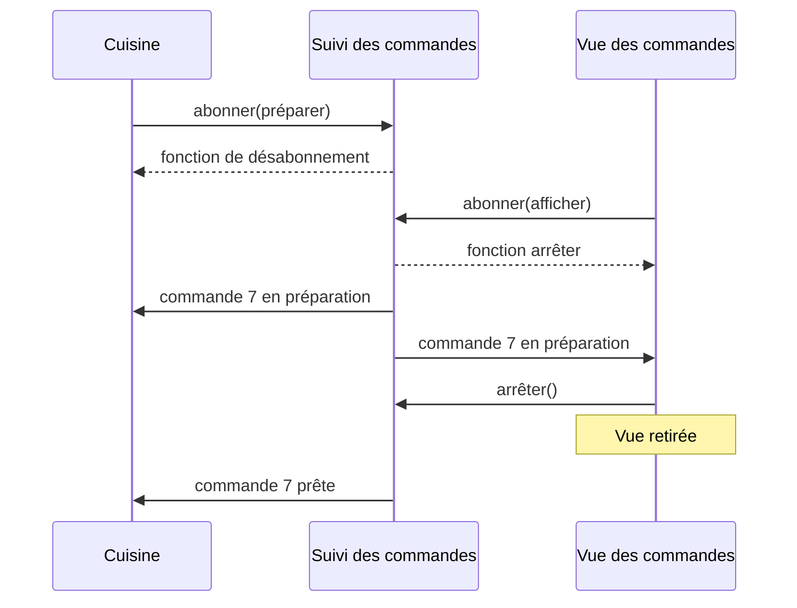

# Observer, prévenir plusieurs abonnés

Observer établit une relation entre un sujet et des abonnés. Quand un changement survient, le sujet prévient les abonnés par un contrat commun. Il n'a pas besoin de connaître le rôle de chacun.

Une commande change de statut. La cuisine, le tableau d'affichage et l'imprimante peuvent réagir différemment à cette information. Dans un autre domaine, une météo peut prévenir plusieurs créatures, chacune choisissant ensuite son comportement.

## Du sujet aux réactions

Le sujet gère les inscriptions et émet la notification. Les abonnés traitent l'information reçue. L'abonnement possède une durée de vie, par exemple celle d'un écran ouvert.



## Une forme fonctionnelle du mécanisme

```ts
type Changement = Readonly<{ id: number; statut: "en préparation" | "prête" }>;
type Abonne = (changement: Changement) => void;
const abonnes = new Set<Abonne>();

function abonner(fn: Abonne): () => void {
  abonnes.add(fn);
  return () => { abonnes.delete(fn); };
}

function notifier(changement: Changement): void {
  const instantane = Object.freeze({ ...changement });
  for (const fn of [...abonnes]) fn(instantane);
}

const arreter = abonner(c => console.log(`Commande ${c.id} ${c.statut}`));
notifier({ id: 7, statut: "prête" }); // Commande 7 prête
arreter();
notifier({ id: 7, statut: "en préparation" }); // Aucun affichage
```

Les fonctions jouent le rôle des objets observateurs du pattern orienté objet. La copie des abonnés fixe les destinataires de cette émission. Un abonnement retiré pendant un appel peut donc encore recevoir la notification en cours. La copie figée du changement protège ici ses champs, tous de type primitif.

## La durée d'un abonnement



Le sujet conserve des références vers les abonnés. Retirer une vue du DOM ne retire pas son abonnement. Son nettoyage doit donc appeler la fonction renvoyée par `abonner`. Le DOM propose déjà des abonnements avec [`addEventListener`](https://developer.mozilla.org/fr/docs/Web/API/EventTarget/addEventListener).

## Les décisions à rendre explicites

Le sujet accueille de nouvelles réactions sans les nommer dans son code. Le trajet d'exécution devient cependant moins visible qu'une suite d'appels directs.

L'exemple est synchrone. Un abonné qui lance une erreur interrompt les suivants. Un envoi de courriel demande de décider si l'erreur bloque les autres réactions et comment signaler un échec après une sauvegarde réussie. Observer ne fournit ni reprise, ni livraison garantie, ni détection des doublons.

Pour un seul destinataire connu, un appel direct reste souvent plus lisible. Observer n'implique pas un WebSocket.

## Observer et publication avec abonnement

Avec Observer, l'abonnement concerne un sujet qui conserve ses observateurs. Dans un système de publication avec abonnement, les émetteurs et les destinataires passent par un intermédiaire, souvent un bus. Celui-ci peut distribuer les messages par sujet nommé. Cette séparation ajoute des choix de routage et de traitement des erreurs. Un bus en mémoire ne garantit pas davantage la livraison qu'un Observer local.

La [présentation de Patterns.dev](https://www.patterns.dev/vanilla/observer-pattern/) compare ces organisations et détaille le nettoyage des abonnements.

La [présentation d'Observer](https://refactoring.guru/fr/design-patterns/observer) décrit sa structure orientée objet. Le [cycle d'une interface](/poo-patterns-frameworks/08-frameworks/) montre où placer l'abonnement et son retrait.
