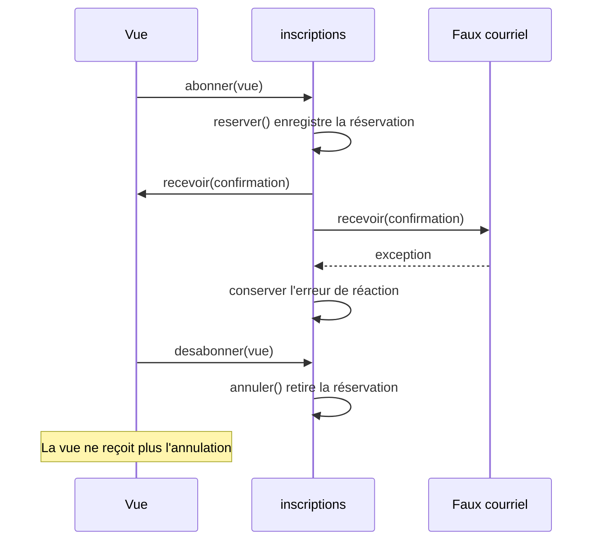

# Faire réagir les vues avec Observer

Après une confirmation ou une annulation, on souhaite écrire dans un journal, envoyer un courriel et actualiser une vue des places disponibles. Cette vue est la partie de l'interface qui affiche les places restantes. Si l'utilisateur la ferme, elle ne doit plus recevoir les changements suivants. Il faut aussi distinguer l'enregistrement de la réservation des réactions qui le suivent. Un courriel en échec ne doit pas transformer une réservation enregistrée en réservation refusée.

Dans une copie d'[`ateliers.ts`](/ressources/poo-patterns-frameworks/ateliers.ts), retrouvez les deux `this.#notifications.push` de la classe `Inscriptions`. Ces lignes écrivent des textes dans un tableau privé, le journal que vérifient les assertions. Le programme de départ n'envoie aucun courriel et n'affiche aucune interface.

Dans cette séance, des objets simulent les réactions de la vue et du courriel. Leurs méthodes s'exécutent de façon synchrone, c'est-à-dire immédiatement, avant le retour de la méthode qui les appelle. Conservez les règles de `reserver`, celles d'`annuler`, le journal et les assertions du départ.

## Commencer par des appels directs

Pour une première solution, appelez vos réactions après `this.#notifications.push` dans `reserver`, puis dans `annuler`. Donnez à chaque réaction le type de changement et une copie de la réservation concernée.

Conservez les erreurs du faux courriel dans une liste séparée. Un `try` autour de cet appel permet d'enregistrer son erreur, puis de poursuivre la mise à jour de la vue. Un `try` autour de toute la réservation ne permettrait plus de distinguer clairement une demande refusée d'une réservation enregistrée dont le courriel a échoué.

Avec Observer, une vue peut s'inscrire puis se retirer. Un objet conserve la liste des abonnés, appelés observateurs, et les prévient lorsqu'un changement a lieu.

## Le mécanisme d’abonnement

Les présentations d'Observer sur [Refactoring.Guru](https://refactoring.guru/fr/design-patterns/observer) et [Patterns.dev](https://www.patterns.dev/vanilla/observer-pattern/) détaillent l'abonnement, la notification et le retrait.

Dans notre variante, la classe `Inscriptions` est le sujet observé, c'est-à-dire l'objet dont les changements intéressent les abonnés. Ses méthodes `reserver` et `annuler` déclenchent les événements, tandis que `abonner`, `desabonner`, `#notifier` et le champ `#observateurs` forment le mécanisme d'abonnement. L'interface `Observateur` est le contrat commun des réactions. La vue et le faux courriel sont les observateurs concrets de la source. Le journal `#notifications` reste un appel direct, car il appartient à la classe et sert aux assertions du départ.

## Ajouter une inscription et son retrait

Ajoutez le type et l'interface avant la classe `Inscriptions`. Un **événement** décrit un changement qui a déjà eu lieu. Il ne demande pas de refaire la réservation.

```ts
type Evenement = Readonly<{
	type: "confirmation" | "annulation";
	reservation: Readonly<Reservation>;
}>;

interface Observateur {
	recevoir(evenement: Evenement): void;
}
```

Ajoutez ensuite ces membres dans la classe `Inscriptions`. `#notifier` commence par `#`, comme les champs privés, si bien que seul le code de la classe peut l'appeler.

```ts
class Inscriptions {
	// Les champs, le constructeur et les méthodes du départ ne changent pas.

	#observateurs = new Set<Observateur>();
	#erreursNotifications: { reservationId: number; erreur: unknown }[] = [];

	get erreursNotifications() {
		return [...this.#erreursNotifications];
	}

	abonner(observateur: Observateur): void {
		this.#observateurs.add(observateur);
	}

	desabonner(observateur: Observateur): void {
		this.#observateurs.delete(observateur);
	}

	#notifier(type: Evenement["type"], reservation: Reservation): void {
		const evenement: Evenement = Object.freeze({
			type,
			reservation: Object.freeze({ ...reservation }),
		});
		for (const observateur of [...this.#observateurs]) {
			try {
				observateur.recevoir(evenement);
			} catch (erreur) {
				this.#erreursNotifications.push({ reservationId: reservation.id, erreur });
			}
		}
	}
}
```

La boucle parcourt une copie de la liste des observateurs pour fixer les destinataires de la notification en cours. Un observateur retiré pendant ce parcours peut donc encore recevoir cette notification, mais il ne recevra pas les suivantes. L'événement contient aussi une copie figée de `reservation`. Ses champs sont tous des valeurs primitives dans ce programme, comme des nombres ou des chaînes, et un observateur ne peut pas les modifier.

Dans `reserver`, ajoutez `this.#notifier("confirmation", reservation)` juste après `this.#notifications.push`. Dans `annuler`, ajoutez `this.#notifier("annulation", reservation)` au même endroit. Ces appels restent après les modifications du tableau des réservations. Le journal garde ses textes d'origine, donc les assertions initiales restent valides.

## La durée d'un abonnement

Le diagramme suivant montre l'ordre des appels. La réservation est enregistrée avant les réactions, et la vue ne reçoit plus de changement après son désabonnement.



Ajoutez ces contrôles après les assertions du programme de départ. L'atelier Photo est encore libre à cet endroit. Les deux classes d'observateurs simulent une vue qui note les changements et un courriel qui échoue à chaque confirmation.

```ts
class VueReservations implements Observateur {
	changements: string[] = [];

	recevoir(evenement: Evenement): void {
		this.changements.push(evenement.type);
	}
}

class CourrielEnPanne implements Observateur {
	recevoir(evenement: Evenement): void {
		if (evenement.type === "confirmation") throw new Error("Courriel indisponible");
	}
}

const vue = new VueReservations();
const courriel = new CourrielEnPanne();
inscriptions.abonner(vue);
inscriptions.abonner(courriel);
const mia = inscriptions.reserver(2, "mia@example.test");
assert.ok(inscriptions.reservations.some(r => r.id === mia.id));
assert.equal(inscriptions.erreursNotifications.length, 1);
assert.deepEqual(vue.changements, ["confirmation"]);

inscriptions.desabonner(vue);
inscriptions.annuler(mia.id);
assert.deepEqual(vue.changements, ["confirmation"]);
assert.equal(inscriptions.erreursNotifications.length, 1);
assert.equal(inscriptions.notifications.at(-1), `Annulation ${mia.id} pour mia@example.test`);
inscriptions.desabonner(courriel);
```

La méthode `desabonner` réalise le **désabonnement**. L'écran qui crée une vue garde une référence vers son observateur et appelle `desabonner` quand il retire la vue. Supprimer du HTML ne supprime pas la référence conservée dans `#observateurs`. Le DOM suit le même principe avec [`addEventListener`](https://developer.mozilla.org/fr/docs/Web/API/EventTarget/addEventListener) et `removeEventListener`.

Pour un second essai, repartez du scénario avant la réservation, puis réservez et annulez avant `inscriptions.desabonner(vue)`. Dans cette variante, la vue doit recevoir `confirmation`, puis `annulation`. Adaptez donc l'assertion qui vérifie les changements reçus. Vérifiez aussi qu'un refus de `reserver` ne produit aucun événement.

## Séparer le succès de la réservation et celui du courriel

Le faux courriel lance son exception pendant l'appel, sans attendre une opération asynchrone. Comme `#notifier` conserve cette erreur et poursuit les autres réactions, `reserver` peut ensuite renvoyer la réservation. L'appelant constate ainsi deux résultats distincts, une réservation confirmée et une réaction en échec.

Le [chapitre Frameworks 5](/poo-patterns-frameworks/08-5-nettoyage/) rattache la durée d'un abonnement à celle de la vue qui l'a créé.

## La même idée avec des fonctions

Dans le code web, un observateur est le plus souvent une simple fonction. L'interface `Observateur` devient alors un type de fonction. `abonner` peut aussi renvoyer la fonction qui retire l'abonnement, ce qui rend la méthode `desabonner` inutile. Dans une copie de votre solution, remplacez l'interface et ces deux méthodes.

```ts
type Observateur = (evenement: Evenement) => void;

class Inscriptions {
	// Les autres membres ne changent pas. La méthode desabonner disparaît.

	abonner(observateur: Observateur): () => void {
		this.#observateurs.add(observateur);
		return () => {
			this.#observateurs.delete(observateur);
		};
	}
}
```

Dans `#notifier`, l'appel `observateur.recevoir(evenement)` devient `observateur(evenement)`. Une vue peut ensuite s'abonner avec une fonction fléchée et conserver la fonction de retrait qu'elle reçoit.

```ts
const changements: string[] = [];
const desabonner = inscriptions.abonner(evenement => changements.push(evenement.type));
const mia = inscriptions.reserver(2, "mia@example.test");
desabonner();
inscriptions.annuler(mia.id);
assert.deepEqual(changements, ["confirmation"]);
```

Le code qui crée l'abonnement reçoit ainsi de quoi l'arrêter, sans garder lui-même une référence vers l'observateur. Les stores de Svelte, la méthode `subscribe` de Redux et le store du chapitre [Frameworks 2](/poo-patterns-frameworks/08-2-etat/) suivent cette forme. Le DOM utilise l'autre forme, car `removeEventListener` doit recevoir la même fonction que celle passée à `addEventListener`. On peut aussi transmettre un `AbortSignal` dans les options de `addEventListener`, puis retirer l'écouteur en appelant `abort()` sur son contrôleur.
