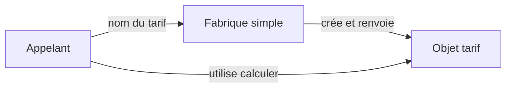

# Factory, centraliser la création

Une fabrique regroupe la création d'objets ou de comportements. Les appelants demandent un résultat sans reproduire les choix nécessaires à sa construction. Le terme *factory* recouvre plusieurs organisations qu'il faut distinguer.

Un formulaire et un import de réservations doivent sélectionner les mêmes tarifs. Si chacun construit ses propres variantes, une nouvelle règle demande plusieurs modifications. Une fabrique simple peut regrouper cette sélection.

## Trois sens à distinguer

Une fabrique simple est une fonction ou un objet qui crée le résultat demandé. Elle utilise souvent une condition ou une table de correspondance. Ce nom ne désigne pas un pattern du catalogue GoF.

Dans [Factory Method](https://refactoring.guru/fr/design-patterns/factory-method), une classe déclare une méthode de création que des sous-classes peuvent redéfinir. Les autres opérations de cette classe utilisent le produit par son contrat.

[Abstract Factory](https://refactoring.guru/fr/design-patterns/abstract-factory) fournit un contrat pour créer une famille de produits compatibles. Par exemple, une famille de composants graphiques peut regrouper boutons et champs de formulaire. Une famille différente fournit les mêmes rôles avec une autre réalisation.

Ces patterns résolvent des problèmes de création différents. Ajouter une méthode nommée `create` ne suffit pas à reconnaître Factory Method.



## Exemple de fabrique simple

```ts
interface Tarif {
  calculer(prixCentimes: number): number;
}
function creerTarif(nom: "normal" | "solidaire"): Tarif {
  if (nom === "solidaire") {
    return { calculer: prix => Math.round(prix / 2) };
  }
  return { calculer: prix => prix };
}

const tarif = creerTarif("solidaire");
console.log(tarif.calculer(2001)); // 1001
```

La fabrique choisit et crée l'objet. [Strategy](/poo-patterns-frameworks/02-strategy/) explique ensuite pourquoi plusieurs règles peuvent remplacer ce tarif. Une chaîne reçue d'un formulaire doit être validée avant de devenir le type union accepté ici.

## Coût et pertinence

La création possède un endroit identifié et les appelants ignorent ses détails. La fabrique doit néanmoins connaître les variantes qu'elle construit. Elle change quand de nouveaux choix apparaissent et peut accumuler trop de responsabilités.

Une construction évidente utilisée à un seul endroit ne justifie pas une fabrique. Factory Method engage une hiérarchie de classes. Abstract Factory engage une famille de contrats. Le besoin de sélectionner deux fonctions n'impose ni l'un ni l'autre.

Le [comparatif des fabriques de Refactoring.Guru](https://refactoring.guru/fr/design-patterns/factory-comparison) précise ces différences de vocabulaire et de structure.
