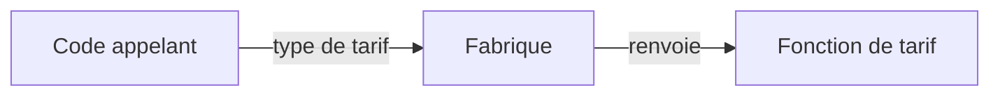

# Factory, centraliser la création

Une fabrique regroupe la création d'objets ou de comportements. Le problème apparaît quand plusieurs écrans doivent choisir et assembler les mêmes règles de tarif.

Nous utilisons ici une **fabrique simple**. Ce n'est pas le pattern GoF Factory Method, qui fait varier une méthode de création par héritage dans des sous-classes.



## Exemple TypeScript

```ts
type Tarif = (prix: number) => number;
function creerTarif(type: "normal" | "solidaire"): Tarif {
  if (type === "solidaire") return prix => Math.round(prix / 2);
  return prix => prix;
}
const tarif = creerTarif("solidaire");
console.log(tarif(2000)); // 1000
```

La fabrique choisit le comportement. [Strategy](/poo-patterns-frameworks/02-strategy/) décrit son interchangeabilité une fois choisi. Ces deux idées peuvent coexister, sans imposer de classes.

## Compromis et limites

La sélection est regroupée et les appelants ignorent les détails de création. La fabrique devient cependant un endroit à modifier quand les variantes changent. Elle peut grossir et masquer des dépendances.

Ne l'utilise pas pour envelopper chaque `new` ou chaque objet littéral. Si un seul endroit crée un objet évident, une fonction de création supplémentaire n'apporte pas nécessairement de clarté. La donnée venant d'un formulaire doit être validée avant de devenir le type union utilisé ici.
