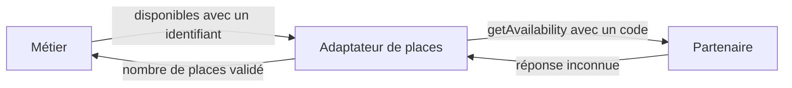

# Adapter, traduire un contrat externe

Adapter permet d'utiliser un service existant à travers le contrat attendu par son client. L'adaptateur expose ce contrat et délègue le travail au service en traduisant les appels et les résultats nécessaires.

Le métier demande les places disponibles pour un identifiant numérique. Un partenaire attend un code textuel et renvoie `remaining_seats`. Si les écrans utilisent directement cette API, ils apprennent son vocabulaire et ses formats.

## Le contrat attendu et le service adapté

Le client connaît le contrat métier `Places`. Le service partenaire possède son propre contrat. L'adaptateur connaît les deux et réalise leur correspondance. Le renommer `Service` ne supprimerait pas cette dépendance au fournisseur.



## Exemple TypeScript sans réseau

```ts
interface Places {
  disponibles(atelierId: number): Promise<number>;
}
interface Partenaire {
  getAvailability(code: string): Promise<unknown>;
}
function adapterPlaces(api: Partenaire): Places {
  return {
    async disponibles(id) {
      const data = await api.getAvailability(`atelier-${id}`);
      if (typeof data !== "object" || data === null ||
          !("remaining_seats" in data)) throw new Error("Format invalide");
      const places = data.remaining_seats;
      if (typeof places !== "number" || !Number.isSafeInteger(places) || places < 0)
        throw new Error("Places invalides");
      return places;
    }
  };
}
const partenaire: Partenaire = {
  async getAvailability() { return { remaining_seats: 3 }; }
};
adapterPlaces(partenaire).disponibles(7).then(console.log); // 3
```

L'objet renvoyé adapte une interface de service. La lecture de `remaining_seats`, prise seule, serait une conversion de données. L'exemple simplifie l'Adapter orienté objet en créant un objet littéral plutôt qu'une classe dédiée.

La correspondance `7` vers `atelier-7` est une convention de ce partenaire fictif. Le résultat commence en `unknown` parce que l'annotation TypeScript ne valide pas une réponse externe. Les erreurs du service restent des erreurs, elles ne deviennent pas zéro place.

## Ce que la frontière protège

Le métier peut recevoir une autre implémentation de `Places` sans changer ses appels. Seul l'assemblage doit connaître le partenaire effectivement utilisé.

Les clients utilisent le vocabulaire métier et le fournisseur peut évoluer derrière l'adaptateur. Cette traduction coûte du code et peut perdre des informations. Deux services peuvent aussi donner des sens différents au mot « disponible ».

Si les contrats correspondent déjà, un appel direct suffit. Adapter ne rend pas une réservation atomique et ne résout pas les délais réseau. Les garanties du fournisseur doivent rester explicites, comme dans la [deuxième étude de cas](/poo-patterns-frameworks/09-situations/#situation-2-une-api-externe-et-un-enregistrement-qui-echoue).

La [fiche Adapter](https://refactoring.guru/fr/design-patterns/adapter) présente les variantes orientées objet de cette adaptation.
