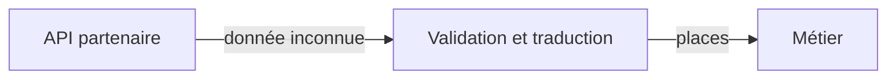

# Adapter, traduire un contrat externe

Adapter traduit une interface existante vers celle attendue par son utilisateur. Notre métier manipule des places disponibles, tandis qu'une API partenaire renvoie `remaining_seats`. Répéter cette traduction dans les écrans les lie au fournisseur.



## Exemple TypeScript

```ts
function lirePlaces(data: unknown): number {
  if (typeof data !== "object" || data === null ||
      !("remaining_seats" in data)) throw new Error("Format invalide");
  const places = data.remaining_seats;
  if (typeof places !== "number" || !Number.isInteger(places) || places < 0)
    throw new Error("Places invalides");
  return places;
}
console.log(lirePlaces({ remaining_seats: 3 })); // 3
```

La validation protège la frontière externe. Une annotation TypeScript seule n'aurait pas vérifié le JSON réellement reçu.

## Compromis et limites

Le fournisseur peut changer sans modifier tous ses utilisateurs. L'adaptateur coûte du code à maintenir et peut perdre une information si les deux modèles ne correspondent pas.

Ne l'utilise pas quand les interfaces correspondent déjà. Une simple traduction de nom reste une simple fonction. Adapter ne résout pas une panne réseau, un délai dépassé ou une réservation concurrente. Ces situations exigent une décision explicite dans la [deuxième situation](/poo-patterns-frameworks/09-situations/).
