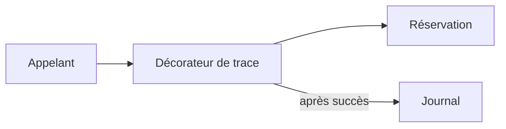

# Decorator, enrichir un comportement

Decorator enveloppe un objet ou une fonction pour ajouter un comportement en conservant son contrat. Le problème apparaît lorsqu'on veut journaliser plusieurs opérations de réservation sans recopier leur logique métier.



## Exemple TypeScript

```ts
type Reserver = (atelierId: number) => string;
function avecTrace(reserver: Reserver): Reserver {
  return id => {
    const resultat = reserver(id);
    console.log(`Atelier réservé ${id}`);
    return resultat;
  };
}
const reserver = avecTrace(id => `reservation-${id}`);
console.log(reserver(7)); // trace, puis reservation-7
```

Si l'opération échoue, la trace de succès n'est pas écrite. Cet exemple utilise une opération synchrone. Pour une promesse, il faut attendre sa résolution avant la trace.

## Compromis et limites

Plusieurs comportements peuvent s'assembler sans multiplier les sous-classes. Leur ordre compte. Empiler des enveloppes rend le trajet d'une erreur plus difficile à suivre. Une trace qui échoue après une réservation réussie ne doit pas laisser croire que rien n'a été enregistré.

Ne l'utilise pas pour ajouter une seule ligne lisible à un seul endroit. Préférer un appel direct si l'enveloppe cache plus qu'elle n'explique. Ce pattern est distinct des décorateurs TypeScript écrits avec `@`, qui sont une fonctionnalité du langage.
