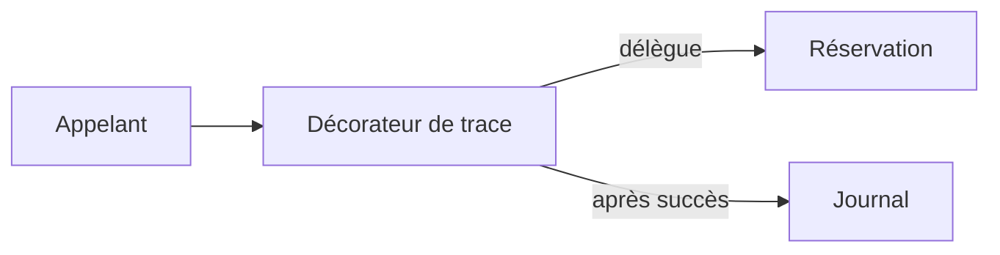
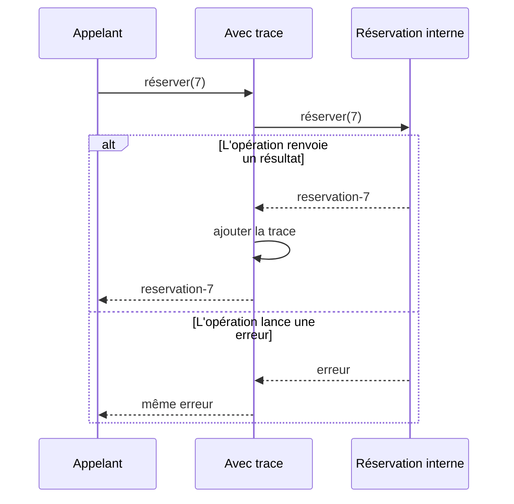

# Decorator, enrichir un comportement

Decorator ajoute un comportement autour d'une opération en conservant son contrat. Le client appelle l'enveloppe comme il appellerait l'opération d'origine. L'enveloppe délègue le travail et intervient avant, après ou autour de cet appel.

Une application veut tracer plusieurs opérations de réservation. Recopier une trace dans chacune disperse cette règle. Créer des sous-classes pour chaque combinaison de fonctionnalités multiplie les variantes. Une enveloppe permet de composer les comportements au moment de l'assemblage.

## L'appelant, l'enveloppe et l'opération

Le composant définit le contrat commun. Le composant concret réalise le travail. Le décorateur garde une référence vers un composant et respecte le même contrat. Il peut donc, à son tour, être enveloppé.



## Une forme fonctionnelle du mécanisme

```ts
type Reserver = (atelierId: number) => string;
const traces: string[] = [];

function avecTrace(reserver: Reserver): Reserver {
  return id => {
    const resultat = reserver(id);
    traces.push(`Atelier réservé ${id}`);
    return resultat;
  };
}

const reserver = avecTrace(id => `reservation-${id}`);
console.log(reserver(7)); // reservation-7
console.log(traces); // ["Atelier réservé 7"]
```

L'exemple compose des fonctions plutôt que les objets de la structure GoF. L'opération interne est simulée, elle ne sauvegarde aucune réservation. Si elle lance une erreur, la trace de succès n'est pas ajoutée. Pour une opération asynchrone, l'enveloppe doit attendre la résolution de la promesse avant d'annoncer ce succès.



## Ordre, erreurs et contrat

L'ordre des enveloppes change le comportement. Une mesure de durée placée autour d'une nouvelle tentative mesure toutes les tentatives. Placée à l'intérieur, elle mesure chaque tentative séparément.

Préserver la signature ne suffit pas à préserver les garanties. Si un journal distant échoue après une réservation enregistrée, propager cette erreur peut laisser croire que la réservation a échoué. Le traitement de cette panne doit être décidé selon le rôle de la trace.

Decorator convient à des comportements réutilisés et composables. Pour une seule ligne à un seul endroit, un appel direct peut être plus clair. Des enveloppes imbriquées augmentent le travail nécessaire pour suivre une erreur.

Le pattern se distingue des décorateurs TypeScript avec `@`, qui sont une fonctionnalité du langage. Il se distingue aussi d'[Adapter](/poo-patterns-frameworks/05-adapter/), qui expose un contrat différent. La [fiche Decorator](https://refactoring.guru/fr/design-patterns/decorator) décrit sa structure orientée objet.
