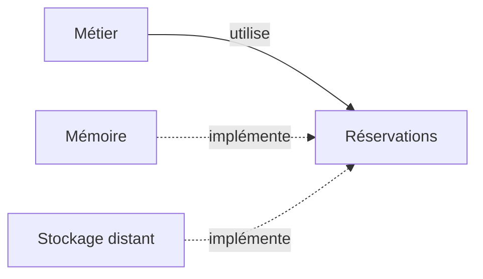

# Repository, isoler la persistance

Repository donne au métier un contrat pour retrouver et enregistrer ses objets, sans exposer les détails du stockage. Le problème apparaît lorsque les règles de réservation dépendent directement de requêtes propres à une base ou à un service.



## Exemple TypeScript

```ts
type Reservation = { id: string; atelierId: number };
interface Reservations {
  enregistrer(r: Reservation): Promise<void>;
  trouver(id: string): Promise<Reservation | undefined>;
}
const donnees = new Map<string, Reservation>();
const memoire: Reservations = {
  async enregistrer(r) { donnees.set(r.id, { ...r }); },
  async trouver(id) {
    const r = donnees.get(id);
    return r ? { ...r } : undefined;
  }
};
```

Les copies empêchent un appelant de modifier l'enregistrement sans passer par le contrat. Les promesses rendent l'exemple compatible avec une implémentation asynchrone.

## Compromis et limites

Le métier peut être exercé en mémoire. Il faut néanmoins maintenir un contrat qui exprime les besoins réels, y compris les échecs. Deux implémentations avec les mêmes méthodes peuvent offrir des garanties différentes.

Ne l'ajoute pas devant chaque tableau ou chaque API. Le Repository ne garantit pas à lui seul une transaction, l'unicité ou le respect d'une capacité entre plusieurs utilisateurs. Ces garanties doivent être définies et appliquées au niveau qui peut les assurer. Un [Adapter](/poo-patterns-frameworks/05-adapter/) peut traduire un fournisseur à l'intérieur d'une implémentation.
