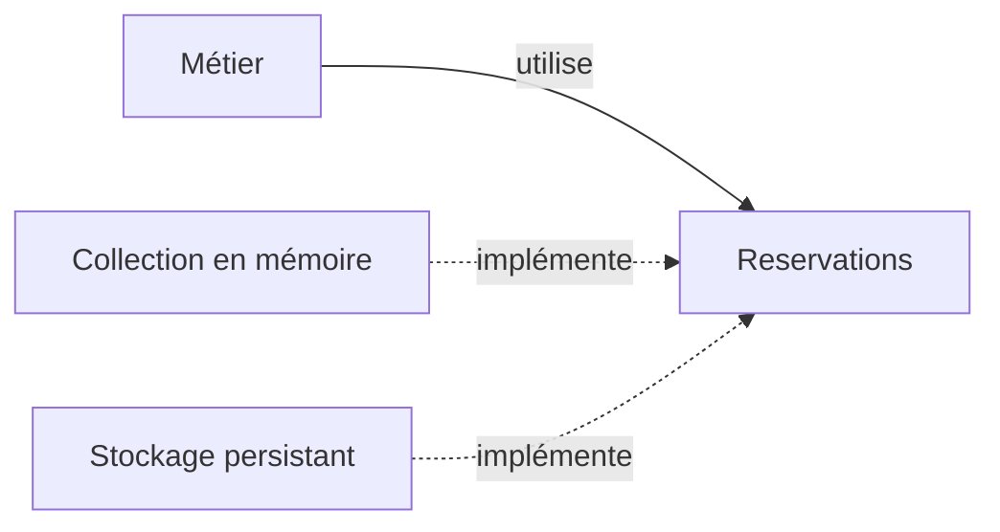

# Repository, isoler la persistance

Repository représente une collection d'objets métier persistants. Le métier peut y rechercher et y ajouter des objets sans connaître les requêtes ou le format de stockage. Ce pattern appartient au catalogue d'architecture d'entreprise de Martin Fowler, pas aux 23 patterns GoF.

Une réservation possède une identité, un atelier et un montant enregistré. Ses règles ne devraient pas nécessiter de connaître le nom d'une table ou les paramètres du SDK d'un fournisseur. Le Repository exprime les opérations de collection dont ces règles ont besoin.

## Un contrat adapté au métier

Le métier utilise le contrat `Reservations`. Une implémentation traduit ces opérations vers le stockage. Le code d'assemblage fournit cette implémentation. Une collection en mémoire permet d'observer le mécanisme sans base de données.



## Exemple TypeScript

```ts
type Reservation = { id: string; atelierId: number; montantCentimes: number };
interface Reservations {
  ajouter(reservation: Reservation): Promise<void>;
  trouver(id: string): Promise<Reservation | undefined>;
}
const donnees = new Map<string, Reservation>();
const memoire: Reservations = {
  async ajouter(reservation) {
    if (donnees.has(reservation.id)) throw new Error("Identifiant déjà présent");
    donnees.set(reservation.id, { ...reservation });
  },
  async trouver(id) {
    const reservation = donnees.get(id);
    return reservation ? { ...reservation } : undefined;
  }
};
async function exemple() {
  await memoire.ajouter({ id: "r1", atelierId: 7, montantCentimes: 2000 });
  console.log((await memoire.trouver("r1"))?.montantCentimes); // 2000
}
void exemple();
```

Les copies empêchent de modifier les enregistrements plats sans passer par le contrat. `undefined` signifie que la recherche a réussi sans trouver l'objet. Une panne de stockage doit rester un échec distinct. Les promesses permettent d'utiliser le même contrat avec un stockage asynchrone.

## Ce que le contrat ne promet pas encore

Le stockage mémoire disparaît au redémarrage. Une implémentation distante peut échouer ou répondre après un délai. Avoir les mêmes noms de méthodes ne donne pas les mêmes garanties de durabilité, de cohérence ou de concurrence.

Le contrat doit donc préciser ce que signifie le succès d'`ajouter`. Il ne garantit ici ni transaction entre plusieurs opérations, ni dernière place face à deux réservations simultanées. Ces garanties demandent un mécanisme au niveau du stockage qui peut les assurer.

Repository devient utile quand des règles métier manipulent des objets persistants et que les détails de stockage brouillent ces règles. Une façade générique `create/read/update/delete` n'exprime pas à elle seule cette collection métier. Ajouter une couche devant chaque tableau ou chaque API augmente les contrats sans forcément isoler une responsabilité.

La [fiche Repository de Martin Fowler](https://martinfowler.com/eaaCatalog/repository.html) décrit l'intention du pattern. Un [Adapter](/poo-patterns-frameworks/05-adapter/) peut intervenir à l'intérieur d'une implémentation pour traduire le contrat d'un fournisseur.
