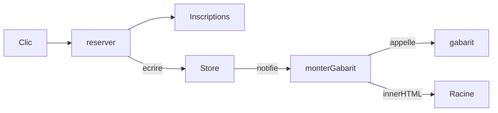

# Frameworks 2, un état observé et un rendu naïf

À la fin du [chapitre 1](/poo-patterns-frameworks/08-frameworks/), la réservation réussit, mais la page affiche toujours le même nombre de places libres. `PageAteliers` n'a lu les ateliers qu'au montage. Nous allons ajouter un objet qui conserve l'état de l'interface et prévient les vues à chaque modification, puis remplacer toute la page pour afficher ce nouvel état.

## L'état de l'interface

L'**état de l'interface** regroupe les données dont le code a besoin pour construire l'affichage à un instant donné. Ici, il contient la liste des ateliers avec leurs places libres, le courriel en cours de saisie et le dernier message à afficher. À partir de ces valeurs, une fonction peut déterminer le texte de chaque ligne et si son bouton doit être désactivé.

Cet état ne remplace pas les données conservées par `Inscriptions`. La classe garde les réservations et vérifie les règles, notamment la capacité de chaque atelier. L'interface en conserve une copie préparée pour l'affichage, avec le nombre de places déjà calculé. Elle y ajoute des informations propres à l'écran, comme le texte du champ. Quand une réservation réussit, l'interface relit les ateliers auprès d'`Inscriptions` et remplace sa copie. Elle affiche ainsi le résultat des règles au lieu de tenir un second compte des réservations.

## Un store est le sujet d'un Observer

Un **store** est un objet qui conserve l'état de l'application et prévient les vues de ses changements. Le terme vient de l'architecture Flux, présentée par Facebook en 2014, et la bibliothèque Redux l'a diffusé à partir de 2015. Notre exemple en garde seulement le stockage et les notifications.

Le store que l'on va écrire permet de lire l'état, de le remplacer et de s'abonner à ses changements. Il reprend l'organisation de la séance [Observer](/poo-patterns-frameworks/03-observer/). Le sujet est le store, et ses observateurs sont les fonctions qui mettent la page à jour. Au lieu de transmettre un événement comme « confirmation », chaque notification leur fournit l'état complet. Tous les abonnés le reçoivent, même si seule une donnée qui ne les concerne pas a changé.

Ajoutez ce type et cette fonction à `src/framework.ts`, sous `monter`.

```ts
export type Store<E> = {
  lire(): E;
  ecrire(suivant: E): void;
  abonner(abonne: (etat: E) => void): () => void;
};

export function creerStore<E>(initial: E): Store<E> {
  let etat = initial;
  const abonnes = new Set<(etat: E) => void>();
  return {
    lire: () => etat,
    ecrire(suivant) {
      etat = suivant;
      for (const abonne of [...abonnes]) abonne(etat);
    },
    abonner(abonne) {
      abonnes.add(abonne);
      return () => {
        abonnes.delete(abonne);
      };
    },
  };
}
```

Le paramètre de type `E` représente la forme de l'état, si bien que le framework peut conserver n'importe quelle valeur sans connaître les ateliers. `creerStore` est une [fabrique](/poo-patterns-frameworks/04-factory/#lire-une-fabrique-qui-garde-une-configuration) : les méthodes renvoyées gardent accès aux variables `etat` et `abonnes` après la fin de l'appel. Cette fermeture les protège comme des champs privés. En revanche, `lire` renvoie l'objet lui-même, sans copie. Si un appelant le modifie directement, le store ne prévient personne, donc notre application passe toujours par `ecrire`.

`ecrire` parcourt une copie des abonnés, `[...abonnes]`. Ainsi, une vue abonnée pendant une notification ne reçoit pas cette même notification.

`abonner` ajoute une fonction à la liste des destinataires, mais ne l'appelle pas immédiatement. Il faut donc lire l'état pour afficher la vue une première fois. La fonction renvoyée par `abonner` permet ensuite de se désabonner. Le code qui crée la vue doit la conserver pour interrompre les notifications quand cette vue disparaît.

Pour vérifier ce comportement sans navigateur, créez `tests/store.test.ts` à la racine du projet, à côté de `src/`.

```ts
import assert from "node:assert/strict";
import { creerStore } from "../src/framework.ts";

const store = creerStore({ places: 2 });
const recues: number[] = [];
const desabonner = store.abonner(etat => recues.push(etat.places));

store.ecrire({ places: 1 });
desabonner();
store.ecrire({ places: 0 });

assert.deepEqual(recues, [1]);
assert.equal(store.lire().places, 0);
console.log("Vérifications réussies.");
```

Exécutez `node tests/store.test.ts`. Le terminal doit afficher « Vérifications réussies. ». L'abonné a reçu la valeur 1, mais pas la valeur 0 écrite après son désabonnement, que le store conserve bien. Node.js exécute ce test sans navigateur, car `framework.ts` ne touche à aucun élément de page au chargement.

## Redessiner toute la page à chaque changement

Le **rendu** produit l'affichage à partir de l'état. Une fonction reçoit les données et décrit la page correspondante. Recalculer cette description après chaque écriture dans le store évite de prévoir une modification pour chaque événement possible.

La façon la plus directe d'appliquer cette idée consiste à écrire la page sous forme de texte HTML, puis à le donner à `innerHTML`. Ajoutez cette fonction au framework.

```ts
export function monterGabarit<E>(
  racine: HTMLElement,
  store: Store<E>,
  gabarit: (etat: E) => string,
): () => void {
  const afficher = (etat: E) => {
    racine.innerHTML = gabarit(etat);
  };
  afficher(store.lire());
  return store.abonner(afficher);
}
```

On appelle ici **gabarit** une fonction qui reçoit l'état et renvoie le texte HTML correspondant. `monterGabarit` affiche d'abord l'état actuel, puis abonne sa fonction d'affichage aux écritures suivantes. Votre code fournit le gabarit, mais le framework décide quand l'appeler, selon l'inversion de contrôle du chapitre 1. La fonction renvoyée interrompt cet abonnement. Contrairement au démontage du chapitre 1, elle ne retire pas les éléments déjà affichés.

Remplacez `src/main.ts` par cette version.

```ts
import { Inscriptions, type AtelierAvecPlaces } from "./inscriptions.ts";
import { creerStore, monterGabarit } from "./framework.ts";

const inscriptions = new Inscriptions([
  { id: 1, titre: "Dessin", capacite: 2, prixCentimes: 2000 },
  { id: 2, titre: "Photo", capacite: 1, prixCentimes: 3000 },
]);

type Etat = Readonly<{ ateliers: AtelierAvecPlaces[]; email: string; message: string }>;

const store = creerStore<Etat>({
  ateliers: inscriptions.listerAteliers(),
  email: "",
  message: "",
});

function gabarit(etat: Etat): string {
  const lignes = etat.ateliers.map(atelier => {
    const desactive = etat.email === "" || atelier.places === 0;
    return `<li>${atelier.titre}, places libres : ${atelier.places}
      <button data-atelier="${atelier.id}" ${desactive ? "disabled" : ""}>Réserver</button></li>`;
  });
  return `<main>
    <label>Courriel <input type="email" value="${etat.email}"></label>
    <ul>${lignes.join("")}</ul>
    <p role="status">${etat.message}</p>
  </main>`;
}

function reserver(atelierId: number): void {
  const etat = store.lire();
  try {
    const reservation = inscriptions.reserver(atelierId, etat.email);
    store.ecrire({
      ...etat,
      ateliers: inscriptions.listerAteliers(),
      message: `Réservation ${reservation.id} confirmée pour ${reservation.email}`,
    });
  } catch (erreur) {
    store.ecrire({ ...etat, message: erreur instanceof Error ? erreur.message : String(erreur) });
  }
}

const racine = document.querySelector<HTMLElement>("#app")!;
monterGabarit(racine, store, gabarit);

racine.addEventListener("input", evenement => {
  const champ = evenement.target as HTMLInputElement;
  store.ecrire({ ...store.lire(), email: champ.value });
});

racine.addEventListener("click", evenement => {
  const bouton = (evenement.target as Element).closest<HTMLButtonElement>("button[data-atelier]");
  if (bouton) reserver(Number(bouton.dataset.atelier));
});
```

Le bouton reste désactivé tant que le courriel est vide ou que l'atelier est complet. Le gabarit a donc besoin du texte saisi pour calculer son état, ce qui explique la présence d'`email` dans le store. Chaque frappe enregistre la valeur du champ et déclenche un nouveau rendu. Un courriel non vide n'est pas forcément valide. La vérification de sa forme reste dans les règles de réservation.

Avec `Readonly`, TypeScript interdit de réaffecter les propriétés de l'état. Le code construit donc un nouvel objet avec `{ ...etat }` et le transmet au store. Cette vérification reste superficielle, car le tableau des ateliers peut encore être modifié.

Dans cet exemple, une **action** est une fonction qui traite une demande et reporte son résultat dans l'état de l'interface. La fonction `reserver` demande d'abord à la classe de créer la réservation. Si elle réussit, l'action relit les places disponibles, prépare le message de confirmation et écrit l'ensemble en une fois dans le store. Si la classe refuse la demande, l'action conserve les ateliers et le courriel, puis remplace seulement le message. Le rendu reçoit ainsi un état qui correspond au résultat de la demande.



Relancez la page. Collez une adresse complète dans le champ, puis réservez l'atelier Dessin. Le nombre de places passe de 2 à 1. La saisie lettre par lettre révèle le premier des trois problèmes du remplacement du HTML.

## Premier défaut, le champ perd le focus

Cliquez dans le champ, puis tapez une lettre. Le curseur disparaît du champ après chaque frappe, et il faut cliquer de nouveau pour taper la suivante.

La frappe déclenche l'événement `input`, qui écrit le courriel dans le store. Le store appelle alors `afficher`, qui remplace tout le HTML de la racine. Le champ dans lequel vous tapiez est retiré de la page, et un nouveau champ, créé à partir du gabarit, prend sa place. Le texte saisi réapparaît grâce à l'attribut `value`, mais le **focus**, qui désigne l'élément recevant la saisie au clavier, reste associé à l'ancien champ jusqu'à son retrait. Le nouveau champ ne le récupère pas. La position du curseur, une sélection de texte ou le défilement d'une liste peuvent aussi être perdus quand leurs éléments sont remplacés.

## Deuxième défaut, les écouteurs disparaissent

Un écouteur posé sur un bouton reste attaché à ce bouton quand le rendu le retire. Lisez ce contre-exemple sans l'ajouter à votre fichier, qui traite déjà les clics sur la racine.

```ts
for (const bouton of racine.querySelectorAll<HTMLButtonElement>("button[data-atelier]")) {
  bouton.addEventListener("click", () => reserver(Number(bouton.dataset.atelier)));
}
```

Ces écouteurs ne concernent que les boutons présents au moment de la boucle. Au premier changement d'état, le rendu retire ces boutons et en crée de nouveaux, sans leur associer les mêmes fonctions. Les clics sur les nouveaux boutons ne déclencheraient donc plus de réservation.

Notre `main.ts` contourne ce problème par la **délégation d'événements**. Un clic sur un bouton remonte ensuite vers ses ancêtres, jusqu'à la racine : c'est la [propagation des événements](https://developer.mozilla.org/fr/docs/Learn_web_development/Core/Scripting/Event_bubbling). Un seul écouteur posé sur la racine reçoit donc les clics de tous les boutons, y compris ceux créés plus tard. `closest` retrouve le bouton concerné et `data-atelier` indique l'atelier. React utilise le même procédé : depuis sa [version 17](https://legacy.reactjs.org/blog/2020/08/10/react-v17-rc.html#changes-to-event-delegation), il pose ses écouteurs sur l'élément racine de l'application.

## Troisième défaut, le texte saisi devient du HTML

Les deux premiers défauts gênent la personne, tandis que le troisième ouvre une faille de sécurité. Collez cette adresse d'un seul coup dans le champ, puis cliquez sur Réserver :

```text
@a.fr
```

Une fenêtre `alert` s'ouvre. L'adresse passe la validation d'`Inscriptions`, car l'expression régulière vérifie seulement l'absence d'espace et la présence d'un `@` et d'un point. Le message de confirmation contient alors cette adresse, et le gabarit l'insère telle quelle dans le HTML. Le navigateur lit `` comme une balise d'image sans source, déclenche son erreur et exécute le code de l'attribut `onerror`.

Cette attaque s'appelle une **injection de script**, ou XSS pour *cross-site scripting*. L'[OWASP](https://owasp.org/www-community/attacks/xss/) la décrit en détail. Ici, la personne s'attaque elle-même, mais le même gabarit afficherait une adresse enregistrée par quelqu'un d'autre, par exemple dans une liste de participants. Le code injecté s'exécuterait alors dans la page de chaque personne qui la consulte. La [documentation d'`innerHTML`](https://developer.mozilla.org/fr/docs/Web/API/Element/innerHTML) rappelle ce risque.

On pourrait échapper les caractères `<`, `>`, `&` et les guillemets pour qu'ils soient affichés au lieu d'être interprétés. Il faudrait alors adapter cette protection à chaque emplacement, notamment le texte du message et la valeur d'un attribut. Un oubli laisserait de nouveau passer du HTML. La propriété [`textContent`](https://developer.mozilla.org/fr/docs/Web/API/Node/textContent) répond à un besoin plus précis. Elle affecte du texte à un élément sans le faire analyser comme du HTML. Le chapitre 3 l'utilise pour afficher le message de confirmation. Cette protection de l'affichage est distincte de la validation du courriel.

## Nuance, l'idée reste bonne

Décrire la page à partir de l'état rassemble les mises à jour dans le gabarit. Les trois défauts observés viennent du choix d'`innerHTML`, qui remplace les éléments existants et interprète la chaîne reçue comme du HTML.

On peut conserver cette description à partir de l'état sans remplacer toute la page. React recalcule une description, la compare avec la précédente, puis détermine les modifications à appliquer aux éléments existants. Le DOM virtuel, présenté au [chapitre 7](/poo-patterns-frameworks/08-7-bilan/), repose sur cette approche. Les chapitres 3 et 4 explorent une autre solution. On crée les éléments au montage, puis on met à jour leur texte ou leurs propriétés sans les remplacer à chaque changement d'état.

Avant de passer au [chapitre 3](/poo-patterns-frameworks/08-3-composants/), gardez `creerStore` dans `framework.ts`. Vous pouvez supprimer `monterGabarit`, qui ne servira plus.
