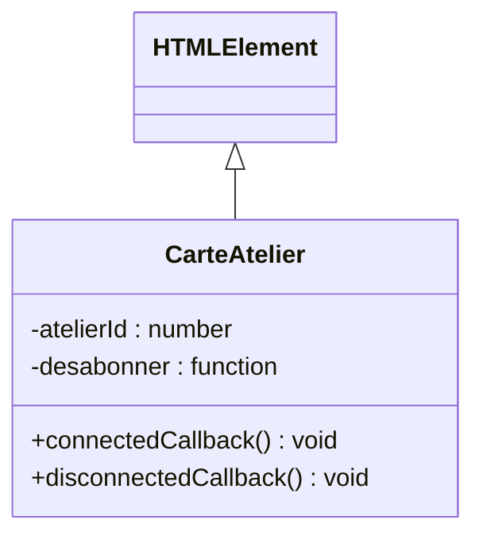

# Frameworks 3, composants en fonctions ou en classes

Au [chapitre 2](/poo-patterns-frameworks/08-2-etat/), chaque écriture dans le store remplaçait toute la page. Ce remplacement faisait perdre le focus au champ et permettait au texte saisi d'être interprété comme du HTML. On va maintenant conserver les éléments pendant les mises à jour et modifier seulement leur contenu ou leurs propriétés.

Chaque ligne d'atelier deviendra un composant chargé de son affichage. On l'écrira comme une fonction, puis comme une classe dont le navigateur appelle les méthodes à l'insertion et au retrait. On pourra ainsi comparer le nettoyage des abonnements et retrouver l'idée des crochets de Template Method.

## Un composant regroupe ce qui change ensemble

Un **composant** regroupe les éléments d'une partie de l'interface et le code qui les fait réagir. Dans notre page, une ligne d'atelier affiche le titre et les places libres, puis propose un bouton de réservation. Le texte dépend de l'atelier, et le bouton dépend aussi du courriel saisi. Réunir ces éléments dans un composant permet de décrire leur création et leurs mises à jour sans répéter ce code pour chaque atelier.

Ce regroupement convient aux éléments qui se répètent ou changent ensemble, comme le texte et le bouton d'une ligne. Si cette partie de la page disparaît seule, le composant permet aussi de rassembler son nettoyage.

## Écrire le composant comme une fonction

Dans `src/main.ts`, conservez le catalogue, le type `Etat`, le store et l'action `reserver` du chapitre 2. Gardez les imports, sauf celui de `monterGabarit`, à remplacer par `monter`. Supprimez la fonction `gabarit`, la constante `racine`, l'appel à `monterGabarit` et les deux écouteurs posés sur la racine.

Ajoutez ce composant. La page qui l'utilise sera écrite plus bas. Pour l'instant, le fichier ne contient donc plus de code de montage.

```ts
function CarteAtelier(atelierId: number): [HTMLElement, () => void] {
  const carte = document.createElement("span");
  const texte = document.createElement("span");
  const bouton = document.createElement("button");
  bouton.textContent = "Réserver";
  bouton.addEventListener("click", () => reserver(atelierId));
  carte.append(texte, " ", bouton);

  const afficher = (etat: Etat) => {
    const atelier = etat.ateliers.find(a => a.id === atelierId)!;
    texte.textContent = `${atelier.titre}, places libres : ${atelier.places}`;
    bouton.disabled = etat.email === "" || atelier.places === 0;
  };
  afficher(store.lire());
  return [carte, store.abonner(afficher)];
}
```

À chaque appel, la fonction crée un conteneur, un élément pour le texte et un bouton. Elle définit ensuite `afficher`, qui retrouve l'atelier dans l'état et modifie seulement `textContent` et `disabled`. Les notifications suivantes ne remplacent aucun élément. Le bouton garde donc son écouteur de clic, sans qu'une délégation soit nécessaire.

L'affectation à `textContent` traite le titre et les places comme du texte. On appliquera la même règle au message de confirmation dans la page. Une adresse contenant `` y restera du texte, au lieu de devenir une balise.

La fonction renvoie un tableau dont les deux positions ont un sens fixe, appelé un tuple. La première contient l'élément à insérer, la seconde la fonction de désabonnement fournie par le store. Le composant donne ainsi à son appelant les moyens de l'afficher et de cesser ses mises à jour.

La fonction ignore à quel moment son élément sera retiré de la page. Son appelant doit donc conserver le nettoyage et l'exécuter au retrait. Sinon, le store continue d'appeler `afficher` sur des éléments devenus invisibles. Il manque un code chargé de suivre leur durée de vie.

## Le navigateur sait quand un élément est retiré

Le navigateur peut prendre en charge ces moments grâce aux [éléments personnalisés](https://developer.mozilla.org/fr/docs/Web/API/Web_components/Using_custom_elements), une des technologies regroupées sous le nom **Web Components**. On écrit une classe qui hérite de `HTMLElement`, puis on l'enregistre sous un nom contenant un tiret, comme `carte-atelier`. Le navigateur reconnaît alors certaines méthodes de la classe et les appelle pendant le **cycle de vie** de l'élément, c'est-à-dire lors de sa connexion au document, de son retrait ou d'autres changements.

- `connectedCallback()` s'exécute quand l'élément est connecté au document, directement ou avec l'un de ses ancêtres.
- `disconnectedCallback()` s'exécute quand il est déconnecté du document, y compris au retrait de l'un de ses ancêtres.
- `attributeChangedCallback()` réagit aux changements des attributs que la classe déclare observer. Notre carte n'en utilise pas.

La documentation MDN rappelle les contraintes du constructeur. Il sert à initialiser l'objet, sans supposer que ses attributs et ses enfants sont disponibles. Il ne doit pas ajouter d'enfants à l'élément. On prépare donc son contenu dans `connectedCallback`, quand le navigateur signale sa connexion au document. Construire un objet et l'insérer dans la page restent deux opérations distinctes.

Remplacez la fonction `CarteAtelier` par cette classe.

```ts
class CarteAtelier extends HTMLElement {
  #atelierId: number;
  #desabonner = () => {};

  constructor(atelierId: number) {
    super();
    this.#atelierId = atelierId;
  }

  connectedCallback(): void {
    const texte = document.createElement("span");
    const bouton = document.createElement("button");
    bouton.textContent = "Réserver";
    bouton.addEventListener("click", () => reserver(this.#atelierId));
    this.replaceChildren(texte, " ", bouton);

    const afficher = (etat: Etat) => {
      const atelier = etat.ateliers.find(a => a.id === this.#atelierId)!;
      texte.textContent = `${atelier.titre}, places libres : ${atelier.places}`;
      bouton.disabled = etat.email === "" || atelier.places === 0;
    };
    afficher(store.lire());
    this.#desabonner = store.abonner(afficher);
  }

  disconnectedCallback(): void {
    this.#desabonner();
  }
}

customElements.define("carte-atelier", CarteAtelier);
```

Le corps de `connectedCallback` reprend la création des éléments, le premier affichage et l'abonnement de la fonction. La classe conserve le désabonnement dans un champ privé, puis l'appelle dans `disconnectedCallback`. Le code qui crée la carte n'a donc plus à garder ce nettoyage. Il lui suffit de retirer l'élément du document pour que le navigateur déclenche `disconnectedCallback`.

`replaceChildren` remplace les enfants de la carte au lieu d'en ajouter après les précédents. Lors d'un déplacement classique qui déconnecte puis reconnecte l'élément, le navigateur appelle `disconnectedCallback`, puis `connectedCallback`. La carte se désabonne, reconstruit ses enfants et s'abonne de nouveau. Les enfants restent donc stables pendant les changements du store, pas pendant toute la vie de l'objet.

Le champ `#desabonner` contient d'abord une fonction vide, remplacée à la connexion. `disconnectedCallback` peut ainsi l'appeler sans tester si un abonnement existe.

Écrivez maintenant la page. Elle reste une fonction, que `monter` appelle.

```ts
function PageAteliers(): HTMLElement {
  const page = document.createElement("main");
  const champ = document.createElement("input");
  champ.type = "email";
  champ.addEventListener("input", () => store.ecrire({ ...store.lire(), email: champ.value }));
  const etiquette = document.createElement("label");
  etiquette.append("Courriel ", champ);

  const liste = document.createElement("ul");
  for (const atelier of store.lire().ateliers) {
    const ligne = document.createElement("li");
    ligne.append(new CarteAtelier(atelier.id));
    liste.append(ligne);
  }

  const statut = document.createElement("p");
  statut.setAttribute("role", "status");
  store.abonner(etat => {
    statut.textContent = etat.message;
  });

  page.append(etiquette, liste, statut);
  return page;
}

monter(document.querySelector<HTMLElement>("#app")!, PageAteliers);
```

Le champ est créé au montage et n'est pas remplacé pendant la saisie. Ses événements écrivent toujours le courriel dans le store, mais les abonnés ne reconstruisent plus la page. Chaque `CarteAtelier` est placée dans un `<li>`, car les entrées d'une liste `<ul>` doivent être des `<li>`. L'appel à `new CarteAtelier(atelier.id)` est possible parce que `customElements.define` a enregistré la classe avant sa construction.

La page s'abonne aussi pour écrire le message dans le paragraphe de statut. Elle utilise maintenant du texte, sans interprétation HTML. Elle ne conserve cependant pas la fonction qui permettrait de retirer cet abonnement. La classe règle le nettoyage des cartes, pas encore celui de toute la page.

## Vérifier les deux versions

Relancez la page et tapez une adresse complète. Vous pouvez saisir toutes les lettres sans cliquer de nouveau dans le champ, car les notifications ne le remplacent plus. Réservez ensuite l'atelier Dessin. Le message confirme la réservation et les places diminuent.

Collez ensuite l'adresse piégée du chapitre 2, `@a.fr`, puis réservez. Le message doit afficher la balise comme du texte, sans ouvrir de fenêtre. Le store et la classe de réservation n'ont pas changé. C'est la façon de reporter le message dans la page qui empêche son interprétation comme du HTML.

Pour observer le désabonnement, remplacez temporairement la dernière ligne de `main.ts` par ces deux lignes. Elles gardent la fonction de démontage et rendent `demonter` et `store` accessibles depuis la console du navigateur.

```ts
const demonter = monter(document.querySelector<HTMLElement>("#app")!, PageAteliers);
Object.assign(window, { demonter, store });
```

Dans la console, conservez une référence vers le texte d'une carte avant de démonter la page. Écrivez ensuite un état où chaque atelier a 9 places libres, puis inspectez le texte conservé. Cette écriture sert uniquement à observer les abonnements. Elle modifie la copie destinée à l'affichage, pas les réservations dans la classe.

```js
const texte = document.querySelector("li span");
demonter();
const etat = store.lire();
store.ecrire({ ...etat, ateliers: etat.ateliers.map(a => ({ ...a, places: 9 })) });
texte.textContent;
```

Avec la classe, le texte conservé garde son ancien nombre de places. Le retrait de la page a déclenché `disconnectedCallback`, qui a désabonné la carte. L'état du store change toujours, mais cette carte ne reçoit plus ses notifications.

Pour comparer, remplacez la classe par la version fonction et supprimez son enregistrement. Dans la page, écrivez alors `const [carte] = CarteAtelier(atelier.id)`, puis `ligne.append(carte)`. Cette décomposition ignore volontairement la seconde valeur, celle qui permet de se désabonner. Rechargez la page pour repartir d'un nouveau montage et d'un nouveau contexte de console, puis rejouez les commandes. Le texte de la carte retirée affiche cette fois 9 places.

Le store conserve la fonction d'affichage, qui garde elle-même une référence vers les éléments retirés. Ceux-ci ne peuvent donc pas être libérés tant que cet abonnement subsiste. La console retient aussi la référence créée pour l'observation, mais cela ne suffit pas à expliquer la mise à jour. C'est bien l'abonnement oublié qui déclenche encore le rendu.

## Template Method, le squelette et les crochets

Le catalogue GoF de 1994 décrit le pattern **Template Method**. [Refactoring.Guru](https://refactoring.guru/fr/design-patterns/template-method) en donne cette définition : il « permet de mettre le squelette d'un algorithme dans la classe mère, mais laisse les sous-classes redéfinir certaines étapes de l'algorithme sans changer sa structure ». La classe mère fixe l'ordre des étapes, et les sous-classes remplissent certaines d'entre elles. Une étape facultative, vide ou dotée d'un comportement par défaut, s'appelle un **crochet**, ou *hook* en anglais.

Dans la forme classique du pattern, une méthode de la classe mère contient l'enchaînement des opérations. Elle appelle certaines méthodes que les sous-classes peuvent redéfinir. La sous-classe change ainsi une étape sans réécrire l'ensemble. Le GoF rattache cette organisation au principe d'Hollywood du [chapitre 1](/poo-patterns-frameworks/08-frameworks/#ce-que-dit-la-definition). Le code qui coordonne le traitement appelle les extensions fournies par l'application.

Notre élément personnalisé illustre une inversion de contrôle comparable, mais ne reproduit pas exactement ce pattern. Le navigateur décide quand appeler les méthodes reconnues de la sous-classe de `HTMLElement`. `CarteAtelier` fournit deux de ces crochets, `connectedCallback` et `disconnectedCallback`. Elle ne définit pas `attributeChangedCallback`, car elle ne réagit à aucun attribut.

La différence est la place du code qui coordonne les appels. Il appartient aux algorithmes du navigateur, pas à une méthode de `HTMLElement` qui enchaînerait des méthodes héritées. Les connexions et les retraits peuvent d'ailleurs se répéter. Le diagramme distingue donc l'héritage de l'élément HTML et les callbacks déclarés par la carte.



La flèche à pointe creuse se lit « CarteAtelier hérite de HTMLElement », comme dans le [chapitre UML](/poo-patterns-frameworks/01-uml/). Les callbacks figurent sur la carte, car ils ne sont pas des méthodes définies sur `HTMLElement`. Lors de `customElements.define`, le navigateur les recherche sur le prototype de la classe enregistrée.

La [fiche aide-mémoire Template Method](/ressources/poo-patterns-frameworks/fiches/template-method.html) présente la forme classique du pattern sur l'envoi d'un colis, puis montre où le reconnaître dans les frameworks.

## Les classes et les fonctions dans les frameworks réels

On retrouve des cycles de vie dans les frameworks, sans que leurs mécanismes soient identiques. Les [composants classes de React](https://react.dev/reference/react/Component) héritent de `Component`. Le framework peut appeler `componentDidMount` après le montage et `componentWillUnmount` avant le retrait. Angular utilise des classes dont les méthodes `ngOnInit` et `ngOnDestroy` correspondent à l'initialisation et à la destruction du composant. [Lit](https://lit.dev/docs/components/lifecycle/) construit ses composants sur les éléments personnalisés et ajoute un cycle de mise à jour à celui du navigateur.

React propose aussi les composants fonctions, avec des hooks depuis 2019. Le mot désigne ici des fonctions de son API, et non des méthodes de sous-classe. Un composant peut notamment déclarer un effet avec `useEffect`. La fonction passée à cet appel peut renvoyer un nettoyage que React exécutera lorsque l'effet doit être arrêté ou réexécuté. Comme dans le tuple renvoyé par notre `CarteAtelier`, le nettoyage est une fonction, mais c'est React qui la conserve et l'appelle.

Vue, Svelte et Solid proposent également des composants écrits sous forme de fonctions ou de fichiers compilés, sans imposer l'héritage d'une classe à l'application. Le choix de la syntaxe n'enlève pas le besoin de suivre les abonnements. Au [chapitre 5](/poo-patterns-frameworks/08-5-nettoyage/), on construira le mécanisme dont notre version fonction a besoin. Le composant enregistrera son nettoyage auprès du framework au lieu de compter sur son appelant pour le conserver.

## Nuance, ce que coûte chaque version

L'héritage de `HTMLElement` et l'enregistrement dans `customElements` permettent à la classe de recevoir les notifications du navigateur. Les champs privés conservent l'identifiant de l'atelier et la fonction de désabonnement entre deux appels. Cette intégration dépend cependant des API du navigateur, absentes de Node.js sans environnement DOM supplémentaire.

Notre constructeur reçoit son argument parce que l'application appelle elle-même `new CarteAtelier(1)`. Si le navigateur crée la balise `<carte-atelier>` écrite dans le HTML, il appelle le constructeur sans argument. Cette classe, telle qu'elle est écrite, ne suffit donc pas pour cet usage. Il faudrait lui transmettre l'identifiant par un attribut ou une propriété et adapter son initialisation.

La fonction n'a besoin ni d'hériter d'un élément HTML ni de s'enregistrer sous un nom de balise. En revanche, quelqu'un doit conserver et exécuter son nettoyage. La classe délègue ce suivi au navigateur, alors que notre fonction attend encore cette aide du framework.

Les deux versions partagent une autre limite. Chaque carte possède une fonction `afficher` qui met à jour son texte et son bouton à chaque écriture dans le store. Taper une lettre recalcule donc le texte de toutes les cartes, alors que seul l'état des boutons dépend du courriel. Le [chapitre 4](/poo-patterns-frameworks/08-4-signaux/) sépare ces mises à jour et construit les abonnements à partir des données que chacune lit.
