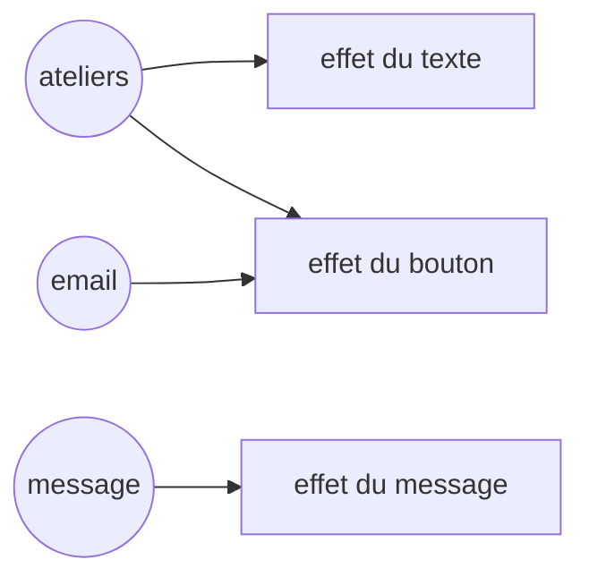

# Frameworks 4, des signaux qui s'abonnent seuls

Au [chapitre 3](/poo-patterns-frameworks/08-3-composants/), les composants conservaient leurs éléments au lieu de reconstruire la page. Leurs mises à jour restaient pourtant trop larges. Chaque carte s'abonnait au store entier, si bien que taper une lettre recalculait son texte alors que seul son bouton dépend du courriel.

Nous allons remplacer le store par des signaux qui déduisent les abonnements des valeurs lues par le code. Le texte d'une carte ne sera ainsi plus recalculé pendant la saisie du courriel.

## Ce que dit la définition

Un **signal** contient une valeur et permet de suivre les fonctions qui en dépendent. La documentation de Vue décrit, dans sa page sur la [réactivité en profondeur](https://fr.vuejs.org/guide/extras/reactivity-in-depth.html), deux opérations complémentaires. Une lecture permet d'enregistrer une dépendance, puis une modification déclenche les effets abonnés.

Un **effet** est une fonction que le framework exécute en surveillant les signaux qu'elle lit. Elle peut, par exemple, lire le nombre de places et écrire le texte d'une carte. Le framework enregistre alors ce signal comme une dépendance de l'effet, afin de relancer la fonction lorsque la valeur change. Une lecture ordinaire, en dehors d'un effet, renvoie la valeur sans créer d'abonnement.

L'idée est ancienne. En 2010, la bibliothèque [Knockout](https://knockoutjs.com/documentation/observables.html) de Steve Sanderson proposait déjà des valeurs observables qui suivaient leurs lecteurs. Solid a ensuite repris et popularisé le mot « signal ». En 2023, l'équipe de Svelte écrit dans l'[annonce des runes](https://svelte.dev/blog/runes) que la réactivité de Svelte 5 repose sur des signaux, « essentiellement ce que faisait Knockout en 2010 ». Angular, Preact et Vue proposent aujourd'hui leurs propres signaux, et une [proposition TC39](https://github.com/tc39/proposal-signals), au stade 1, étudie leur ajout au langage JavaScript.

## En clair

On retrouve le pattern Observer, mais le framework se charge de l'inscription. Avec le store, une vue appelait `abonner` et précisait la fonction à rappeler. Avec un signal, elle déclare un effet qui lit la valeur dont elle a besoin. Pendant cette exécution, la lecture inscrit l'effet comme abonné. Une écriture qui change la valeur relance ensuite les effets inscrits auprès de ce signal, sans relancer ceux qui n'en dépendent pas.

Prenons le bouton d'une carte. Son état dépend du courriel et des places de l'atelier. L'effet qui calcule `disabled` s'abonne aux signaux qu'il lit effectivement pendant ce calcul. Il peut ne lire que le courriel si celui-ci est vide, car cela suffit déjà à désactiver le bouton. En revanche, l'effet qui écrit le titre et les places ne lit jamais le courriel. Taper une lettre ne le relance donc pas.

## Repérer le besoin

Notre fonction `afficher` met à jour plusieurs éléments à chaque changement, même ceux qui ne dépendent pas de la donnée modifiée. Séparer ces mises à jour demanderait de gérer à la main leurs abonnements et leurs désabonnements. Un oubli dans la liste des dépendances laisserait alors un élément afficher une valeur périmée.

## Construire Signal et effet

Remplacez `creerStore` et le type `Store` de `src/framework.ts` par ce code. Gardez `monter` au début du fichier.

```ts
let effetCourant: Effet | null = null;

export class Signal<T> {
  #valeur: T;
  #lecteurs = new Set<Effet>();

  constructor(valeur: T) {
    this.#valeur = valeur;
  }

  lire(): T {
    effetCourant?.suivre(this.#lecteurs);
    return this.#valeur;
  }

  ecrire(valeur: T): void {
    if (Object.is(this.#valeur, valeur)) return;
    this.#valeur = valeur;
    for (const effet of [...this.#lecteurs]) effet.executer();
  }
}

class Effet {
  #fonction: () => void;
  #sources = new Set<Set<Effet>>();

  constructor(fonction: () => void) {
    this.#fonction = fonction;
  }

  suivre(lecteurs: Set<Effet>): void {
    lecteurs.add(this);
    this.#sources.add(lecteurs);
  }

  executer(): void {
    this.#oublierSources();
    const precedent = effetCourant;
    effetCourant = this;
    try {
      this.#fonction();
    } finally {
      effetCourant = precedent;
    }
  }

  #oublierSources(): void {
    for (const lecteurs of this.#sources) lecteurs.delete(this);
    this.#sources.clear();
  }
}

export function effet(fonction: () => void): void {
  new Effet(fonction).executer();
}
```

La variable de module `effetCourant` indique pour quel effet une lecture a lieu. Elle vaut `null` lorsqu'aucun effet ne s'exécute.

`effet(fonction)` crée un objet `Effet` et l'exécute aussitôt. Ce premier passage produit l'affichage initial et découvre les dépendances. `executer` place l'objet dans `effetCourant` avant d'appeler sa fonction, puis restaure la valeur précédente dans le bloc `finally`, même si la fonction lève une erreur. Cette sauvegarde permet aussi les effets imbriqués. Quand l'effet intérieur se termine, `effetCourant` désigne de nouveau l'effet extérieur, auquel les lectures suivantes seront rattachées.

Pendant cette exécution, chaque appel à `lire()` trouve l'effet dans `effetCourant` et appelle sa méthode `suivre`. Celle-ci conserve le lien dans deux ensembles. Le signal range l'effet parmi ses lecteurs, pour savoir qui prévenir lors d'une écriture. L'effet conserve l'ensemble des lecteurs du signal parmi ses sources, pour pouvoir s'en retirer plus tard. Puisque ces collections sont des ensembles, lire plusieurs fois le même signal ne crée pas plusieurs abonnements.

Une lecture faite hors d'un effet, par exemple dans un écouteur de clic, trouve `effetCourant` à `null` et ne crée aucun abonnement. Le suivi se limite donc aux lectures synchrones effectuées pendant l'appel de la fonction. Une lecture différée, après un délai ou une attente asynchrone, n'est plus rattachée à cet effet.

`ecrire` compare la nouvelle valeur à l'ancienne avec [`Object.is`](https://developer.mozilla.org/fr/docs/Web/JavaScript/Reference/Global_Objects/Object/is). Si elles sont identiques, il ne fait rien. Sinon, il remplace la valeur puis relance les lecteurs. Pour un tableau ou un objet, la comparaison porte sur son identité, pas sur son contenu. Modifier un tableau en place puis réécrire ce même tableau ne déclencherait donc pas les effets. L'application écrira de nouveaux tableaux pour signaler les changements.

La copie `[...this.#lecteurs]` permet de parcourir les abonnés présents au début de l'écriture. Sans elle, la boucle `for...of` parcourrait directement un ensemble que les effets modifient en s'exécutant. Un effet se retire de ses sources, puis s'y réinscrit quand il relit le signal. La boucle retrouverait alors cet effet à la fin de l'ensemble et le relancerait sans fin.

Avant chaque exécution, `#oublierSources` retire l'effet de tous les signaux lus au passage précédent. La fonction reconstruit ensuite ses abonnements à partir de ses nouvelles lectures. Les dépendances sont donc **dynamiques**, car elles peuvent changer avec les conditions du programme. Si une branche ne lit plus un signal, l'effet cesse de s'y abonner au lieu de conserver une dépendance devenue inutile.

La classe `Signal` protège sa valeur et ses lecteurs dans des champs privés, comme la classe `Inscriptions` protège ses réservations. Remplacer la valeur impose de passer par `ecrire`, qui déclenche les lecteurs. Cette protection n'empêche toutefois pas de modifier le contenu d'un objet reçu à la lecture. La classe `Effet` n'est pas exportée, car l'application doit seulement déclarer des effets avec la fonction `effet`, sans manipuler leurs abonnements.



## Vérifier sans navigateur

Créez `tests/signaux.test.ts` et exécutez-le avec `node tests/signaux.test.ts`.

```ts
import assert from "node:assert/strict";
import { Signal, effet } from "../src/framework.ts";

const email = new Signal("");
const places = new Signal(2);
const etats: string[] = [];

effet(() => {
  etats.push(email.lire() === "" || places.lire() === 0 ? "désactivé" : "actif");
});
assert.deepEqual(etats, ["désactivé"]);

places.ecrire(1);
assert.deepEqual(etats, ["désactivé"]);

email.ecrire("lea@example.test");
assert.deepEqual(etats, ["désactivé", "actif"]);

email.ecrire("lea@example.test");
assert.equal(etats.length, 2);

places.ecrire(0);
assert.deepEqual(etats, ["désactivé", "actif", "désactivé"]);
console.log("Vérifications réussies.");
```

Au premier passage, le courriel est vide. La partie gauche de l'opérateur `||` suffit donc à décider que le bouton est désactivé, sans lire `places`. L'effet s'abonne seulement au courriel, ce qui explique la deuxième assertion. Le passage de deux places à une ne le relance pas, puisque le résultat resterait « désactivé ».

Quand le courriel est rempli, l'effet se relance et lit aussi `places`. Il trouve la valeur courante, une place, puis s'abonne à ce signal. Écrire deux fois la même adresse ne provoque pas de nouvelle exécution, grâce à `Object.is`. En revanche, le passage à zéro place relance l'effet et ajoute « désactivé » au tableau. Ce test montre que les abonnements suivent les lectures réellement exécutées, pas tous les noms de signaux présents dans la fonction.

## Réécrire l'interface avec des signaux

Remplacez `src/main.ts` par cette version.

```ts
import { Inscriptions } from "./inscriptions.ts";
import { Signal, effet, monter } from "./framework.ts";

const inscriptions = new Inscriptions([
  { id: 1, titre: "Dessin", capacite: 2, prixCentimes: 2000 },
  { id: 2, titre: "Photo", capacite: 1, prixCentimes: 3000 },
]);

const ateliers = new Signal(inscriptions.listerAteliers());
const email = new Signal("");
const message = new Signal("");

function reserver(atelierId: number): void {
  try {
    const reservation = inscriptions.reserver(atelierId, email.lire());
    ateliers.ecrire(inscriptions.listerAteliers());
    message.ecrire(`Réservation ${reservation.id} confirmée pour ${reservation.email}`);
  } catch (erreur) {
    message.ecrire(erreur instanceof Error ? erreur.message : String(erreur));
  }
}

function LigneAtelier(atelierId: number): HTMLLIElement {
  const ligne = document.createElement("li");
  const texte = document.createElement("span");
  const bouton = document.createElement("button");
  bouton.textContent = "Réserver";
  bouton.addEventListener("click", () => reserver(atelierId));
  ligne.append(texte, " ", bouton);

  const atelier = () => ateliers.lire().find(a => a.id === atelierId)!;
  effet(() => {
    texte.textContent = `${atelier().titre}, places libres : ${atelier().places}`;
  });
  effet(() => {
    bouton.disabled = email.lire() === "" || atelier().places === 0;
  });
  return ligne;
}

function PageAteliers(): HTMLElement {
  const page = document.createElement("main");
  const champ = document.createElement("input");
  champ.type = "email";
  champ.addEventListener("input", () => email.ecrire(champ.value));
  const etiquette = document.createElement("label");
  etiquette.append("Courriel ", champ);

  const liste = document.createElement("ul");
  liste.append(...ateliers.lire().map(atelier => LigneAtelier(atelier.id)));

  const statut = document.createElement("p");
  statut.setAttribute("role", "status");
  effet(() => {
    statut.textContent = message.lire();
  });

  page.append(etiquette, liste, statut);
  return page;
}

monter(document.querySelector<HTMLElement>("#app")!, PageAteliers);
```

L'état unique du store devient trois signaux, un par donnée qui change indépendamment. Le type `Etat` et la classe `CarteAtelier` disparaissent. On revient à une fonction, `LigneAtelier`, qui crée ses éléments une seule fois et renvoie directement son `<li>`. Les effets déclarés dans cette fonction prennent en charge leurs mises à jour.

La fonction `atelier` calcule une **valeur dérivée**, c'est-à-dire une valeur obtenue à partir d'un autre état. Ici, elle recherche l'atelier de la ligne dans le signal `ateliers`, sans conserver de résultat en mémoire. Quand un effet l'appelle, l'appel à `ateliers.lire()` se produit toujours pendant cet effet. Le suivi traverse donc l'appel de fonction, et l'effet s'abonne au signal même s'il ne le lit pas directement dans son propre corps.

Chaque ligne crée deux effets. Le premier écrit le titre et les places, tandis que le second règle l'état du bouton. Taper une lettre ne relance que le second effet de chaque ligne. Quand une réservation réussit, `reserver` écrit un nouveau tableau dans `ateliers`. L'effet du texte se relance pour chaque ligne et, tant que le courriel n'est pas vide, celui du bouton aussi.

Le suivi est plus précis qu'avec le store entier, mais il s'arrête au niveau du signal. Toutes les lignes partagent le même tableau d'ateliers. Réserver Dessin relance donc aussi les effets abonnés à ce tableau dans la ligne Photo, même si ses places n'ont pas changé.

`reserver` lit `email.lire()` depuis un écouteur de clic. Aucun effet n'est en cours à ce moment, donc cette lecture ne crée pas d'abonnement. La réservation utilise le courriel au moment du clic, mais ne doit pas se rejouer lorsque le courriel change.

Relancez la page et vérifiez le comportement. Les boutons restent désactivés tant que le champ est vide, le focus reste dans le champ pendant la saisie, et les places diminuent après chaque réservation. Le bouton de Photo se désactive après sa réservation, puisque l'atelier n'a qu'une place.

## Une fuite dans les effets imbriqués

Le framework sait retirer les dépendances devenues inutiles, mais il ne sait pas encore arrêter un effet dont l'affichage a disparu. Tant que les ateliers restent les mêmes et que la page reste montée, ce manque passe inaperçu. Il devient visible lorsqu'un effet en crée d'autres à chaque reconstruction d'une liste. Créez `tests/fuite.ts` pour observer leur accumulation.

```ts
import { Signal, effet } from "../src/framework.ts";

const email = new Signal("");
const reservations = new Signal([1, 2]);
let executions = 0;

effet(() => {
  for (const _ of reservations.lire()) {
    effet(() => {
      email.lire();
      executions++;
    });
  }
});

reservations.ecrire([1, 2, 3]);
executions = 0;
email.ecrire("sam@example.test");
console.log(`Effets relancés : ${executions}`);
```

L'effet extérieur représente une liste de réservations, et chaque effet intérieur représente une ligne qui dépend du courriel. Le premier passage crée deux effets de ligne. L'écriture d'un tableau de trois réservations relance l'effet extérieur, qui en crée trois autres sans arrêter les deux premiers.

Le compteur est ensuite remis à zéro pour mesurer seulement les exécutions provoquées par le changement de courriel. Le programme en affiche 5, alors que la nouvelle liste ne demande que trois effets. Les deux anciens sont toujours abonnés au courriel, à côté des trois nouveaux.

Dans une interface, un effet de ligne conserve les éléments qu'il doit mettre à jour. Le signal retient cet effet parmi ses lecteurs, même lorsque les éléments ont quitté la page. Il continue donc de les mettre à jour et empêche le navigateur de libérer leur mémoire. Le [chapitre 5](/poo-patterns-frameworks/08-5-nettoyage/) ajoute un lien entre la durée de vie d'un effet et celle du code qui l'a créé, afin d'arrêter ces anciens effets.

## Les signaux dans les frameworks réels

Solid sépare les opérations en deux API. La fonction `createSignal` renvoie une fonction de lecture et une fonction d'écriture, tandis que `createEffect` déclare l'effet. Vue nomme `ref` ses conteneurs de valeurs réactives et propose `watchEffect` pour les effets. Le pseudo-code de sa documentation utilise une variable `activeEffect`, qui joue le rôle de notre `effetCourant`. Les fonctions `track` et `trigger` correspondent respectivement à `suivre` et à la boucle d'`ecrire`.

Angular propose `signal`, `computed` et `effect` pour distinguer l'état modifiable, les valeurs calculées et les effets. Svelte 5 expose les runes `$state` et `$effect` plutôt que des appels explicites de lecture et d'écriture. Son compilateur ajoute les opérations nécessaires au suivi. On retrouve donc le même besoin, relier un calcul aux valeurs qu'il lit, sans retrouver nécessairement les mêmes appels dans le code de l'application.

Ryan Carniato, l'auteur de Solid, construit une bibliothèque semblable dans l'article [*Building a Reactive Library from Scratch*](https://dev.to/ryansolid/building-a-reactive-library-from-scratch-1i0p), publié en 2021. Son code copie aussi les abonnés avant de les relancer et nettoie les dépendances avant chaque exécution.

## Nuance, ce que notre version ne fait pas

Nos effets se relancent immédiatement, pendant chaque écriture. Quand `reserver` écrit dans `ateliers` puis dans `message`, un effet qui lit les deux voit d'abord les nouveaux ateliers avec l'ancien message, puis s'exécute de nouveau. La [documentation de Svelte](https://svelte.dev/docs/svelte/$effect) décrit un autre choix. Les nouvelles exécutions y sont groupées après la mise à jour du DOM. Le moment d'exécution varie donc selon le framework.

Les frameworks proposent aussi des **valeurs calculées**, comme `computed` dans Angular et Vue. Notre fonction `atelier` refait sa recherche à chaque appel, même si les données n'ont pas changé. Une valeur calculée conserve son résultat et suit les signaux nécessaires au calcul. Si aucun d'eux n'a changé, une nouvelle lecture réutilise ce résultat. Sinon, elle le recalcule à la demande. Ce mécanisme évite les recherches répétées sans maintenir manuellement une seconde copie de l'état.

Le synchronisme impose aussi des limites. Un effet qui modifie un signal qu'il vient de lire peut se rappeler lui-même sans fin. La copie des abonnés protège le parcours de l'ensemble, mais pas contre cette récursion. De même, le bloc `finally` restaure l'effet courant après une erreur sans la traiter. Si un effet lève une erreur, celle-ci interrompt la boucle d'écriture, et les lecteurs suivants ne sont pas exécutés.

Toute lecture faite pendant un effet crée un abonnement, y compris une lecture involontaire. Le chapitre 5 en montre un exemple, et Solid propose la fonction `untrack` pour lire une valeur sans s'y abonner.
