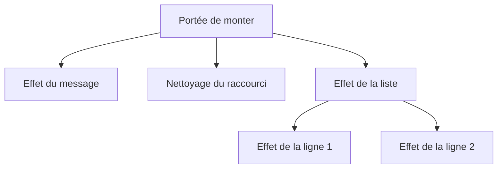

# Frameworks 5, monter et nettoyer

Au [chapitre 4](/poo-patterns-frameworks/08-4-signaux/), les signaux ont permis de mettre à jour seulement les affichages qui en dépendent. Il leur manque pourtant une information. Quand une liste remplace ses lignes, les effets des anciennes lignes restent abonnés, car le framework ne sait pas qu'ils ne servent plus.

Un écouteur posé sur un objet qui survit au composant, comme `document`, pose le même problème. Retirer un élément de la page ne suffit pas à arrêter ce qui le référence ailleurs. Dans ce chapitre, on va rattacher chaque effet et chaque nettoyage à une durée de vie, afin que le framework les arrête avant une reconstruction ou au démontage de la page.

## Ce que dit la définition

Le **cycle de vie** d'un composant décrit les étapes de son existence. Après sa création, il est **monté**, c'est-à-dire inséré dans la page, puis son affichage se met à jour lorsque ses données changent. Il est enfin **démonté** quand l'application le retire. Ce retrait doit aussi arrêter les activités qui n'ont plus de raison de continuer, comme ses abonnements, ses écouteurs extérieurs ou ses minuteries. Une requête en cours peut également devoir être annulée pour ne pas agir sur un composant disparu.

Solid range ces nettoyages dans des **portées**. Sa documentation de [`onCleanup`](https://docs.solidjs.com/reference/lifecycle/on-cleanup) explique que cette fonction « enregistre une fonction de nettoyage dans la portée réactive courante ». La portée d'un composant est nettoyée quand le composant est démonté. La portée d'un effet est nettoyée avant chaque nouvelle exécution de cet effet.

## En clair

Une portée regroupe les opérations qu'il faudra défaire ensemble. Pendant la construction de la page, le framework désigne une portée courante. Chaque effet créé et chaque nettoyage demandé s'y inscrivent, sans que les fonctions composants aient à transmettre une liste entre elles. Au démontage, il suffit de détruire cette portée pour arrêter les effets et exécuter les nettoyages enregistrés.

Un effet possède aussi sa propre portée, rattachée à celle qui était courante lors de sa création. Quand il se relance, il vide d'abord sa portée pour arrêter les effets créés au passage précédent. Les nouveaux effets s'y inscrivent ensuite. On distingue ainsi deux moments de nettoyage. Une reconstruction arrête les anciens effets enfants, tandis que le démontage arrête tous les effets de la page.

Dans notre framework, appeler une fonction composant ne crée pas de portée supplémentaire. Les composants utilisent celle dans laquelle ils sont appelés. Ce sont le montage de la page, la création explicite d'une portée et la création d'un effet qui organisent les durées de vie. L'arbre des portées suit donc les créations réactives, pas nécessairement chaque élément de l'arbre HTML.

## Le repérer dans le code

Posez ces questions à chaque composant :

- Le composant s'abonne-t-il à un objet qui vivra plus longtemps que lui, comme un signal global, `document` ou `window` ?
- Lance-t-il une minuterie avec `setInterval`, ou une requête qui pourrait répondre après son démontage ?
- Un effet crée-t-il des éléments ou d'autres effets à chaque exécution ?

Un écouteur posé sur un bouton du composant n'a généralement pas besoin d'être retiré séparément. Le bouton et son écouteur peuvent être libérés ensemble, dès que plus rien ne référence le bouton. Un écouteur posé sur `document` est différent, car `document` vit aussi longtemps que la page. Il conserve la fonction d'écoute et, par elle, les éléments auxquels cette fonction accède.

## Une liste de réservations qui fuit

Pour observer les deux problèmes, on ajoute une liste de réservations et un raccourci clavier. Sous les ateliers, chaque réservation aura un bouton d'annulation. La liste masquera les réservations dont le courriel diffère de celui du champ, sans les supprimer de l'état. La touche `/` placera le curseur dans ce champ.

Les deux composants suivants montrent comment construire la liste. Lisez-les d'abord pour repérer leurs effets. Ils seront assemblés dans la version de l'interface présentée après la correction du framework, avec l'état et l'action d'annulation dont ils ont besoin.

```ts
function LigneReservation(reservation: Reservation): HTMLLIElement {
  const ligne = document.createElement("li");
  const bouton = document.createElement("button");
  bouton.textContent = "Annuler";
  bouton.addEventListener("click", () => annuler(reservation.id));
  ligne.append(`${titres.get(reservation.atelierId)}, ${reservation.email} `, bouton);

  effet(() => {
    ligne.hidden = reservation.email !== email.lire().trim().toLowerCase();
  });
  return ligne;
}

function ListeReservations(): HTMLElement {
  const section = document.createElement("section");
  const titre = document.createElement("h2");
  titre.textContent = "Vos réservations";
  const liste = document.createElement("ul");
  effet(() => {
    liste.replaceChildren(...reservations.lire().map(r => LigneReservation(r)));
  });
  section.append(titre, liste);
  return section;
}
```

`ListeReservations` reconstruit toutes ses lignes chaque fois que le signal `reservations` change. Chaque ligne crée un effet qui la masque si son adresse diffère du courriel saisi. Avec le framework du chapitre 4, remplacer les éléments ne retire pas les effets des anciennes lignes. Ils restent abonnés au courriel et conservent les lignes qu'ils modifient. Après plusieurs réservations et annulations, une seule frappe peut donc relancer de nombreux effets pour des lignes qui ne sont plus affichées. Le script `tests/fuite.ts` du chapitre 4 reproduit cette accumulation.

Le raccourci clavier pose le second problème. Son écouteur sera inscrit sur `document`, qui survit à la page des ateliers. Si l'application retire cette page pour en afficher une autre, l'écouteur restera actif. Il conservera l'ancien champ et tentera encore de lui donner le focus à chaque appui sur la touche.

## Construire les portées

Réorganisez `src/framework.ts` selon la version suivante, qui modifie `Effet` et `monter` et ajoute la gestion des portées. Conservez intégralement la classe `Signal` du chapitre 4 à l'emplacement indiqué. Son corps est abrégé dans le bloc pour ne pas répéter le même code, il ne faut donc pas le remplacer par le commentaire.

```ts
type Portee = { parent: Portee | null; nettoyages: (() => void)[] };

let porteeCourante: Portee | null = null;
let effetCourant: Effet | null = null;

function dans<T>(portee: Portee, fonction: () => T): T {
  const precedente = porteeCourante;
  porteeCourante = portee;
  try {
    return fonction();
  } finally {
    porteeCourante = precedente;
  }
}

function detruire(portee: Portee): void {
  for (const nettoyage of portee.nettoyages.splice(0).reverse()) nettoyage();
}

export function creerPortee<T>(fonction: () => T): [T, () => void] {
  const portee: Portee = { parent: porteeCourante, nettoyages: [] };
  const detruirePortee = () => detruire(portee);
  porteeCourante?.nettoyages.push(detruirePortee);
  return [dans(portee, fonction), detruirePortee];
}

export function auNettoyage(nettoyage: () => void): void {
  if (!porteeCourante) throw new Error("auNettoyage appelé hors d'une portée");
  porteeCourante.nettoyages.push(nettoyage);
}

export type Composant = () => HTMLElement;

export function monter(racine: HTMLElement, composant: Composant): () => void {
  const [element, detruirePortee] = creerPortee(composant);
  racine.append(element);
  return () => {
    detruirePortee();
    element.remove();
  };
}

export class Signal<T> {
  // Le code du chapitre 4 ne change pas.
}

class Effet {
  #fonction: () => void;
  #sources = new Set<Set<Effet>>();
  #portee: Portee;
  #actif = true;

  constructor(fonction: () => void) {
    this.#fonction = fonction;
    this.#portee = { parent: porteeCourante, nettoyages: [] };
    porteeCourante?.nettoyages.push(() => this.#arreter());
  }

  suivre(lecteurs: Set<Effet>): void {
    lecteurs.add(this);
    this.#sources.add(lecteurs);
  }

  executer(): void {
    if (!this.#actif) return;
    this.#nettoyer();
    const precedent = effetCourant;
    effetCourant = this;
    try {
      dans(this.#portee, this.#fonction);
    } finally {
      effetCourant = precedent;
    }
  }

  #arreter(): void {
    this.#actif = false;
    this.#nettoyer();
  }

  #nettoyer(): void {
    for (const lecteurs of this.#sources) lecteurs.delete(this);
    this.#sources.clear();
    detruire(this.#portee);
  }
}

export function effet(fonction: () => void): void {
  new Effet(fonction).executer();
}
```

Une `Portee` contient une liste de fonctions de nettoyage et un lien vers sa portée parente. La variable `porteeCourante` désigne la portée qui reçoit les nouvelles inscriptions, comme `effetCourant` désigne l'effet qui reçoit les nouvelles dépendances. La fonction `dans` remplace cette portée le temps d'appeler une fonction, puis restaure la précédente dans son bloc `finally`.

Ces deux variables ont des rôles distincts. L'effet courant indique à quel calcul rattacher une lecture de signal. La portée courante indique qui devra arrêter un nouvel effet ou appeler un nettoyage. Le lien parent servira au chapitre 6 pour rechercher des valeurs fournies par un ancêtre. Ce n'est pas lui qui déclenche le nettoyage des enfants.

`detruire` extrait les nettoyages et vide leur liste avec `splice(0)`, puis les appelle dans l'ordre inverse de leur inscription. Les opérations enregistrées en dernier sont ainsi défaites en premier. Comme la liste est déjà vide pendant les appels, une seconde demande de destruction ne rejoue pas les mêmes nettoyages.

`creerPortee` exécute une fonction dans une nouvelle portée, puis renvoie son résultat avec la fonction qui détruit cette portée. Si une portée parente est courante, elle reçoit cette fonction de destruction dans sa propre liste de nettoyages. Détruire la parente provoquera donc aussi la destruction de l'enfant. La relation de nettoyage vient de cette inscription, et non d'un parcours du lien parent.

`monter` utilise ce mécanisme pour construire la page dans une portée. La fonction de démontage qu'il renvoie détruit cette portée avant de retirer l'élément. Le framework ne surveille pas lui-même les retraits du DOM. Pour obtenir le nettoyage, le code appelant doit utiliser cette fonction de démontage, plutôt que retirer directement l'élément.

Les composants appellent `auNettoyage` pour inscrire une fonction dans la portée courante. Si aucune portée n'est active, l'appel lève une erreur au lieu d'ignorer la demande. C'est notamment le cas dans un écouteur de clic, appelé plus tard par le navigateur. La portée reste active pendant la construction synchrone du composant ou l'exécution synchrone d'un effet, pas pendant toute la durée de vie de l'élément.

Dans `Effet`, le constructeur crée une portée pour les ressources de l'effet, puis inscrit l'arrêt de l'effet auprès de la portée courante. La méthode `executer` lance ensuite la fonction dans cette portée propre, si bien que les effets enfants et les nettoyages créés pendant l'appel lui appartiennent.

Avant chaque nouvelle exécution, `#nettoyer` retire les abonnements et vide la portée de l'effet. Dans la liste de réservations, ce nettoyage arrête les effets des anciennes lignes avant de construire les nouvelles. Arrêter l'effet parent produit le même nettoyage, mais empêche en plus toute exécution ultérieure. On ne confond donc pas remettre à zéro les ressources d'un effet qui continue et arrêter définitivement cet effet.

Le champ `#actif` empêche aussi de relancer un effet déjà arrêté. La méthode `ecrire` copie ses lecteurs avant de les exécuter. Si l'un d'eux arrête un autre effet présent dans cette copie, celui-ci reste tout de même dans le tableau à parcourir. Le contrôle de `#actif` lui fait ignorer cette demande d'exécution, sinon il pourrait se réabonner après son arrêt. Ce cas peut se produire lorsqu'un effet parent et ses enfants lisent le même signal. Dans la liste actuelle, le parent lit les réservations et les enfants lisent le courriel, mais le framework doit aussi rester correct lorsque ces dépendances se recoupent.



## Réécrire l'interface

Dans `src/main.ts`, reprenez cette organisation en conservant la fonction `LigneAtelier` du chapitre 4. Ajoutez aussi les fonctions `LigneReservation` et `ListeReservations` présentées au début du chapitre, à la place des commentaires qui rappellent leur présence. La version ci-dessous ajoute le signal `reservations`, l'action `annuler` et le raccourci clavier.

```ts
import { Inscriptions, type Reservation } from "./inscriptions.ts";
import { Signal, auNettoyage, effet, monter } from "./framework.ts";

const inscriptions = new Inscriptions([
  { id: 1, titre: "Dessin", capacite: 2, prixCentimes: 2000 },
  { id: 2, titre: "Photo", capacite: 1, prixCentimes: 3000 },
]);
const titres = new Map(inscriptions.listerAteliers().map(a => [a.id, a.titre]));

const ateliers = new Signal(inscriptions.listerAteliers());
const reservations = new Signal(inscriptions.reservations);
const email = new Signal("");
const message = new Signal("");

function reserver(atelierId: number): void {
  try {
    const reservation = inscriptions.reserver(atelierId, email.lire());
    ateliers.ecrire(inscriptions.listerAteliers());
    reservations.ecrire(inscriptions.reservations);
    message.ecrire(`Réservation ${reservation.id} confirmée pour ${reservation.email}`);
  } catch (erreur) {
    message.ecrire(erreur instanceof Error ? erreur.message : String(erreur));
  }
}

function annuler(reservationId: number): void {
  inscriptions.annuler(reservationId);
  ateliers.ecrire(inscriptions.listerAteliers());
  reservations.ecrire(inscriptions.reservations);
  message.ecrire(`Réservation ${reservationId} annulée`);
}

// LigneAtelier ne change pas depuis le chapitre 4.
// LigneReservation et ListeReservations sont présentés plus haut.

function PageAteliers(): HTMLElement {
  const page = document.createElement("main");
  const champ = document.createElement("input");
  champ.type = "email";
  champ.addEventListener("input", () => email.ecrire(champ.value));
  const etiquette = document.createElement("label");
  etiquette.append("Courriel ", champ);

  const raccourci = (evenement: KeyboardEvent) => {
    if (evenement.key === "/" && document.activeElement !== champ) {
      evenement.preventDefault();
      champ.focus();
    }
  };
  document.addEventListener("keydown", raccourci);
  auNettoyage(() => document.removeEventListener("keydown", raccourci));

  const liste = document.createElement("ul");
  liste.append(...ateliers.lire().map(atelier => LigneAtelier(atelier.id)));

  const statut = document.createElement("p");
  statut.setAttribute("role", "status");
  effet(() => {
    statut.textContent = message.lire();
  });

  page.append(etiquette, liste, statut, ListeReservations());
  return page;
}

monter(document.querySelector<HTMLElement>("#app")!, PageAteliers);
```

Le raccourci montre comment le composant déclare une ressource à nettoyer. `PageAteliers` inscrit son écouteur sur `document`, puis demande son retrait au démontage avec `auNettoyage`. Elle continue de renvoyer son élément, sans avoir à renvoyer ni à conserver la fonction de nettoyage. L'appel fonctionne parce que `monter` exécute `PageAteliers` dans une portée.

`annuler` n'entoure pas son appel d'un `try`. La seule erreur possible d'`Inscriptions.annuler` concerne une réservation inconnue, et le bouton disparaît de la liste dès la première annulation. Si une autre partie de l'application pouvait annuler la même réservation, il faudrait traiter ce refus comme dans `reserver`.

## Vérifier

Exécutez de nouveau `node tests/fuite.ts`. Le programme affiche maintenant 3 effets relancés au lieu de 5. Avant de créer les trois nouvelles lignes, l'effet extérieur vide sa propre portée et arrête les deux effets précédents. Lui-même n'est rattaché à aucune portée parente dans ce script, il ne sera donc pas arrêté automatiquement. Le test suivant ajoute cette portée parente pour vérifier aussi l'arrêt complet.

Créez ensuite `tests/portees.test.ts`, qui vérifie le démontage complet et le retrait d'un écouteur. Node.js fournit `EventTarget` et `Event`, si bien que le test n'a pas besoin de navigateur.

```ts
import assert from "node:assert/strict";
import { Signal, auNettoyage, creerPortee, effet } from "../src/framework.ts";

const email = new Signal("");
const reservations = new Signal([1, 2]);
let executions = 0;

const [, detruire] = creerPortee(() => {
  effet(() => {
    for (const _ of reservations.lire()) {
      effet(() => {
        email.lire();
        executions++;
      });
    }
  });
});

reservations.ecrire([1, 2, 3]);
executions = 0;
email.ecrire("sam@example.test");
assert.equal(executions, 3);

detruire();
executions = 0;
email.ecrire("zoe@example.test");
assert.equal(executions, 0);

const cible = new EventTarget();
let recus = 0;
const [, demonter] = creerPortee(() => {
  const compter = () => recus++;
  cible.addEventListener("ping", compter);
  auNettoyage(() => cible.removeEventListener("ping", compter));
});
cible.dispatchEvent(new Event("ping"));
demonter();
cible.dispatchEvent(new Event("ping"));
assert.equal(recus, 1);

assert.throws(() => auNettoyage(() => {}), /hors d'une portée/);
console.log("Vérifications réussies.");
```

Le premier test vérifie les deux durées de vie. Après la reconstruction, le courriel ne relance que les trois effets des nouvelles lignes. Après la destruction de la portée parente, il n'en relance plus aucun. Le test de l'écouteur vérifie séparément qu'un événement reçu après le démontage ne provoque plus d'appel. Enfin, la dernière assertion vérifie qu'un nettoyage déclaré sans portée n'est pas accepté.

Relancez aussi `node tests/signaux.test.ts`, qui doit toujours réussir. Dans le navigateur, appuyez sur `/` pour placer le curseur dans le champ. Tapez `lea@example.test`, réservez Dessin, puis tapez `sam@example.test` et réservez de nouveau Dessin. La liste ne montre que la réservation de l'adresse saisie, car les autres lignes sont masquées. Remettez l'adresse de Léa et cliquez sur Annuler pour faire disparaître sa ligne et rendre une place à Dessin.

## Le nettoyage dans les frameworks réels

Chaque framework propose sa façon de déclarer un nettoyage. Dans React, la fonction passée à [`useEffect`](https://react.dev/reference/react/useEffect) peut renvoyer une fonction de nettoyage. React appelle ce nettoyage avant de relancer l'effet avec de nouvelles dépendances, puis après le retrait du composant. En développement, le mode strict ajoute un cycle d'exécution puis de nettoyage avant l'exécution normale. Il permet ainsi de repérer les effets dont le nettoyage ne défait pas correctement les opérations.

Vue propose [`onUnmounted`](https://vuejs.org/guide/essentials/lifecycle.html) pour le démontage d'un composant, et ses effets reçoivent une fonction pour inscrire leur propre nettoyage. Dans Svelte 5, un `$effect` peut renvoyer une fonction de nettoyage, appelée avant la nouvelle exécution et à la destruction de l'effet. Angular fournit [`DestroyRef`](https://angular.dev/api/core/DestroyRef), sur lequel on inscrit un nettoyage avec `onDestroy`. Solid propose `onCleanup`, dont notre `auNettoyage` reprend le fonctionnement. Les éléments personnalisés du [chapitre 3](/poo-patterns-frameworks/08-3-composants/) utilisent `disconnectedCallback`.

Ces API confient au framework le moment du nettoyage. Le composant décrit comment retirer un écouteur ou arrêter une activité, sans demander à son appelant de conserver séparément chaque opération à défaire.

## Nuance, ce qui reste à surveiller

Le suivi automatique tient compte de l'exécution en cours, pas du nom de la fonction appelée. `LigneReservation` cherche donc le titre dans une `Map` construite une fois, `titres`, au lieu de lire `ateliers.lire()`. La ligne est construite pendant l'effet de la liste. Si elle lisait le signal `ateliers` avant de créer son propre effet, cette lecture abonnerait l'effet de la liste aux ateliers.

Une réservation écrit d'abord les ateliers, puis les réservations. Avec cet abonnement involontaire, elle reconstruirait donc la liste deux fois au lieu d'une. La portée de nettoyage ne change pas cette règle de suivi. Quand un composant est appelé dans un effet, ses lectures faites hors de ses propres effets restent attribuées à l'effet parent.

Le nettoyage ne résout pas non plus le coût de la reconstruction. Notre liste recrée toutes ses lignes à chaque changement des réservations. Un champ en cours de saisie perdrait ainsi son contenu et son focus, comme au chapitre 2. Même un bouton peut perdre le focus lorsqu'on le remplace. Les frameworks savent conserver l'identité des lignes, avec une **clé** comme l'attribut `key` de React, ou avec un mécanisme de liste comme le composant `For` de Solid. Ils peuvent ainsi réutiliser la ligne correspondant à une réservation au lieu de reconstruire son élément.

Pour les requêtes et les écouteurs multiples, le navigateur propose [`AbortController`](https://developer.mozilla.org/fr/docs/Web/API/AbortController). Un seul `controleur.abort()`, inscrit avec `auNettoyage`, peut retirer plusieurs écouteurs déclarés avec l'option `signal` et annuler une requête `fetch` en cours. Ce mécanisme serait utile si la page interrogeait le partenaire de la séance [Adapter](/poo-patterns-frameworks/05-adapter/).

La gestion des erreurs reste limitée. Si un nettoyage lève une erreur, `detruire` interrompt sa boucle. Les nettoyages restants, déjà retirés de la liste, ne seront pas appelés par une seconde destruction. De même, une erreur pendant la construction restaure la portée précédente grâce à `finally`, mais ne détruit pas automatiquement les ressources déjà créées. Cette version suppose donc que la construction et les nettoyages se terminent sans erreur.

Enfin, un effet créé hors de toute portée parente n'a aucun propriétaire chargé de l'arrêter. Les effets qu'il crée seront nettoyés avant ses nouvelles exécutions, mais lui-même restera abonné. Solid [émet un avertissement en développement](https://github.com/solidjs/solid/blob/main/packages/solid/src/reactive/signal.ts) lorsque des calculs sont créés sans propriétaire de leur durée de vie. Notre framework l'accepte, et c'est à vous de créer vos effets dans un composant monté ou dans une portée créée avec `creerPortee`.

Le [chapitre 6](/poo-patterns-frameworks/08-6-injection/) range les composants dans leur propre fichier. Ils ne pourront plus lire les variables de `main.ts`, et il faudra leur fournir l'état autrement.
