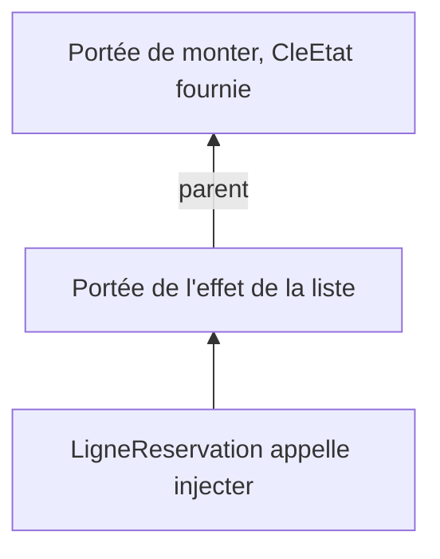

# Frameworks 6, fournir les services

Après le [chapitre 5](/poo-patterns-frameworks/08-5-nettoyage/), `src/main.ts` réunit le catalogue, quatre signaux, deux actions et quatre composants. Tant que tout reste dans ce fichier, les composants accèdent aux variables du module, comme `email` ou `reserver`. Si on les déplace, cet accès disparaît. Il faut alors décider quel code construit l'état de la page et comment les composants le reçoivent.

On va d'abord regrouper l'état et les actions dans une classe, puis comparer plusieurs façons de la transmettre. On construira ensuite un contexte qui rend une valeur accessible aux descendants d'une même portée. L'état jouera ici le rôle d'un **service**, un objet qui donne aux composants accès à des données et à des opérations communes. L'objectif n'est pas de supprimer tous les paramètres, mais de comprendre ce que ce partage apporte et ce qu'il rend moins visible.

## Regrouper l'état et les actions dans une classe

La page mélange encore deux rôles. La **présentation** crée les éléments, les met à jour et réagit aux actions de la personne. L'**orchestration** coordonne ces actions avec les règles d'`Inscriptions`, puis conserve le résultat dans l'état de l'interface. Par exemple, le bouton signale une demande de réservation, tandis que l'orchestration appelle les règles et actualise les places affichées.

Les signaux et les actions `reserver` et `annuler` relèvent de ce second rôle. Créez `src/etat.ts` pour les réunir dans une classe. Les règles de capacité et de doublon restent dans leur classe actuelle, sans dépendre du navigateur.

```ts
import type { AtelierAvecPlaces, Inscriptions, Reservation } from "./inscriptions.ts";
import { Signal, type Cle } from "./framework.ts";

export class EtatAteliers {
  readonly ateliers: Signal<AtelierAvecPlaces[]>;
  readonly reservations: Signal<Reservation[]>;
  readonly email = new Signal("");
  readonly message = new Signal("");
  #inscriptions: Inscriptions;

  constructor(inscriptions: Inscriptions) {
    this.#inscriptions = inscriptions;
    this.ateliers = new Signal(inscriptions.listerAteliers());
    this.reservations = new Signal(inscriptions.reservations);
  }

  titre(atelierId: number): string {
    return this.#inscriptions.listerAteliers().find(a => a.id === atelierId)?.titre ?? "";
  }

  reserver(atelierId: number): void {
    try {
      const reservation = this.#inscriptions.reserver(atelierId, this.email.lire());
      this.#actualiser();
      this.message.ecrire(`Réservation ${reservation.id} confirmée pour ${reservation.email}`);
    } catch (erreur) {
      this.message.ecrire(erreur instanceof Error ? erreur.message : String(erreur));
    }
  }

  annuler(reservationId: number): void {
    this.#inscriptions.annuler(reservationId);
    this.#actualiser();
    this.message.ecrire(`Réservation ${reservationId} annulée`);
  }

  #actualiser(): void {
    this.ateliers.ecrire(this.#inscriptions.listerAteliers());
    this.reservations.ecrire(this.#inscriptions.reservations);
  }
}

export const CleEtat: Cle<EtatAteliers> = Symbol("état des ateliers");
```

La classe reçoit `Inscriptions` par son constructeur et conserve cette instance dans un champ privé. Un composant qui reçoit cet état ne peut donc pas atteindre les règles par ce champ. Il appelle `reserver` ou `annuler`, qui actualisent les signaux après une opération réussie. La méthode privée `#actualiser` réunit les deux écritures nécessaires pour maintenir les ateliers et les réservations à jour.

Les signaux restent publics. Le mot-clé `readonly` empêche de remplacer un signal par un autre, mais il ne rend pas son contenu immuable. On peut écrire dans `etat.email`, pas réaffecter `etat.email`. Cette classe organise donc les accès sans interdire toute modification extérieure de l'état.

La méthode `titre` remplace la `Map` du chapitre 5. Elle lit le catalogue sans passer par un signal. Si une ligne l'appelle pendant l'effet qui reconstruit la liste des réservations, cet appel n'abonne donc pas l'effet au signal des ateliers. On conserve ainsi la séparation entre les données nécessaires à la création d'une ligne et celles dont on veut suivre les changements.

La dernière ligne crée une clé qui permettra aux composants de demander cet état sans importer une instance particulière. Le type `Cle` n'existe pas encore dans le framework. Une erreur TypeScript à cet endroit est donc attendue jusqu'à l'ajout de ce type, plus bas dans le chapitre.

Cette classe ne crée aucun élément HTML. On peut donc vérifier sans navigateur qu'une réservation met à jour les places, qu'un refus produit un message et qu'une annulation libère sa place. Créez `tests/etat.test.ts`.

```ts
import assert from "node:assert/strict";
import { Inscriptions } from "../src/inscriptions.ts";
import { EtatAteliers } from "../src/etat.ts";

const etat = new EtatAteliers(
  new Inscriptions([{ id: 1, titre: "Dessin", capacite: 1, prixCentimes: 2000 }]),
);
etat.email.ecrire(" Lea@example.test ");
etat.reserver(1);
assert.equal(etat.ateliers.lire()[0].places, 0);
assert.equal(etat.message.lire(), "Réservation 1 confirmée pour lea@example.test");

etat.email.ecrire("sam@example.test");
etat.reserver(1);
assert.equal(etat.message.lire(), "Atelier complet");

etat.annuler(1);
assert.equal(etat.ateliers.lire()[0].places, 1);
assert.equal(etat.reservations.lire().length, 0);
console.log("Vérifications réussies.");
```

## Comment un composant obtient-il l'état ?

Déplacez maintenant les quatre composants de `main.ts` dans un nouveau fichier, `src/composants.ts`. Ils ne voient plus les variables de `main.ts`. Trois solutions se présentent.

La première consiste à créer une instance dans un module et à l'importer partout. On écrirait dans `etat.ts` une ligne comme `export const etat = new EtatAteliers(new Inscriptions([...]))`, puis chaque composant ferait `import { etat } from "./etat.ts"`. Tous ces composants utiliseraient alors la même instance, construite avec le catalogue défini dans le module. Deux pages montées sur le même écran partageraient leurs réservations, même si on voulait les rendre indépendantes.

Le problème ne vient pas des modules, mais du choix d'exporter une instance unique. Un module peut aussi exporter une classe ou une fonction qui crée plusieurs états. Il reste alors à transmettre à chaque composant l'instance qui lui est destinée.

La deuxième consiste à passer l'état en paramètre de composant en composant :

```ts
export function PageAteliers(etat: EtatAteliers): HTMLElement {
  // ...
  page.append(etiquette, liste, statut, ListeReservations(etat));
}

function ListeReservations(etat: EtatAteliers): HTMLElement {
  // ...
  liste.replaceChildren(...etat.reservations.lire().map(r => LigneReservation(etat, r)));
}

function LigneReservation(etat: EtatAteliers, reservation: Reservation): HTMLLIElement {
  // ...
}
```

Avec les paramètres, les dépendances de chaque composant apparaissent dans sa signature. Un test peut fournir l'état de son choix, et la lecture de l'appel indique d'où il vient. Cette solution convient à notre page, puisque chaque composant utilise l'état.

La transmission devient plus encombrante lorsqu'une valeur traverse plusieurs composants qui n'en ont pas besoin. Une zone intermédiaire doit alors recevoir l'état uniquement pour le transmettre à une liste située plus bas. La documentation de Vue appelle cette situation le *props drilling*, c'est-à-dire la transmission répétée de propriétés à travers plusieurs niveaux.

La troisième solution associe une valeur à un contexte partagé. Un ancêtre **fournit** la valeur, puis un descendant l'**injecte** sans que les composants intermédiaires la transmettent. On va construire cette solution pour observer son fonctionnement, même si les paramètres suffiraient encore dans notre exemple.

## Ce que dit la définition

Une **dépendance** est un objet dont un autre code a besoin pour travailler. `EtatAteliers` est ainsi une dépendance des composants, et la classe qui vérifie les réservations est une dépendance de l'état. La question est de savoir qui choisit ces objets et comment le code utilisateur les obtient.

Martin Fowler décrit l'**injection de dépendances** dans l'article [*Inversion of Control Containers and the Dependency Injection pattern*](https://martinfowler.com/articles/injection.html), publié le 23 janvier 2004. Il emploie ce nom pour distinguer une manière d'assembler les objets de l'inversion de contrôle, notion plus générale.

Fowler compare deux façons d'obtenir une dépendance. Avec un **localisateur de services**, le code demande l'objet dont il a besoin à un mécanisme de recherche. Avec l'injection, un autre code lui transmet cet objet, par exemple par son constructeur. L'article présente trois formes d'injection, par le constructeur, par un mutateur et par une interface.

En clair, l'injection de dépendances retire au composant la responsabilité de créer ou de choisir ses collaborateurs. Vous l'avez déjà pratiquée dans la séance [Strategy](/poo-patterns-frameworks/02-strategy/) : `reserver` recevait l'objet `Tarif` de son appelant. `EtatAteliers` la pratique aussi, puisqu'elle reçoit `Inscriptions` par son constructeur.

## Fournir et injecter

Dans `src/framework.ts`, ajoutez un champ `valeurs` au type `Portee`.

```ts
type Portee = {
  parent: Portee | null;
  nettoyages: (() => void)[];
  valeurs: Map<unknown, unknown>;
};
```

Deux endroits créent une portée, `creerPortee` et le constructeur d'`Effet`. Ajoutez `valeurs: new Map()` à chacun :

```ts
const portee: Portee = { parent: porteeCourante, nettoyages: [], valeurs: new Map() };
```

```ts
this.#portee = { parent: porteeCourante, nettoyages: [], valeurs: new Map() };
```

Ajoutez enfin le type `Cle` et deux fonctions après `auNettoyage`.

```ts
export interface Cle<T> extends Symbol {
  readonly valeur?: T;
}

export function fournir<T>(cle: Cle<T>, valeur: T): void {
  if (!porteeCourante) throw new Error("fournir appelé hors d'une portée");
  porteeCourante.valeurs.set(cle, valeur);
}

export function injecter<T>(cle: Cle<T>): T {
  for (let portee = porteeCourante; portee; portee = portee.parent) {
    if (portee.valeurs.has(cle)) return portee.valeurs.get(cle) as T;
  }
  throw new Error(`Aucune valeur fournie pour ${cle.toString()}`);
}
```

`fournir` range une valeur dans la portée courante, sous une clé. `injecter` cherche cette clé dans la portée courante, puis remonte vers les parents jusqu'à la racine. La première valeur trouvée est celle que la fonction renvoie. Une portée enfant peut donc masquer la valeur d'un parent sans modifier celle du parent. Si aucune portée ne contient la clé, l'erreur indique quelle dépendance manque.

Le lien `parent` du chapitre 5 permet cette recherche. Il relie des contextes d'exécution, pas directement les éléments HTML. Dans notre code, les fonctions composants ne créent pas chacune une portée. `PageAteliers` et `ListeReservations` s'exécutent dans celle créée par `monter`. L'effet de la liste crée ensuite sa propre portée, dont le parent est cette portée de montage. Une ligne créée par cet effet y cherche l'état, puis le retrouve dans la portée de `monter`, où `main.ts` l'a fourni.



Une clé est un `Symbol`. Chaque appel à `Symbol("état des ateliers")` crée une valeur unique, même avec la même description. Deux modules peuvent donc choisir la même description sans désigner la même clé. Une simple chaîne comme `"etat"` ne possède pas cette propriété. Pour retrouver une valeur, le fournisseur et le composant doivent importer la même clé, et non recréer un symbole portant le même nom.

Le type `Cle<T>` relie une clé au type de sa valeur, sur le modèle du type `InjectionKey` de Vue. La propriété `valeur` n'est pas créée à l'exécution. Sa déclaration transporte seulement le type `T`, afin que TypeScript puisse le retrouver. Ainsi, `injecter(CleEtat)` renvoie une `EtatAteliers` sans conversion dans le composant, et `fournir(CleEtat, 42)` est refusé à la compilation. Ce contrôle ne valide pas les objets à l'exécution.

Fournir un objet ne décide pas non plus de sa durée de vie. Le code qui assemble l'application choisit s'il construit un état par page ou s'il partage le même état entre plusieurs pages. Le démontage arrête les effets associés à la portée, mais il n'appelle aucune méthode de destruction sur l'objet fourni. Si cet objet possède lui-même des ressources à fermer, il faut prévoir leur nettoyage.

## Réécrire les composants

Dans `src/composants.ts`, chaque composant commence par injecter l'état. Voici la ligne de réservation.

```ts
import type { Reservation } from "./inscriptions.ts";
import { auNettoyage, effet, injecter } from "./framework.ts";
import { CleEtat } from "./etat.ts";

function LigneReservation(reservation: Reservation): HTMLLIElement {
  const etat = injecter(CleEtat);
  const ligne = document.createElement("li");
  const bouton = document.createElement("button");
  bouton.textContent = "Annuler";
  bouton.addEventListener("click", () => etat.annuler(reservation.id));
  ligne.append(`${etat.titre(reservation.atelierId)}, ${reservation.email} `, bouton);

  effet(() => {
    ligne.hidden = reservation.email !== etat.email.lire().trim().toLowerCase();
  });
  return ligne;
}
```

Faites de même dans `LigneAtelier`, `ListeReservations` et `PageAteliers` : ajoutez `const etat = injecter(CleEtat);` en première ligne, puis remplacez `email` par `etat.email`, `reserver(atelierId)` par `etat.reserver(atelierId)`, et ainsi de suite. Exportez seulement `PageAteliers`, que `main.ts` doit monter. Le [fichier `composants.ts` du corrigé](/ressources/poo-patterns-frameworks/mini-framework/src/composants.ts) montre le résultat complet.

`main.ts` peut alors se limiter à choisir les objets de l'application et à les assembler.

```ts
import { Inscriptions } from "./inscriptions.ts";
import { fournir, monter } from "./framework.ts";
import { CleEtat, EtatAteliers } from "./etat.ts";
import { PageAteliers } from "./composants.ts";

const etat = new EtatAteliers(
  new Inscriptions([
    { id: 1, titre: "Dessin", capacite: 2, prixCentimes: 2000 },
    { id: 2, titre: "Photo", capacite: 1, prixCentimes: 3000 },
  ]),
);

monter(document.querySelector<HTMLElement>("#app")!, () => {
  fournir(CleEtat, etat);
  return PageAteliers();
});
```

Ce fichier choisit le catalogue, construit `Inscriptions` puis `EtatAteliers`, et fournit cette instance à la racine. Les composants demandent l'état sans connaître le catalogue qui a servi à le construire. Un test peut donc monter la même page avec une autre instance et un catalogue adapté au scénario. En revanche, la clé désigne ici une classe concrète avec un champ privé. Une fausse classe indépendante ne serait pas interchangeable sans modifier ce contrat.

## Vérifier

Relancez la page : elle se comporte comme au chapitre 5. Relancez aussi `node tests/etat.test.ts`, `node tests/portees.test.ts` et `node tests/signaux.test.ts`.

Ajoutez `tests/injection.test.ts` pour vérifier la recherche dans les portées.

```ts
import assert from "node:assert/strict";
import { creerPortee, fournir, injecter, type Cle } from "../src/framework.ts";

const CleLangue: Cle<string> = Symbol("langue");

creerPortee(() => {
  fournir(CleLangue, "fr");
  creerPortee(() => {
    assert.equal(injecter(CleLangue), "fr");
    fournir(CleLangue, "en");
    assert.equal(injecter(CleLangue), "en");
  });
  assert.equal(injecter(CleLangue), "fr");
});

assert.throws(() => creerPortee(() => injecter(CleLangue)), /Aucune valeur fournie/);
console.log("Vérifications réussies.");
```

La portée intérieure lit d'abord la langue fournie par sa parente, puis fournit sa propre valeur. Cette valeur masque celle du parent pour les recherches effectuées dans la portée intérieure et ses descendants. Le parent n'a pas changé, si bien qu'une lecture dans la portée extérieure renvoie toujours `"fr"`. La dernière assertion vérifie qu'une dépendance absente produit bien une erreur.

Pour vérifier que le partage dépend du montage, ajoutez un second `<div id="app2">` à `index.html`. Montez-y une autre `PageAteliers`, avec une autre instance d'`EtatAteliers` et un autre catalogue. Fournissez chaque instance dans sa propre portée de montage, puis réservez dans la première page. Les places de la seconde doivent rester inchangées. Si les composants importaient tous la même instance depuis un module, ils partageraient au contraire les réservations.

## L'injection dans les frameworks réels

Vue propose [`provide` et `inject`](https://vuejs.org/guide/components/provide-inject.html). Un composant parent fournit une valeur, et tout descendant peut l'injecter, quelle que soit sa profondeur. Si plusieurs parents fournissent la même clé, le plus proche gagne. Vue recommande des clés `Symbol` et propose le type `InjectionKey<T>`, dont notre `Cle<T>` reprend le principe.

React propose le **contexte**, avec [`createContext` et `useContext`](https://react.dev/learn/passing-data-deeply-with-context). Svelte offre `setContext` et `getContext`, et Solid `createContext` et `useContext`. Angular propose un système d'[injection de dépendances](https://angular.dev/guide/di) dans lequel des injecteurs organisés en arbre associent des clés à des fournisseurs. Un composant peut recevoir les services par son constructeur ou les demander avec la fonction `inject`.

## Nuance, injection ou localisateur

Selon la distinction de Fowler, notre `injecter` ressemble davantage à un localisateur de services. Le composant demande explicitement son service en appelant `injecter(CleEtat)`, au lieu de le recevoir sans rien demander. On retrouve cette demande explicite avec le contexte de React, `inject` de Vue et la fonction `inject` d'Angular, sans que leurs systèmes soient identiques. L'injection par le constructeur des classes Angular, ou celle d'`Inscriptions` dans `EtatAteliers`, correspond à la définition stricte.

Ce choix rend une dépendance moins visible. La signature `LigneReservation(reservation)` ne dit plus que la ligne a besoin de l'état. Un test doit donc connaître cette exigence et fournir la clé avant de créer le composant. À défaut, l'erreur apparaît à l'exécution, lors de la recherche de la valeur.

Notre `injecter` exige aussi qu'une portée soit active. C'est le cas pendant le montage d'un composant, pendant l'exécution d'un effet ou dans une fonction appelée par `creerPortee`. Un écouteur de clic ordinaire s'exécute plus tard, après la restauration de la portée précédente. Il ne peut donc pas y chercher l'état. Chaque composant obtient la référence pendant sa construction, puis ses écouteurs utilisent la constante conservée.

Vue et React encadrent eux aussi l'endroit où ces fonctions peuvent être appelées, mais leurs règles ne sont pas celles de notre miniature. Dans sa Composition API, Vue demande d'appeler `inject` pendant la préparation du composant. React impose d'appeler [`useContext`](https://react.dev/reference/react/useContext) au niveau supérieur d'un composant fonctionnel ou d'un Hook personnalisé, et non dans un écouteur d'événement. Le contexte d'appel fait donc partie du contrat de ces API, autant que la valeur qu'elles renvoient.

Gardez donc le paramètre quand il suffit. Un composant qui reçoit ses données de son parent direct rend ses besoins visibles et se teste sans contexte de montage. Le contexte partagé devient utile lorsque plusieurs niveaux intermédiaires devraient transmettre une dépendance qu'ils n'utilisent pas. En contrepartie, il faut connaître la clé, le fournisseur et le moment où la recherche est autorisée. Fournir tout l'état donne aussi accès à toutes ses opérations publiques, même à un composant qui n'en utilise qu'une partie. Le contexte ne remplace donc pas le choix des données et des actions que l'on souhaite exposer.

La version pédagogique du framework possède désormais toutes les fonctions prévues dans cette série. Le [chapitre 7](/poo-patterns-frameworks/08-7-bilan/) le compare aux frameworks réels et propose une grille pour lire celui de votre projet.
