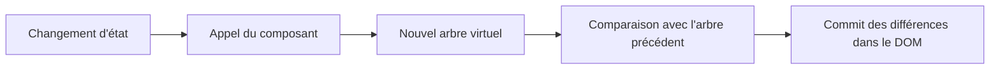

# Frameworks 7, comparer avec les frameworks réels

Le fichier [`framework.ts` du corrigé](/ressources/poo-patterns-frameworks/mini-framework/src/framework.ts) rassemble les mécanismes construits depuis le début de la série. Il monte les composants, suit les données lues par les effets, organise les nettoyages et recherche les services fournis. On peut désormais suivre un clic depuis la demande de réservation jusqu'à la mise à jour de la page, sans attribuer ces étapes à un mécanisme invisible.

Cette miniature aide à lire un framework réel, mais elle n'en remplace pas les garanties ni les outils. Ce dernier chapitre compare les mécanismes plutôt que la taille des implémentations. Il distingue notamment le suivi des données, le calcul du rendu et les modifications du DOM, avant de vous proposer la même enquête dans votre projet.

## Ce que vous avez construit

Au démarrage, l'application passe une fonction composant à `monter`. Le framework appelle cette fonction dans une portée et conserve les nettoyages qu'elle déclare. L'application ne décide donc pas seule du contexte d'exécution de son composant. On retrouve l'inversion de contrôle du premier chapitre.

Pendant la construction de la page, chaque effet lit les données dont son affichage dépend. La classe `Signal` enregistre ces lectures, puis prévient les effets concernés lors d'une écriture. Ce mécanisme reprend Observer, avec un abonnement automatique. Le store précédent utilisait au contraire des abonnements explicites. Dans les deux versions, conserver l'état et prévenir ses lecteurs sont deux responsabilités distinctes. `creerStore` garde cet état dans une fermeture, tandis que les signaux le conservent dans des champs privés.

Lorsqu'un effet se relance, sa portée arrête les effets enfants et exécute les nettoyages du passage précédent. Au démontage, la portée de montage fait de même pour les ressources qui lui sont rattachées. Les éléments personnalisés du chapitre 3 recevaient leurs appels de cycle de vie du navigateur. Ce fonctionnement illustrait une inversion de contrôle comparable à celle de Template Method, sans reproduire exactement le pattern. Les fonctions composants ont besoin que notre framework organise explicitement ce cycle.

Enfin, `fournir` et `injecter` séparent l'assemblage des objets de leur utilisation par les composants. Le contexte permet de retrouver un état sans le transmettre à chaque niveau. À l'intérieur de `EtatAteliers`, la réception d'`Inscriptions` par le constructeur reste un exemple d'injection de dépendances au sens strict de Fowler. Le contexte de recherche et le paramètre de constructeur résolvent donc un besoin voisin, mais ne rendent pas les dépendances visibles de la même manière.

Le tableau suivant donne des points d'entrée pour retrouver ces rôles dans quatre frameworks. Il ne décrit pas des API interchangeables. Les règles d'appel, le moment des mises à jour et les garanties de nettoyage doivent être vérifiés dans chaque documentation.

| Rôle | Notre framework | React | Vue | Svelte 5 | Angular |
| --- | --- | --- | --- | --- | --- |
| Monter l'application | `monter` | `createRoot(...).render` | `createApp(...).mount` | `mount` | `bootstrapApplication` |
| Conserver un état | `Signal` | `useState` | `ref` | `$state` | `signal` |
| Réagir à un changement | `effet` | nouveau rendu du composant | `watchEffect` | `$effect` | `effect` |
| Déclarer un nettoyage | `auNettoyage` | fonction renvoyée par `useEffect` | `onUnmounted` | fonction renvoyée par `$effect` | `DestroyRef` |
| Fournir un service | `fournir`, `injecter` | `createContext`, `useContext` | `provide`, `inject` | `setContext`, `getContext` | injecteurs, `inject` |
| Écrire un composant en classe | `extends HTMLElement` | `extends Component`, API de classes | pas dans l'API native présentée ici | pas dans l'API native présentée ici | classe décorée par `@Component` |

La ligne « Réagir à un changement » demande une précaution. Notre `effet` exécute directement la fonction qui modifie le DOM. Dans React, le nouveau rendu calcule une description de l'interface, et les effets déclarés avec [`useEffect`](https://react.dev/reference/react/useEffect) répondent à un autre besoin, celui de synchroniser le composant avec un système extérieur. Il ne faut donc pas confondre un effet de rendu de notre framework avec une API qui porte le mot « effet ».

Deux questions permettent de comparer les moteurs. Quelles données ont changé, et quelle partie du programme doit recalculer l'affichage ? Puis, une fois ce calcul effectué, quels éléments du DOM faut-il réellement modifier ? Le suivi des dépendances répond à la première question. Le DOM virtuel, présenté ci-dessous, est une façon de répondre à la seconde. Ces mécanismes peuvent être combinés.

## Le DOM virtuel de React

Au [chapitre 2](/poo-patterns-frameworks/08-2-etat/), on recalculait toute la page à chaque changement. Cette approche rendait le code de rendu lisible, mais l'affectation à `innerHTML` remplaçait les éléments existants et interprétait le texte comme du HTML. React permet lui aussi de recalculer une description de l'interface, sans remplacer pour autant tous les éléments de la page.

Quand une mise à jour d'état déclenche un rendu, React rappelle la fonction du composant concerné et peut rendre ses descendants. La fonction décrit l'interface attendue au lieu de créer elle-même les éléments du DOM. Cette description forme un arbre d'objets JavaScript, couramment appelé **DOM virtuel**.

React rapproche ce nouvel arbre du précédent lors de la **réconciliation**. Il détermine quels éléments peuvent être conservés, puis applique les changements nécessaires au DOM pendant la phase de **commit**. Un nouveau calcul de rendu n'entraîne donc pas nécessairement une modification du DOM. La documentation de React décrit cette séparation dans [*Render and Commit*](https://react.dev/learn/render-and-commit).

Cette séparation évite de recréer le champ à chaque frappe. Tant que son type et son identité dans l'arbre restent les mêmes, React conserve l'élément existant, donc son focus. Une modification de cette identité, par exemple par une clé différente, peut au contraire le remplacer. La documentation sur la [conservation et la réinitialisation de l'état](https://react.dev/learn/preserving-and-resetting-state) détaille ces conditions.

Les événements sont déclarés dans la description du composant et React gère leur association aux éléments. On n'a donc pas à réinstaller manuellement les écouteurs après une affectation à une chaîne HTML. Enfin, le texte inséré entre accolades dans JSX est échappé par défaut. L'API `dangerouslySetInnerHTML` permet au contraire de demander explicitement l'insertion de HTML, avec les précautions que ce choix exige.

Notre framework évite cette comparaison en donnant à chaque effet la fonction qui modifie les éléments concernés. La taille d'une mise à jour dépend toutefois de ce qu'on met dans l'effet. Celui d'une ligne change un texte ou un bouton, tandis que celui des réservations reconstruit toute une liste. Utiliser des signaux ne garantit donc pas à lui seul des mises à jour élément par élément. L'endroit où une valeur est lue détermine aussi l'abonnement, comme l'a montré la nuance du [chapitre 5](/poo-patterns-frameworks/08-5-nettoyage/#nuance-ce-qui-reste-a-surveiller).

Vue illustre la combinaison des approches. Ses `ref` suivent les dépendances selon le principe des signaux, tandis que son moteur de rendu fondé sur le DOM virtuel compare les descriptions produites par les composants. Angular suit aussi les signaux lus par les gabarits, mais les utilise pour organiser ses mises à jour, sans reproduire notre boucle synchrone. Sa [documentation sur les signaux](https://angular.dev/guide/signals) explique ce lien avec le rendu. Le choix ne se réduit donc pas à opposer les signaux au DOM virtuel.

## Ce que font les compilateurs

Nos composants créent leurs éléments avec `document.createElement`. Écrire chaque élément, chaque insertion et chaque mise à jour rend le mécanisme visible, mais occupe beaucoup de place. Un **compilateur** peut traduire une syntaxe plus concise en JavaScript avant l'exécution. On écrit alors la structure attendue, et l'outil produit une partie du code qui la construit.

JSX, utilisé par React et Solid, ressemble à du HTML placé dans le code, comme `<button onClick={reserver}>Réserver</button>`. Cette ressemblance ne détermine pas le moteur de rendu. React et Solid acceptent une syntaxe voisine, mais la transforment pour des mécanismes différents. Vue et Svelte proposent aussi des fichiers qui regroupent le gabarit, le script et les styles.

Dans Svelte 5 et Solid, le code compilé s'appuie sur le suivi réactif pour mettre à jour les parties variables du DOM. On peut y reconnaître le travail accompli à la main aux chapitres 4 et 5, sans y retrouver exactement les mêmes fonctions `effet` ou les mêmes affectations à `textContent`. Le compilateur et le moteur d'exécution se répartissent ce travail. La compilation réduit ainsi le code à écrire, mais ne supprime pas les questions de dépendances, d'identité des éléments et de nettoyage.

## Ce qui manque encore à notre framework

Notre version rend les mécanismes inspectables en laissant de côté plusieurs problèmes rencontrés dans une application réelle. Les frameworks et leurs écosystèmes proposent des réponses à ces problèmes, mais ces réponses diffèrent selon l'outil choisi. Pour comparer une solution, examinez notamment les points suivants :

- Le regroupement des écritures évite de recalculer plusieurs fois le même affichage pendant une action. Notre version relance les effets immédiatement après chaque écriture, ce qui peut leur faire observer des états intermédiaires.
- Les valeurs calculées évitent de refaire un calcul dont les données n'ont pas changé. Leur mise en mémoire et le moment du recalcul dépendent du mécanisme proposé.
- Les listes avec clés permettent de retrouver une ligne existante au lieu de la recréer. Cette identité devient visible lorsqu'une ligne contient un champ en cours de saisie.
- Le rendu côté serveur produit un premier HTML sans attendre la construction complète de l'interface dans le navigateur. L'hydratation rattache ensuite à ce HTML les comportements de l'application. Le cours [Architecture logicielle](/architecture-logicielle/02-rendu-web/) présente ces stratégies de rendu.
- Le routage associe les adresses aux pages à afficher. Selon la solution, il appartient au framework lui-même ou à une bibliothèque de son écosystème.
- Le traitement des erreurs détermine ce qui continue à fonctionner après un échec. Dans notre version, un effet qui lève une erreur interrompt la boucle d'`ecrire`, et les effets suivants ne sont pas relancés. La séance [Observer](/poo-patterns-frameworks/03-observer/) a posé la même question pour les abonnés.
- Les outils de développement rendent observables l'arbre des composants, leur état ou leurs mises à jour. Ils aident à expliquer un comportement que la seule lecture du composant ne révèle pas.

Ces limites empêchent de traiter notre miniature comme un outil prêt pour la production. Elles donnent aussi des critères de lecture. Pour chaque mécanisme, on peut désormais demander qui déclenche le travail, quelles données il utilise et quel code en gère la fin.

## Essayer dans votre projet

Suivez une réservation du clic jusqu'à l'affichage, comme dans le [trajet d'un clic](/poo-patterns-frameworks/08-frameworks/#le-trajet-dun-clic). Essayez ensuite ces situations dans votre projet ou dans notre mini framework :

- Réservez une place et observez la mise à jour du nombre de places.
- Réservez dans un atelier complet. Le refus doit s'afficher sans modifier les données.
- Retirez la vue. Ses abonnements et ses écouteurs extérieurs doivent être nettoyés.
- Vérifiez qu'une mise à jour de l'affichage ne déclenche pas une nouvelle réservation.

## Vérifier sa compréhension

### 1. Pourquoi `ecrire` parcourt-il une copie de ses lecteurs ?

Dans la classe `Signal`, que se passerait-il si la boucle d'`ecrire` parcourait directement `this.#lecteurs` au lieu de `[...this.#lecteurs]` ?

Lire l'explication

Avant chaque exécution, un effet se retire des lecteurs de ses signaux, puis il s'y réinscrit en lisant de nouveau leur valeur. Un `Set` parcouru par `for...of` visite les éléments ajoutés pendant le parcours. Sans copie, la boucle retrouverait l'effet qu'elle vient de relancer, le relancerait encore, et ne s'arrêterait jamais. La copie fige la liste des lecteurs au moment de l'écriture.

### 2. Quels écouteurs faut-il retirer au démontage ?

`PageAteliers` pose un écouteur `click` sur chaque bouton Réserver et un écouteur `keydown` sur `document`. Lesquels faut-il retirer quand la page est démontée ?

Lire l'explication

Dans cet exemple, il faut retirer explicitement l'écouteur posé sur `document`. `document` reste accessible pendant toute la vie de la page. Il conserve donc l'écouteur et les objets que sa fonction référence, dont le champ de saisie, même après le retrait du composant.

Les boutons retirés du DOM peuvent, eux, être libérés avec leurs écouteurs dès que plus rien ne les référence. Leur retrait ne garantit pas à lui seul cette absence de références, mais le code de la page n'en conserve pas ailleurs. C'est pourquoi `PageAteliers` appelle `auNettoyage` pour l'écouteur extérieur, sans le faire pour chaque bouton.

### 3. Pourquoi la classe se désabonne-t-elle sans aide ?

Au chapitre 3, `CarteAtelier` en classe se désabonne au démontage, alors que la version fonction a besoin que son appelant garde la fonction de désabonnement. D'où vient cette différence ?

Lire l'explication

La différence vient du contrat avec le navigateur, pas d'une capacité automatique des classes à se nettoyer. Pour les éléments personnalisés, le navigateur appelle `disconnectedCallback` lorsque l'élément quitte le document, y compris après le retrait d'un ancêtre. La classe conserve son désabonnement dans un champ privé et l'exécute dans ce crochet. On retrouve l'inversion de contrôle, puisque le navigateur fixe le moment de l'appel. Le rapprochement avec Template Method ne signifie pas qu'une méthode de `HTMLElement` organise ces appels.

La fonction du chapitre 3 ne possède pas ce contrat. Elle renvoie donc un nettoyage à son appelant, qui doit le conserver et l'appeler. Au chapitre 5, les portées donnent au framework la responsabilité de mémoriser ces nettoyages. Le composant les déclare, puis le framework les exécute au démontage.

### 4. `injecter` est-elle de l'injection de dépendances ?

Selon la distinction de Martin Fowler, notre fonction `injecter` relève-t-elle de l'injection de dépendances ou du localisateur de services ? Quel code du mini framework correspond à l'autre catégorie ?

Lire l'explication

`injecter` ressemble à un localisateur de services, puisque le composant demande son état en appelant `injecter(CleEtat)`. Sa signature ne révèle pas cette dépendance. Un test doit donc savoir qu'il faut installer la valeur dans une portée avant d'appeler le composant.

`EtatAteliers` reçoit au contraire `Inscriptions` par son constructeur. C'est l'injection au sens de Fowler, car le besoin apparaît dans la signature et un autre code fournit l'objet. Ici, `main.ts` remplit le rôle d'assemblage. Il choisit les instances, passe l'une au constructeur de l'autre, puis fournit l'état aux composants. Dans les deux mécanismes, le code utilisateur peut recevoir une instance choisie pour un test, sous réserve qu'elle respecte le type attendu.

### 5. Comment le DOM virtuel et les signaux gardent-ils le focus ?

Au chapitre 2, le champ perdait le focus à chaque frappe, alors que React et notre framework à signaux évitent tous deux ce défaut. Par quels moyens différents y parviennent-ils ?

Lire l'explication

Notre framework crée le champ une seule fois. Les effets mettent à jour le texte des lignes, la visibilité des réservations ou la propriété `disabled` des boutons, selon les données qui changent. Aucun ne remplace le champ. Sa présence dans le DOM ne dépend donc pas d'une comparaison.

React rappelle la fonction du composant pour recalculer sa description. Si le champ conserve son type et son identité dans l'arbre, la réconciliation réutilise l'élément existant. Dans les deux approches, le focus reste en place parce que le même élément demeure dans la page. Ce résultat n'est pas garanti pour une ligne que notre liste recrée, ni pour un champ auquel React attribue une nouvelle identité.

## Pour aller plus loin

Le [dossier du corrigé](/ressources/poo-patterns-frameworks/mini-framework/package.json) contient l'application complète. Ses fichiers sont [`framework.ts`](/ressources/poo-patterns-frameworks/mini-framework/src/framework.ts), [`etat.ts`](/ressources/poo-patterns-frameworks/mini-framework/src/etat.ts), [`composants.ts`](/ressources/poo-patterns-frameworks/mini-framework/src/composants.ts), [`main.ts`](/ressources/poo-patterns-frameworks/mini-framework/src/main.ts), [`inscriptions.ts`](/ressources/poo-patterns-frameworks/mini-framework/src/inscriptions.ts) et [`index.html`](/ressources/poo-patterns-frameworks/mini-framework/index.html). Le fichier [`tests/framework.test.ts`](/ressources/poo-patterns-frameworks/mini-framework/tests/framework.test.ts) regroupe les vérifications des chapitres 4 à 6, et `npm test` l'exécute.

Pour comparer vos choix avec ceux d'un auteur de framework, lisez l'article de Ryan Carniato [*Building a Reactive Library from Scratch*](https://dev.to/ryansolid/building-a-reactive-library-from-scratch-1i0p). La page de Vue sur la [réactivité en profondeur](https://fr.vuejs.org/guide/extras/reactivity-in-depth.html) explique le même mécanisme avec les `Proxy` de JavaScript. La [proposition TC39 sur les signaux](https://github.com/tc39/proposal-signals) montre ce qu'un standard commun pourrait offrir aux frameworks. Les [références du cours](/poo-patterns-frameworks/11-ressources/#frameworks-et-cycle-dexecution) rassemblent ces lectures.
