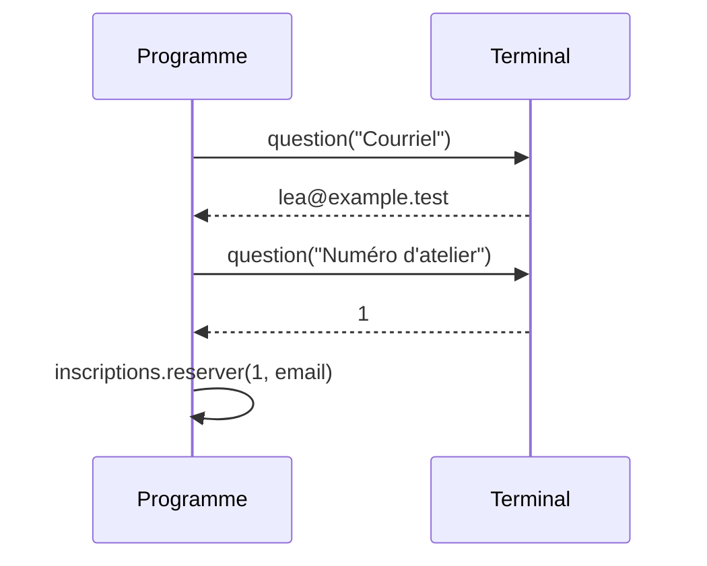
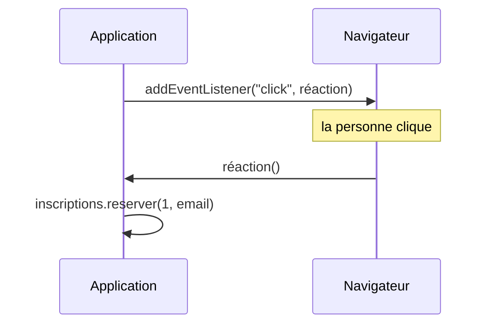
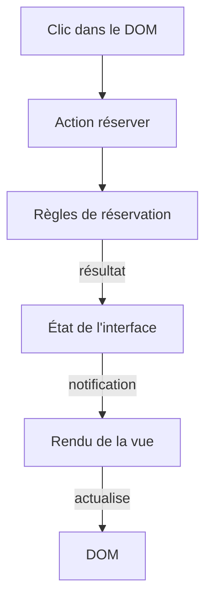

# Frameworks 1, qui appelle le code de l'application

L'application d'ateliers sait déjà réserver une place et refuser une demande invalide. Pour l'utiliser dans un navigateur, il reste à relier ces opérations à une interface. Qui appelle le code de réservation après un clic ? Comment le nombre de places affiché suit-il les réservations ? Que faut-il arrêter lorsqu'une vue disparaît ?

Nous allons construire un petit framework d'environ 130 lignes en sept chapitres. Chaque étape corrige une limite de la précédente à l'aide des patterns du cours. On retrouve ainsi des mécanismes présents dans React, Vue, Svelte ou Angular.

1. Dans ce chapitre, le navigateur déclenche les actions de la personne et une première fonction `monter` installe l'interface. On introduit ainsi l'inversion de contrôle.
2. [Un état observé et un rendu naïf](/poo-patterns-frameworks/08-2-etat/) relie les changements de données à l'affichage avec un store fondé sur Observer. La mise à jour par `innerHTML` révèle ensuite trois limites.
3. [Composants, fonctions ou classes](/poo-patterns-frameworks/08-3-composants/) sépare les parties de l'interface et compare deux façons de leur donner un cycle de vie, avec les Web Components et un rapprochement avec Template Method.
4. [Des signaux qui s'abonnent seuls](/poo-patterns-frameworks/08-4-signaux/) évite de déclarer chaque abonnement à la main. Le mécanisme observe les données lues pendant un calcul.
5. [Monter et nettoyer](/poo-patterns-frameworks/08-5-nettoyage/) associe les abonnements à la durée de vie de la vue afin de les retirer au bon moment.
6. [Fournir les services](/poo-patterns-frameworks/08-6-injection/) sépare les composants du choix des objets qu'ils utilisent grâce à l'injection de dépendances.
7. [Comparer avec les frameworks réels](/poo-patterns-frameworks/08-7-bilan/) situe le DOM virtuel et la compilation par rapport aux mécanismes construits.

Les chapitres font évoluer les mêmes fichiers. Le [corrigé final](/ressources/poo-patterns-frameworks/mini-framework/src/framework.ts) rassemble le framework obtenu à la fin du chapitre 6. Le dossier [`mini-framework`](/ressources/poo-patterns-frameworks/mini-framework/package.json) contient aussi l'application complète et ses vérifications.

## Ce que dit la définition

En 1988, Ralph Johnson et Brian Foote décrivent les frameworks orientés objet dans l'article [*Designing Reusable Classes*](http://www.laputan.org/drc/drc.html), publié dans le *Journal of Object-Oriented Programming*. Ralph Johnson est aussi l'un des quatre auteurs du catalogue GoF. Voici leur définition, traduite :

> Une caractéristique importante d'un framework est que les méthodes définies par l'utilisateur pour l'adapter sont souvent appelées depuis le framework lui-même, et non depuis le code de l'application. Le framework joue souvent le rôle du programme principal : il coordonne et ordonne l'activité de l'application. Cette inversion du contrôle donne aux frameworks le pouvoir de servir de squelettes extensibles.

En 2005, Martin Fowler reprend cette citation dans son article [*InversionOfControl*](https://martinfowler.com/bliki/InversionOfControl.html). Il y écrit que l'inversion de contrôle est ce qui distingue un framework d'une bibliothèque. Il cite aussi son surnom, le « principe d'Hollywood », d'après la phrase qu'on prête aux studios : « Ne nous appelez pas, nous vous appellerons. »

## En clair

Une **bibliothèque** fournit des fonctions que l'application appelle pour effectuer une tâche. Le code de l'application choisit quand demander cette tâche et comment utiliser son résultat. Par exemple, dans `inscriptions.reserver(1, "lea@example.test")`, il demande une réservation, puis poursuit son traitement. L'exemple est synchrone, et une bibliothèque peut aussi être asynchrone. La différence tient à qui décide du moment de l'appel.

Un **framework** organise une partie de l'exécution et appelle le code que l'application lui fournit aux moments prévus. Vous écrivez par exemple comment construire une vue, et le framework décide quand appeler cette fonction. L'**inversion de contrôle**, souvent abrégée IoC, désigne ce changement de responsable. Pour la partie concernée, l'application fournit une réaction au lieu de déclencher elle-même chaque appel. Elle garde toutefois la responsabilité de ses règles et des opérations qu'elle demande depuis cette réaction.

## Le repérer dans le code

Suivez l'appel d'une fonction de l'application. Si votre code la transmet au navigateur ou au framework, qui la déclenche ensuite selon son propre cycle, l'appel est inversé. Ce transfert du moment de l'appel caractérise l'inversion de contrôle, même quand l'ordre des instructions reste facile à suivre.

## Avant, le terminal pose les questions dans son ordre

Martin Fowler compare deux versions d'un même programme pour montrer qui pilote l'échange. On peut faire cette comparaison avec les ateliers, sans modifier les règles de réservation. Dans une copie d'[`ateliers.ts`](/ressources/poo-patterns-frameworks/ateliers.ts), remplacez l'import d'`assert` par celui de `readline`. Conservez le catalogue et la création de l'objet d'inscription, puis remplacez les assertions et les `console.log` de la fin par ces lignes.

```ts
import { createInterface } from "node:readline/promises";

// Les types, la classe Inscriptions et le catalogue ne changent pas.

const terminal = createInterface({ input: process.stdin, output: process.stdout });
const email = await terminal.question("Courriel : ");
const atelierId = Number(await terminal.question("Numéro d'atelier : "));
console.log(inscriptions.reserver(atelierId, email));
terminal.close();
```

Exécutez `node ateliers.ts` et répondez aux deux questions avec un courriel valide et un identifiant d'atelier. La réservation s'affiche ensuite dans le terminal. Dans cette version, le programme fixe l'ordre de l'échange. Il attend le courriel avant de demander l'atelier, puis attend l'identifiant avant de réserver. La personne ne peut pas inverser ces deux étapes sans que l'on change le programme.



## Après, le navigateur appelle vos fonctions

Dans le formulaire web que l'on veut construire, les champs et les boutons restent disponibles en même temps. La personne peut saisir son courriel, choisir un atelier, puis revenir corriger l'adresse. Au lieu d'attendre chaque réponse dans une suite d'instructions, l'application enregistre une fonction à appeler lors du clic. Le navigateur la déclenche lorsque cet événement survient.

```ts
bouton.addEventListener("click", () => {
  inscriptions.reserver(atelier.id, champ.value);
});
```

L'appel à `addEventListener` illustre déjà une inversion de contrôle à petite échelle. La fonction passée en second argument n'est pas exécutée au moment de l'inscription. Le navigateur conserve l'écouteur et l'appelle lorsque le bouton reçoit un clic. L'application n'a donc pas à écrire une boucle qui surveille ce bouton. Le navigateur prend en charge le déclenchement des appels à travers sa [boucle d'événements](https://developer.mozilla.org/fr/docs/Web/JavaScript/Reference/Execution_model).



Notre framework appellera aussi le code de l'application pour construire l'affichage, le mettre à jour et libérer ses ressources. Le retrait d'un élément ne suffit pas à arrêter tout le code qui lui est associé.

## Préparer le projet

Le premier programme web réutilise les règles du terminal, mais son point d'entrée sera une page. Comme les navigateurs n'exécutent pas directement TypeScript, [Vite](https://vite.dev/guide/) transforme les fichiers `.ts` et fournit un serveur de développement. Créez le projet dans un nouveau dossier de travail :

```sh
npm create vite@latest ateliers-ui -- --template vanilla-ts
cd ateliers-ui
npm install
```

Le modèle `vanilla-ts` crée une page `index.html`, qui contient un élément `<div id="app">` et charge `src/main.ts`. Vous remplacerez ce fichier plus bas. Les autres fichiers de démonstration de `src/` ne serviront pas, et vous pouvez les supprimer.

Copiez ensuite [`inscriptions.ts` du corrigé](/ressources/poo-patterns-frameworks/mini-framework/src/inscriptions.ts) dans `src/`. Il reprend les règles de réservation d'`ateliers.ts`, sans le catalogue ni les assertions. Il ajoute le type `AtelierAvecPlaces`, qui décrit un atelier accompagné de son nombre de places libres et que renvoie `listerAteliers`.

Ce fichier est un **module**. Le mot `export` placé devant ses types et sa classe permet aux autres fichiers de les importer. Les champs privés comme `#reservations` restent en revanche inaccessibles hors de la classe. L'interface passera donc par les méthodes publiques d'`Inscriptions`, et les règles de capacité et de doublon resteront dans la classe. Le [guide des modules de MDN](https://developer.mozilla.org/fr/docs/Web/JavaScript/Guide/Modules) détaille `import` et `export`.

## Écrire la première fonction du framework

Créez `src/framework.ts` pour y placer le code qui installe une interface, sans connaître les ateliers ni les réservations. Cette première version ne fait que construire un élément, l'ajouter à la page et fournir une façon de le retirer. Le type `HTMLElement` désigne l'objet JavaScript qui représente un élément HTML.

```ts
export type Composant = () => HTMLElement;

export function monter(racine: HTMLElement, composant: Composant): () => void {
  const element = composant();
  racine.append(element);
  return () => element.remove();
}
```

Un **composant** est ici une fonction qui construit un morceau d'interface et renvoie son élément HTML. La fonction `monter` reçoit cette fonction de construction et la **racine**, c'est-à-dire l'élément de la page qui accueillera son résultat. Elle appelle le composant, puis insère l'élément obtenu dans la page. Elle renvoie enfin une fonction qui pourra retirer cet élément. Cette fonction prépare le **démontage**, pour l'instant limité au retrait du DOM, l'arbre d'éléments qui représente la page. Le type de retour `() => void` indique que l'appel à la fonction de montage fournit une autre fonction, sans argument ni valeur de retour.

En recevant une fonction, `monter` choisit le moment de construction. Si on lui fournissait seulement un élément déjà construit, le composant se serait exécuté avant l'appel au framework. Dans cette première version, `monter` l'appelle immédiatement. Au chapitre 5, ce même point d'appel permettra aussi de recueillir les opérations de nettoyage créées pendant la construction.

Remplacez ensuite le contenu de `src/main.ts`.

```ts
import { Inscriptions } from "./inscriptions.ts";
import { monter } from "./framework.ts";

const inscriptions = new Inscriptions([
  { id: 1, titre: "Dessin", capacite: 2, prixCentimes: 2000 },
  { id: 2, titre: "Photo", capacite: 1, prixCentimes: 3000 },
]);

function PageAteliers(): HTMLElement {
  const page = document.createElement("main");
  const champ = document.createElement("input");
  champ.type = "email";
  const etiquette = document.createElement("label");
  etiquette.append("Courriel ", champ);
  const statut = document.createElement("p");
  statut.setAttribute("role", "status");
  const liste = document.createElement("ul");

  for (const atelier of inscriptions.listerAteliers()) {
    const bouton = document.createElement("button");
    bouton.textContent = "Réserver";
    bouton.addEventListener("click", () => {
      try {
        const reservation = inscriptions.reserver(atelier.id, champ.value);
        statut.textContent = `Réservation ${reservation.id} confirmée pour ${reservation.email}`;
      } catch (erreur) {
        statut.textContent = erreur instanceof Error ? erreur.message : String(erreur);
      }
    });
    const ligne = document.createElement("li");
    ligne.append(`${atelier.titre}, places libres : ${atelier.places} `, bouton);
    liste.append(ligne);
  }

  page.append(etiquette, liste, statut);
  return page;
}

monter(document.querySelector<HTMLElement>("#app")!, PageAteliers);
```

Les imports se terminent par `.ts`, comme dans le reste du cours. Vite les accepte, et Node.js pourra exécuter les mêmes fichiers dans les tests des chapitres suivants. Le nom `PageAteliers` commence par une majuscule, une convention des frameworks pour distinguer un composant d'une fonction ordinaire. L'attribut `role="status"` demande aux lecteurs d'écran d'annoncer les changements du message.

Le `try` regroupe l'appel à `reserver` et la préparation du message de confirmation. Si la réservation est refusée, le traitement passe dans le bloc d'erreur et affiche le motif, par exemple « Atelier complet ». La règle de capacité reste dans `Inscriptions`, tandis que l'interface traduit le résultat en message pour la personne.

## Vérifier

Lancez `npm run dev`, puis ouvrez l'adresse affichée, en général `http://localhost:5173`. Saisissez `lea@example.test` et cliquez sur le bouton de l'atelier Dessin. Au premier essai, le message doit confirmer la réservation 1. Cliquez à nouveau avec la même adresse pour observer le refus d'une double inscription. Le message change, mais la réservation précédente reste enregistrée.

Après la première réservation, la ligne affiche pourtant toujours « places libres : 2 ». Le calcul des places est juste. Le décalage vient de `PageAteliers`, qui a lu les données une seule fois, au montage, puis créé un texte qui ne change plus. La réservation a modifié les données internes, sans déclencher de nouvelle lecture pour l'affichage. Il manque donc un lien entre le changement de données et la mise à jour de la vue. Le [chapitre 2](/poo-patterns-frameworks/08-2-etat/) construit ce lien.

## Le trajet d'un clic

Le schéma suit un clic sur Réserver jusqu'au nombre de places actualisé. La réservation fonctionne déjà, mais le lien entre l'état et l'affichage reste à construire.



Chaque étape a un rôle distinct dans ce trajet.

| Élément | Responsabilité | Chapitre |
| --- | --- | --- |
| Événement DOM | Signaler le clic de la personne. | 1 |
| Action | Demander une réservation et traiter son résultat. | 1, puis 6 |
| Règles | Vérifier la capacité, le courriel et les doublons dans `Inscriptions`. | Point de départ |
| État de l'interface | Conserver les informations nécessaires à l'affichage. | 2 |
| Notifications | Prévenir les vues d'un changement d'état. | 2, puis 4 |
| Rendu | Mettre l'affichage en accord avec l'état. | 2, 3 et 4 |
| Nettoyage | Retirer les abonnements d'une vue démontée. | 3, puis 5 |

Désactiver le bouton d'un atelier complet améliore l'interface, mais la règle de capacité reste dans `Inscriptions`. Un autre appelant, comme un import de fichier ou une autre page, pourrait demander une réservation sans passer par ce bouton.

## Nuance, une frontière qui dépend du point de vue

La limite entre bibliothèque et framework dépend de la partie du programme que l'on observe. React se présente comme une bibliothèque, et votre code l'appelle bien pour démarrer le rendu. Pourtant, son moteur appelle ensuite vos composants pendant les phases de [rendu et de commit](https://react.dev/learn/render-and-commit). Pour cette partie de l'exécution, React se comporte comme un framework, tandis que d'autres choix, comme le routage, restent à votre charge.

L'application garde ses décisions, mais confie certains déclenchements au framework. Suivre l'exécution demande alors de connaître ses points d'appel. Une erreur dans un composant peut apparaître dans une pile qui traverse le framework, et l'ordre des mises à jour ne se déduit plus du seul fichier du composant.
