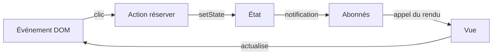

# Frameworks et inversion de contrôle

Une bibliothèque fournit des fonctions que ton application appelle. Un framework organise une partie de l'exécution et appelle le code que tu lui confies. Cette inversion de contrôle, ou IoC, concerne le cycle d'exécution. La distinction est utile, même si un outil peut combiner les deux rôles.

L'injection de dépendances consiste à fournir une dépendance au lieu de la construire sur place. Elle peut aider à organiser un framework, mais elle ne désigne pas toute l'inversion de contrôle.

## Un micro-framework pour comprendre

Notre cible pédagogique affiche le nombre de places et un bouton de réservation. Un clic déclenche une action. L'action modifie l'état, puis l'interface reflète cet état. Le framework décide quand appeler la fonction de rendu fournie par l'application.



Le premier rendu a lieu au montage, avant tout clic. Une notification d'état ne doit pas simuler un nouveau clic. Sans cette distinction, le schéma peut masquer une boucle infinie.

## API proposée à discuter

```ts
type Etat = { places: number };
type Store = {
  getState(): Readonly<Etat>;
  setState(suivant: Etat): void;
  subscribe(fn: (etat: Readonly<Etat>) => void): () => void;
};
type Monter = (racine: HTMLElement, store: Store) => () => void;
```

Ce contrat est une proposition, pas un exercice de mémorisation. Le groupe peut retenir des noms ou une organisation différents. `Readonly` protège les écritures directes au typage, pas l'objet à l'exécution.

Au montage, créer les éléments DOM, brancher le clic avec `addEventListener`, s'abonner au store et effectuer le premier rendu. Le rendu actualise le texte et l'état du bouton. Au démontage, appeler le désabonnement et retirer l'écouteur DOM avec la même fonction. Le métier garde le contrôle de la capacité, même si le bouton est désactivé.

## Tester le schéma avant de coder

Suivez une réservation réussie puis une réservation refusée. Précisez qui produit le message d'erreur et si l'état change. Retirez ensuite la vue. Elle ne doit plus recevoir de notification. Une panne de notification ne signifie pas automatiquement que la réservation a échoué.

Codez éventuellement le store ou le montage d'une vue, puis simulez le reste sur papier. Pas de DOM virtuel, de routeur ni de système de plugins. Le résultat explique un mécanisme de framework, sans prétendre remplacer un framework de production. [Observer](/poo-patterns-frameworks/03-observer/) aide à discuter les abonnements.
