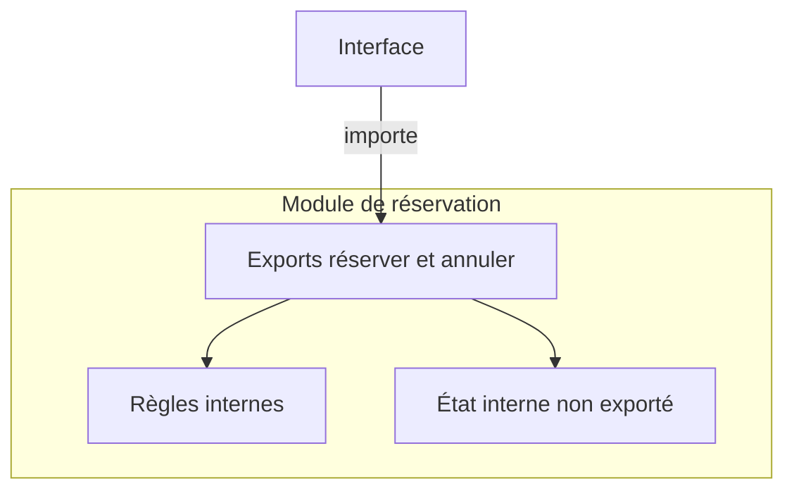
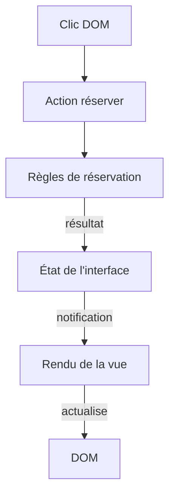
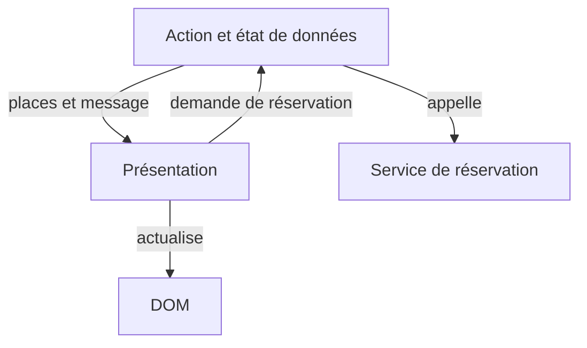

# Frameworks et inversion de contrôle

L'application d'ateliers fonctionne pour l'instant dans un terminal. Cette dernière séance prépare son passage à une interface qui affiche les places et propose une réservation. Elle sert aussi à repérer les responsabilités dans un framework existant. Elle ne demande pas de construire un framework.

## Partir d'un clic sur Réserver

Dessiner le trajet du clic jusqu'au nombre de places affiché. Reprendre `reserver` et `listerAteliers` du [point de départ](/poo-patterns-frameworks/10-exercice/) ; les règles de capacité et de doublon restent dans ce code métier. L'interface appelle ces opérations et présente leur résultat.

Avant de choisir une bibliothèque, répondre à ces questions :

- Qui demande la réservation et qui vérifie ses règles ?
- Qui conserve l'état nécessaire à l'affichage ?
- Qui retire les écouteurs et les abonnements quand une vue disparaît ?

Les sections suivantes aident à annoter ce trajet. Les lectures de Fowler, MDN, React et Patterns.dev apportent des points de vue complémentaires sur son organisation.

## Qui appelle le code de l'application ?

Une bibliothèque fournit des opérations que l'application appelle. Un framework organise une partie de l'exécution et appelle les fonctions que l'application lui fournit. Il fixe des points d'entrée et des moments d'exécution, par exemple le montage d'une vue ou le traitement d'une requête.

Cette inversion de contrôle, ou IoC, existe aussi à plus petite échelle. Après l'inscription d'un écouteur DOM, le navigateur appelle cette fonction quand l'événement survient. L'application ne contient pas une boucle qui surveille elle-même tous les clics. Martin Fowler décrit l'[inversion de contrôle](https://martinfowler.com/bliki/InversionOfControl.html) comme une différence dans la conduite de l'exécution.

La frontière entre bibliothèque et framework dépend du périmètre observé. React se présente comme une bibliothèque. Son moteur de rendu appelle pourtant les composants au cours du cycle de [rendu et de commit](https://react.dev/learn/render-and-commit). L'application peut contrôler d'autres choix, comme son routage.

## Une frontière de module

Un module JavaScript choisit ce qu'il exporte. Les autres fichiers importent ses opérations publiques, sans accéder directement aux variables qu'il garde dans sa portée. Cette frontière permet de modifier la représentation des réservations sans changer leurs appelants.



Exporter un objet mutable permet encore aux appelants de modifier cet objet. Le fichier ne protège que les accès qu'il ne donne pas.

[Module Pattern sur Patterns.dev](https://www.patterns.dev/vanilla/module-pattern/) présente cette organisation. Le [guide des modules de MDN](https://developer.mozilla.org/fr/docs/Web/JavaScript/Guide/Modules) décrit `import` et `export`.

## Le cycle d'une interface

Une vue affiche le nombre de places et propose une réservation. Son fonctionnement distingue les responsabilités suivantes.

| Élément | Responsabilité |
| --- | --- |
| Événement DOM | Signaler le clic de la personne. |
| Action | Demander une réservation et traiter son résultat. |
| Métier | Vérifier les règles, notamment la capacité. |
| État de l'interface | Conserver les informations nécessaires à l'affichage. |
| Notifications | Prévenir les vues abonnées d'un changement d'état. |
| Rendu | Calculer puis appliquer l'affichage correspondant à l'état. |



Le rendu ne déclenche pas une nouvelle réservation. Il décrit l'état obtenu. Désactiver le bouton quand l'atelier est complet améliore l'interface, mais la règle de capacité reste dans le métier. Un autre appelant pourrait demander une réservation sans utiliser ce bouton.

## Présentation et orchestration

Une vue reçoit des données à afficher et signale les actions demandées. L'orchestration appelle les services, traite leurs résultats et prépare les données de la vue. La présentation peut ainsi s'examiner avec des données connues, sans contacter le fournisseur.



Cette séparation de responsabilités n'impose pas deux composants ni deux classes. Un état local, comme le texte saisi dans un champ, peut rester dans la vue. Extraire une couche qui ne fait que transmettre les mêmes données ajoute une étape de lecture. [Container/Presentational sur Patterns.dev](https://www.patterns.dev/react/presentational-container-pattern/) illustre cette séparation avec React et discute ses limites.

## Un contrat minimal d'état et de montage

Le contrat suivant rend visibles les échanges nécessaires. Son implémentation peut utiliser des fonctions et des écouteurs, sans hiérarchie de classes.

```ts
type Etat = Readonly<{ places: number; message: string }>;
interface Store {
  getState(): Etat;
  setState(suivant: Etat): void;
  subscribe(fn: (etat: Etat) => void): () => void;
}
type MonterVue = (
  racine: HTMLElement,
  store: Store,
  reserver: () => void
) => () => void;
```

`getState` fournit l'état courant. `setState` remplace cet état et prévient les abonnés. `subscribe` renvoie une fonction de désabonnement.

Au montage, la vue crée ses éléments, branche le clic et s'abonne au store. Elle effectue aussi un premier rendu, sans attendre un changement. L'action `reserver` lui est fournie par l'application.

Au démontage, la vue appelle le désabonnement et [retire son écouteur DOM](https://developer.mozilla.org/fr/docs/Web/API/EventTarget/removeEventListener). La fonction renvoyée par `MonterVue` regroupe ce nettoyage. Une vue retirée ne doit plus recevoir les changements.

## Injection de dépendances et choix d'architecture

L'injection de dépendances fournit un collaborateur depuis l'extérieur au lieu de le construire dans le code qui l'utilise. Ici, le montage reçoit le store et l'action.

L'[article de Fowler sur l'injection](https://martinfowler.com/articles/injection.html) approfondit ce mécanisme. La section sur l'[inversion des dépendances](/poo-patterns-frameworks/01-solid/#d-inversion-des-dependances) distingue ce principe de l'injection. La séance [Strategy](/poo-patterns-frameworks/02-strategy/) applique une fonction fournie par l'appelant à une variation de tarif.

Pour examiner un framework concret, repérez le propriétaire de l'état, le mécanisme qui programme le rendu et le nettoyage au démontage. La politique d'erreur des abonnés complète ce cycle d'exécution.

## Vérifier le trajet choisi

Placer les événements suivants sur le schéma du début :

1. Une réservation réussit. Le nombre de places change après son enregistrement.
2. L'atelier est complet. Le refus s'affiche et les données restent inchangées.
3. La vue est retirée. Son abonnement et son écouteur de clic sont nettoyés.
4. Une notification provoque un nouveau rendu. Elle ne déclenche pas une nouvelle réservation.

Le livrable est un schéma annoté et une explication des responsabilités. Si une interface existe déjà dans votre projet, vérifier ces cas sur elle. Sinon, ces vérifications restent des scénarios à jouer ; les contrats présentés ici ne constituent pas une interface prête à exécuter.
