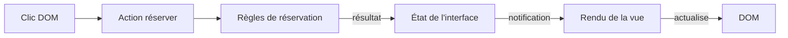

# Frameworks et inversion de contrôle

## Qui appelle le code de l'application ?

Une bibliothèque fournit des opérations que l'application appelle. Un framework organise une partie de l'exécution et appelle les fonctions que l'application lui fournit. Il fixe des points d'entrée et des moments d'exécution, par exemple le montage d'une vue ou le traitement d'une requête.

Cette inversion de contrôle, ou IoC, existe aussi à plus petite échelle. Après l'inscription d'un écouteur DOM, le navigateur appelle cette fonction quand l'événement survient. L'application ne contient pas une boucle qui surveille elle-même tous les clics. Martin Fowler décrit l'[inversion de contrôle](https://martinfowler.com/bliki/InversionOfControl.html) comme une différence dans la conduite de l'exécution.

La frontière entre bibliothèque et framework dépend du périmètre observé. React se présente comme une bibliothèque. Son moteur de rendu appelle pourtant les composants au cours du cycle de [rendu et de commit](https://react.dev/learn/render-and-commit). L'application peut contrôler d'autres choix, comme son routage.

## Le cycle d'une interface

Une vue affiche le nombre de places et propose une réservation. Son fonctionnement distingue les responsabilités suivantes.

| Élément | Responsabilité |
| --- | --- |
| Événement DOM | Signaler le clic de la personne. |
| Action | Demander une réservation et traiter son résultat. |
| Métier | Vérifier les règles, notamment la capacité. |
| État de l'interface | Conserver les informations nécessaires à l'affichage. |
| Notifications | Prévenir les vues abonnées d'un changement d'état. |
| Rendu | Calculer puis appliquer l'affichage correspondant à l'état. |



Le rendu ne déclenche pas une nouvelle réservation. Il décrit l'état obtenu. Désactiver le bouton quand l'atelier est complet améliore l'interface, mais la règle de capacité reste dans le métier. Un autre appelant pourrait demander une réservation sans utiliser ce bouton.

## Un contrat minimal d'état et de montage

Le contrat suivant rend visibles les échanges nécessaires. Son implémentation peut utiliser des fonctions et des écouteurs, sans hiérarchie de classes.

```ts
type Etat = Readonly<{ places: number; message: string }>;
interface Store {
  getState(): Etat;
  setState(suivant: Etat): void;
  subscribe(fn: (etat: Etat) => void): () => void;
}
type MonterVue = (
  racine: HTMLElement,
  store: Store,
  reserver: () => void
) => () => void;
```

`getState` fournit l'état courant. `setState` remplace cet état et prévient les abonnés. `subscribe` renvoie une fonction de désabonnement. Le contrat doit préciser si deux états égaux produisent une notification. `Readonly` interdit les affectations au typage, il ne fige pas l'objet à l'exécution.

Au montage, la vue crée ses éléments, branche le clic et s'abonne au store. Elle effectue aussi un premier rendu, sans attendre un changement. L'action `reserver` lui est fournie par l'application.

Au démontage, la vue appelle le désabonnement et retire son écouteur DOM. Le [retrait d'un écouteur](https://developer.mozilla.org/fr/docs/Web/API/EventTarget/removeEventListener) exige la même fonction et la même valeur de capture qu'à l'inscription. La fonction renvoyée par `MonterVue` regroupe ce nettoyage. Une vue retirée ne doit plus recevoir les changements.

## Injection de dépendances et choix d'architecture

L'injection de dépendances fournit un collaborateur depuis l'extérieur au lieu de le construire dans le code qui l'utilise. Un constructeur peut recevoir un service de notification. Ici, le montage reçoit le store et l'action. Aucun conteneur d'injection n'est nécessaire pour réaliser ce mécanisme.

L'[article de Fowler sur l'injection](https://martinfowler.com/articles/injection.html) détaille ces possibilités. L'injection décrit l'assemblage des collaborateurs. Le principe d'inversion des dépendances décrit les dépendances entre règles et détails techniques. [Strategy](/poo-patterns-frameworks/02-strategy/) décrit une variation d'algorithme. Fournir un objet au constructeur ne démontre pas, à lui seul, les deux autres notions.

Pour examiner un framework concret, repérez le propriétaire de l'état, le mécanisme qui programme le rendu et le nettoyage au démontage. La politique d'erreur des abonnés complète ce cycle d'exécution.
