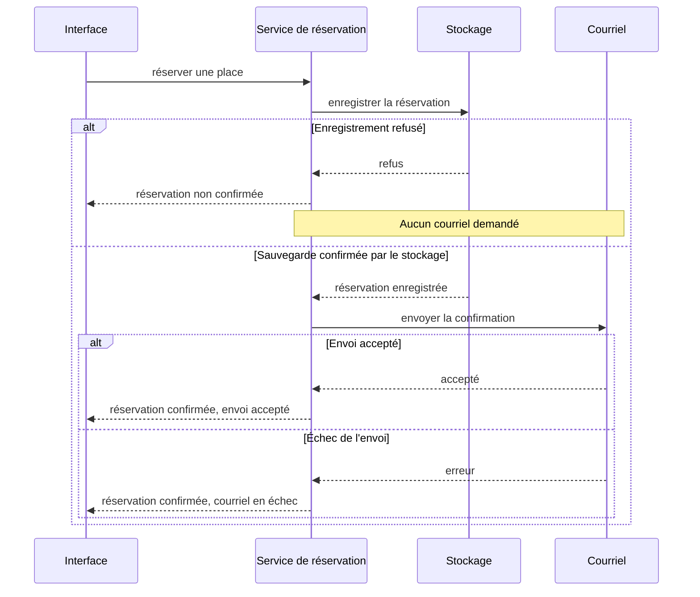

# Mise en situation

Une application d'inscription propose un catalogue d'ateliers, une réservation et une annulation. Elle fonctionne avec un tarif unique et des données en mémoire. L'[exemple TypeScript](/poo-patterns-frameworks/10-exercice/) permet de vérifier les comportements, mais les choix se comparent aussi par des schémas.

Un schéma indique les responsabilités, nomme les appels et représente les erreurs.

Ces trois demandes servent de carnet de décisions pendant les séances. Avant chaque lecture, proposer une modification directe du programme. Après la lecture, comparer cette proposition au pattern étudié.

## Situation 1, des tarifs qui varient

Un tarif solidaire accorde une réduction de moitié. Les montants sont des entiers en centimes, arrondis au centime le plus proche. Le montant enregistré ne change plus après la réservation. D'autres réductions sont envisagées, sans besoin confirmé.

Retrouver l'affectation de `montantCentimes` dans le programme. Écrire une assertion pour le prix impair et une autre pour le montant figé. La [séance Strategy](/poo-patterns-frameworks/02-strategy/) fait ensuite essayer les deux options suivantes.

Une option conserve une fonction avec une condition sur le tarif. Les règles et leur sélection se lisent au même endroit. Une autre fournit une fonction de tarif à la réservation. Chaque règle peut évoluer séparément, mais le choix de cette fonction doit être organisé ailleurs.

La première option convient à deux règles locales et stables. La seconde devient intéressante si les tarifs changent souvent ou sont réutilisés. Une [Strategy](/poo-patterns-frameworks/02-strategy/) isole alors le calcul. Une [fabrique](/poo-patterns-frameworks/04-factory/) peut regrouper une sélection répétée.

L'arrondi appartient à la règle de calcul, avec un test commun aux appelants. Pour 2 001 centimes, le tarif solidaire donne 1 001 centimes. Une ancienne réservation garde son montant après modification du catalogue. Recalculer son prix à la lecture changerait la règle métier.

## Situation 2, une API externe et un enregistrement qui échoue

Un partenaire expose les ateliers avec le champ `remaining_seats`. Les réservations doivent survivre au redémarrage. Le service peut renvoyer un format invalide ou refuser un enregistrement. Une confirmation ne doit pas annoncer une sauvegarde qui a échoué.

Séparer les deux besoins avant de dessiner. Quelles données faut-il traduire ? Quelles données faut-il retrouver après un redémarrage ? Les séances [Adapter](/poo-patterns-frameworks/05-adapter/) et [Repository](/poo-patterns-frameworks/07-repository/) travaillent ces questions dans des copies distinctes du programme.

Une option place l'appel au fournisseur et sa traduction dans le service de réservation. Elle limite les contrats, mais mêle règles métier et formats externes. Une autre confie la traduction à un [Adapter](/poo-patterns-frameworks/05-adapter/) et la collection persistante à un [Repository](/poo-patterns-frameworks/07-repository/). Elle contient les changements du fournisseur, au prix de contrats et d'implémentations supplémentaires.

Plusieurs opérations utilisant le fournisseur donnent davantage de raisons d'isoler sa traduction. Une intégration unique peut conserver une frontière plus directe, avec une validation de sa réponse.

La confirmation suit le succès de l'enregistrement.

## Situation 3, plusieurs réactions puis une interface

Une confirmation alimente un journal et un courriel. Une vue des places réagit aussi aux changements et peut être retirée. L'échec du courriel ne doit pas annuler une réservation déjà confirmée.

Dessiner l'ordre des appels avec un courriel en échec. Indiquer à quel moment la réservation est confirmée et qui retire l'abonnement de la vue. La [séance Observer](/poo-patterns-frameworks/03-observer/) permet de vérifier ces choix avec des réactions simulées.

Une option appelle explicitement chaque destinataire. L'ordre et les erreurs sont visibles, mais le service connaît chaque réaction. Une autre émet un événement reçu par des abonnés. [Observer](/poo-patterns-frameworks/03-observer/) permet d'ajouter une réaction sans modifier l'émetteur. Le trajet des appels devient moins visible et demande une politique d'erreur.

Des destinataires peu nombreux et stables favorisent les appels directs. Des réactions indépendantes ajoutées régulièrement donnent davantage d'intérêt aux abonnements. Une trace autour d'une opération peut relever de [Decorator](/poo-patterns-frameworks/06-decorator/) plutôt que d'un événement partagé.

L'interface conserve la réservation confirmée et signale séparément l'échec d'envoi. Le démontage d'une vue libère son abonnement. Une notification d'état provoque un rendu, pas une nouvelle réservation. Le [chapitre sur les frameworks](/poo-patterns-frameworks/08-frameworks/) détaille cette séparation.

### Représenter les succès et les échecs séparément

Cette séquence montre une option avec des appels directs. Elle distingue le résultat de l'enregistrement de celui du courriel.

## Une dernière demande sans pattern indiqué

Exporter les réservations actives avec leurs champs `id`, `atelierId`, `email` et `montantCentimes`. L'export ne modifie aucun enregistrement et n'émet aucune notification.

Proposer une fonction, ses contrôles et un schéma seulement s'il aide à expliquer la solution. Aucun pattern n'est imposé. Vérifier les données exportées, puis l'absence de modification et de notification. Expliquer en quelques phrases ce qui justifie le découpage retenu.

## Garder la raison d'une décision avec un ADR

Un ADR conserve le contexte, la décision et ses conséquences. Le [support consacré aux ADR](/architecture-logicielle/06-adr/#version-minimale) en donne une forme courte. Voici un exemple pour les tarifs.

> Deux tarifs sont utilisés uniquement par la réservation. Nous conservons une fonction avec une condition plutôt que deux stratégies injectées. La lecture reste locale, mais ajouter un tarif demande de modifier cette fonction. Nous réexaminerons ce choix si une deuxième opération réutilise les règles ou si leurs évolutions deviennent indépendantes.

L'ADR note une décision et son coût. La [proposition de Michael Nygard](https://cognitect.com/blog/2011/11/15/documenting-architecture-decisions) explique l'intérêt de conserver ces raisons, même lorsque la décision est remplacée.
