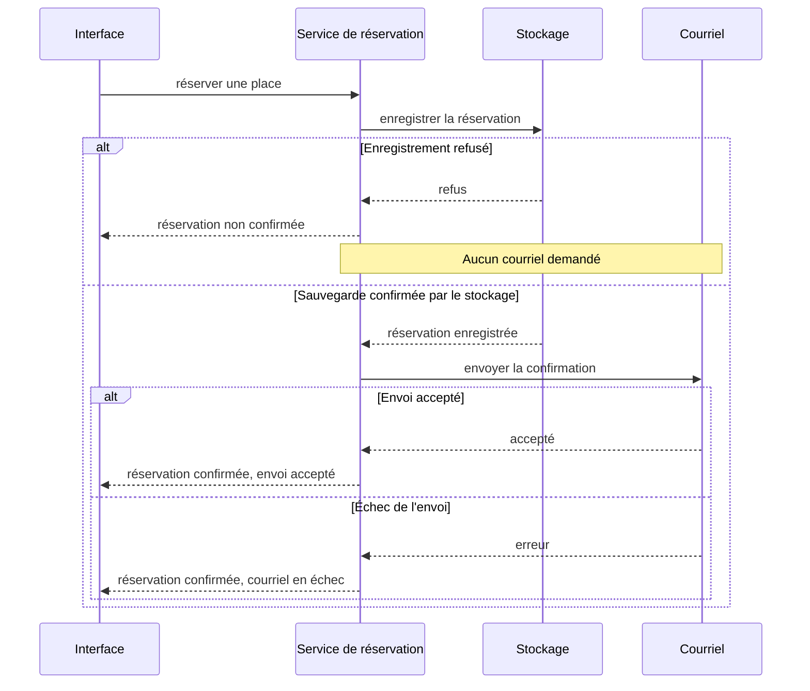

# Mise en situation

L'[application de réservation](/poo-patterns-frameworks/10-exercice/) permet de consulter les ateliers, de réserver une place et d'annuler une inscription. Voici trois évolutions à essayer.

## Situation 1, des tarifs qui varient

Ajoutez un tarif solidaire qui réduit le prix de moitié, arrondi au centime le plus proche. Pour un prix de 2 001 centimes, la réservation doit enregistrer 1 001 centimes. Son montant reste ensuite inchangé, même si le prix du catalogue évolue.

La séance [Strategy](/poo-patterns-frameworks/02-strategy/) montre comment ajouter ce tarif à `reserver`, d'abord avec une condition, puis avec un objet qui calcule le montant. La séance [Factory](/poo-patterns-frameworks/04-factory/) regroupe le choix du tarif quand plusieurs endroits en ont besoin.

## Situation 2, une API externe et un enregistrement qui échoue

Un partenaire fournit les places disponibles dans un champ `remaining_seats`. Branchez cette information sur la liste des ateliers avec [Adapter](/poo-patterns-frameworks/05-adapter/). Une réponse invalide ou une panne doit être signalée, sans être confondue avec un atelier complet.

On souhaite aussi conserver les réservations après un redémarrage. La séance [Repository](/poo-patterns-frameworks/07-repository/) prépare les échanges avec le stockage et simule un échec d'écriture. La confirmation ne doit être envoyée qu'après un enregistrement réussi. Le stockage durable reste à ajouter.

## Situation 3, plusieurs réactions puis une interface

Après une réservation confirmée, l'application ajoute une entrée dans un journal, envoie un courriel et actualise les places disponibles. L'échec du courriel laisse la réservation confirmée. Quand la vue est retirée, elle ne reçoit plus les changements suivants.

Avec [Observer](/poo-patterns-frameworks/03-observer/), abonnez la vue et le courriel aux réservations, puis essayez de retirer la vue et de faire échouer le courriel. La [série sur les frameworks](/poo-patterns-frameworks/08-frameworks/) reprend ces mécanismes dans une interface. Pour ajouter une trace autour d'un appel, voyez aussi [Decorator](/poo-patterns-frameworks/06-decorator/).

### Représenter les succès et les échecs séparément

Cette séquence montre l'ordre des appels. L'enregistrement et l'envoi du courriel ont chacun leur résultat.

## Exporter les réservations

Ajoutez une fonction qui exporte les réservations actives avec leurs champs `id`, `atelierId`, `email` et `montantCentimes`. Essayez-la après quelques inscriptions et une annulation. L'export ne modifie aucun enregistrement et n'émet aucune notification.
