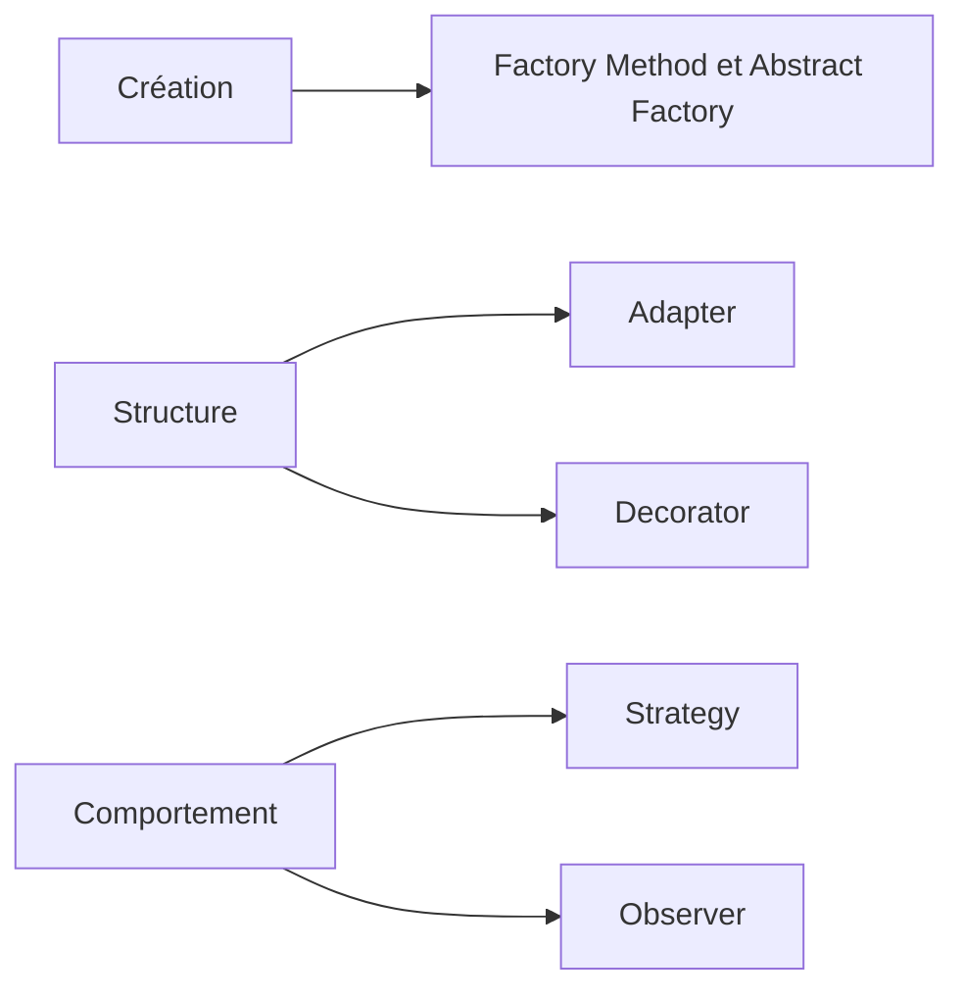

# POO, design patterns et frameworks

Vous allez créer des créatures avec leur propre énergie, puis faire évoluer une application de réservation d'ateliers. Ces cas pratiques permettent de découvrir les classes, l'encapsulation, les interfaces et la collaboration entre objets, puis les design patterns et les frameworks.

Les exemples utilisent TypeScript. Pour démarrer, il suffit de savoir écrire des fonctions et manipuler des objets et des tableaux.

## La POO dans le code web

Si vous écrivez du JavaScript pour le navigateur, vous utilisez déjà des objets, même sans les nommer ainsi. Un bouton de la page est une instance de `HTMLButtonElement`, une classe qui hérite de `HTMLElement`, puis de `Element`, `Node` et `EventTarget`. La méthode `addEventListener` vient de cette dernière classe et applique le pattern Observer, que le cours étudie. Angular, NestJS et Lit écrivent aussi leurs composants et leurs services en classes, comme Laravel et Symfony en PHP. La POO sert donc dans le développement web, et pas seulement en Java ou dans les applications de bureau.

Contrairement à Java, TypeScript n'oblige pourtant pas à tout écrire en classes. Un module, un objet écrit avec des accolades ou une fonction suffisent souvent, et React, Vue ou Svelte décrivent leurs composants avec des fonctions ou des fichiers compilés. Le cours retient donc les idées de la POO qui servent dans les deux styles : protéger les règles d'un objet, faire dépendre le code d'un contrat, et assembler des objets qui collaborent au lieu de construire de longues chaînes d'héritage. Chaque séance de pattern montre d'abord une version en classes, puis la même idée écrite avec des fonctions.

## Le parcours essentiel

Ce parcours rassemble ce qu'un développeur TypeScript utilise le plus souvent dans un projet web. Suivez-le dans l'ordre, parce que chaque étape reprend le code ou les notions de la précédente.

1. Lancez l'application de réservation et suivez une réservation dans son code avec [Démarrer](/poo-patterns-frameworks/10-exercice/).
2. Lisez les [bases de la POO](/poo-patterns-frameworks/01-fondations/), qui expliquent l'encapsulation, les contrats, le typage structurel et la composition. Les sections sur l'écosystème et sur la classe abstraite peuvent attendre.
3. Pratiquez ces notions en construisant une grenouille et un poisson avec les [exercices de créatures](/poo-patterns-frameworks/13-entrainement/#construire-des-creatures-en-trois-etapes).
4. Faites évoluer l'application avec les cinq séances de patterns du tableau suivant. Les [mises en situation](/poo-patterns-frameworks/09-situations/) décrivent les demandes auxquelles elles répondent.
5. Construisez une interface réactive avec la [série mini framework](/poo-patterns-frameworks/08-frameworks/). Ses sept chapitres réutilisent Observer et l'injection de dépendances pour expliquer le fonctionnement de React, Vue, Svelte ou Angular.

| Besoin dans l'application | Séance | Où vous retrouverez l'idée en web |
| --- | --- | --- |
| Ajouter un tarif solidaire. | [Strategy](/poo-patterns-frameworks/02-strategy/) | La fonction de comparaison passée à `sort`, une règle de calcul reçue en paramètre. |
| Lire les données d'un partenaire. | [Adapter](/poo-patterns-frameworks/05-adapter/) | La conversion d'une réponse JSON aux noms de l'application, après `fetch`. |
| Ajouter une trace autour d'une réservation. | [Decorator](/poo-patterns-frameworks/06-decorator/) | Les middlewares de Hono, une fonction qui enveloppe `fetch`. |
| Séparer les règles de réservation de leur stockage. | [Repository](/poo-patterns-frameworks/07-repository/) | Le module d'accès à la base de données d'un serveur Node. |
| Prévenir plusieurs destinataires après une réservation. | [Observer](/poo-patterns-frameworks/03-observer/) | `addEventListener`, les stores et les signaux des frameworks. |

Chaque séance sur un pattern utilise une copie du programme de départ. Les chapitres du mini framework se suivent et font évoluer les mêmes fichiers.

## Les fiches aide-mémoire

Chaque fiche résume un pattern sur une page illustrée, avec son schéma, son code et une question pour vérifier que vous l'avez compris. Ouvrez-la à la fin de la séance, ou relisez-la avant un exercice.

- [Strategy](/ressources/poo-patterns-frameworks/fiches/strategy.html) range plusieurs façons de faire la même chose derrière un même contrat.
- [Observer](/ressources/poo-patterns-frameworks/fiches/observer.html) prévient tous les abonnés quand l'état d'un objet change.
- [Adapter et Facade](/ressources/poo-patterns-frameworks/fiches/adapter-facade.html) traduisent une interface étrangère ou cachent plusieurs objets derrière une méthode simple.
- [Decorator](/ressources/poo-patterns-frameworks/fiches/decorator.html) ajoute un comportement autour d'un objet sans changer son contrat.
- [Template Method](/ressources/poo-patterns-frameworks/fiches/template-method.html) fixe l'ordre des étapes et laisse les sous-classes en remplir certaines, comme le font les frameworks.

## Approfondir

Les chapitres suivants restent utiles, mais ils peuvent attendre la fin du parcours. Lisez-les quand un problème précis se présente, ou pour préparer un entretien technique ou un jury, où l'on demande souvent ce vocabulaire et ces diagrammes.

- [SOLID](/poo-patterns-frameworks/01-solid/) détaille cinq principes de conception. Dans un projet web, ce sont surtout S et D qui servent. S demande de séparer le code qui change pour des raisons différentes, comme le calcul d'un tarif et le texte d'une confirmation. D demande que les règles dépendent d'un contrat, puis qu'on leur fournisse le stockage ou le client d'API qui le respecte. Les séances Strategy et Repository appliquent déjà ces deux idées.
- [UML](/poo-patterns-frameworks/01-uml/) apprend à lire et à dessiner un diagramme de classes. Pour suivre le cours, savoir lire une classe et ses relations suffit.
- [Factory](/poo-patterns-frameworks/04-factory/) distingue plusieurs façons de regrouper la création des objets. En TypeScript, une fonction qui renvoie un objet couvre la plupart des besoins.

Le [glossaire](/poo-patterns-frameworks/12-glossaire/) rassemble le vocabulaire, et la [bibliographie commentée](/poo-patterns-frameworks/11-ressources/) classe les lectures par sujet.

## Les familles de patterns

Le catalogue *Design Patterns*, écrit par Gamma, Helm, Johnson et Vlissides, est souvent appelé GoF pour *Gang of Four*. Il distingue trois [familles](https://refactoring.guru/fr/design-patterns/classification) selon le problème traité. Le schéma suivant situe les patterns de ce catalogue étudiés dans le cours.

« Factory » est un terme général. Une fonction de fabrique simple n'est pas nécessairement un Factory Method. Repository appartient aux patterns d'architecture d'entreprise, hors du catalogue GoF. [Patterns.dev](https://www.patterns.dev/#patterns) présente aussi des organisations propres au Web, comme les modules JavaScript et la séparation entre données et présentation.

Le catalogue GoF décrit 23 patterns orientés objet. Reconnaître ceux du schéma suffit pour commencer. Les fiches de [Refactoring.Guru](https://refactoring.guru/design-patterns) présentent leurs structures classiques et leur pseudo-code, ainsi que les patterns que le cours n'étudie pas.

## Repères historiques

Simula a introduit la programmation par objets en 1967, puis Smalltalk l'a diffusée depuis le Xerox PARC dans les années 1970. Un objet regroupe un état et des méthodes. L'encapsulation lui permet de protéger ses règles, et le polymorphisme permet à plusieurs objets de répondre au même appel chacun à sa manière.

<figure class="course-media">

<figcaption>Le navigateur Smalltalk affiche les classes et leurs méthodes. <a href="https://d2w9rnfcy7mm78.cloudfront.net/21819379/original_c5b90a6c29d416c2df7866f97b563b44.png">Voir la capture d'origine</a>. Le <a href="https://www.microsoft.com/en-us/research/wp-content/uploads/1988/01/ACM-Alto-software-paper.pdf#page=23">texte de Butler W. Lampson sur le logiciel de l'Alto</a> donne le contexte historique de cet environnement.</figcaption>
</figure>
