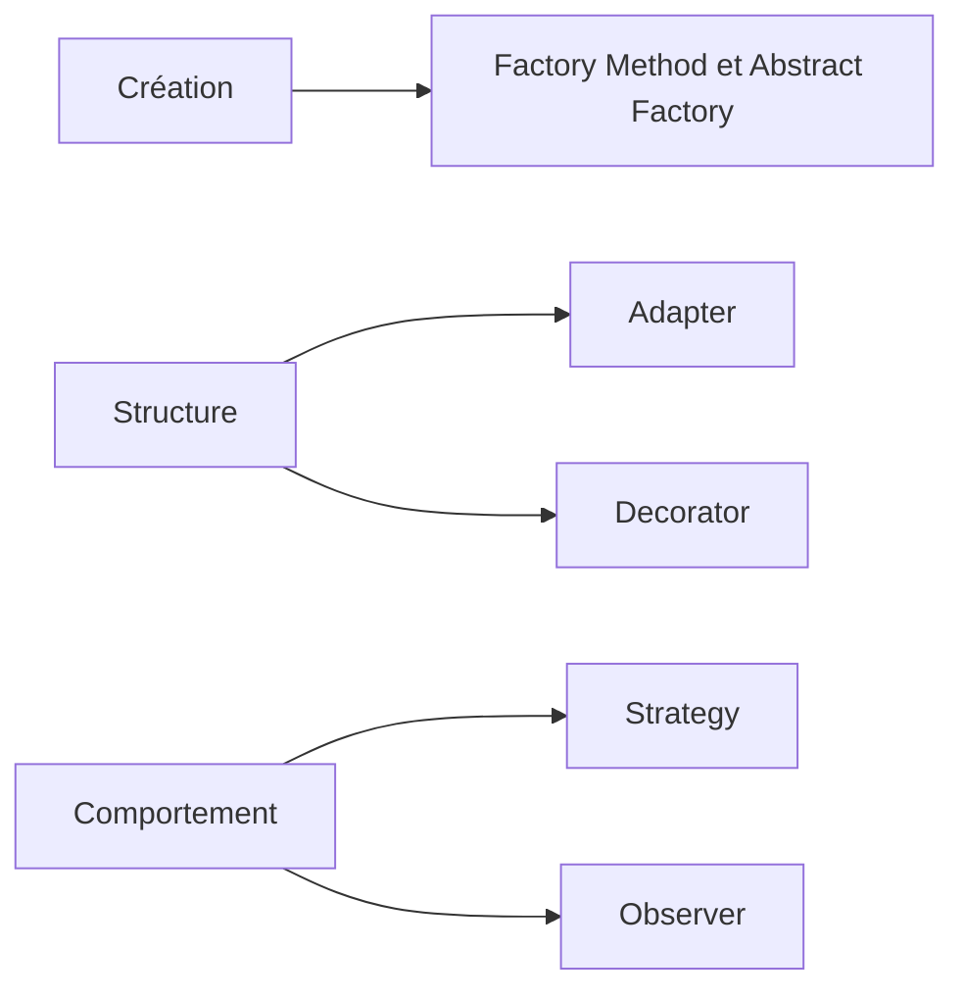

# POO, design patterns et frameworks

Les décisions d'architecture organisent les responsabilités et les dépendances d'une application. Leur intérêt dépend des règles à préserver et des changements attendus. Un calcul de prix, un stockage et un affichage n'évoluent pas pour les mêmes raisons.

La programmation orientée objet organise le code autour d'objets qui associent un état et des opérations. Un design pattern décrit une organisation réutilisable face à un problème récurrent. Un framework organise une partie de l'application et de son exécution.

Les exemples utilisent TypeScript. Savoir lire des fonctions, des objets et des tableaux suffit pour commencer. Les fondations expliquent les classes et les interfaces.

<figure class="course-media">

<figcaption>Le navigateur Smalltalk affiche les classes et leurs méthodes. <a href="https://d2w9rnfcy7mm78.cloudfront.net/21819379/original_c5b90a6c29d416c2df7866f97b563b44.png">Voir la capture d'origine</a>. Le <a href="https://www.microsoft.com/en-us/research/wp-content/uploads/1988/01/ACM-Alto-software-paper.pdf#page=23">texte de Butler W. Lampson sur le logiciel de l'Alto</a> donne le contexte historique de cet environnement.</figcaption>
</figure>

## Un parcours de lecture

Les [fondations](/poo-patterns-frameworks/01-fondations/) posent les notions de POO, de contrat et de responsabilité. Les six fiches suivantes décrivent des mécanismes précis. Le chapitre [Frameworks et inversion de contrôle](/poo-patterns-frameworks/08-frameworks/) les relie au cycle d'une interface.

Les [trois études de cas](/poo-patterns-frameworks/09-situations/) montrent comment comparer des choix d'architecture. L'[exercice TypeScript](/poo-patterns-frameworks/10-exercice/) fournit une application fonctionnelle à faire évoluer. Chaque chapitre peut aussi se consulter séparément pour réviser une notion.

## Quel problème cherche-t-on à résoudre ?

| Problème observé | Mécanisme à examiner |
| --- | --- |
| Plusieurs règles de calcul varient indépendamment de l'opération qui les utilise. | [Strategy](/poo-patterns-frameworks/02-strategy/) |
| Plusieurs destinataires réagissent au même changement. | [Observer](/poo-patterns-frameworks/03-observer/) |
| La création ou la sélection des objets se répète. | [Factory](/poo-patterns-frameworks/04-factory/) |
| Un service existant expose un contrat différent de celui attendu. | [Adapter](/poo-patterns-frameworks/05-adapter/) |
| Un comportement doit entourer une opération en conservant son contrat. | [Decorator](/poo-patterns-frameworks/06-decorator/) |
| Le métier doit manipuler une collection d'objets persistants sans connaître les requêtes de stockage. | [Repository](/poo-patterns-frameworks/07-repository/) |

Une condition locale ou un appel direct peut suffire. Une abstraction se justifie par le changement qu'elle permet de contenir. Elle ajoute un contrat et du code à maintenir.

## Les familles de patterns

Le catalogue GoF distingue trois [familles](https://refactoring.guru/fr/design-patterns/classification) selon l'intention du pattern. Ce schéma situe les patterns GoF étudiés dans le cours.

« Factory » est un terme général. Une fonction de fabrique simple n'est pas nécessairement un Factory Method. Repository appartient aux patterns d'architecture d'entreprise, hors du catalogue GoF. [Patterns.dev](https://www.patterns.dev/#patterns) présente aussi des organisations propres au Web, comme les modules JavaScript et la séparation entre données et présentation.

La [bibliographie commentée](/poo-patterns-frameworks/11-ressources/) rassemble les références par sujet. Le catalogue *Design Patterns* de Gamma, Helm, Johnson et Vlissides, souvent appelé GoF, décrit 23 patterns orientés objet. Les fiches présentent aussi des formes fonctionnelles adaptées aux exemples TypeScript.
