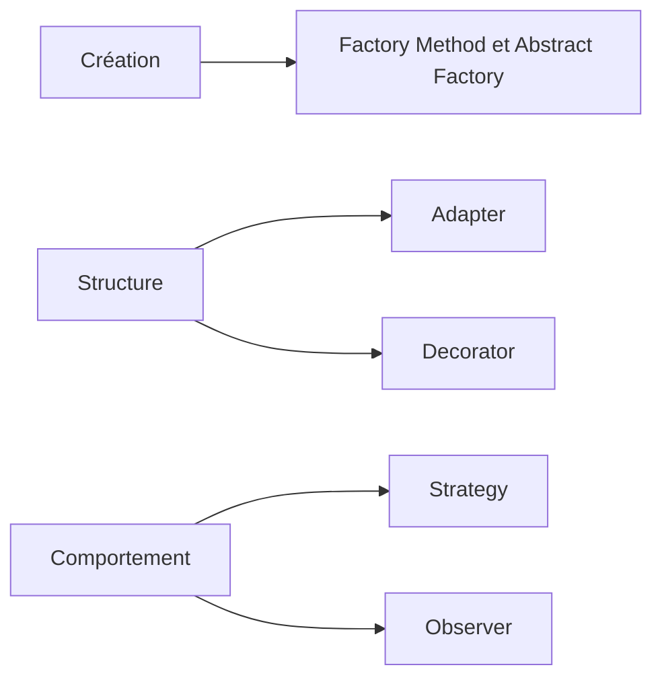

# POO, design patterns et frameworks

Ce parcours part d'une application qui fonctionne. Elle gère des ateliers, des réservations et des annulations. Vous allez la lire, la modifier et vérifier qu'elle respecte toujours ses règles quand les demandes changent.

La programmation orientée objet (POO) organise le code autour d'objets qui associent un état et des opérations. Un design pattern donne un nom à une organisation réutilisable. Un framework organise une partie de l'exécution de l'application. Ces notions servent ici à expliquer des choix concrets, avec leurs conséquences.

Les fiches de [Refactoring.Guru](https://refactoring.guru/design-patterns) fournissent les structures classiques et leur pseudo-code. Les autres [références du cours](/poo-patterns-frameworks/11-ressources/) proposent des explications complémentaires et les documentations des langages. Chaque séance indique quoi lire, puis demande de retrouver ces idées dans notre programme.

Les exemples utilisent TypeScript. Les fonctions, objets et tableaux suffisent pour démarrer. Les [bases de la POO](/poo-patterns-frameworks/01-fondations/) expliquent les classes, l'encapsulation, les interfaces et l'héritage. Le chapitre [SOLID](/poo-patterns-frameworks/01-solid/) développe ensuite les cinq principes avec des exemples avant et après. Le [glossaire](/poo-patterns-frameworks/12-glossaire/) aide à retrouver le vocabulaire, dont le duck typing. Certains termes mis en évidence dans le texte proposent aussi une définition.

## Un parcours de lecture

Commencer par [exécuter l'application](/poo-patterns-frameworks/10-exercice/), puis suivre une réservation dans son code. Revenir aux fondations dès qu'une notion manque. Le chapitre [UML](/poo-patterns-frameworks/01-uml/) apprend à lire les schémas des références et à dessiner les relations de notre modèle.

Les bases de la POO présentent les mécanismes du langage. SOLID aide à examiner les choix de conception. Lire un principe à la fois, suivre son exemple, puis revenir à la séance qui utilise cette idée. Il n'est pas nécessaire de mémoriser les cinq lettres avant de commencer les ateliers.

Les [exercices progressifs et les autoévaluations](/poo-patterns-frameworks/13-entrainement/) se consultent au fil du parcours. Commencer par les créatures après les fondations, puis revenir aux questions sur les patterns après leurs séances. Les projets facultatifs du restaurant et du panier permettent ensuite de réutiliser ces acquis dans un autre contexte.

Les [trois demandes d'évolution](/poo-patterns-frameworks/09-situations/) donnent le contexte des séances. Elles concernent les tarifs, un partenaire externe et les réactions à une réservation. Pour chacune, comparer une solution directe et une organisation plus séparée, puis justifier le choix.

Chaque séance repart d'une copie du programme de départ, sauf indication contraire. Les variantes isolent une question à la fois. Les réunir ensuite demande d'adapter leurs contrats et de rejouer leurs vérifications.

| Travail à réaliser | Séance ou aide |
| --- | --- |
| Lire le programme, relever les règles et lancer ses vérifications. | [Démarrer l'atelier](/poo-patterns-frameworks/10-exercice/) |
| Ajouter un tarif solidaire et préserver les montants déjà enregistrés. | [Strategy](/poo-patterns-frameworks/02-strategy/) |
| Traduire et vérifier les réponses d'un partenaire. | [Adapter](/poo-patterns-frameworks/05-adapter/) |
| Définir ce que signifie enregistrer une réservation. | [Repository](/poo-patterns-frameworks/07-repository/) |
| Comparer des appels directs et des abonnements pour les notifications. | [Observer](/poo-patterns-frameworks/03-observer/) |
| Retrouver ces responsabilités dans une interface. | [Frameworks et inversion de contrôle](/poo-patterns-frameworks/08-frameworks/) |
| Vérifier sa compréhension et expliquer une solution dans un autre domaine. | [Exercices et autoévaluations](/poo-patterns-frameworks/13-entrainement/) |

Les aides [Factory](/poo-patterns-frameworks/04-factory/) et [Decorator](/poo-patterns-frameworks/06-decorator/) se consultent lorsqu'une création se répète ou qu'un même comportement doit entourer plusieurs opérations.

## Ce que vous allez produire

Pour chaque changement, conserver les éléments suivants :

- Une modification du programme accompagnée de vérifications observables.
- Un schéma des responsabilités ou des appels, limité à la question étudiée.
- Quelques phrases sur le choix retenu, son coût et ce qui pourrait le faire changer.

Une solution lisible avec une condition peut convenir. L'évaluation porte sur les règles préservées et le raisonnement, pas sur le nombre de patterns ajoutés.

## Repères historiques en complément

Simula a introduit la programmation par objets en 1967, puis Smalltalk l'a diffusée depuis le Xerox PARC dans les années 1970. Un objet regroupe un état et des méthodes. L'encapsulation lui permet de protéger ses règles, et le polymorphisme permet à plusieurs objets de répondre au même appel chacun à sa manière.

<figure class="course-media">

<figcaption>Le navigateur Smalltalk affiche les classes et leurs méthodes. <a href="https://d2w9rnfcy7mm78.cloudfront.net/21819379/original_c5b90a6c29d416c2df7866f97b563b44.png">Voir la capture d'origine</a>. Le <a href="https://www.microsoft.com/en-us/research/wp-content/uploads/1988/01/ACM-Alto-software-paper.pdf#page=23">texte de Butler W. Lampson sur le logiciel de l'Alto</a> donne le contexte historique de cet environnement.</figcaption>
</figure>

## Quel problème cherche-t-on à résoudre ?

| Problème observé | Mécanisme à examiner |
| --- | --- |
| Plusieurs règles de calcul varient indépendamment de l'opération qui les utilise. | [Strategy](/poo-patterns-frameworks/02-strategy/) |
| Plusieurs destinataires réagissent au même changement. | [Observer](/poo-patterns-frameworks/03-observer/) |
| La création ou la sélection des objets se répète. | [Factory](/poo-patterns-frameworks/04-factory/) |
| Un service existant expose un contrat différent de celui attendu. | [Adapter](/poo-patterns-frameworks/05-adapter/) |
| Un comportement doit entourer une opération en conservant son contrat. | [Decorator](/poo-patterns-frameworks/06-decorator/) |
| Le métier doit manipuler une collection d'objets persistants sans connaître les requêtes de stockage. | [Repository](/poo-patterns-frameworks/07-repository/) |

Une abstraction permet de contenir un changement, mais ajoute un contrat et du code à maintenir.

## Les familles de patterns

Le catalogue GoF distingue trois [familles](https://refactoring.guru/fr/design-patterns/classification) selon l'intention du pattern. Ce schéma situe les patterns GoF étudiés dans le cours.

« Factory » est un terme général. Une fonction de fabrique simple n'est pas nécessairement un Factory Method. Repository appartient aux patterns d'architecture d'entreprise, hors du catalogue GoF. [Patterns.dev](https://www.patterns.dev/#patterns) présente aussi des organisations propres au Web, comme les modules JavaScript et la séparation entre données et présentation.

La [bibliographie commentée](/poo-patterns-frameworks/11-ressources/) rassemble les références par sujet. Le catalogue *Design Patterns* de Gamma, Helm, Johnson et Vlissides, souvent appelé GoF, décrit 23 patterns orientés objet. Les fiches présentent aussi des formes fonctionnelles adaptées aux exemples TypeScript.
